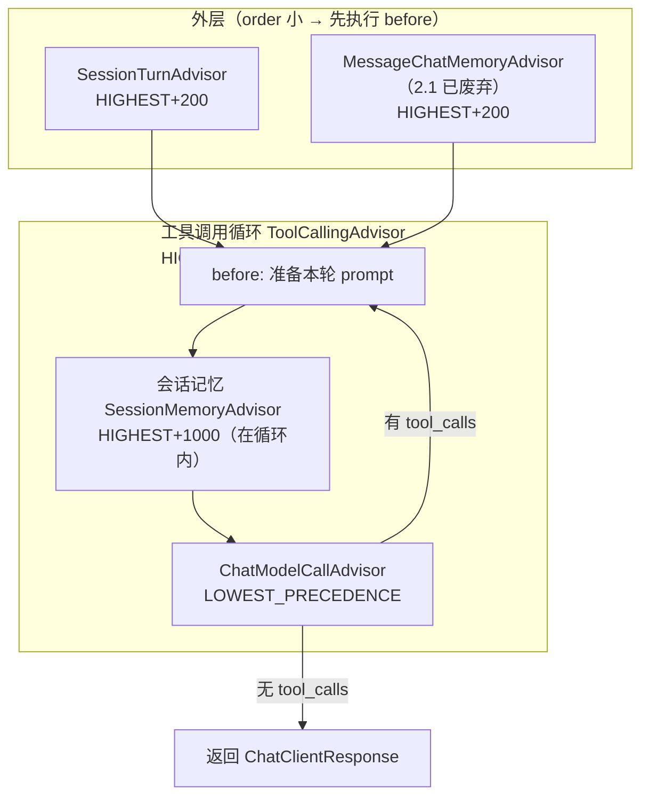

# Advisor 链与对话记忆源码解析：从拦截器链到 Session memory

> 一句话结论：`Advisor` 链就是一条 Spring AOP 风格的拦截器链（`before → next → after`），`getOrder()` 决定谁在内谁在外；2.1 起旧的 `ChatMemory` + `MessageChatMemoryAdvisor` 全被 `@Deprecated`，官方迁移方向是 `spring-ai-session` / `spring-ai-session-advisor` 里的 `SessionService` + `SessionAdvisors`。
> 阅读前置：`01-Spring框架/02-AOP`（`Ordered`、责任链）、上一篇 `01-chatclient-链式api源码.md`。
> 预计阅读: 45 分钟 ｜ 源码: `spring-ai-client-chat:2.1.0`、`spring-ai-session:2.1.0`、`spring-ai-session-advisor:2.1.0`

## 0. 先看现象

```java
ChatClient chatClient = ChatClient.builder(chatModel)
    .defaultAdvisors(
        SessionAdvisors.builder(sessionService)
            .compaction(new TurnCountTrigger(20), WindowCompactionStrategy.builder().lastTurns(10).build())
            .build())
    .build();

String r = chatClient.prompt()
    .user("这个工单怎么处理？")
    .advisors(SessionAdvisors.session("ticket-42"))
    .call()
    .content();
```

几个反直觉的点：

1. **Advisor 的"链"不是链表，是 `Deque` + `pop()`** —— 一条链只能用一次，用第二次直接抛异常。
2. **`getOrder()` 值越小越靠外**（越先执行 `before`、越晚执行 `after`），像洋葱皮。
3. **工具调用循环自己是一条独立的"内层链"**：`ToolCallingAdvisor` 用 `callAdvisorChain.copy(this)` 拿到"自己之后"的剩余链，然后**循环复用**。
4. **记忆 Advisor 分两代**：老的 `MessageChatMemoryAdvisor` 在循环**外面**（每轮不看历史）；新的 `SessionMemoryAdvisor` 故意放在循环**里面**（每轮都看历史）。这个顺序差异是新旧两代最本质的区别。
5. 2.1 已经把 `ChatMemory` 整个接口标成 `@Deprecated(forRemoval = true)`。

**AI 概念速览**

- **对话记忆（memory）**：模型本身无状态，每次请求都要把"历史消息"重新放进 prompt。记忆组件就是负责"存历史、取历史、裁剪历史"。
- **会话（session）**：比"一段消息列表"更重的东西 —— 一条**只追加的事件日志**（append-only log），带版本号、支持压缩（compaction）、支持按类型/时间窗口过滤。
- **compaction（压缩）**：历史太长时，把前 N 轮对话总结成一段摘要消息，原事件仍留在日志里但不进 prompt。

## 1. 整体地图



**读图说明**

- 灰/外框（order 更小，如 `+200`）的 Advisor **只在整条链上执行一次**：模型调用前 `before` 一次，最终结果拿到后 `after` 一次。
- `ToolCallingAdvisor`（`+300`）把"模型调用"包成一个 `do-while` 循环：每轮都会把"自己之后的链"（用 `copy(this)` 得到的子链）重新跑一遍。
- 所以 order **小于 300** 的 Advisor 看不到中间轮次；order **大于 300** 的（例如 `SessionMemoryAdvisor` 的 `+1000`）**每轮都会执行**。
- 链尾固定是 `ChatModelCallAdvisor`（`LOWEST_PRECEDENCE`），它是唯一真正调 `ChatModel#call` 的一环。

**与 Spring AOP 的对照**

| 维度 | Spring AOP 拦截器链 | Spring AI Advisor 链 |
| --- | --- | --- |
| 顺序依据 | `Ordered` / `@Order` | `Advisor#getOrder()`（`Advisor extends Ordered`） |
| 执行模型 | 递归调用 `MethodInvocation#proceed()` | 递归调用 `CallAdvisorChain#nextCall(...)` |
| 链是否可复制 | `ProceedingJoinPoint` 不可复制 | **`chain.copy(after)` 可从指定 Advisor 之后复制子链** |
| 链是否一次性 | 每次调用新建 | **一次性**：`Deque.pop()` 消费，重复调用抛异常 |
| 返回类型 | 任意 | 固定 `ChatClientResponse`（装 `ChatResponse` + `context`） |
| 流式支持 | 无原生概念 | `StreamAdvisor#adviseStream` 返回 `Flux` |

## 2. 关键类逐个拆

| 类 | 职责 | 关键点 |
| --- | --- | --- |
| `Advisor` | 所有 Advisor 的根接口 | `extends Ordered`；提供 `DEFAULT_CHAT_MEMORY_PRECEDENCE_ORDER = +200`；`getName()` |
| `CallAdvisor` | 非流式链的单元 | 唯一方法 `adviseCall(request, chain)` |
| `StreamAdvisor` | 流式链的单元 | 唯一方法 `adviseStream(request, chain) → Flux` |
| `BaseAdvisor` | 模板方法：`before → next → after` | 同时实现 Call/Stream；流式下 `after` 只在 finish reason 帧 |
| `DefaultAroundAdvisorChain` | 责任链实现 | 可变 `Deque`；`pop()` 消费；`copy(after)` 复制子链；Builder 里 `OrderComparator.sort` |
| `MemoryAdvisor` | 记忆 Advisor 的**标记接口** | `CONVERSATION_ID = "chat_memory_conversation_id"`；`ChatClient` 靠它判断"已经有记忆了" |
| `MessageChatMemoryAdvisor` | 老一代记忆实现（2.1 `@Deprecated`） | 依赖 `ChatMemory`；默认 order `+200`（在工具循环外） |
| `ToolCallingAdvisor` | 工具调用循环 | `DEFAULT_ORDER = +300`；用 `copy(this)` 循环；上限/确认/`returnDirect` |
| `SessionService` | 新一代会话存储抽象 | append-only 事件日志 + 版本号 + `EventFilter` + compaction |
| `SessionMemoryAdvisor` | 新一代记忆 Advisor | `DEFAULT_ORDER = +1000`（在工具循环**内**）；`SESSION_ID_CONTEXT_KEY = MemoryAdvisor.CONVERSATION_ID` |
| `SessionTurnAdvisor` | 新一代"回合" Advisor | `DEFAULT_ORDER = +200`（在循环**外**）；创建会话、补存未执行的工具结果、触发压缩 |

## 3. 源码逐段精读

### 3.1 `Advisor` / `CallAdvisor` / `StreamAdvisor`：三个层级的契约

```java (src: Advisor.java#L31-L47)
public interface Advisor extends Ordered {

	/**
	 * Default order for chat-memory advisors. Placed before (outside)
	 * {@link org.springframework.ai.chat.client.advisor.ToolCallingAdvisor#DEFAULT_ORDER}
	 * so the memory advisor wraps the tool-call loop, and the {@code ToolCallingAdvisor}
	 * manages its own intermediate conversation history.
	 */
	int DEFAULT_CHAT_MEMORY_PRECEDENCE_ORDER = Ordered.HIGHEST_PRECEDENCE + 200;

	/**
	 * Return the name of the advisor.
	 * @return the advisor name.
	 */
	String getName();

}
```

- **在干什么**：`Advisor` 只规定两件事 —— **有顺序**（`extends Ordered`）、**有名字**（`getName()`，用于日志和 observation）。顺带定义了一个"记忆 Advisor 的默认顺序"常量。
- **为什么这么写**：注释写得很直白：`+200` 比 `ToolCallingAdvisor` 的 `+300` **小**，所以记忆 Advisor 默认在工具循环**外面**（只执行一次），而"中间的对话历史"由 `ToolCallingAdvisor` 自己管。这是一个**刻意的设计**，不是随手定的数值。
- **如果改成别的会怎样**：如果把记忆放在循环内（order > 300），每一轮都要读写一次记忆库 —— 对老式 `ChatMemory` 来说是重复写入；这正是新 `SessionMemoryAdvisor` 敢放 `+1000` 的原因：它靠 `PromptHistory` 做**去重**（`overlap` / 只追加缺的部分），所以每轮执行也安全。
- **常见坑**：`getOrder()` 的语义和 Spring `Ordered` 完全一致 —— **值小=优先级高=更外层**。别把"高优先级"理解成"后执行"。

```java (src: CallAdvisor.java#L30-L34)
public interface CallAdvisor extends Advisor {

	ChatClientResponse adviseCall(ChatClientRequest chatClientRequest, CallAdvisorChain callAdvisorChain);

}
```

```java (src: StreamAdvisor.java#L32-L36)
public interface StreamAdvisor extends Advisor {

	Flux<ChatClientResponse> adviseStream(ChatClientRequest chatClientRequest, StreamAdvisorChain streamAdvisorChain);

}
```

- **在干什么**：非流式与流式**分成两个接口**，各自只有一个方法。
- **为什么这么写**：流式要返回 `Flux`，`CallAdvisor` 返回单值，语义差别大（错误传播、取消、背压）。拆开后，一个 Advisor 可以**只实现一种**（例如只支持非流的校验 Advisor）。
- **常见坑**：只实现 `CallAdvisor` 的 Advisor，在 `.stream()` 时**完全不参与**。反之，`BaseAdvisor` 同时实现两者，但它对流式的支持是"半吊子"：`after` 只在结束帧触发（见 3.2）。有些 Advisor（如 `StructuredOutputValidationAdvisor`）干脆在 `adviseStream` 里直接 `Flux.error(new UnsupportedOperationException(...))`。

### 3.2 `BaseAdvisor`：模板方法，以及流式下的"after 只跑一次"

```java (src: BaseAdvisor.java#L42-L79)
public interface BaseAdvisor extends CallAdvisor, StreamAdvisor {

	Scheduler DEFAULT_SCHEDULER = Schedulers.boundedElastic();

	@Override
	default ChatClientResponse adviseCall(ChatClientRequest chatClientRequest, CallAdvisorChain callAdvisorChain) {
		Assert.notNull(chatClientRequest, "chatClientRequest cannot be null");
		Assert.notNull(callAdvisorChain, "callAdvisorChain cannot be null");

		ChatClientRequest processedChatClientRequest = before(chatClientRequest, callAdvisorChain);
		ChatClientResponse chatClientResponse = callAdvisorChain.nextCall(processedChatClientRequest);
		return after(chatClientResponse, callAdvisorChain);
	}

	@Override
	default Flux<ChatClientResponse> adviseStream(ChatClientRequest chatClientRequest,
			StreamAdvisorChain streamAdvisorChain) {
		Assert.notNull(chatClientRequest, "chatClientRequest cannot be null");
		Assert.notNull(streamAdvisorChain, "streamAdvisorChain cannot be null");
		Assert.notNull(getScheduler(), "scheduler cannot be null");

		Flux<ChatClientResponse> chatClientResponseFlux = Mono.just(chatClientRequest)
			.publishOn(getScheduler())
			.map(request -> this.before(request, streamAdvisorChain))
			.flatMapMany(streamAdvisorChain::nextStream);

		return chatClientResponseFlux.map(response -> {
			if (AdvisorUtils.onFinishReason().test(response)) {
				response = after(response, streamAdvisorChain);
			}
			return response;
		}).onErrorResume(error -> Flux.error(new IllegalStateException("Stream processing failed", error)));
	}

	@Override
	default String getName() {
		return this.getClass().getSimpleName();
	}
```

- **在干什么**：把"给我写一个 Advisor"简化为"实现 `before()` 和 `after()`"。非流式：`before → nextCall → after`，一目了然。流式：`before` 在 `publishOn(scheduler)` 后执行一次，之后**每个 chunk 都过一遍 `map`，但只有 finish reason 帧才调用 `after`**。
- **为什么这么写**：流式下每个 chunk 都调 `after` 会把"保存整条助手消息"变成"保存 N 个半截消息"。用 `AdvisorUtils.onFinishReason()` 作为闸门，`after` 天然只跑一次，而且拿到的是**聚合后**的完整响应（`nextStream` 内部已用 `aggregateChatClientResponse` 聚合）。
- **如果改成别的会怎样**：如果每帧都 `after`，`MessageChatMemoryAdvisor` 会往记忆里塞几十条碎片；如果完全不 `after`，最后的助手消息永远存不进去。
- **常见坑**：①**流式下 `before` 在 `boundedElastic` 线程执行**，如果你的 `before` 依赖 `ThreadLocal`（如 `SecurityContextHolder`、`RequestContextHolder`），要显式传上下文（这正是 `SessionMemoryAdvisor` 用 `ContextSnapshotFactory` 的原因）；②`after` 收到的是**聚合后**的响应，不是原始 chunk，因此想改每个 chunk 必须在 `adviseStream` 里自己 `map`；③`onErrorResume` 把任何异常包成 `IllegalStateException("Stream processing failed")`，**原始异常类型会丢**，排查时注意 `getCause()`。

### 3.3 `DefaultAroundAdvisorChain#nextCall`：`Deque` + `pop()`

```java (src: DefaultAroundAdvisorChain.java#L97-L111)
	@Override
	public ChatClientResponse nextCall(ChatClientRequest chatClientRequest) {
		Assert.notNull(chatClientRequest, "the chatClientRequest cannot be null");

		if (this.callAdvisors.isEmpty()) {
			throw new IllegalStateException("No CallAdvisors available to execute");
		}

		var advisor = this.callAdvisors.pop();

		var observationContext = AdvisorObservationContext.builder()
			.advisorName(advisor.getName())
			.chatClientRequest(chatClientRequest)
			.order(advisor.getOrder())
			.build();
```

- **在干什么**：从头部 `pop()` 一个 Advisor，建 observation 上下文，然后（下一行起）在 observation 里调 `advisor.adviseCall(chatClientRequest, this)` —— **注意传的是 `this`**，所以 Advisor 里再调 `chain.nextCall(...)` 就是"继续往后走"。
- **为什么这么写**：`pop()` 而非"索引推进"，是为了让"链只能前进"变成**类型层面的保证** —— 没有 `reset()`，也就没有"重入"的可能。
- **如果改成别的会怎样**：如果保留索引，`ToolCallingAdvisor` 循环时就会"从头再走一遍"，把所有外层 Advisor 也重复执行（记忆会被写 N 遍）。
- **常见坑（本文最重要的一条）**：**同一个 `CallResponseSpec` 只能终结一次**。第二次终结时 `callAdvisors` 已空 → `IllegalStateException("No CallAdvisors available to execute")`。`ToolCallingAdvisor` 之所以能循环，是因为它每次都用 `chain.copy(this)` 造一条**新**子链。

`copy(after)` 的实现决定了"子链 = 我之后的那些人"：

```java (src: DefaultAroundAdvisorChain.java#L168-L186)
	@Override
	public CallAdvisorChain copy(CallAdvisor after) {
		return this.copyAdvisorsAfter(this.getCallAdvisors(), after);
	}

	@Override
	public StreamAdvisorChain copy(StreamAdvisor after) {
		return this.copyAdvisorsAfter(this.getStreamAdvisors(), after);
	}

	private DefaultAroundAdvisorChain copyAdvisorsAfter(List<? extends Advisor> advisors, Advisor after) {

		Assert.notNull(after, "The after advisor must not be null");
		Assert.notNull(advisors, "The advisors must not be null");

		int afterAdvisorIndex = advisors.indexOf(after);

		if (afterAdvisorIndex < 0) {
			throw new IllegalArgumentException("The specified advisor is not part of the chain: " + after.getName());
```

- **在干什么**：`copy(this)` → 在当前链的**不可变快照**（`originalCallAdvisors`）里找到自己的下标 → 取 `subList(index+1, size)` 造一条新链。
- **为什么这么写**：靠 `originalCallAdvisors`（`List.copyOf`）而不是已被 `pop()` 干净的 `Deque`，才能在链跑到一半时"回溯"出自己的位置。
- **常见坑**：`copy(x)` 里 `x` 必须是**同一条链上的实例**（`indexOf` 用 `equals`，Advisor 通常不重写 `equals`，所以是引用比较）。自己 `new` 一个同类型 Advisor 传进去会抛 `IllegalArgumentException`。

### 3.4 Builder 的排序：`OrderComparator.sort` + `addLast`

```java (src: DefaultAroundAdvisorChain.java#L260-L276)
				List<StreamAdvisor> streamAroundAdvisorList = advisors.stream()
					.filter(a -> a instanceof StreamAdvisor)
					.map(a -> (StreamAdvisor) a)
					.toList();

				if (!CollectionUtils.isEmpty(streamAroundAdvisorList)) {
					streamAroundAdvisorList.forEach(this.streamAdvisors::push);
				}

				this.reOrder();
			}
			return this;
		}

		/**
		 * (Re)orders the advisors in priority order based on their Ordered attribute.
		 */
```

- **在干什么**：`pushAll` 把 Advisor 按"是不是 `CallAdvisor` / `StreamAdvisor`"分到两个 `Deque`，然后 `reOrder()` 统一排序。
- **为什么这么写**：`push` 是入栈（压到头部），排序后再 `addLast` 让**order 最小的位于头部**，于是 `pop()` 出来的就是"最外层"。
- **常见坑**：`reOrder()` 之后顺序就定了。**运行期改 `getOrder()` 的返回值不会重排**（`getOrder()` 只在排序时读一次）。想改顺序必须重新 `prompt()`/重新 build 链。

### 3.5 `ToolCallingAdvisor`：把"链"当循环体用

```java (src: ToolCallingAdvisor.java#L90-L96)
	/**
	 * Default advisor order. Higher than
	 * {@link org.springframework.ai.chat.client.advisor.api.Advisor#DEFAULT_CHAT_MEMORY_PRECEDENCE_ORDER}
	 * (+200) so that memory advisors at their default order are placed outside this
	 * advisor and do not participate in each tool-call iteration.
	 */
	public static final int DEFAULT_ORDER = Ordered.HIGHEST_PRECEDENCE + 300;
```

循环主体（省略了确认/上限分支，下一节详讲）：

```java (src: ToolCallingAdvisor.java#L156-L197)
		var instructions = chatClientRequest.prompt().getInstructions();
		// Always the complete history for this turn, independent of what
		// doGetNextInstructionsForToolCall trims `instructions` down to for forwarding
		// to the rest of the chain (e.g. for a memory advisor nested inside the loop
		// that doesn't itself de-duplicate). This is what the ToolCallingManager sees,
		// so trimming the forwarded prompt never hides earlier rounds from its tool
		// call limit counting.
		var fullTurnHistory = instructions;

		ChatClientResponse chatClientResponse = null;
		UsageAccumulator usageAccumulator = new UsageAccumulator();

		boolean isToolCall = false;

		do {

			// Before Call
			var processedChatClientRequest = ChatClientRequest.builder()
				.prompt(new Prompt(instructions, toolCallingChatOptions))
				.context(chatClientRequest.context())
				.build();

			// Next Call
			processedChatClientRequest = this.doBeforeCall(processedChatClientRequest, callAdvisorChain);

			// Re-read the options doBeforeCall() may have mutated (e.g. a subclass
			// injecting per-iteration tool callbacks) so executeToolCalls() below sees
			// what was actually sent to the model, not the pre-doBeforeCall snapshot.
			toolCallingChatOptions = (ToolCallingChatOptions) processedChatClientRequest.prompt().getOptions();
			Assert.notNull(toolCallingChatOptions,
					"redundant check that should never fail (doBeforeCall must not change the options type away from ToolCallingChatOptions), but here to help NullAway");

			chatClientResponse = callAdvisorChain.copy(this).nextCall(processedChatClientRequest);

			chatClientResponse = this.doAfterCall(chatClientResponse, callAdvisorChain);

			// After Call
			ChatResponse chatResponse = chatClientResponse.chatResponse();
			usageAccumulator.addRoundResponse(chatResponse);
			isToolCall = this.toolExecutionEligibilityChecker.isToolCallResponse(chatResponse);

			if (isToolCall) {
```

- **在干什么**：`do-while` 循环里，每轮用 `callAdvisorChain.copy(this).nextCall(...)` 跑"自己之后的那半条链"（记忆内层 Advisor + `ChatModelCallAdvisor`），然后判 `isToolCall`，是就执行工具、把结果拼回 `instructions` 再来一轮。
- **为什么这么写**：`copy(this)` 是**关键技巧** —— 让"链的后半段"变成可重复调用的"循环体"，同时保证前半段（外层记忆、审计）**只跑一次**。`fullTurnHistory` 与 `instructions` 分离，则是为了让**工具调用上限的计数**总能看到完整历史（否则内层记忆裁剪会"藏掉"之前的轮次，导致计数永远从 0 开始）。
- **如果改成别的会怎样**：如果在循环里调 `chain.nextCall`（不 `copy`），第二次就抛 `IllegalStateException`；如果直接 `while(true) { toolCallingManager.executeToolCalls(...); chatModel.call(...) }` 手写，就绕过了所有内层 Advisor（观测、结构化输出、内层记忆全部失效）。
- **常见坑**：①`copy(this)` 只复制**自己之后**的 Advisor，所以**审计/限流/脱敏要放在 order < 300** 才能看到"整轮一次"，而要"每轮都看"就必须放 order > 300；②`doBeforeCall` 可能改 options，所以循环里**重新读**了 `toolCallingChatOptions`；③`usageAccumulator` 把每轮 usage 累加后写回最终响应，**直接用最后一轮的 usage 会严重低估成本**。

`conversationHistoryEnabled = false` 时的裁剪逻辑（老式记忆 Advisor 在链内时会用到）：

```java (src: ToolCallingAdvisor.java#L250-L262)
	protected List<Message> doGetNextInstructionsForToolCall(ChatClientRequest chatClientRequest,
			ChatClientResponse chatClientResponse, ToolExecutionResult toolExecutionResult) {

		if (!this.conversationHistoryEnabled) {
			List<Message> history = toolExecutionResult.conversationHistory();
			if (history.isEmpty()) {
				return history;
			}
			return List.of(chatClientRequest.prompt().getSystemMessage(), history.get(history.size() - 1));
		}

		return toolExecutionResult.conversationHistory();
	}
```

- **在干什么**：`conversationHistoryEnabled=false` 时，下一轮只带"system + 最后一条消息"（通常就是 `ToolResponseMessage`），历史由**内层记忆 Advisor** 补。
- **为什么这么写**：`DefaultChatClientRequestSpec#autoRegisterToolCallingAdvisor()` 会检测"链上有没有 order 更大（更内层）的 `MemoryAdvisor`"，有就自动把 `conversationHistoryEnabled` 关掉 —— 避免"历史被拼两遍"。
- **常见坑**：手动把 `SessionMemoryAdvisor` 用 `defaultAdvisors(...)` 加进来（order `+1000`），自动逻辑会把工具循环的历史关掉；如果你又手动 `disableInternalConversationHistory()` 但链上没有内层记忆，模型就会"失忆"，只能看到最后一条 `ToolResponseMessage`。

### 3.6 `MemoryAdvisor`：一个标记接口 + 一个魔法字符串

```java (src: MemoryAdvisor.java#L38-L46)
public interface MemoryAdvisor extends Advisor {

	/**
	 * The advisor context key of the conversation a request belongs to. Memory advisors
	 * read it to find the conversation or session, and the {@code ChatClient} observation
	 * records it. Set with
	 * {@code .advisors(a -> a.param(MemoryAdvisor.CONVERSATION_ID, conversationId))}.
	 */
	String CONVERSATION_ID = "chat_memory_conversation_id";
```

以及默认取值方法：

```java (src: MemoryAdvisor.java#L51-L56)
	default String getConversationId(Map<String, @Nullable Object> context) {
		Assert.notNull(context, "context cannot be null");
		Assert.noNullElements(context.keySet().toArray(), "context cannot contain null keys");
		Assert.notNull(context.get(CONVERSATION_ID), "conversationId cannot be null");
		return context.get(CONVERSATION_ID).toString();
	}
```

- **在干什么**：`MemoryAdvisor` **没有抽象方法**，它的作用是"给记忆 Advisor 打标"；同时定义 context key `CONVERSATION_ID`，并提供带断言的读取方法。
- **为什么这么写**：`ChatClient` 需要知道"用户是不是已经自己配了记忆"，靠 `instanceof MemoryAdvisor` 判断（见上一篇 `autoRegisterToolCallingAdvisor()`），比配置项可靠。`getConversationId` 里的三层断言把"忘传 conversationId"变成**启动即失败**的明确错误，而不是悄悄用同一个会话。
- **常见坑**：`CONVERSATION_ID` 的值是字符串 `"chat_memory_conversation_id"`，**必须用常量**别手写（历史上这个 key 换过名）；`getConversationId` 会 `toString()`，所以传 `Long` 也行，但**跨请求类型要一致**（`42` 与 `"42"` 都是 `"42"`，没问题，但 `42L` 与 `"0042"` 就成了两个会话）。

### 3.7 老一代：`MessageChatMemoryAdvisor` + `ChatMemory`（2.1 已废弃）

```java (src: MessageChatMemoryAdvisor.java#L39-L50)
/**
 * Memory is retrieved added as a collection of messages to the prompt
 *
 * @author Christian Tzolov
 * @author Mark Pollack
 * @author Thomas Vitale
 * @since 1.0.0
 * @deprecated since 2.1.0, for removal in 3.0.0, in favor of {@code SessionAdvisors} and
 * {@code SessionMemoryAdvisor} in {@code spring-ai-session-advisor}
 */
@Deprecated(since = "2.1.0", forRemoval = true)
@SuppressWarnings("removal")
```

```java (src: MessageChatMemoryAdvisor.java#L77-L111)
	@Override
	public ChatClientRequest before(ChatClientRequest chatClientRequest, AdvisorChain advisorChain) {
		String conversationId = getConversationId(chatClientRequest.context());

		// 1. Retrieve the chat memory for the current conversation.
		List<Message> memoryMessages = this.chatMemory.get(conversationId);

		// 2. Advise the request messages list.
		List<Message> promptMessages = chatClientRequest.prompt().getInstructions();
		List<Message> processedMessages = new ArrayList<>();
		if (!isMemoryAlreadyInPrompt(promptMessages, memoryMessages)) {
			processedMessages.addAll(memoryMessages);
		}
		processedMessages.addAll(promptMessages);

		// 2.1. Ensure system message, if present, appears first in the list.
		for (int i = 0; i < processedMessages.size(); i++) {
			if (processedMessages.get(i) instanceof SystemMessage) {
				Message systemMessage = processedMessages.remove(i);
				processedMessages.add(0, systemMessage);
				break;
			}
		}

		// 3. Create a new request with the advised messages.
		ChatClientRequest processedChatClientRequest = chatClientRequest.mutate()
			.prompt(chatClientRequest.prompt().mutate().messages(processedMessages).build())
			.build();

		// 4. Add the new user message to the conversation memory.
		Message userMessage = processedChatClientRequest.prompt().getLastUserOrToolResponseMessage();
		this.chatMemory.add(conversationId, userMessage);

		return processedChatClientRequest;
	}
```

- **在干什么**：四步走 —— 取记忆 → 拼到 prompt 前面（并做一次"是不是已经拼过"的去重）→ 把第一个 `SystemMessage` 挪到最前 → 把本次的 user/工具消息**立刻写回**记忆。
- **为什么这么写**：`isMemoryAlreadyInPrompt` 是为了兼容"外面已经有人把记忆拼好了"的场景（否则重复拼接会让 prompt 指数膨胀）；把 user 消息在 `before` 就落盘，是保证"模型调用失败时用户问题也不丢"。
- **如果改成别的会怎样**：如果先调模型再写 user，一次网络异常就会让这轮对话彻底丢失；如果不挪 system 到最前，记忆消息会插到 system 之前，多数模型效果变差。
- **常见坑**：①这个 Advisor 默认 order `+200`，**在工具循环外面**，所以循环中间轮次的工具结果**不会**进记忆（由 `ToolCallingAdvisor` 自己带历史）；②`after` 会把**所有** `Generation` 都当助手消息存进去（`n>1` 时全存）；③`adviseStream` 用 `ChatClientMessageAggregator` 聚合后才 `after`，所以流式下也是存**完整**消息。

`ChatMemory` 接口本身也被打了 `@Deprecated`：

```java (src: ChatMemory.java#L30-L40)
 * @deprecated since 2.1.0, for removal in 3.0.0, in favor of session memory,
 * {@code org.springframework.ai.session.SessionService} in {@code spring-ai-session}; the
 * context key is {@code MemoryAdvisor.CONVERSATION_ID} in {@code spring-ai-client-chat}
 */
@Deprecated(since = "2.1.0", forRemoval = true)
public interface ChatMemory {

	/**
	 * The key to retrieve the chat memory conversation id from the context.
	 */
	String CONVERSATION_ID = "chat_memory_conversation_id";
```

- **在干什么**：官方明确写出迁移目标：`org.springframework.ai.session.SessionService`（`spring-ai-session` 模块），并且 context key 统一到 `MemoryAdvisor.CONVERSATION_ID`。
- **常见坑**：`ChatMemory.CONVERSATION_ID` 与 `MemoryAdvisor.CONVERSATION_ID` 值相同，但**是两个常量**。3.0 删掉 `ChatMemory` 后，代码里引用 `ChatMemory.CONVERSATION_ID` 的地方会编译失败。

### 3.8 新一代记忆：`SessionService` 是"事件日志"，不是"消息列表"

```java (src: SessionService.java#L30-L50)
/**
 * The sessions of an application and their conversations: creating and finding sessions,
 * appending, reading and searching their events, compacting them. {@link #appendEvent}
 * appends one event. {@link #appendEvents(String, List, long)} appends a batch only if
 * the log has not changed since the caller read its version. Compaction writes this way,
 * and so can any other code that builds events from the log.
 * {@link DefaultSessionService} implements it on a {@link SessionRepository}.
 *
 * @author Christian Tzolov
 * @since 2.1.0
 */
public interface SessionService {

	// Sessions

	/**
	 * Creates a session with the request's id, a random UUID when it has none, its time
	 * to live and its metadata.
	 * @throws SessionAlreadyExistsException if a session with the requested id exists
	 */
	Session create(CreateSessionRequest request);
```

`findOrCreate` 用"先查、再建、撞了再查"实现并发安全的首次使用：

```java (src: SessionService.java#L60-L80)
	default Session findOrCreate(CreateSessionRequest request) {
		Assert.notNull(request, "request must not be null");
		String sessionId = request.id();
		Assert.hasText(sessionId, "request must have an id");
		Session session = findById(sessionId);
		if (session != null) {
			return session;
		}
		try {
			return create(request);
		}
		catch (SessionAlreadyExistsException ex) {
			Session existing = findById(sessionId);
			if (existing == null) {
				throw ex;
			}
			return existing;
		}
	}

	@Nullable Session findById(String sessionId);
```

- **在干什么**：`SessionService` 管的是**会话 + 事件日志**：建会话、追加事件（带乐观版本号）、按过滤条件读事件、搜索、压缩。`findOrCreate` 用 try-catch 兜住"并发首次创建"。
- **为什么这么写**：`ChatMemory` 只有 `add/get/clear` 四个方法，"取最近 N 条"这种策略被**硬编码在实现里**；而事件日志把"存什么"与"取什么"解耦 —— 取的部分用 `EventFilter` 表达，于是同一个会话可以同时满足"取最近 10 轮给模型"和"全量索引给搜索"。
- **如果改成别的会怎样**：如果沿用 `List<Message>`，就没法做"压缩后原文还能搜"（压缩必须删数据），也没法做审计。
- **常见坑**：`appendEvents` 的 `expectedVersion` 是**乐观锁**，两个并发写只有一个成功（抛 `IllegalStateException`，而非静默覆盖）；`deleteExpiredSessions` **必须自己调度**（注释明说"Nothing calls this on its own: call it from a scheduler, every hour for example"）。

读"给模型看的消息"与读"全量历史"是两个方法：

```java (src: SessionService.java#L162-L177)
	/**
	 * The messages of the whole log, the events a compaction covered and the summaries
	 * included: the full history, not a prompt. Use {@link #getActiveMessages(String)}
	 * for the prompt.
	 */
	default List<Message> getMessages(String sessionId) {
		return getEvents(sessionId).stream().filter(SessionEvent::hasMessage).map(SessionEvent::getMessage).toList();
	}

	/**
	 * The messages of the active view, the context window to send to the model: {@code
	 * getEvents(sessionId, EventFilter.active())} as messages.
	 */
	default List<Message> getActiveMessages(String sessionId) {
		return getEvents(sessionId, EventFilter.active()).stream().map(SessionEvent::getMessage).toList();
	}
```

- **在干什么**：`getMessages` = 全量（含被压缩覆盖的）；`getActiveMessages` = **active view**（压缩边界之后的部分），这才是"该喂给模型的".
- **常见坑**：把 `getMessages(...)` 直接喂给模型是最容易犯的错 —— 压缩等于没发生，token 照样爆。

事件本身长这样（`EventType.MESSAGE` 才参与 prompt）：

```java (src: EventType.java#L27-L49)
/**
 * What a {@link SessionEvent} records. A type is its name: the well-known types are
 * constants here, and an application or an agent runtime defines its own with
 * {@link #of(String)}; every store keeps the name, and a filter by type works for any of
 * them. Only a {@link #MESSAGE} event takes part in prompt assembly and compaction, and
 * only a type that {@link #canCarryMessage() carries a message} wraps a Spring AI
 * message.
 *
 * @author Christian Tzolov
 * @since 2.1.0
 */
public final class EventType {

	/** The longest name; a store sizes its column for it. */
	public static final int MAX_NAME_LENGTH = 64;

	private static final Pattern NAME = Pattern.compile("[A-Z][A-Z0-9_.]*");

	/**
	 * A conversation message; the event carries a
	 * {@link org.springframework.ai.chat.messages.Message}.
	 */
	public static final EventType MESSAGE = of("MESSAGE");
```

- **在干什么**：`EventType` 是**开放**的（`of(String)` 自定义，名字要求 `[A-Z][A-Z0-9_.]*`），内置只有 `MESSAGE` 与 `COMPACTION`。
- **为什么这么写**：Agent 运行期需要记录"工具调用开始/结束""人工审批"等**非消息**事件；开放类型让业务自定义而不改框架。
- **常见坑**：自定义类型名必须**大写开头**且只含 `A-Z0-9_.`，否则 `of()` 里的断言失败。看 `of` 的实现即可确认，本文未摘录该段。

### 3.9 `SessionMemoryAdvisor`：为什么它敢放进工具循环里

```java (src: SessionMemoryAdvisor.java#L98-L113)
	/**
	 * Above the order of the tool-calling loop, which is
	 * {@link org.springframework.ai.chat.client.advisor.ToolCallingAdvisor#DEFAULT_ORDER}
	 * by default, so the memory advisor runs inside the loop, once per round. An advisor
	 * that has to run in every round too takes an order above the loop's: below this one
	 * to run around the memory advisor, above this one to run inside it.
	 */
	public static final int DEFAULT_ORDER = Ordered.HIGHEST_PRECEDENCE + 1000;

	/**
	 * Context key of the session a request runs on;
	 * {@link MemoryAdvisor#CONVERSATION_ID}, the conversation key of every memory
	 * advisor. Set with {@code .advisors(a ->
	 * a.param(SessionMemoryAdvisor.SESSION_ID_CONTEXT_KEY, sessionId))}.
	 */
	public static final String SESSION_ID_CONTEXT_KEY = MemoryAdvisor.CONVERSATION_ID;
```

`before` 的四个步骤是这一代设计的核心：

```java (src: SessionMemoryAdvisor.java#L177-L221)
	@Override
	public ChatClientRequest before(ChatClientRequest request, AdvisorChain advisorChain) {

		// 1. Resolve the session id (it must be in the context) and find or create the
		// session. Whether the caller may use it is not decided here: an authorizing
		// SessionService (see the security module) checks every read and append.
		String sessionId = SessionContexts.sessionId(request.context());
		this.sessionService.findOrCreate(SessionContexts.createRequest(sessionId, request.context()));

		// 2. Read the history: always the active view, whatever the configured or
		// per-request filter says; the events a compaction covered live on for search
		// only
		EventFilter eventFilter = resolveEventFilter(request.context()).merge(EventFilter.active());
		List<SessionEvent> events = this.sessionService.getEvents(sessionId, eventFilter);
		// A lastN window, or a messageTypes filter without SYSTEM, may leave the system
		// prompt, which is configuration, outside the events read: look it up on its own
		SessionEvent systemPrompt = PromptHistory.latestStoredSystemPrompt(events);
		if (systemPrompt == null && !canReturnSystemPrompt(eventFilter)) {
			systemPrompt = latestStoredSystemPrompt(sessionId);
		}

		// 3. The prompt: the history the request does not carry yet, valid for the model
		List<Message> prompt = PromptHistory.of(events, (systemPrompt != null) ? systemPrompt.getMessage() : null)
			.prompt(request.prompt().getInstructions(), sessionId);

		// 4. Store the request's trailing user message, subject to the message filter, or
		// tool results, always. Skipping only affects persistence, not the prompt. A
		// request without one stores nothing.
		Message userMessage = PromptHistory.lastUserOrToolResponse(request.prompt().getInstructions());
		String requestEventId = null;
		if (userMessage != null && shouldPersist(userMessage, sessionId)) {
			requestEventId = UUID.randomUUID().toString();
			this.sessionService.appendEvent(
					SessionEvent.builder().id(requestEventId).sessionId(sessionId).message(userMessage).build());
		}

		// The forwarded request copies the context, so the id reaches the response too.
		// When nothing was stored the key is left out, rather than set to null.
		ChatClientRequest.Builder forwarded = request.mutate()
			.prompt(request.prompt().mutate().messages(prompt).build());
		if (requestEventId != null) {
			forwarded.context(REQUEST_EVENT_ID_CONTEXT_KEY, requestEventId);
		}
		return forwarded.build();
	}
```

- **在干什么**：①从 context 拿 `sessionId` 并 `findOrCreate`；②读 active view 的事件（同时单独找一次"最新的 system 消息"，防止窗口过滤把它漏掉）；③用 `PromptHistory` 拼出"**只包含请求还没有携带的那部分历史**"的 prompt；④把本次的 user/工具消息**追加进日志**（受 message filter 约束）。
- **为什么这么写**：第 ③ 步的 `PromptHistory.prompt(...)` 会算 `overlap`（请求消息末尾与历史末尾重合多少条），只补"缺的前半段"。**这就是它能在工具循环里每轮执行却不重复写入的原因** —— 循环第二轮请求里已经带着上一轮的 assistant+tool 消息，overlap 会跳过它们。第 ④ 步在 `before` 落盘（同老实现），保证问题不丢。
- **如果改成别的会怎样**：如果每轮都把全部历史前置（不 overlap），第二轮 prompt 就变成 `[历史][第一轮][历史+第一轮]`，token 迅速膨胀且模型会看到重复对话。
- **常见坑**：①`sessionId` 必须显式放进 context（`SessionContexts.sessionId` 会抛 `IllegalStateException`，提示语很明确）；②`SessionMemoryAdvisor` **自己不压缩、不存 `returnDirect` 的工具结果**（javadoc 明说），这些靠 `SessionTurnAdvisor`；③`after` 默认会**过滤掉"没有内容"的助手消息**（空白文本、无工具调用、无媒体），所以"只调工具不说话"的那一轮不会进日志。

`SessionAdvisors` 就是"把这两个 Advisor 一起给我"的工厂：

```java (src: SessionAdvisors.java#L70-L73)
	public static Consumer<ChatClient.AdvisorSpec> session(String sessionId) {
		Assert.hasText(sessionId, "sessionId must not be empty");
		return advisors -> advisors.param(SessionMemoryAdvisor.SESSION_ID_CONTEXT_KEY, sessionId);
	}
```

- **在干什么**：把 `sessionId` 塞进 `advisorParams`（也就是 `ChatClientRequest#context()`），供记忆 Advisor 读取。
- **常见坑**：这是个 `Consumer<AdvisorSpec>`，要放在 `.advisors(...)` 里；**如果只写 `.advisors(...)` 却忘了 `.build()` 出两个 Advisor，记忆根本不会生效**（`SessionAdvisors.builder(...).build()` 才是注册点）。

### 3.10 自定义 `CallAdvisor`：审计 / 脱敏 / 限流

以下是**示意代码**（非源码摘录），演示三种注意点：

```java
// 示意代码
public class AuditAdvisor implements BaseAdvisor {          // ① 用 BaseAdvisor 省样板

    private final int order;

    @Override
    public int getOrder() { return order; }                 // ② order < 300 才"整轮一次"

    @Override
    public ChatClientRequest before(ChatClientRequest request, AdvisorChain chain) {
        // ③ 只读不改：脱敏请用 mutate() 生成新对象
        String userText = request.prompt().getLastUserOrToolResponseMessage().getText();
        log.info("audit before: conversationId={}, user={}",
                 request.context().get(MemoryAdvisor.CONVERSATION_ID), mask(userText));
        return request;
    }

    @Override
    public ChatClientResponse after(ChatClientResponse response, AdvisorChain chain) {
        Usage usage = response.chatResponse().getMetadata().getUsage();
        log.info("audit after: promptTokens={}, completionTokens={}, total={}",
                 usage.getPromptTokens(), usage.getCompletionTokens(), usage.getTotalTokens());
        return response;
    }
}
```

- **在干什么**：一个"整条链只执行一次"的审计 Advisor：`before` 记用户输入（脱敏后），`after` 记 token 用量。
- **为什么要这样**：`BaseAdvisor` 已实现 `adviseCall/adviseStream`，你只写业务；`order < 300` 保证不被工具循环重复触发；`after` 里的 `usage` 是**整轮累加后**的值（`ToolCallingAdvisor` 的 `applyAccumulatedUsage`），所以审计到的成本是准的。
- **如果改成别的会怎样**：①直接 `implements CallAdvisor` 而不实现 `StreamAdvisor` → 流式调用时**审计完全失效**；②order 设成 `+500`（在循环内）→ 每轮审计一次，日志爆炸；③在 `before` 里直接改 `request.prompt().getInstructions()`（`List` 是内部引用）→ 改动会泄漏到其他 Advisor，务必 `mutate()`。
- **常见坑（限流）**：限流想"拒绝整轮"就放 order < 300 并抛异常；`BaseAdvisor#adviseStream` 会把异常包成 `IllegalStateException("Stream processing failed", e)`，所以**客户端判断异常类型时要看 cause**。脱敏要同时处理 `before`（发给模型前）与 `after`（返回给用户前），只做一边等于没做。

## 4. 一次完整执行时序

一次带记忆 + 工具调用的请求（`chatClient.prompt().user("查一下工单 42").tools(gitTools).advisors(SessionAdvisors.session("s1")).call().content()`）：

| # | 位置 | 发生了什么 |
| --- | --- | --- |
| 1 | `buildAdvisorChain()` | 检测到 `MemoryAdvisor` 在链上 → 自动注册 `ToolCallingAdvisor(conversationHistoryEnabled=false)`；末尾追加 `ChatModelCallAdvisor` |
| 2 | `OrderComparator.sort` | 顺序：`SessionTurnAdvisor(+200)` → `ToolCallingAdvisor(+300)` → `SessionMemoryAdvisor(+1000)` → `ChatModelCallAdvisor(LOWEST)` |
| 3 | `SessionTurnAdvisor#adviseCall` | `findOrCreate` 会话；补存"未执行的工具结果"；调 `chain.nextCall(...)` |
| 4 | `ToolCallingAdvisor#adviseCall` | 进 `do-while`，`copy(this)` 得到 `[SessionMemoryAdvisor, ChatModelCallAdvisor]` |
| 5 | `SessionMemoryAdvisor#before`（第 1 轮） | 读 events → `PromptHistory` 补历史 → 追加本次 user 事件 → 返回新 prompt |
| 6 | `ChatModelCallAdvisor#adviseCall` | `chatModel.call(prompt)` → 模型返回 `tool_calls` |
| 7 | `ToolCallingAdvisor` | `isToolCall=true` → `toolCallingManager.executeToolCalls(...)` → 得 `ToolResponseMessage` |
| 8 | `SessionMemoryAdvisor#before`（第 2 轮） | 请求里已含第 1 轮 assistant+tool 消息 → `overlap` 跳过 → 只补更早的历史 → 追加工具消息事件 |
| 9 | `ChatModelCallAdvisor#adviseCall` | 第二次 `chatModel.call(...)` → 模型给出最终文本 |
| 10 | `ToolCallingAdvisor` | `isToolCall=false` → 退出循环 → `applyAccumulatedUsage` 累加两轮 usage |
| 11 | `SessionMemoryAdvisor#after` | 把助手消息追加进日志（过滤空消息） |
| 12 | `SessionTurnAdvisor` 收尾 | 存储本轮结果、按需触发 compaction |
| 13 | `DefaultCallResponseSpec#content()` | 取文本返回 |

## 5. 设计模式与设计取舍

| 模式/取舍 | 体现 | 为什么要这样 |
| --- | --- | --- |
| 责任链 + 洋葱模型 | `nextCall` 递归 | 与 Spring AOP 心智模型一致，`before/after` 天然成对 |
| 模板方法 | `BaseAdvisor` | 自定义 Advisor 只写 `before/after` |
| 标记接口 | `MemoryAdvisor` | `ChatClient` 用它判断"是否已有记忆"，避免重复注册 |
| 子链复制 | `chain.copy(this)` | 把"链的后半段"变成可复用循环体 |
| 一次性链 | `Deque.pop()` | 类型层面禁止重入，避免记忆被写多遍 |
| 事件溯源（Event Sourcing） | `SessionEvent` + `EventType` + 版本号 | 压缩不删数据、可审计、可搜索 |
| 策略/管道 | `EventFilter`、`CompactionTrigger` + `CompactionStrategy` | "读多少"与"什么时候压"都变成可替换组件 |
| 能力探测 | `instanceof MemoryAdvisor` → 关掉内部历史 | 让"内层记忆"与"循环自带历史"不打架 |

## 6. 踩坑与调试手法

| # | 坑 | 现象 | 原因与解法 |
| --- | --- | --- | --- |
| 1 | 链只能用一次 | 第二次终结抛 `IllegalStateException("No CallAdvisors available to execute")` | `Deque` 被 `pop()` 空；每次终结重新 `prompt()` |
| 2 | `copy(x)` 传错实例 | `IllegalArgumentException("The specified advisor is not part of the chain: ")` | `indexOf` 是引用比较；必须传链上同一个实例 |
| 3 | order 放错层 | 记忆/审计被调 N 次或 0 次 | `+200` 外、`+1000` 内；对照 `ToolCallingAdvisor.DEFAULT_ORDER = +300` |
| 4 | 忘了传 `CONVERSATION_ID` | `IllegalStateException: conversationId cannot be null` | 用 `.advisors(SessionAdvisors.session(id))` 或 `a.param(MemoryAdvisor.CONVERSATION_ID, id)` |
| 5 | 把 `getMessages` 喂模型 | token 爆、压缩失效 | 用 `getActiveMessages` / `EventFilter.active()` |
| 6 | 流式下 `before` 拿不到 `ThreadLocal` | `SecurityContext` 为空、MDC 丢失 | `adviseStream` 在 `boundedElastic` 上执行；用 `ContextSnapshotFactory` 或显式传参 |
| 7 | 流式下 `after` 不触发 | 记忆里没有助手消息 | `after` 只在 finish reason 帧执行；检查模型是否真返回了 finish reason（错误中断时不会） |
| 8 | 自定义 Advisor 只实现 `CallAdvisor` | `.stream()` 时完全不生效 | 同时实现 `StreamAdvisor` 或直接 `extends BaseAdvisor` |
| 9 | 运行期改 `getOrder()` | 顺序没变 | 排序只在建链时做一次；要改就重建链 |
| 10 | `ToolCallingAdvisor` 有多个 | `IllegalStateException("At most one ToolAdvisor is allowed...")` | 自己加了 `ToolCallingAdvisor` 又依赖自动注册；`validateSingleToolAdvisor()` 会拦 |
| 11 | 老代码引用 `ChatMemory.CONVERSATION_ID` | 3.0 升级编译失败 | 迁到 `MemoryAdvisor.CONVERSATION_ID` / `SessionMemoryAdvisor.SESSION_ID_CONTEXT_KEY` |
| 12 | 会话永不清理 | 存储暴涨 | `deleteExpiredSessions(before)` 需要自己调度；建会话时设 TTL |

**调试手法**

1. `SimpleLoggerAdvisor`（order 默认 0，最外层）看完整请求/响应 JSON。
2. 想看**每轮**发生了什么，把日志 Advisor 放在 order > 300（例如 `+400`），它会跟着循环打印。
3. 记忆不生效时，先在 `before` 里打印 `request.context()` 的 key 集合，确认 `chat_memory_conversation_id` 在。
4. 会话内容不对时，直接 `sessionService.getMessages(id)` 打印事件类型与内容，比猜快得多。

## 7. ⚠️ 版本差异

| 项目 | 1.0.x | 2.x（基线 2.1.0） | 说明 |
| --- | --- | --- | --- |
| 记忆抽象 | `ChatMemory`（`add/get/clear`） | **`ChatMemory` 标记 `@Deprecated(since="2.1.0", forRemoval=true)`**，迁向 `SessionService`（事件日志 + 版本号 + compaction） | 包路径分别为 `org.springframework.ai.chat.memory` 与 `org.springframework.ai.session` |
| 记忆 Advisor | `MessageChatMemoryAdvisor` | 同样 `@Deprecated(forRemoval=true)`，官方推荐 `SessionAdvisors` / `SessionMemoryAdvisor`（`spring-ai-session-advisor`） | 新 Advisor 位于工具循环**内**（`+1000`） |
| 记忆标记 | 无 | 新增 `MemoryAdvisor`（2.0），`CONVERSATION_ID` 成为唯一 context key | `ChatClient` 靠它避免重复注册 |
| 工具循环 | `ToolCallAdvisor` | 改名 **`ToolCallingAdvisor`**，`ToolCallAdvisor` 成为 `@Deprecated(since="2.0.0", forRemoval=true)` 别名 | 新增 `conversationHistoryEnabled`、`copy(this)` 循环、上限与确认 |
| 默认顺序 | 记忆 Advisor 与循环 Advisor 顺序关系不明确 | 常量写死：记忆 `+200`、循环 `+300`；`SessionTurnAdvisor` 也是 `+200`、`SessionMemoryAdvisor` `+1000` | 用常量而非魔法数字，**这是最容易踩坑的地方** |
| 会话压缩 | 无 | `TurnCountTrigger` / `TokenCountTrigger` / `WindowCompactionStrategy` 等（`spring-ai-session/compaction`） | 老实现只有"窗口淘汰"（`MessageWindowChatMemory`，同样已 `@Deprecated`） |
| 流式 Advisor 语义 | `BaseAdvisor` 已有 | 保持一致（`after` 只在 finish reason 帧） | 但新 Advisor（如 `SessionMemoryAdvisor#adviseStream`）加了上下文快照 |
| 结构化输出校验 | 无 | `StructuredOutputValidationAdvisor`，且**流式直接抛 `UnsupportedOperationException`** | 用 `validateSchema()` 才会挂上 |

> 表格之外的细节（如 1.0 里 `MessageChatMemoryAdvisor` 的确切构造签名）本文未逐一比对源码，标注为**未验证**。

## 8. 面试高频问与答

1. **Advisor 链和 Spring AOP 拦截器链的异同？** 都是 `Ordered` 排序 + 递归 `proceed`；差别是 Advisor 链**一次性**（`Deque.pop()`）、返回类型固定为 `ChatClientResponse`、且支持 `copy(after)` 生成子链。
2. **`getOrder()` 值大小代表什么？** 越小越靠外层：先 `before`、后 `after`。
3. **为什么 `ToolCallingAdvisor` 用 `copy(this)`？** 让它之后的链成为可重复执行的"循环体"，同时前半段只执行一次。
4. **记忆 Advisor 的默认 order 为什么是 `+200`？** 为了在工具循环（`+300`）**外面**，避免每轮重复读写记忆；循环的中间历史由 `ToolCallingAdvisor` 自带。
5. **新 `SessionMemoryAdvisor` 为什么敢放 `+1000`（循环内）？** 因为它用 `PromptHistory` 计算 overlap，只补请求"还没带"的历史，每轮执行也不会重复。
6. **`MemoryAdvisor` 有什么方法？** 没有抽象方法，是标记接口；只定义了 `CONVERSATION_ID` 常量与带断言的 `getConversationId(context)`。
7. **`ChatClient` 怎么知道用户配过记忆了？** `autoRegisterToolCallingAdvisor()` 里 `anyMatch(a -> a instanceof MemoryAdvisor && a.getOrder() > configuredOrder)`，有则关掉循环自带历史。
8. **流式下 `after()` 什么时候执行？** 只在 `AdvisorUtils.onFinishReason()` 为真的那一帧；因为 `nextStream` 已把流聚合过，这一帧带完整响应。
9. **`SessionService` 与 `ChatMemory` 本质区别？** 前者是带版本号的 append-only 事件日志（可压缩、可搜索、可审计），后者只是消息列表。
10. **`getMessages` 和 `getActiveMessages` 有什么区别？** 前者含被压缩覆盖的事件（全量历史），后者只返回 active view，应喂给模型的是后者。
11. **怎么自定义一个限流 Advisor？** 实现 `BaseAdvisor`，order 设小于 300（整轮一次），在 `before` 里计数/抛异常；流式注意异常会被包成 `IllegalStateException`。
12. **两个 `ToolCallingAdvisor` 会怎样？** `validateSingleToolAdvisor()` 抛 `IllegalStateException("At most one ToolAdvisor is allowed in the advisor chain...")`。

## 9. 动手练习

1. **观察洋葱结构**：写 3 个 `BaseAdvisor`（order = -100 / 0 / +100），打印 `before`/`after`，确认输出形如 `b(-100) b(0) b(100) a(100) a(0) a(-100)`。
2. **验证链一次性**：同一 `CallResponseSpec` 调两次 `.content()`，捕获异常并打印消息。
3. **验证内层/外层差异**：把日志 Advisor 分别放在 order `+200` 与 `+1000`，跑一个会触发 2 轮工具调用的请求，比较日志条数。
4. **验证 `copy` 的边界**：在自定义 Advisor 里对 `chain.copy(new XxxAdvisor())` 调用，确认抛 `IllegalArgumentException`。
5. **迁移演练**：把一段用 `MessageChatMemoryAdvisor` + `MessageWindowChatMemory` 的代码改为 `SessionAdvisors.builder(sessionService)` + `.advisors(SessionAdvisors.session(id))`，并用 `getActiveMessages` 校验内容。

**验收标准**：每个练习都能指出"源码哪一行导致了该现象"（练习 1–4 对应第 3 节的摘录；练习 5 对应第 7 节的版本差异表）。

## 小结

- `Advisor` 链是 AOP 式责任链：`Ordered` 排序、`before → next → after`、`Deque.pop()` 一次性消费、`copy(after)` 生成子链。
- `ToolCallingAdvisor`（`+300`）把链的后半段当循环体，因此 order 决定"你看到的是整轮还是每轮"。
- 老记忆方案（`ChatMemory` + `MessageChatMemoryAdvisor`）在 2.1 全线废弃；新方案 `SessionService` 是带版本与压缩的事件日志，`SessionMemoryAdvisor` 放循环内靠 overlap 去重。
- `MemoryAdvisor.CONVERSATION_ID` 是唯一会话键，必须显式传，否则直接抛异常。
- 自定义 Advisor 优先 `extends BaseAdvisor`；流式下记住 `before` 换线程、`after` 只在末帧。

## 自测题

1. `Advisor` 为什么 `extends Ordered`？`DEFAULT_CHAT_MEMORY_PRECEDENCE_ORDER` 是多少？
2. `BaseAdvisor#adviseStream` 里 `after` 的触发条件是什么？
3. `DefaultAroundAdvisorChain#nextCall` 在链空时抛什么异常？为什么第二次终结会走到这里？
4. `copy(CallAdvisor after)` 依据什么找到 `after` 的位置？找不到怎么处理？
5. `ToolCallingAdvisor` 的 `DEFAULT_ORDER` 是多少？为什么必须大于记忆默认 order？
6. `conversationHistoryEnabled=false` 时下一轮 prompt 只包含哪两条消息？
7. `MemoryAdvisor` 有抽象方法吗？`CONVERSATION_ID` 的值是什么？
8. `MessageChatMemoryAdvisor#before` 的四步分别是什么？
9. `SessionService#getActiveMessages` 与 `getMessages` 的语义差别？
10. `SessionMemoryAdvisor` 的 `before` 为什么不会重复写历史？
11. `SessionTurnAdvisor` 的 order 是多少？为什么在循环外？
12. 自定义审计 Advisor 想"每轮都记录 token 用量"，order 应该放在哪一侧？

<details><summary>参考答案</summary>

1. 为了让所有 Advisor 参与统一的优先级排序（与 Spring `Ordered` 一致）；值为 `Ordered.HIGHEST_PRECEDENCE + 200`。
2. `AdvisorUtils.onFinishReason().test(response)` 为真时（即结束帧），此时 `response` 已是聚合后的完整响应。
3. 抛 `IllegalStateException("No CallAdvisors available to execute")`；因为第一次执行已把 `Deque` 里的 Advisor 全部 `pop()` 掉。
4. 用 `originalCallAdvisors.indexOf(after)`（引用/`equals` 比较）；找不到抛 `IllegalArgumentException("The specified advisor is not part of the chain: " + after.getName())`。
5. `Ordered.HIGHEST_PRECEDENCE + 300`；必须大于 `+200`，才能让默认 order 的记忆 Advisor 待在循环外，不参与每轮迭代。
6. `chatClientRequest.prompt().getSystemMessage()` 与 `history.get(history.size() - 1)`（通常是本轮 `ToolResponseMessage`）。
7. 没有抽象方法（标记接口）；值为字符串 `"chat_memory_conversation_id"`。
8. ①按 `conversationId` 取记忆；②记忆消息拼到 prompt 前（带"是否已拼过"的去重）+ 把 `SystemMessage` 挪到最前；③`mutate()` 生成新请求；④把本次最后一条 user/工具消息写入记忆。
9. `getMessages` 返回全量日志（含被压缩覆盖的事件）；`getActiveMessages` 只返回 active view（压缩边界之后），是应喂给模型的部分。
10. 它用 `PromptHistory.prompt(requestMessages, sessionId)` 计算历史与请求的 `overlap`（重合条数），只补请求尚未携带的前半段；循环的第二轮请求已带上一轮 assistant+tool 消息，于是被跳过。
11. `Ordered.HIGHEST_PRECEDENCE + 200`；它在循环外，负责"每个 ChatClient 调用算一个回合"的事情：创建会话、补存未执行/returnDirect 的工具结果、触发压缩。
12. 放在循环**内**（order > 300，例如 `+400`），这样每轮都会经过它；若放外侧则只能拿到整轮累加后的 usage。

</details>
