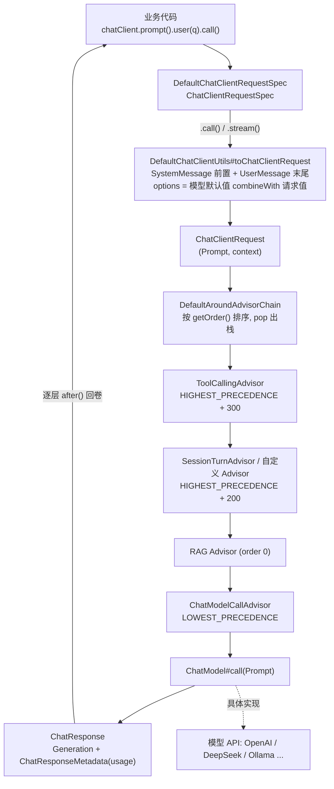

# 01-ChatClient 与模型抽象

> 一句话结论：`ChatClient` 是一层**链式 API 外壳**，它把「拼消息 → 组 options → 过 Advisor 链 → 落到 `ChatModel#call(Prompt)`」这条固定流程封装好；所有可替换的东西（模型、记忆、工具、RAG、结构化输出）都是挂在 Advisor 链上的。

> 阅读前置：`06-SpringAI/README.md`；`01-Spring框架/02-AOP`（拦截器链、`Ordered` 排序）。
> 源码基线：Spring AI **2.1.0**（`org.springframework.ai:spring-ai-client-chat`、`spring-ai-model`）。

## 学习目标

读完本目录，你应该能：

1. 在不看源码的情况下，说出 `chatClient.prompt().user("...").call().content()` 这一行背后**经过的每一个对象**，以及它们在哪个包。
2. 解释 `ChatModel` / `StreamingChatModel` / `EmbeddingModel` / `ImageModel` 四个接口的契约差别，并说明为什么 `ChatModel` 要顺便 `extends StreamingChatModel`。
3. 说清 `call().entity(Foo.class)` 是怎么让大模型"吐出能被 Jackson 反序列化的 JSON"的：`BeanOutputConverter#getFormat()` 拼指令 + `convert()` 清洗 + 反序列化。
4. 解释 `Advisor` 链的执行模型，以及它和 Spring AOP 拦截器链的异同（尤其是 `.stream()` 下 `after()` 只在**最后一个 chunk** 触发）。
5. 知道 2.1 里 `ChatMemory` 已 `@Deprecated(forRemoval = true)`，新抽象是 `spring-ai-session` 的 `SessionService` + `spring-ai-session-advisor` 的 `SessionMemoryAdvisor`。

## 整体地图

**读图说明**

- 左到右是"请求下行"，从右往左回卷是"响应上行"：每个 Advisor 都包住后面所有环节，形成套娃。
- `DefaultChatClientUtils#toChatClientRequest` 是**唯一**负责"把链式调用拼成 `Prompt`"的地方；`system` 永远被塞到最前，`user` 永远在最后。
- 链尾固定两个"终结者"：`ChatModelCallAdvisor`（`call` 用）和 `ChatModelStreamAdvisor`（`stream` 用），它们的 order 是 `LOWEST_PRECEDENCE`，因此一定是最后出栈的那个 —— 真正发起 HTTP 请求的就是它们。
- `ToolCallingAdvisor` 的 order 比记忆类 Advisor **更小**（更外层？不，见正文：`HIGHEST_PRECEDENCE + 300` > `+200`，数值越大越靠内层），它会在内部循环调用 `callAdvisorChain.copy(this).nextCall(...)`，从而把"一次工具调用回合"伪装成"多次模型调用"。
- 模型实现类（OpenAI / Ollama …）只实现 `ChatModel#call(Prompt)`，对 `ChatClient` 一无所知 —— 这是整个设计的分层底线。

## 两篇摘要

| 文章 | 解决的问题 | 关键类 |
| --- | --- | --- |
| [01-chatclient-链式api源码.md](01-chatclient-链式api源码.md) | 一行 `.prompt().user().call()` 到底做了什么；四个模型接口的契约；`Prompt`/`ChatResponse` 的数据结构；`entity()` 结构化输出与 `.stream()` 背压 | `ChatClient`、`DefaultChatClient`、`DefaultChatClientBuilder`、`DefaultChatClientUtils`、`ChatModel`、`Prompt`、`ChatResponse`、`BeanOutputConverter` |
| [02-advisor-链与对话记忆.md](02-advisor-链与对话记忆.md) | Advisor 链如何排序/入栈/出栈；如何写一个自定义 Advisor；2.1 记忆抽象从 `ChatMemory` 迁到 `SessionService` | `Advisor`、`BaseAdvisor`、`DefaultAroundAdvisorChain`、`ToolCallingAdvisor`、`SessionMemoryAdvisor`、`MessageWindowChatMemory` |

## 建议阅读顺序

先 01 把"一条请求怎么走到模型"打通，再读 02 把"横向切面怎么插进去"补齐。02 里 `ToolCallingAdvisor` 的循环会和 `02-工具调用与RAG` 的 `DefaultToolCallingManager` 互相引用，建议连读。

## 学习检查点

- [ ] 能背出 `DefaultChatClientRequestSpec#buildAdvisorChain()` 往链里**追加**了哪两个 Advisor，以及它们的 order 是多少。
- [ ] 能解释为什么 `.call()` 里先调 `DefaultChatClientUtils.toChatClientRequest(this)` 再 `new DefaultCallResponseSpec(...)`，而"真正发请求"发生在 `.content()`。
- [ ] 能说清 `ChatOptions` 的三层覆盖顺序（模型默认 → `.options()` → Advisor 内部 mutate），并指出源码里写这句话的那一行。
- [ ] 能写出一个自定义 `CallAdvisor`（脱敏 + 审计），并说出为什么流式场景要额外聚合。
- [ ] 能说出 2.1 弃用 `ChatMemory` 后，`CONVERSATION_ID` 这个上下文 key 被哪个新类复用了。
