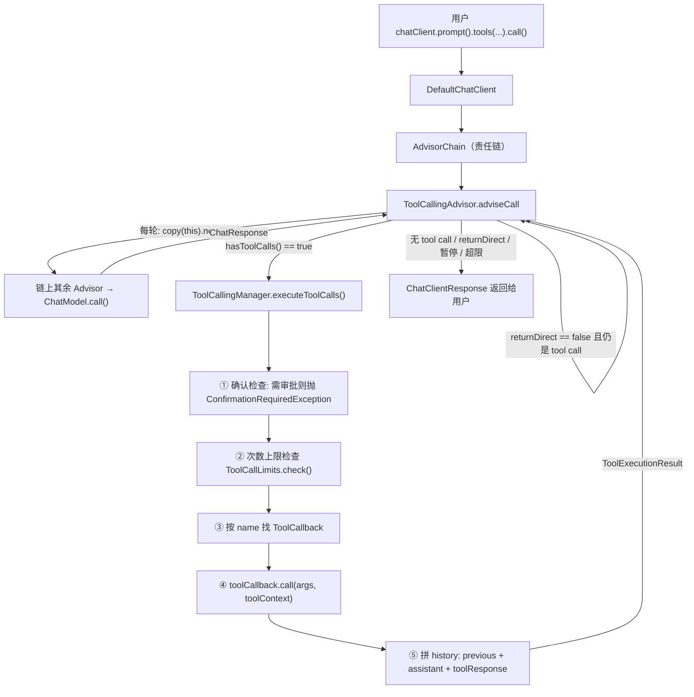
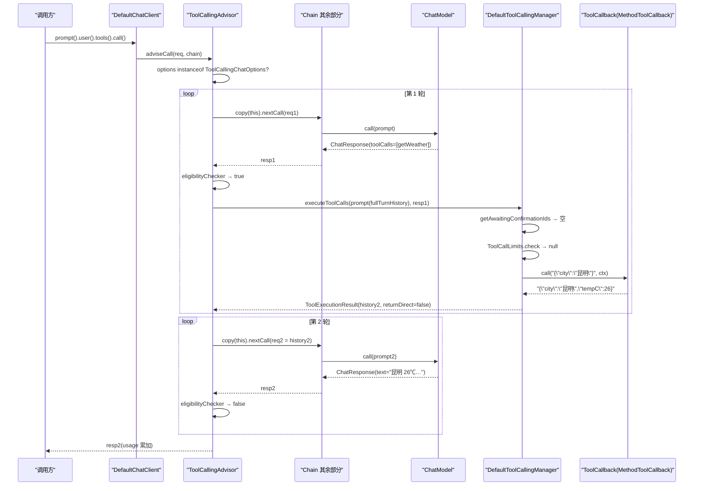
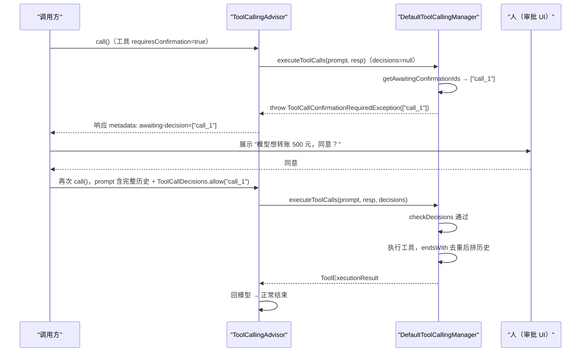

# Tool Calling 工具调用循环源码解析：从模型"想调工具"到框架"真去调"

> 一句话结论：Spring AI 的工具调用是一个"模型点菜、框架跑腿"的 do-while 循环——`ToolCallingAdvisor` 负责转圈，`DefaultToolCallingManager` 负责一轮里真正找到工具、执行工具、拼回对话历史，直到模型不再点菜为止；2.1.0 在这个循环上加了两道"刹车"：调用次数上限（Tool call limits）和人工确认（Tool call confirmation）。
> 阅读前置：读过 [02-advisor-链与对话记忆](../01-ChatClient与模型抽象/02-advisor-链与对话记忆.md)，知道 Advisor 链是什么、`ChatClientRequest`/`ChatClientResponse` 长什么样。
> 预计阅读: 50 分钟 ｜ 源码: `spring-ai-client-chat:2.1.0`、`spring-ai-model:2.1.0`

---

## 0. 先看现象

### 0.1 一个最小的工具调用

先解释两个词：**Tool（工具）** 就是你写的一个 Java 方法，模型"不会算天气、不会查库存"，但它可以"请求"你去查；**Tool Calling（工具调用）** 是模型输出一段结构化 JSON（工具名 + 参数），而不是输出一段文字。

下面是一段示例代码（不是源码，仅演示用法）：

```java
// 示例代码：非源码
record Weather(String city, int tempC) {}

@Tool(description = "查询某城市当前气温")
Weather getWeather(@ToolParam(description = "城市名") String city) {
    return new Weather(city, 26); // 假装查了天气
}

ChatClient chatClient = ChatClient.create(chatModel);

String answer = chatClient.prompt()
    .user("昆明现在多少度？穿外套合适吗？")
    .tools(new WeatherTools())       // 把带 @Tool 的对象交给 ChatClient
    .call()
    .content();
System.out.println(answer);
// 大致输出："昆明现在 26℃，穿件薄外套或长袖即可。"
```

你只调了一次 `.call()`，但幕后发生了 **两次** 模型请求 + **一次** 方法调用：

1. 第 1 次请求模型，模型没有回答，而是"点菜"：`{"name":"getWeather","arguments":{"city":"昆明"}}`。
2. 框架找到 `getWeather` 方法，用 JSON 参数反射调用，拿到 `{"city":"昆明","tempC":26}`。
3. 把"模型点菜"和"工具结果"都追加到对话里，**第 2 次**请求模型。
4. 这次模型给出自然语言答案，循环结束。

### 0.2 几个反直觉的点

1. **工具不是模型执行的，是你的 JVM 执行的。** 模型只是"填表"，表里写工具名和参数；真正 `method.invoke(...)` 的是 `MethodToolCallback`。
2. **一次 `.call()` 可能打了 N 次模型。** 循环在 `ToolCallingAdvisor.adviseCall` 里，是个 `do { ... } while (isToolCall)`。
3. **循环有"里程上限"。** 2.1.0 默认每个工具一轮最多 40 次、全部工具合计 150 次（[[源码:DefaultToolCallingManager.java#L103-L110]]），超了默认直接抛 `ToolCallLimitExceededException`——不是模型报错，是框架主动踩刹车。
4. **危险操作可以"暂停等人"。** 标了 `@Tool(requiresConfirmation = true)` 的工具，模型一点菜，循环就停，把"等审批"的 key 放进响应 metadata；你拿到人 的决定后，带着决定重新调用才继续。
5. **`returnDirect = true` 会跳过第 2 次模型请求。** 工具结果直接原样返回给调用方，不经过模型"复述"。

### 0.3 AI 概念速览

- **Tool Call / Function Call**：模型输出的结构化调用请求，含 `id`、`name`、`arguments`(JSON 字符串)。
- **AssistantMessage / ToolResponseMessage**：前者是模型说的话（也可能含 tool call），后者是框架替工具"回话"的消息。两者都要塞回对话，模型才知道工具结果。
- **ToolCallback**：Spring AI 对"一个可被模型调用的工具"的统一抽象（名字、描述、JSON Schema、`call()` 方法）。
- **ToolCallingManager**：执行一轮工具调用的"跑腿主管"。
- **Tool Calling Loop**：本篇主角，"问模型 → 跑工具 → 回填 → 再问模型"的循环。
- **Human-in-the-loop**：在自动执行前插入人的审批，见第 7 节与 [02-agent 篇](../03-MCP与Agent/02-agent-多轮自治与-human-in-the-loop.md)。

---

## 1. 整体地图



**读图说明**

| 图中节点 | 对应源码 | 一句话 |
|---|---|---|
| `ToolCallingAdvisor.adviseCall` | [[源码:ToolCallingAdvisor.java#L143-L248]] | 循环体，本篇精读重点 |
| `copy(this).nextCall()` | [[源码:ToolCallingAdvisor.java#L188-L188]] | 每轮把"自己"从链里摘掉再走一遍，避免递归 |
| `ToolCallingManager.executeToolCalls` | [[源码:DefaultToolCallingManager.java#L205-L213]] | 两个重载：无决定 / 带决定 |
| 确认检查 | [[源码:DefaultToolCallingManager.java#L285-L294]] | 2.1.0 新增 |
| 次数上限 | [[源码:ToolCallLimits.java#L113-L130]] | 每工具 + 总计两级 |
| 找 ToolCallback | [[源码:DefaultToolCallingManager.java#L472-L485]] | 先在 prompt 携带的工具里找，可选 fallback |
| 执行 | [[源码:DefaultToolCallingManager.java#L396-L410]] | 包在 Observation 里，可观测 |
| 拼历史 | [[源码:DefaultToolCallingManager.java#L487-L493]] | 三段拼接 |

整条链可以类比为餐厅：模型是**顾客点菜**（Tool Call），`ToolCallingAdvisor` 是**传菜员**（在顾客和后厨之间来回跑），`ToolCallingManager` 是**后厨主管**（确认订单能不能做、做了几份、找哪位厨师），`ToolCallback` 是**厨师**（真正做菜）。

---

## 2. 关键类

| 类 | 模块 | 职责 | 关键点 |
|---|---|---|---|
| `ToolCallingAdvisor` | client-chat | 工具调用循环；同时实现 `CallAdvisor`、`StreamAdvisor`、`ToolAdvisor` | 默认 order = `HIGHEST_PRECEDENCE + 300`，比 memory advisor(+200) 更靠内层，memory 不参与每轮迭代 |
| `ToolCallingManager` | model | 接口：`resolveToolDefinitions` + 两个 `executeToolCalls` | 带决定的那个重载默认抛 `UnsupportedOperationException`，自定义实现必须显式覆盖 |
| `DefaultToolCallingManager` | model | 默认实现：确认检查、上限、查找、执行、拼历史 | Builder 默认 `onLimitExceeded=THROW`、`policy=fromToolMetadata()` |
| `ToolCallback` | model | 一个工具的统一抽象 | `getToolDefinition()`、`getToolMetadata()`、`call()` |
| `ToolDefinition` | model | 给模型看的"菜单项"：name / description / inputSchema | 是个 record |
| `ToolMetadata` | model | 给框架看的属性：`returnDirect`、`requiresConfirmation` | 后者 2.1.0 新增 |
| `MethodToolCallback` | model | 把 `@Tool` 方法包装成 `ToolCallback` | JSON → 参数 → 反射 → 结果转字符串 |
| `ToolCallingChatOptions` | model | 运行时工具列表 + ToolContext | runtime 优先于默认，**不合并** |
| `ToolExecutionResult` | model | 一轮执行的产物：新历史 + 是否直接返回 | `buildGenerations()` 把工具结果变成 `Generation` |
| `ToolCallDecisions` / `ToolCallDecision` | model | 人工审批的载体 | 按 key（id 或 `#位置`）对应每个 tool call |
| `ToolCallConfirmationPolicy` | model | 哪些调用需要确认 | `fromToolMetadata()` / `forTools()` / `or()` |
| `ToolCallLimits` | model | 次数上限计数与判定 | 包私有；只数"本轮"（最后一个 UserMessage 起） |
| `ToolCallLimitBehavior` | model | 超限行为 | `THROW` / `RETURN_ERROR_RESPONSE` |
| `ToolExecutionEligibilityChecker` | model | 判断响应是否含工具调用 | 默认 `chatResponse.hasToolCalls()` |

术语解释：

- **`returnDirect`**：工具结果不回给模型"复述"，直接给调用方。适合工具本身就是最终答案（比如查一个 ID）。
- **`ToolContext`**：一个 `Map<String,Object>`，在所有工具之间共享、模型看不见。常放"当前登录用户"、"tenantId"。
- **Observation**：Micrometer 的可观测性抽象，每次工具调用会产生一个 span。

---

## 3. 源码逐段精读

### 3.1 循环的入口与跳过条件

[[源码:ToolCallingAdvisor.java#L143-L152]]

```java (src: ToolCallingAdvisor.java#L143-L152)
	@Override
	public ChatClientResponse adviseCall(ChatClientRequest chatClientRequest, CallAdvisorChain callAdvisorChain) {
		Assert.notNull(callAdvisorChain, "callAdvisorChain must not be null");
		Assert.notNull(chatClientRequest, "chatClientRequest must not be null");

		ChatOptions options = chatClientRequest.prompt().getOptions();
		if (!(options instanceof ToolCallingChatOptions toolCallingChatOptions)) {
			// No tool calling options - skip the tool calling advisor
			return callAdvisorChain.nextCall(chatClientRequest);
		}
```

- **在干什么**：拿 prompt 的 options，如果不是 `ToolCallingChatOptions`，说明这次请求压根没带工具，直接放行给下一个 advisor。
- **为什么这么写**：Advisor 是无条件的（只要注册就会执行），所以要用 `instanceof` 模式匹配做"软开关"。
- **如果改成别的会怎样**：如果这里不跳过，每次普通对话都会白跑一轮 `do-while`，而且 `executeToolCalls` 会被调用于没有 tool call 的响应，抛 `"No tool call requested by the chat model"`。
- **常见坑**：你 `tools(...)` 了，但 options 却不是 `ToolCallingChatOptions`——通常是自己 `prompt(new Prompt(..., new DefaultChatOptions()))` 强塞了默认 options，把工具列表覆盖掉了。

### 3.2 为什么要有 `fullTurnHistory`

[[源码:ToolCallingAdvisor.java#L154-L168]]

```java (src: ToolCallingAdvisor.java#L154-L168)
		chatClientRequest = this.doInitializeLoop(chatClientRequest, callAdvisorChain);

		var instructions = chatClientRequest.prompt().getInstructions();
		// Always the complete history for this turn, independent of what
		// doGetNextInstructionsForToolCall trims `instructions` down to for forwarding
		// to the rest of the chain (e.g. for a memory advisor nested inside the loop
		// that doesn't itself de-duplicate). This is what the ToolCallingManager sees,
		// so trimming the forwarded prompt never hides earlier rounds from its tool
		// call limit counting.
		var fullTurnHistory = instructions;

		ChatClientResponse chatClientResponse = null;
		UsageAccumulator usageAccumulator = new UsageAccumulator();

		boolean isToolCall = false;
```

- **在干什么**：把初始指令列表复制一份叫 `fullTurnHistory`。
- **为什么这么写**：后面 `instructions` 可能被 `doGetNextInstructionsForToolCall` 裁剪（关掉内部历史时只保留 system + 最后一条），但 `ToolCallingManager` 数"本轮调了几次工具"要靠完整历史。两个变量分开，裁剪不会影响计数。
- **如果改成别的会怎样**：如果只留一个 `instructions` 且被裁剪，上限计数会低估，死循环刹不住。
- **常见坑**：自己写子类覆盖 `doGetNextInstructionsForToolCall` 时，忘了 `fullTurnHistory` 是独立变量，以为改一处即可。

### 3.3 do-while 循环体（核心）

[[源码:ToolCallingAdvisor.java#L170-L248]]

```java (src: ToolCallingAdvisor.java#L170-L248)
		do {

			// Before Call
			var processedChatClientRequest = ChatClientRequest.builder()
				.prompt(new Prompt(instructions, toolCallingChatOptions))
				.context(chatClientRequest.context())
				.build();

			// Next Call
			processedChatClientRequest = this.doBeforeCall(processedChatClientRequest, callAdvisorChain);

			// Re-read the options doBeforeCall() may have mutated (e.g. a subclass
			// injecting per-iteration tool callbacks) so executeToolCalls() below sees
			// what was actually sent to the model, not the pre-doBeforeCall snapshot.
			toolCallingChatOptions = (ToolCallingChatOptions) processedChatClientRequest.prompt().getOptions();
			Assert.notNull(toolCallingChatOptions,
					"redundant check that should never fail (doBeforeCall must not change the options type away from ToolCallingChatOptions), but here to help NullAway");

			chatClientResponse = callAdvisorChain.copy(this).nextCall(processedChatClientRequest);

			chatClientResponse = this.doAfterCall(chatClientResponse, callAdvisorChain);

			// After Call
			ChatResponse chatResponse = chatClientResponse.chatResponse();
			usageAccumulator.addRoundResponse(chatResponse);
			isToolCall = this.toolExecutionEligibilityChecker.isToolCallResponse(chatResponse);

			if (isToolCall) {
				Assert.notNull(chatResponse, "redundant check that should never fail, but here to help NullAway");

				ToolExecutionResult toolExecutionResult;
				try {
					toolExecutionResult = this.toolCallingManager
						.executeToolCalls(new Prompt(fullTurnHistory, toolCallingChatOptions), chatResponse);
				}
				catch (ToolCallLimitExceededException ex) {
					// Return the breach as a single generation - directly to the
					// application client instead of looping back to the LLM.
					chatClientResponse = chatClientResponse.mutate()
						.chatResponse(ChatResponse.builder()
							.from(chatResponse)
							.generations(List.of(ex.buildGeneration()))
							.build())
						.build();
					break;
				}
				catch (ToolCallConfirmationRequiredException ex) {
					// A call that needs a person's confirmation pauses the loop: none of
					// the reply's calls ran, the reply goes back to the caller with the
					// keys of the calls that wait for a decision.
					chatClientResponse = paused(chatClientResponse, chatResponse, ex);
					break;
				}

				fullTurnHistory = toolExecutionResult.conversationHistory();

				if (toolExecutionResult.returnDirect()) {

					// Return tool execution result directly to the application client
					// instead of returning it to the LLM.
					chatClientResponse = chatClientResponse.mutate()
						.chatResponse(ChatResponse.builder()
							.from(chatResponse)
							.generations(ToolExecutionResult.buildGenerations(toolExecutionResult))
							.build())
						.build();
					break;
				}

				instructions = this.doGetNextInstructionsForToolCall(processedChatClientRequest, chatClientResponse,
						toolExecutionResult);
			}

		}
		while (isToolCall); // loop until no tool calls are present

		chatClientResponse = usageAccumulator.applyAccumulatedUsage(chatClientResponse);
		return this.doFinalizeLoop(chatClientResponse, callAdvisorChain);
	}
```

- **在干什么**：每轮 (1) 用当前 `instructions` + 工具选项构造请求；(2) `doBeforeCall` 钩子；(3) 重读 options；(4) **`callAdvisorChain.copy(this).nextCall(...)`** 走剩余链（含真正的模型调用）；(5) `doAfterCall` 钩子；(6) 累加 token 用量；(7) 判断是否含 tool call；(8) 是则交给 manager 执行，三种异常/条件各有一个出口；(9) 把 manager 返回的新历史作为下一轮 `instructions`。
- **为什么这么写**：
  - `copy(this)`：链是"从当前 advisor 往后走"，如果不把自己摘掉，下一轮再进 `adviseCall` 就递归了。
  - `doBeforeCall` 之后**重读** options：子类可能在钩子里按轮次注入不同工具，manager 要看到"真正发给模型的那份"。
  - `UsageAccumulator`：多轮调用会产生多份 usage，得合并后报给调用方，否则账单对不上。
- **如果改成别的会怎样**：
  - 不 `copy(this)` → 无限递归 StackOverflow。
  - 不重读 options → 子类动态注入的工具在 manager 里找不到，抛 `"No ToolCallback found for tool name"`。
  - 不累加 usage → 调用方看到的 token 数只是最后一轮。
- **常见坑**：
  - 把 `ToolCallLimitExceededException` 的 `buildGeneration()` 当"模型错误"——其实它是一个带 `finishReason=toolCallLimitExceeded` 的正常 Generation，`content()` 能读到超限说明文字。
  - 以为 `ToolCallConfirmationRequiredException` 会抛到你手里——不会，被这里捕获并转成"暂停响应"，你需要用 `chatResponse().getMetadata()` 去看 `spring.ai.tool-calls-awaiting-decision`。

### 3.4 下一轮指令怎么裁剪

[[源码:ToolCallingAdvisor.java#L250-L262]]

```java (src: ToolCallingAdvisor.java#L250-L262)
	protected List<Message> doGetNextInstructionsForToolCall(ChatClientRequest chatClientRequest,
			ChatClientResponse chatClientResponse, ToolExecutionResult toolExecutionResult) {

		if (!this.conversationHistoryEnabled) {
			List<Message> history = toolExecutionResult.conversationHistory();
			if (history.isEmpty()) {
				return history;
			}
			return List.of(chatClientRequest.prompt().getSystemMessage(), history.get(history.size() - 1));
		}

		return toolExecutionResult.conversationHistory();
	}
```

- **在干什么**：决定下一轮发给模型的历史。默认（`conversationHistoryEnabled=true`）原样用 manager 拼好的完整历史；关掉后只发 system 消息 + 最后一条（即 ToolResponseMessage）。
- **为什么这么写**：配合外层 `MessageChatMemoryAdvisor`——如果 memory advisor 在循环外层，它每轮会自己重新加载完整历史，内部再拼一份就重复了。
- **如果改成别的会怎样**：关掉内部历史但 memory 又在循环内层 → 模型看不到 assistant 的 tool call 消息，而只有 tool response，大多数模型 API 直接报 400。
- **常见坑**：`conversationHistoryEnabled=false` 时，若某个模型要求 assistant(tool_calls) 与 tool 消息成对出现，会出现 "messages must alternate" 类报错。

### 3.5 Advisor 的默认顺序

[[源码:ToolCallingAdvisor.java#L86-L128]]

```java (src: ToolCallingAdvisor.java#L86-L128)
public class ToolCallingAdvisor implements CallAdvisor, StreamAdvisor, ToolAdvisor {

	private static final ChatClientMessageAggregator CHAT_CLIENT_MESSAGE_AGGREGATOR = new ChatClientMessageAggregator();

	/**
	 * Default advisor order. Higher than
	 * {@link org.springframework.ai.chat.client.advisor.api.Advisor#DEFAULT_CHAT_MEMORY_PRECEDENCE_ORDER}
	 * (+200) so that memory advisors at their default order are placed outside this
	 * advisor and do not participate in each tool-call iteration.
	 */
	public static final int DEFAULT_ORDER = Ordered.HIGHEST_PRECEDENCE + 300;

	protected static final ToolExecutionEligibilityChecker DEFAULT_TOOL_EXECUTION_ELIGIBILITY_CHECKER = chatResponse -> chatResponse != null
			&& chatResponse.hasToolCalls();

	protected final ToolCallingManager toolCallingManager;

	private final ToolExecutionEligibilityChecker toolExecutionEligibilityChecker;

	/**
	 * Set the order close to {@link Ordered#LOWEST_PRECEDENCE} to ensure an advisor is
	 * executed first in the chain (first for request processing, last for response
	 * processing).
	 * <p>
	 * https://docs.spring.io/spring-ai/reference/api/advisors.html#_advisor_order
	 */
	private final int advisorOrder;

	private final boolean conversationHistoryEnabled;

	protected ToolCallingAdvisor(ToolCallingManager toolCallingManager,
			ToolExecutionEligibilityChecker toolExecutionEligibilityChecker, int advisorOrder,
			boolean conversationHistoryEnabled) {
		Assert.notNull(toolCallingManager, "toolCallingManager must not be null");
		Assert.notNull(toolExecutionEligibilityChecker, "toolExecutionEligibilityChecker must not be null");
		Assert.isTrue(advisorOrder > BaseAdvisor.HIGHEST_PRECEDENCE && advisorOrder < BaseAdvisor.LOWEST_PRECEDENCE,
				"advisorOrder must be between HIGHEST_PRECEDENCE and LOWEST_PRECEDENCE");

		this.toolCallingManager = toolCallingManager;
		this.toolExecutionEligibilityChecker = toolExecutionEligibilityChecker;
		this.advisorOrder = advisorOrder;
		this.conversationHistoryEnabled = conversationHistoryEnabled;
	}
```

- **在干什么**：类声明 + 默认 order + 默认"是否工具调用"判定 + 构造校验。
- **为什么这么写**：order 数值越大越靠内层（越接近模型）。memory advisor 默认 `+200`，工具循环 `+300`，这样 memory 在外层，只进出一次，不会每轮重新加载。
- **如果改成别的会怎样**：把 memory advisor 挪到 `+400`，它就会在循环里每轮跑一次，要么重复追加历史，要么与 `fullTurnHistory` 不一致。
- **常见坑**：自定义 advisor 想在"每轮"都执行（比如每轮重写 query），order 要设得比 +300 大；想在"整体"只执行一次，要比 +300 小。

### 3.6 暂停响应长什么样

[[源码:ToolCallingAdvisor.java#L534-L563]]

```java (src: ToolCallingAdvisor.java#L534-L563)
	private static ChatClientResponse pausedChunk(ChatClientResponse aggregated, ChatResponse chatResponse,
			ToolCallConfirmationRequiredException ex) {
		Generation toolCallGeneration = toolCallGeneration(chatResponse);
		AssistantMessage reply = toolCallGeneration.getOutput();
		List<MessagePart> toolCallParts = reply.getParts().stream().filter(ToolCallPart.class::isInstance).toList();
		AssistantMessage toolCallsOnly = AssistantMessage.builder()
			.parts(toolCallParts)
			.properties(reply.getMetadata())
			.build();
		ChatResponse chunk = ChatResponse.builder()
			.from(chatResponse)
			.generations(List.of(new Generation(toolCallsOnly, toolCallGeneration.getMetadata())))
			.metadata(ToolCallDecisions.AWAITING_DECISION_METADATA_KEY, ex.getToolCallIds())
			.build();
		return aggregated.mutate().chatResponse(chunk).build();
	}

	/**
	 * The paused reply as the model gave it, with the keys of the tool calls that wait
	 * for a decision.
	 */
	private static ChatClientResponse paused(ChatClientResponse response, ChatResponse chatResponse,
			ToolCallConfirmationRequiredException ex) {
		return response.mutate()
			.chatResponse(ChatResponse.builder()
				.from(chatResponse)
				.metadata(ToolCallDecisions.AWAITING_DECISION_METADATA_KEY, ex.getToolCallIds())
				.build())
			.build();
	}
```

- **在干什么**：两个静态方法，把"模型点菜但没执行"的响应原样返回，并在 metadata 里塞 `AWAITING_DECISION_METADATA_KEY` → 待审批 key 列表。`pausedChunk` 用于流式（只保留 ToolCallPart），`paused` 用于阻塞。
- **为什么这么写**：调用方拿到响应后，既要知道"模型想调什么"（tool call 部分），又要知道"哪些需要我拍板"（metadata key 列表），两者缺一不可。
- **如果改成别的会怎样**：如果不保留 tool call 消息，恢复时你无法把 assistant 的 tool call 放回历史，模型 API 会拒绝孤立的 tool response。
- **常见坑**：`content()` 读到的通常是空字符串（模型没说话，只点了菜），判断"是否暂停"请用 `ToolCallDecisions.isAwaitingDecision(chatResponse)`，不要看文本。

### 3.7 Manager 的两个入口

[[源码:DefaultToolCallingManager.java#L205-L213]]

```java (src: DefaultToolCallingManager.java#L205-L213)
	public ToolExecutionResult executeToolCalls(Prompt prompt, ChatResponse chatResponse) {
		return this.doExecuteToolCalls(prompt, chatResponse, null);
	}

	@Override
	public ToolExecutionResult executeToolCalls(Prompt prompt, ChatResponse chatResponse, ToolCallDecisions decisions) {
		Assert.notNull(decisions, "decisions cannot be null");
		return this.doExecuteToolCalls(prompt, chatResponse, decisions);
	}
```

- **在干什么**：两个重载都汇到私有 `doExecuteToolCalls`，区别只是 `decisions` 是否为 null。
- **为什么这么写**：`decisions == null` 表示"首次执行，遇需要确认的就抛异常"；非 null 表示"人已经拍板，按决定执行"。
- **如果改成别的会怎样**：如果两者合一用一个 Optional 参数，会把 2.1.0 之前就存在的接口签名改掉，破坏二进制兼容。
- **常见坑**：自定义 `ToolCallingManager` 时只覆盖了第一个重载，第二个走接口 default 实现，直接抛 `UnsupportedOperationException`。

### 3.8 一轮执行的总调度

[[源码:DefaultToolCallingManager.java#L215-L260]]

```java (src: DefaultToolCallingManager.java#L215-L260)
	private ToolExecutionResult doExecuteToolCalls(Prompt prompt, ChatResponse chatResponse,
			@Nullable ToolCallDecisions decisions) {
		Assert.notNull(prompt, "prompt cannot be null");
		Assert.notNull(chatResponse, "chatResponse cannot be null");

		Optional<Generation> toolCallGeneration = chatResponse.getResults()
			.stream()
			.filter(g -> !CollectionUtils.isEmpty(g.getOutput().getToolCalls()))
			.findFirst();

		if (toolCallGeneration.isEmpty()) {
			throw new IllegalStateException("No tool call requested by the chat model");
		}

		AssistantMessage assistantMessage = toolCallGeneration.get().getOutput();

		ToolContext toolContext = buildToolContext(prompt, assistantMessage);

		InternalToolExecutionResult internalToolExecutionResult = executeToolCall(prompt, assistantMessage, toolContext,
				decisions);

		// A resumed batch may come with the conversation up to and including the reply;
		// the history then holds the reply once
		List<Message> previousMessages = prompt.getInstructions();
		if (endsWith(previousMessages, assistantMessage)) {
			previousMessages = previousMessages.subList(0, previousMessages.size() - 1);
		}
		List<Message> conversationHistory = buildConversationHistoryAfterToolExecution(previousMessages,
				assistantMessage, internalToolExecutionResult.toolResponseMessage());

		return ToolExecutionResult.builder()
			.conversationHistory(conversationHistory)
			.returnDirect(internalToolExecutionResult.returnDirect())
			.build();
	}

	private static ToolContext buildToolContext(Prompt prompt, AssistantMessage assistantMessage) {
		Map<String, Object> toolContextMap = Map.of();

		if (prompt.getOptions() instanceof ToolCallingChatOptions toolCallingChatOptions
				&& !CollectionUtils.isEmpty(toolCallingChatOptions.getToolContext())) {
			toolContextMap = new HashMap<>(toolCallingChatOptions.getToolContext());
		}

		return new ToolContext(toolContextMap);
	}
```

- **在干什么**：找第一个含 tool call 的 Generation → 建 ToolContext → 调 `executeToolCall` 拿到 ToolResponseMessage → 去重后拼历史 → 包装成 `ToolExecutionResult`。
- **为什么这么写**：
  - `endsWith(previousMessages, assistantMessage)`：恢复暂停批次时，你传进来的 prompt 已经包含了"模型点菜"那条消息，再拼一次就重复了，所以先剥掉。
  - `ToolContext` 用 `HashMap` 拷贝一份：工具执行过程中可以往里写东西（比如累加结果），不影响原 options。
- **如果改成别的会怎样**：不去重 → 恢复时历史里出现两条相同的 assistant(tool_calls)，部分模型 API 报"duplicate tool call id"。
- **常见坑**：`ToolContext` 里放的是可变对象，多个并发请求共享同一个 bean 时会互相污染——放不可变值或每次 new。

### 3.9 确认检查与决定校验（2.1.0 新增）

[[源码:DefaultToolCallingManager.java#L283-L294]]

```java (src: DefaultToolCallingManager.java#L283-L294)
		// whole batch, unless the decisions cover it
		// Decisions name the calls by key: the id, or the position when there is none
		List<String> toolCallKeys = ToolCallDecisions.toolCallKeys(assistantMessage);
		if (decisions == null) {
			List<String> awaiting = this.getAwaitingConfirmationIds(assistantMessage, toolCallKeys, toolCallbacks);
			if (!awaiting.isEmpty()) {
				throw new ToolCallConfirmationRequiredException(awaiting);
			}
		}
		else {
			checkDecisions(decisions, assistantMessage, toolCallKeys, toolCallbacks);
		}
```

- **在干什么**：在任何工具跑之前，先算出每个 tool call 的 key；无决定时，有需要确认的就整批暂停；有决定时，校验决定覆盖了全部调用。
- **为什么这么写**："整批暂停"而不是"跑一部分留一部分"——因为模型的 tool call 是一个批次，拆开执行会让历史出现半截 tool response，模型难以理解。key 用 id 或 `#位置`，是因为有些模型不返回 id 或返回重复 id。
- **如果改成别的会怎样**：如果只暂停需要确认的那个、其余照跑，恢复时 `endsWith` 去重逻辑会错乱（历史里已有一条 tool response）。
- **常见坑**：模型没给 id 时，`ToolCallDecisions.of(ToolCallDecision.allow("#0"))` 才能匹配第一个调用；写 `allow("call_abc")` 会触发 `"No tool call has the key"`。

[[源码:DefaultToolCallingManager.java#L446-L466]]

```java (src: DefaultToolCallingManager.java#L446-L466)
	private static void checkDecisions(ToolCallDecisions decisions, AssistantMessage assistantMessage,
			List<String> toolCallKeys, List<ToolCallback> toolCallbacks) {
		Set<String> assistantToolCallIds = new LinkedHashSet<>(toolCallKeys);
		for (ToolCallDecision decision : decisions.decisions()) {
			Assert.isTrue(assistantToolCallIds.contains(decision.toolCallId()), () -> "No tool call has the key '"
					+ decision.toolCallId() + "'; the reply's tool call keys: " + assistantToolCallIds);
		}
		Set<String> missing = new LinkedHashSet<>(assistantToolCallIds);
		decisions.decisions().forEach(decision -> missing.remove(decision.toolCallId()));
		Assert.isTrue(missing.isEmpty(), () -> "Every tool call of the reply needs a decision; missing: " + missing);
		List<AssistantMessage.ToolCall> toolCalls = assistantMessage.getToolCalls();
		for (int i = 0; i < toolCalls.size(); i++) {
			AssistantMessage.ToolCall toolCall = toolCalls.get(i);
			ToolCallDecision decision = decisions.decisionOn(toolCallKeys.get(i));
			if (decision != null && decision.allowed() && findToolCallback(toolCallbacks, toolCall.name()) == null) {
				throw new IllegalArgumentException(
						"The prompt does not carry the tool '" + toolCall.name() + "' of the allowed call '"
								+ toolCallKeys.get(i) + "'; an allowed call runs only with a tool of the prompt");
			}
		}
	}
```

- **在干什么**：三道校验：(1) 决定里的 key 必须在回复里存在；(2) 每个调用都要有决定；(3) 允许的调用，其工具必须在 prompt 携带的工具列表里，不允许靠 fallback resolver 按名字解析。
- **为什么这么写**：恢复执行是"人已经看过并同意"的状态，安全边界要更严：防止人批准的是 A，恢复时 resolver 却解析到一个同名但不同的工具。
- **如果改成别的会怎样**：去掉第 (3) 条，攻击者可以在两次请求之间注册同名工具，绕过审批。
- **常见坑**：恢复时换了 `tools(...)` 对象或没传 tools，导致 `"The prompt does not carry the tool"`。

### 3.10 主循环：拒绝、计数、超限

[[源码:DefaultToolCallingManager.java#L303-L347]]

```java (src: DefaultToolCallingManager.java#L303-L347)

		List<AssistantMessage.ToolCall> toolCalls = assistantMessage.getToolCalls();
		for (int i = 0; i < toolCalls.size(); i++) {

			AssistantMessage.ToolCall toolCall = toolCalls.get(i);
			String toolName = toolCall.name();

			ToolCallDecision decision = (decisions != null) ? decisions.decisionOn(toolCallKeys.get(i)) : null;
			if (decision != null && !decision.allowed()) {
				// A denied call does not run; the model receives the decision's message
				toolResponses
					.add(new ToolResponseMessage.ToolResponse(toolCall.id(), toolName, decision.denyMessage()));
				denied = true;
				continue;
			}

			if (logger.isDebugEnabled()) {
				logger.debug("Executing tool call: " + toolCall.name());
			}

			totalToolCallCount++;
			int toolCallCount = toolCallCounts.merge(toolName, 1, Integer::sum);

			ToolCallLimits.Breach limitBreach = this.toolCallLimits.check(toolName, toolCallCount, totalToolCallCount);
			if (limitBreach != null) {
				toolResponses.add(new ToolResponseMessage.ToolResponse(toolCall.id(), toolName, limitBreach.message()));

				if (this.toolCallLimits.onLimitExceeded() == ToolCallLimitBehavior.THROW) {
					ToolResponseMessage partialToolResponseMessage = ToolResponseMessage.builder()
						.responses(toolResponses)
						.build();
					List<Message> partialConversationHistory = buildConversationHistoryAfterToolExecution(
							prompt.getInstructions(), assistantMessage, partialToolResponseMessage);
					ToolExecutionResult partialToolExecutionResult = ToolExecutionResult.builder()
						.conversationHistory(partialConversationHistory)
						.returnDirect(Objects.requireNonNullElse(returnDirect, false))
						.build();
					throw new ToolCallLimitExceededException(limitBreach.toolName(), limitBreach.limit(),
							partialToolExecutionResult);
				}

				// ToolCallLimitBehavior.RETURN_ERROR_RESPONSE: skip invoking this tool
				// call but keep processing the rest of the batch.
				continue;
			}
```

- **在干什么**：遍历本批每个 tool call：被人拒绝的 → 写一条"拒绝说明"的 tool response 并跳过；否则计数 +1，先查单工具上限再查总上限；超限时按 `onLimitExceeded` 策略，`THROW` 把已执行的部分结果打包抛出，`RETURN_ERROR_RESPONSE` 则写一条超限说明继续处理本批剩余调用。
- **为什么这么写**：
  - 拒绝也要回一条 tool response：模型 API 要求每个 tool call 都有对应响应，否则下一轮 400。
  - `RETURN_ERROR_RESPONSE` 让模型"看到"自己被拒绝，有机会改换策略（比如换工具），比直接炸掉更友好。
  - `THROW` 时把 partial 结果带上：调用方可以知道"超限前已经跑了几次、结果是什么"。
- **如果改成别的会怎样**：被拒绝的调用不回响应 → 下一轮模型报错；超限不抛 → 死循环烧钱。
- **常见坑**：默认 `THROW`，很多人以为会"优雅降级"，结果线上 500；要降级请显式 `.onLimitExceeded(RETURN_ERROR_RESPONSE)`。

### 3.11 空参数兜底

[[源码:DefaultToolCallingManager.java#L349-L363]]

```java (src: DefaultToolCallingManager.java#L349-L363)
			String toolInputArguments = toolCall.arguments();

			// Handle the possible null parameter situation in streaming mode.
			final String finalToolInputArguments;
			if (!StringUtils.hasText(toolInputArguments)) {
				if (logger.isWarnEnabled()) {
					logger.warn("Tool call arguments are null or empty for tool: " + toolName
							+ ". Using empty JSON object as default.");
				}
				finalToolInputArguments = "{}";
			}
			else {
				finalToolInputArguments = toolInputArguments;
			}

```

- **在干什么**：流式模式下 tool call 的 `arguments` 可能是 null/空，统一兜底成 `"{}"`。
- **为什么这么写**：`MethodToolCallback` 用 JSON 解析参数，null 会 NPE；`{}` 让无参方法能正常跑、有参方法则因缺参数报明确错误。
- **如果改成别的会怎样**：不兜底 → 流式场景下偶发 NPE，且难以复现。
- **常见坑**：看到 `Tool call arguments are null or empty` 日志不要慌，它只是 warn，对无参工具是正常路径。

### 3.12 找工具与 returnDirect 聚合

[[源码:DefaultToolCallingManager.java#L364-L379]]

```java (src: DefaultToolCallingManager.java#L364-L379)
			ToolCallback toolCallback = this.resolveToolCallback(toolCallbacks, toolName);

			if (toolCallback == null) {
				if (logger.isWarnEnabled()) {
					logger.warn(POSSIBLE_LLM_TOOL_NAME_CHANGE_WARNING_START + toolName
							+ POSSIBLE_LLM_TOOL_NAME_CHANGE_WARNING_END);
				}
				throw new IllegalStateException("No ToolCallback found for tool name: " + toolName);
			}

			if (returnDirect == null) {
				returnDirect = toolCallback.getToolMetadata().returnDirect();
			}
			else {
				returnDirect = returnDirect && toolCallback.getToolMetadata().returnDirect();
			}
```

- **在干什么**：按名字找 callback，找不到就 warn + 抛异常；`returnDirect` 用 AND 聚合——只有本批**所有**工具都 `returnDirect` 才算 true。
- **为什么这么写**：`returnDirect` 的语义是"结果直接给调用方，不回模型"。如果一批里有一个要回模型、一个不要，历史就不完整，所以取 AND。
- **如果改成别的会怎样**：取 OR → 部分工具结果不回模型，模型下一轮看不到，可能重复调用。
- **常见坑**：模型"幻觉"出不存在的工具名，或工具名被截断（部分模型限制 64 字符），都会撞到这条 `IllegalStateException`。日志里 `POSSIBLE_LLM_TOOL_NAME_CHANGE` 是定位线索。

[[源码:DefaultToolCallingManager.java#L472-L493]]

```java (src: DefaultToolCallingManager.java#L472-L493)
	private @Nullable ToolCallback resolveToolCallback(List<ToolCallback> toolCallbacks, String toolName) {
		ToolCallback toolCallback = findToolCallback(toolCallbacks, toolName);
		if (toolCallback == null && this.resolutionFallbackEnabled) {
			return this.toolCallbackResolver.resolve(toolName);
		}
		return toolCallback;
	}

	private static @Nullable ToolCallback findToolCallback(List<ToolCallback> toolCallbacks, String toolName) {
		return toolCallbacks.stream()
			.filter(tool -> toolName.equals(tool.getToolDefinition().name()))
			.findFirst()
			.orElse(null);
	}

	private List<Message> buildConversationHistoryAfterToolExecution(List<Message> previousMessages,
			AssistantMessage assistantMessage, ToolResponseMessage toolResponseMessage) {
		List<Message> messages = new ArrayList<>(previousMessages);
		messages.add(assistantMessage);
		messages.add(toolResponseMessage);
		return messages;
	}
```

- **在干什么**：查找顺序：prompt 携带的工具 → （可选）`ToolCallbackResolver` 按名字兜底；拼历史 = 旧消息 + 模型点菜消息 + 工具响应消息。
- **为什么这么写**：默认关闭 fallback（见 3.13），保证"这次请求给了什么工具就只能调什么"，是一道安全边界。
- **如果改成别的会怎样**：默认开 fallback → 模型可调到任何 Spring 容器里注册的工具，包括你没打算暴露的。
- **常见坑**：以为 `@Tool` bean 注册成 `ToolCallbackProvider` 后就能被调——不行，还要 `defaultToolCallbacks(provider)` 或 `.tools(...)` 挂到请求上。

### 3.13 真正执行：Observation 包裹

[[源码:DefaultToolCallingManager.java#L385-L418]]

```java (src: DefaultToolCallingManager.java#L385-L418)
			Observation parent = ToolCallReactiveContextHolder.getContext()
				.getOrDefault(ObservationThreadLocalAccessor.KEY, this.observationRegistry.getCurrentObservation());

			ToolCallingObservationContext observationContext = ToolCallingObservationContext.builder()
				.toolDefinition(toolCallback.getToolDefinition())
				.toolMetadata(toolCallback.getToolMetadata())
				.toolCallId(toolCall.id())
				.toolType(toolCall.type())
				.toolCallArguments(finalToolInputArguments)
				.build();

			String toolCallResult = ToolCallingObservationDocumentation.TOOL_CALL
				.observation(this.observationConvention, DEFAULT_OBSERVATION_CONVENTION, () -> observationContext,
						this.observationRegistry)
				.parentObservation(parent)
				.observe(() -> {
					String toolResult;
					try {
						toolResult = toolCallback.call(finalToolInputArguments, toolContext);
					}
					catch (ToolExecutionException ex) {
						toolResult = this.toolExecutionExceptionProcessor.process(ex);
					}
					observationContext.setToolCallResult(toolResult);
					return toolResult;
				});

			toolResponses.add(new ToolResponseMessage.ToolResponse(toolCall.id(), toolName,
					toolCallResult != null ? toolCallResult : ""));
		}

		// Straight back to the caller only when every call ran and asked for it
		return new InternalToolExecutionResult(ToolResponseMessage.builder().responses(toolResponses).build(),
				Objects.requireNonNullElse(returnDirect, false) && !denied);
```

- **在干什么**：确定父 Observation（响应式上下文优先，否则当前线程），建 observation context，把 `toolCallback.call(...)` 包进 `observe(...)`，`ToolExecutionException` 交给处理器决定是抛还是转成错误文本，最后 null 结果转 `""`。
- **为什么这么写**：Observation 让每次工具调用在 tracing 里是一个 span，能看到参数、耗时、结果。异常处理器默认 `alwaysThrow=false`，即把异常信息作为工具结果回给模型，让模型"知道自己错了"并重试或换路。
- **如果改成别的会怎样**：异常直接抛出 → 一次工具失败整个对话 500；不让模型看到错误 → 模型无法自我纠正。
- **常见坑**：工具内部抛的是业务异常（非 `ToolExecutionException`）且没被 `MethodToolCallback` 包装——`MethodToolCallback.callMethod` 会把 `InvocationTargetException` 包成 `ToolExecutionException`，但如果你绕过它直接实现 `ToolCallback`，要自己包。

### 3.14 两种超限行为

[[源码:ToolCallLimitBehavior.java#L26-L42]]

```java (src: ToolCallLimitBehavior.java#L26-L42)
public enum ToolCallLimitBehavior {

	/**
	 * Throw a {@link ToolCallLimitExceededException} carrying the tool calls executed so
	 * far, aborting the current batch of tool calls immediately.
	 */
	THROW,

	/**
	 * Skip invoking the tool callback and instead return a
	 * {@link org.springframework.ai.chat.messages.ToolResponseMessage.ToolResponse}
	 * explaining that the limit was reached, letting the model see the rejection and
	 * decide how to proceed.
	 */
	RETURN_ERROR_RESPONSE

}
```

- **在干什么**：枚举两个值，语义见注释。
- **为什么这么写**：`THROW` 是保守默认（宁可失败不烧钱）；`RETURN_ERROR_RESPONSE` 给需要"尽量完成"的场景。
- **如果改成别的会怎样**：默认改成 `RETURN_ERROR_RESPONSE` → 模型可能无视错误继续点菜，上限失去意义（每轮都写一条超限响应，循环仍继续直到总上限）。
- **常见坑**：`RETURN_ERROR_RESPONSE` 下单工具超限不影响其他工具，但总上限超限时每个调用都会得到一条"总数超限"响应，循环仍然会回到模型一次。

### 3.15 上限计数：只数"本轮"

[[源码:ToolCallLimits.java#L74-L105]]

```java (src: ToolCallLimits.java#L74-L105)
	 * loop), so this reconstructs the running count without the manager itself holding
	 * any per-turn state. Only messages from the current turn - the last
	 * {@link UserMessage} onward, matching the Turn definition used by the
	 * {@code spring-ai-session} project - are counted, so a long conversation replayed in
	 * full by an external {@code ChatMemory} advisor does not inflate the count with tool
	 * calls from earlier turns.
	 */
	static Map<String, Integer> countPriorToolCalls(List<Message> instructions) {
		Map<String, Integer> counts = new HashMap<>();
		for (Message message : currentTurnMessages(instructions)) {
			if (message instanceof ToolResponseMessage toolResponseMessage) {
				for (ToolResponseMessage.ToolResponse response : toolResponseMessage.getResponses()) {
					counts.merge(response.name(), 1, Integer::sum);
				}
			}
		}
		return counts;
	}

	/**
	 * The current, still-open turn: the last {@link UserMessage} in {@code instructions}
	 * plus everything after it. Falls back to the full list if no {@link UserMessage} is
	 * present.
	 */
	private static List<Message> currentTurnMessages(List<Message> instructions) {
		for (int i = instructions.size() - 1; i >= 0; i--) {
			if (instructions.get(i) instanceof UserMessage) {
				return instructions.subList(i, instructions.size());
			}
		}
		return instructions;
	}
```

- **在干什么**：从历史里**倒着**找最后一个 `UserMessage`，只统计它之后的 `ToolResponseMessage`，按工具名计数。
- **为什么这么写**：Manager 是无状态单例，不能自己记"这是第几次"；用历史重算既无状态又能跨"暂停—恢复"正确计数（恢复时历史里已有前几次的 tool response）。
- **如果改成别的会怎样**：数全部历史 → 长对话里前面几轮的工具调用会把本轮配额吃光。
- **常见坑**：用户消息不是 `UserMessage` 类型（自定义 Message 子类）→ 退化成数全部历史。

[[源码:ToolCallLimits.java#L113-L133]]

```java (src: ToolCallLimits.java#L113-L133)
	@Nullable Breach check(String toolName, int toolCallCount, int totalToolCallCount) {
		if (!this.toolsExcludedFromLimit.contains(toolName)) {
			int maxCallsForTool = this.maxCallsPerTool.getOrDefault(toolName, this.defaultMaxCallsPerTool);
			if (maxCallsForTool != NO_LIMIT && toolCallCount > maxCallsForTool) {
				return new Breach(toolName, maxCallsForTool,
						"Tool call limit (%d) exceeded for tool '%s'. No further calls to this tool are allowed in this turn."
							.formatted(maxCallsForTool, toolName));
			}
		}

		if (this.maxTotalToolCalls != NO_LIMIT && totalToolCallCount > this.maxTotalToolCalls) {
			return new Breach(null, this.maxTotalToolCalls,
					"Total tool call limit (%d) exceeded for this turn. No further tool calls are allowed."
						.formatted(this.maxTotalToolCalls));
		}

		return null;
	}

	record Breach(@Nullable String toolName, int limit, String message) {
	}
```

- **在干什么**：先查单工具（被排除的跳过），再查总数；`NO_LIMIT=-1` 表示不限。返回 `Breach` 或 null。
- **为什么这么写**：单工具上限抓"同一个工具反复调"（典型死循环），总上限抓"在多个工具间来回跳"的另一种死循环。两层互补。
- **如果改成别的会怎样**：只有单工具上限 → 模型在 A/B 之间交替调用可以无限循环。
- **常见坑**：总数超限时 `Breach.toolName` 为 null，`ToolCallLimitExceededException` 里要判空。

### 3.16 默认上限与 Builder

[[源码:DefaultToolCallingManager.java#L96-L110]]

```java (src: DefaultToolCallingManager.java#L96-L110)
	 * Default cap applied to every tool name unless overridden via
	 * {@link Builder#maxCallsPerTool(String, int)}, exempted via
	 * {@link Builder#excludeToolFromLimit(String)}, or disabled entirely via
	 * {@link Builder#unlimitedCallsPerTool()}. Generous enough for legitimate iterative
	 * tool use (pagination, retries) while still catching a runaway loop long before it
	 * becomes expensive.
	 */
	public static final int DEFAULT_MAX_CALLS_PER_TOOL = 40;

	/**
	 * Default cap on the total number of tool calls, across all tools combined, allowed
	 * within a turn, unless disabled entirely via
	 * {@link Builder#unlimitedTotalToolCalls()}.
	 */
	public static final int DEFAULT_MAX_TOTAL_TOOL_CALLS = 150;
```

- **在干什么**：两个常量 40 / 150。
- **为什么这么写**：注释说得很清楚——"足够容纳合法的分页、重试，又能在变得昂贵之前抓住失控循环"。
- **如果改成别的会怎样**：调太大失去保护；调太小分页场景误伤。
- **常见坑**：分页工具一次翻 50 页，默认 40 会超限；用 `maxCallsPerTool("searchPage", 100)` 或 `excludeToolFromLimit("searchPage")`。

[[源码:DefaultToolCallingManager.java#L618-L664]]

```java (src: DefaultToolCallingManager.java#L618-L664)
		/**
		 * What to do when a configured limit is exceeded. Defaults to
		 * {@link ToolCallLimitBehavior#THROW}.
		 */
		public Builder onLimitExceeded(ToolCallLimitBehavior onLimitExceeded) {
			Assert.notNull(onLimitExceeded, "onLimitExceeded cannot be null");
			this.onLimitExceeded = onLimitExceeded;
			return this;
		}

		/**
		 * Whether a call to a tool that is not part of the request's tool callbacks may
		 * still be executed by resolving it through the {@link ToolCallbackResolver}.
		 * Defaults to {@code false}, so that the tools attached to a request bound what
		 * can be executed for that request.
		 * @param resolutionFallbackEnabled {@code true} to allow name-based resolution of
		 * tools absent from the request via the resolver
		 * @since 2.0.1
		 */
		public Builder resolutionFallbackEnabled(boolean resolutionFallbackEnabled) {
			this.resolutionFallbackEnabled = resolutionFallbackEnabled;
			return this;
		}

		/**
		 * Which tool calls need a person's confirmation before they run. The manager
		 * refuses to run such a call without a decision for it, by throwing
		 * {@link ToolCallConfirmationRequiredException} before any call of the batch
		 * runs; see {@link ToolCallDecisions}. Defaults to
		 * {@link ToolCallConfirmationPolicy#fromToolMetadata()}: the calls of tools
		 * marked {@code requiresConfirmation}.
		 * @param toolCallConfirmationPolicy the policy
		 * @since 2.1.0
		 */
		public Builder toolCallConfirmationPolicy(ToolCallConfirmationPolicy toolCallConfirmationPolicy) {
			Assert.notNull(toolCallConfirmationPolicy, "toolCallConfirmationPolicy cannot be null");
			this.toolCallConfirmationPolicy = toolCallConfirmationPolicy;
			return this;
		}

		public DefaultToolCallingManager build() {
			ToolCallLimits toolCallLimits = new ToolCallLimits(this.defaultMaxCallsPerTool, this.maxCallsPerTool,
					this.toolsExcludedFromLimit, this.maxTotalToolCalls, this.onLimitExceeded);
			return new DefaultToolCallingManager(this.observationRegistry, this.toolCallbackResolver,
					this.toolExecutionExceptionProcessor, toolCallLimits, this.resolutionFallbackEnabled,
					this.toolCallConfirmationPolicy);
		}
```

- **在干什么**：Builder 的三个关键开关 + `build()`。
- **为什么这么写**：每个开关的 javadoc 都把默认值和安全含义写明了，这是读源码时最值得学的"自文档化"风格。
- **如果改成别的会怎样**：`resolutionFallbackEnabled` 默认改 true 会打破"请求即边界"。
- **常见坑**：通过 Spring 自动配置拿到的 `ToolCallingManager` 是全局 bean；只想对某个 ChatClient 改上限，要单独 `ChatClient.builder(chatModel).toolCallingManager(...)`（具体 builder 方法名以 2.1.0 `ChatClient.Builder` API 为准，本篇未入库核实）。

### 3.17 审批载体：ToolCallDecisions

[[源码:ToolCallDecisions.java#L57-L93]]

```java (src: ToolCallDecisions.java#L57-L93)
public record ToolCallDecisions(List<ToolCallDecision> decisions) {

	/**
	 * The prefix of the key of a tool call that has no id of its own, followed by the
	 * call's position in the reply, starting at {@code 0}.
	 */
	public static final String POSITION_KEY_PREFIX = "#";

	/**
	 * The response metadata key under which a paused loop lists the keys of the tool
	 * calls that wait for a decision, as a {@code List<String>}. When streaming, the key
	 * is on the last chunk only; the aggregated response does not carry it.
	 */
	public static final String AWAITING_DECISION_METADATA_KEY = "spring.ai.tool-calls-awaiting-decision";

	public ToolCallDecisions {
		Assert.notNull(decisions, "decisions must not be null");
		Assert.noNullElements(decisions, "decisions must not contain null elements");
		Assert.isTrue(decisions.stream().map(ToolCallDecision::toolCallId).distinct().count() == decisions.size(),
				"decisions must be about distinct tool calls");
		decisions = List.copyOf(decisions);
	}

	/** The decisions, one per tool call. */
	public static ToolCallDecisions of(ToolCallDecision... decisions) {
		return new ToolCallDecisions(List.of(decisions));
	}

	/** The decision on the tool call with the key, or {@code null} when there is none. */
	public @Nullable ToolCallDecision decisionOn(String toolCallId) {
		for (ToolCallDecision decision : this.decisions) {
			if (decision.toolCallId().equals(toolCallId)) {
				return decision;
			}
		}
		return null;
	}
```

- **在干什么**：record 持有决定列表；紧凑构造器保证无重复 key；`of()` 快捷构造；`decisionOn()` 线性查找。
- **为什么这么写**：一个批次通常只有 1–5 个调用，线性查找足够，不需要 Map。
- **如果改成别的会怎样**：允许重复 key → 一个调用两个决定，语义不清。
- **常见坑**：流式模式下 `AWAITING_DECISION_METADATA_KEY` **只在最后一个 chunk 上**，聚合后的 `content()` 看不到；要用 `chatResponse()` 读。

[[源码:ToolCallDecisions.java#L105-L147]]

```java (src: ToolCallDecisions.java#L105-L147)
	public static List<String> toolCallKeys(AssistantMessage message) {
		Assert.notNull(message, "message must not be null");
		List<AssistantMessage.ToolCall> toolCalls = message.getToolCalls();
		List<String> keys = new ArrayList<>(toolCalls.size());
		for (int i = 0; i < toolCalls.size(); i++) {
			String id = toolCalls.get(i).id();
			keys.add(isOwnId(id, toolCalls) ? id : POSITION_KEY_PREFIX + i);
		}
		return keys;
	}

	/**
	 * Whether the id names one call only. An id that looks like a position key does not
	 * count, so that it can never stand for another call.
	 */
	private static boolean isOwnId(@Nullable String id, List<AssistantMessage.ToolCall> toolCalls) {
		return StringUtils.hasText(id) && !id.startsWith(POSITION_KEY_PREFIX)
				&& toolCalls.stream().filter(toolCall -> id.equals(toolCall.id())).count() == 1;
	}

	/**
	 * The keys of the tool calls a paused loop waits on (see
	 * {@link #toolCallKeys(AssistantMessage)}), or an empty list when the response is not
	 * a paused one. When streaming, ask the last chunk; the aggregated response does not
	 * carry the keys.
	 * <p>
	 * Only a response tells a paused reply apart: read it with {@code chatResponse()} or
	 * {@code chatClientResponse()}. The text that {@code content()} returns is the paused
	 * reply's text, often empty, and a streamed {@code content()} simply ends.
	 */
	@SuppressWarnings("unchecked")
	public static List<String> awaitingDecision(@Nullable ChatResponse chatResponse) {
		if (chatResponse == null) {
			return List.of();
		}
		Object ids = chatResponse.getMetadata().get(AWAITING_DECISION_METADATA_KEY);
		return (ids instanceof List<?> list) ? (List<String>) list : List.of();
	}

	/** Whether the response is a paused one, with tool calls waiting for a decision. */
	public static boolean isAwaitingDecision(@Nullable ChatResponse chatResponse) {
		return !awaitingDecision(chatResponse).isEmpty();
	}
```

- **在干什么**：`toolCallKeys` 给每个调用生成唯一 key：有唯一 id 用 id，否则用 `#位置`；`isOwnId` 排除空 id、以 `#` 开头的 id、重复 id。`awaitingDecision` 从 metadata 读 key 列表。
- **为什么这么写**：不同模型对 tool call id 的支持参差不齐（有的不给、有的给重复的），位置 key 是兜底；排除 `#` 开头的 id 防止真 id 与位置 key 撞车。
- **如果改成别的会怎样**：不处理重复 id → 决定可能匹配到错的调用。
- **常见坑**：javadoc 特意提醒——`content()` 看不出是否暂停，一定用 `chatResponse()`。

### 3.18 确认策略

[[源码:ToolCallConfirmationPolicy.java#L36-L75]]

```java (src: ToolCallConfirmationPolicy.java#L36-L75)
@FunctionalInterface
public interface ToolCallConfirmationPolicy {

	/**
	 * Whether the tool call needs a confirmation before it runs.
	 * @param toolCall the call the model asked for
	 * @param toolMetadata the metadata of the tool the call names, or {@code null} when
	 * the manager finds no tool for the call
	 */
	boolean requiresConfirmation(AssistantMessage.ToolCall toolCall, @Nullable ToolMetadata toolMetadata);

	/** A call needs confirmation when either policy says so. */
	default ToolCallConfirmationPolicy or(ToolCallConfirmationPolicy other) {
		Assert.notNull(other, "other must not be null");
		return (toolCall, toolMetadata) -> requiresConfirmation(toolCall, toolMetadata)
				|| other.requiresConfirmation(toolCall, toolMetadata);
	}

	/** No call needs confirmation. */
	static ToolCallConfirmationPolicy none() {
		return (toolCall, toolMetadata) -> false;
	}

	/**
	 * The calls of tools whose metadata says so
	 * ({@link ToolMetadata#requiresConfirmation()},
	 * {@code @Tool(requiresConfirmation = true)}). The default of
	 * {@link DefaultToolCallingManager}.
	 */
	static ToolCallConfirmationPolicy fromToolMetadata() {
		return (toolCall, toolMetadata) -> toolMetadata != null && toolMetadata.requiresConfirmation();
	}

	/** The calls of the named tools. */
	static ToolCallConfirmationPolicy forTools(String... toolNames) {
		Set<String> names = Set.of(toolNames);
		return (toolCall, toolMetadata) -> names.contains(toolCall.name());
	}

}
```

- **在干什么**：一个布尔函数接口 + 四个工厂/组合方法。
- **为什么这么写**：策略模式，按"工具元数据"、"工具名"、"任意组合"覆盖常见需求；`or()` 让多个来源的规则可叠加。
- **如果改成别的会怎样**：写死"只看注解" → 无法按运行时（比如金额 > 1000 才确认）决定。
- **常见坑**：`toolMetadata` 可能为 null（找不到工具时），自己写 lambda 要判空。

### 3.19 `@Tool` 注解上的新属性

[[源码:Tool.java#L61-L82]]

```java (src: Tool.java#L61-L82)
	/**
	 * Whether the tool result should be returned directly or passed back to the model.
	 */
	boolean returnDirect() default false;

	/**
	 * Whether a call of the tool needs a person's confirmation before it runs.
	 * {@link org.springframework.ai.model.tool.DefaultToolCallingManager} refuses to run
	 * such a call without a decision, and the tool-calling loop pauses on it; see
	 * {@link org.springframework.ai.model.tool.ToolCallDecisions}. A custom
	 * {@link org.springframework.ai.model.tool.ToolCallingManager} has to check it
	 * itself.
	 * @since 2.1.0
	 */
	boolean requiresConfirmation() default false;

	/**
	 * The class to use to convert the tool call result to a String.
	 */
	Class<? extends ToolCallResultConverter> resultConverter() default DefaultToolCallResultConverter.class;

}
```

- **在干什么**：`returnDirect`、`requiresConfirmation`、`resultConverter` 三个属性。
- **为什么这么写**：`requiresConfirmation` 默认 false 保证向后兼容；javadoc 明确说自定义 Manager 要自己检查，否则注解形同虚设。
- **如果改成别的会怎样**：默认 true → 所有存量工具都要审批，升级即破坏。
- **常见坑**：用了自定义 `ToolCallingManager` 却没处理确认逻辑，`requiresConfirmation=true` 的工具会直接执行。

### 3.20 暂停异常本身

[[源码:ToolCallConfirmationRequiredException.java#L37-L61]]

```java (src: ToolCallConfirmationRequiredException.java#L37-L61)
public class ToolCallConfirmationRequiredException extends RuntimeException {

	private final List<String> toolCallIds;

	/**
	 * Create the exception for the calls that wait for a decision.
	 * @param toolCallIds the keys of the tool calls that need a confirmation (see
	 * {@link ToolCallDecisions#toolCallKeys}), in the order the model asked for them
	 */
	public ToolCallConfirmationRequiredException(List<String> toolCallIds) {
		super("Tool calls " + toolCallIds + " need a person's confirmation before they run");
		Assert.notEmpty(toolCallIds, "toolCallIds must not be empty");
		Assert.noNullElements(toolCallIds, "toolCallIds must not contain null elements");
		this.toolCallIds = List.copyOf(toolCallIds);
	}

	/**
	 * The keys of the tool calls that need a confirmation (see
	 * {@link ToolCallDecisions#toolCallKeys}), in the order the model asked for them.
	 */
	public List<String> getToolCallIds() {
		return this.toolCallIds;
	}

}
```

- **在干什么**：RuntimeException，持有待审批 key 列表，构造时校验非空。
- **为什么这么写**：用异常做"控制流"——Manager 只负责执行，不该知道 Advisor 怎么暂停；抛异常让 Advisor 决定"转成暂停响应"。职责分离。
- **如果改成别的会怎样**：改成返回特殊 `ToolExecutionResult`（带 paused 标志）更"干净"，但要改接口返回类型，破坏 2.0 的二进制兼容。
- **常见坑**：自己直接调 `toolCallingManager.executeToolCalls(prompt, response)` 时，这个异常会真的抛到你手里，需要自己处理。

---

## 4. 完整时序

### 4.1 阻塞调用（含一次工具调用）



### 4.2 步骤表

| 步骤 | 位置 | 做什么 | 可能的出口 |
|---|---|---|---|
| 1 | ToolCallingAdvisor L149 | 判断 options 类型 | 非 `ToolCallingChatOptions` → 直接 nextCall |
| 2 | L154 | `doInitializeLoop` 钩子 | — |
| 3 | L163 | 记录 `fullTurnHistory` | — |
| 4 | L170–L176 | 构造本轮请求 | — |
| 5 | L179 | `doBeforeCall` 钩子 | — |
| 6 | L184 | 重读 options | — |
| 7 | L188 | `copy(this).nextCall` → 模型 | — |
| 8 | L190 | `doAfterCall` 钩子 | — |
| 9 | L194–L195 | 累加 usage；判断是否 tool call | 否 → 退出循环 |
| 10 | L201–L203 | `executeToolCalls` | — |
| 11 | Manager L286–L291 | 确认检查 | 抛 `ConfirmationRequired` → L219 暂停、break |
| 12 | Manager L326–L347 | 上限检查 | `THROW` 抛 `LimitExceeded` → L205 超限、break；`RETURN_ERROR_RESPONSE` → continue |
| 13 | Manager L364–L372 | 找工具 | 找不到 → 抛 `IllegalStateException`（**不捕获，冒泡**） |
| 14 | Manager L396–L410 | 执行 | `ToolExecutionException` → 处理器决定 |
| 15 | Manager L487–L493 | 拼历史 | — |
| 16 | Advisor L224 | `fullTurnHistory = conversationHistory()` | — |
| 17 | Advisor L226–L237 | `returnDirect`？ | 是 → 直接返回、break |
| 18 | Advisor L239 | 裁剪下一轮指令 | — |
| 19 | Advisor L244 | `while(isToolCall)` | 回到步骤 4 |
| 20 | Advisor L246 | 应用累加 usage | 返回 |

### 4.3 需要人工确认时的时序



> 注意：上图"再次 call()"如何把 `ToolCallDecisions` 传给 Advisor，本篇未在入库源码中核实具体 API（`ChatClient` 上是否有 `toolCallDecisions(...)` 之类方法，**未验证**）。可以确认的是 Manager 层的入口是 [[源码:DefaultToolCallingManager.java#L210-L213]]。

---

## 5. 设计模式

| 模式 | 在哪里 | 体现 |
|---|---|---|
| 责任链 + 迭代器 | `ToolCallingAdvisor` 用 `copy(this).nextCall()` | 把"链"当可重入的迭代器，每轮都从自己之后开始 |
| 策略 | `ToolExecutionEligibilityChecker`、`ToolCallConfirmationPolicy`、`ToolCallLimitBehavior`、`ToolExecutionExceptionProcessor` | 四个可替换的"判断点" |
| 模板方法 | `doInitializeLoop` / `doBeforeCall` / `doAfterCall` / `doGetNextInstructionsForToolCall` / `doFinalizeLoop` | 子类可挂钩，骨架不变 |
| Builder | `DefaultToolCallingManager.Builder`、`ToolExecutionResult.builder()` | 多可选参数，默认值集中在字段初始化处 |
| 无状态设计 | `ToolCallLimits.countPriorToolCalls` 从历史重算 | Manager 可做单例，不需要 ThreadLocal |
| 用异常做控制流 | `ToolCallConfirmationRequiredException`、`ToolCallLimitExceededException` | Manager 不懂 Advisor 的暂停/返回逻辑，通过异常解耦 |
| 适配器 | `MethodToolCallback` 把 `Method` 适配成 `ToolCallback` | 注解 → 反射 → JSON |
| 组合 | `ToolCallConfirmationPolicy.or()` | 多规则叠加 |

**一个值得学的取舍**：Manager 用"异常"而不是"返回特殊结果"来表示暂停。教科书会说别拿异常当控制流，但这里换来的是：接口签名不变（二进制兼容）、Advisor 层集中处理三种出口、Manager 可以被单独调用时也能感知到"需要确认"。读源码时要看到这种工程权衡，而不是只背"最佳实践"。

---

## 6. 踩坑调试

| 现象 | 原因 | 解法 |
|---|---|---|
| `IllegalStateException: No ToolCallback found for tool name: xxx` | 模型幻觉了工具名；或工具名被截断；或 `.tools()` 没挂上 | 看 warn 日志 `POSSIBLE_LLM_TOOL_NAME_CHANGE`；检查工具名是否符合 `^[a-zA-Z0-9_.-]+$`（[[源码:ToolUtils.java#L52-L52]]）；确认 `tools(...)` 的对象确实有 `@Tool` 方法 |
| `ToolCallLimitExceededException` 线上 500 | 默认 `onLimitExceeded=THROW` | 分页类工具 `maxCallsPerTool(name, n)` 或 `excludeToolFromLimit`；需要降级时显式 `RETURN_ERROR_RESPONSE` |
| 模型报 "tool_calls must be followed by tool messages" | 自定义 advisor 删掉了 assistant(tool_calls) 消息；或 `conversationHistoryEnabled=false` 与 memory advisor 配置冲突 | 确保历史里 assistant(tool_calls) 与 ToolResponseMessage 成对；参考 3.4 |
| 多轮 token 数看起来"少了" | 旧版本只报最后一轮 usage | 2.1.0 有 `UsageAccumulator`（[[源码:UsageAccumulator.java#L83-L96]]）已累加；若自己绕过 Advisor 直接调模型则没有 |
| 流式里拿不到 `awaiting-decision` | 该 key 只在**最后一个 chunk** 的 metadata 上 | 用 `.chatResponse()` 而非 `.content()`；参考 3.17 |
| 恢复审批时报 `No tool call has the key 'call_abc'` | 模型没返回 id，key 应为 `#0` | 用 `ToolCallDecisions.awaitingDecision(resp)` 拿到的 key 原样回传 |
| 恢复审批时报 `The prompt does not carry the tool` | 恢复时没传同一个 `tools(...)` | 恢复请求必须带相同工具列表 |
| 工具方法抛异常，对话直接炸 | 自己实现了 `ToolCallback` 而没包 `ToolExecutionException` | 用 `MethodToolCallback` 或在 `call()` 里包 `new ToolExecutionException(definition, ex)` |
| `@Tool` 方法返回 `Function` 类型被忽略 | 函数式返回类型被视为函数式工具 bean 而非方法工具 | 改返回类型（[[源码:MethodToolCallbackProvider.java#L110-L123]]） |
| 两个工具同名，启动报 `Multiple tools with the same name` | `validateToolCallbacks` 校验（[[源码:ToolCallingChatOptions.java#L92-L101]]） | 改 `@Tool(name=...)` |

**调试手法**

1. 开 `logging.level.org.springframework.ai.model.tool=DEBUG`，能看到 `Executing tool call: xxx`。
2. 开 `org.springframework.ai.chat.client.advisor=DEBUG`，观察每轮 request。
3. 用 Micrometer tracing 看 `spring.ai tool call` span，参数、结果、耗时都在。
4. 自己写一个继承 `ToolCallingAdvisor` 的子类，覆盖 `doAfterCall` 打印轮次——比断点更直观。

---

## 7. ⚠️ 版本差异（1.0 → 2.x）

| 主题 | 1.0.x | 2.x | 说明 |
|---|---|---|---|
| 工具循环所在类 | `ToolCallingManager` 内部 + 各 ChatModel 自带的 `internalToolExecutionEnabled` 开关 | 循环上移到 `ToolCallingAdvisor`（client-chat 模块），Manager 只管"一轮" | 架构变化；1.0 的 `internalToolExecutionEnabled` 在 2.x 的 `ChatModel` 接口中不存在（[[源码:ChatModel.java#L30-L68]] 可见接口只有 `call/stream/getOptions`）；模型实现侧是否仍保留该开关**未验证** |
| `ToolCallingManager` 接口 | 一个 `executeToolCalls(prompt, response)` | 新增 `executeToolCalls(prompt, response, decisions)`，default 抛 `UnsupportedOperationException` | 2.1.0 新增，见 [[源码:ToolCallingManager.java#L67-L70]] |
| 调用次数上限 | 无（只能靠模型自己停） | `maxCallsPerTool` 默认 40、`maxTotalToolCalls` 默认 150 | 2.x 新增（具体引入版本未核实，`resolutionFallbackEnabled` 标 `@since 2.0.1`，上限机制推测同期，**未验证**） |
| 按名解析兜底 | 1.0 默认会去 Spring 容器里找同名工具 | 2.x `resolutionFallbackEnabled` 默认 `false` | 2.0.1 起收紧安全边界（[[源码:DefaultToolCallingManager.java#L628-L640]]） |
| 人工确认 | 无 | `@Tool(requiresConfirmation)`、`ToolCallConfirmationPolicy`、`ToolCallDecisions`、暂停/恢复 | **2.1.0 新增**，源码多处 `@since 2.1.0` |
| `ToolResponseMessage.responses` 字段 | 公开字段 | `@Deprecated(since="2.1.0", forRemoval=true)`，改用 `getResults()`/`getResponses()` | [[源码:ToolResponseMessage.java#L44-L50]]、[[源码:ToolResponseMessage.java#L82-L99]] |
| 对话记忆 | `ChatMemory` + `MessageChatMemoryAdvisor` | `ChatMemory` 被 deprecate，改 `SessionService` + `SessionMemoryAdvisor`（spring-ai-session 模块） | 详见 [02-advisor 篇 §7](../01-ChatClient与模型抽象/02-advisor-链与对话记忆.md)；本篇工具循环与 memory 的配合（`conversationHistoryEnabled`）在两种方案下都适用 |
| `ChatModel.getDefaultOptions()` | 存在 | `@Deprecated(forRemoval=true)` | [[源码:ChatModel.java#L59-L62]] |

> **未验证声明**：上表中"1.0.x"列的行为基于公开资料与写作规范描述，1.0 源码**未入库**，未逐行核实。凡本篇正文没给出 `[[源码:]]` 锚点的 1.0 行为，请以官方迁移指南为准。

---

## 8. 面试问答

**Q1：Spring AI 里工具调用是谁执行的？模型还是框架？**
框架。模型只输出结构化的 tool call（name + JSON arguments）；真正的方法调用由 `ToolCallback`（通常是 `MethodToolCallback` 反射调用）在 JVM 里完成，结果再作为 `ToolResponseMessage` 回给模型。

**Q2：描述 `ToolCallingAdvisor.adviseCall` 的循环结构。**
`do { 构造请求 → doBeforeCall → 重读 options → copy(this).nextCall → doAfterCall → 累加 usage → 判断 hasToolCalls → 是则 executeToolCalls → 更新 fullTurnHistory/instructions } while (isToolCall)`。四个出口：无 tool call、`returnDirect`、`ToolCallLimitExceededException`、`ToolCallConfirmationRequiredException`。

**Q3：为什么每轮要 `callAdvisorChain.copy(this)`？**
链是单向的，`nextCall` 从当前 advisor 的下一个开始。如果不把自己摘掉，下一轮再进 `adviseCall` 就形成递归。`copy(this)` 返回一个"跳过我"的链视图。

**Q4：`fullTurnHistory` 和 `instructions` 有什么区别？为什么要分开？**
`instructions` 是下一轮真正发给链的（可能被裁剪，关掉内部历史时只剩 system + 最后一条）；`fullTurnHistory` 始终完整，交给 Manager 做上限计数。分开是为了"裁剪不影响计数"。

**Q5：`ToolCallingManager` 的两个 `executeToolCalls` 有何区别？**
第二个多一个 `ToolCallDecisions`。`decisions==null` 表示首次执行，遇到需要确认的工具直接抛异常暂停；非 null 表示恢复执行，按人的决定逐个 allow/deny，且校验每个调用都有决定、允许的工具必须在 prompt 里。

**Q6：默认的工具调用上限是多少？超了会怎样？**
单工具 40、总计 150。默认 `THROW`：抛 `ToolCallLimitExceededException`，Advisor 把它转成一个 `finishReason=toolCallLimitExceeded` 的 Generation 直接返回，不再回模型。可配 `RETURN_ERROR_RESPONSE` 让模型看到拒绝并自行调整。

**Q7：上限计数为什么只数"最后一个 UserMessage 之后"？**
Manager 无状态，靠历史重算。只数本轮是为了避免长对话里前几轮的工具调用吃掉本轮配额；同时也和 spring-ai-session 的 Turn 定义一致。

**Q8：`returnDirect` 在一批多个工具时怎么聚合？**
AND。只有本批所有被调用的工具都 `returnDirect=true` 才直接返回；且如果有任一调用被人拒绝（`denied=true`），也不直接返回（[[源码:DefaultToolCallingManager.java#L416-L418]]）。

**Q9：被用户拒绝的 tool call，框架怎么处理？为什么不直接跳过？**
写一条 `ToolResponseMessage.ToolResponse(id, name, denyMessage)` 回给模型，标记 `denied=true`，不执行。不直接跳过是因为模型 API 要求每个 tool call 都有对应 tool response，否则下一轮请求 400。

**Q10：`resolutionFallbackEnabled` 是什么？为什么默认关？**
找不到工具时是否允许通过 `ToolCallbackResolver` 按名字去 Spring 容器找。默认关是为了"请求携带的工具就是边界"，防止模型调用到没暴露的工具。2.0.1 引入。

**Q11：人工确认的 key 为什么有 `#0` 这种形式？**
部分模型不返回 tool call id 或返回重复 id。`ToolCallDecisions.toolCallKeys` 对这类调用用 `#位置` 作 key；`isOwnId` 还排除以 `#` 开头的真 id，防撞车。

**Q12：流式模式下如何判断"暂停等人"？**
`ToolCallDecisions.isAwaitingDecision(chatResponse)`，读 metadata `spring.ai.tool-calls-awaiting-decision`。该 key 只在流最后一个 chunk 上，要用 `.chatResponse()` 读，`.content()` 看不出。

**Q13：工具方法抛异常，默认会中断对话吗？**
不会（默认配置）。`MethodToolCallback.callMethod` 把 `InvocationTargetException` 包成 `ToolExecutionException`，Manager 交给 `ToolExecutionExceptionProcessor`，默认 `alwaysThrow=false`，把异常文本作为工具结果回给模型，让模型自我纠正。

**Q14：自定义 `ToolCallingManager` 时要注意什么？**
接口第二个 `executeToolCalls` 是 default 抛 `UnsupportedOperationException`，必须覆盖；`@Tool(requiresConfirmation)` 的检查也完全由 Manager 负责，不实现就形同虚设。

---

## 9. 动手练习

**练习 1：亲眼看循环转几圈**
写一个 `@Tool` 返回随机数的方法，提示词让模型"反复抽直到抽到大于 90 的数"。开 DEBUG 日志，数一数 `Executing tool call` 出现几次。

验收：日志里能看到多轮；最终回答里数字 > 90；`chatResponse().getMetadata().getUsage()` 的 token 数明显大于单轮。

**练习 2：触发并处理上限**
同一工具，提示词改成"永远继续抽，不要停"。观察 `ToolCallLimitExceededException`。然后用 Builder 把 `maxCallsPerTool` 设成 5，分别试 `THROW` 和 `RETURN_ERROR_RESPONSE`。

验收：`THROW` 时 `.content()` 读到 "Tool call limit (5) exceeded for tool ..."；`RETURN_ERROR_RESPONSE` 时模型会"解释"自己被拒绝了。

**练习 3：人工确认**
给工具加 `@Tool(requiresConfirmation = true)`，调 `.call()` 后用 `ToolCallDecisions.awaitingDecision(resp.chatResponse())` 拿到 key。打印出来，观察 key 是 id 还是 `#0`。

验收：能看到 key；`resp.content()` 为空或很短；不传决定时工具**没有**被执行（在方法里打日志验证）。

**练习 4：自定义 Advisor 观察每轮**
继承 `ToolCallingAdvisor`（或包一个 `CallAdvisor` 设 order = `DEFAULT_ORDER + 1`），在 `adviseCall` 里打印每轮的 `prompt().getInstructions().size()`。

验收：每轮消息数递增 2（assistant + tool response）。

**练习 5：关闭内部历史**
`ToolCallingAdvisor.builder().disableInternalConversationHistory()`（方法见 [[源码:ToolCallingAdvisor.java#L665-L665]]），配合外层 `MessageChatMemoryAdvisor`，观察第二轮发给模型的消息。

验收：第二轮只含 system + 最后一条 tool response（由 memory advisor 补齐其余）；解释为什么这样不会丢历史。

---

## 小结

- 工具调用 = 模型点菜（tool call）+ 框架跑腿（`ToolCallback.call`）+ 回填历史 + 再问模型，循环在 `ToolCallingAdvisor.adviseCall` 的 `do-while` 里。
- 循环每轮用 `copy(this).nextCall()` 避免递归；`fullTurnHistory` 保完整、`instructions` 可裁剪。
- `DefaultToolCallingManager` 一轮内依次做：确认检查 → 决定校验 → 拒绝处理 → 上限检查 → 找工具 → 执行（Observation 包裹、异常处理器兜底）→ 拼历史。
- 四个出口：无 tool call / `returnDirect` / 超限 / 待确认。
- 2.1.0 的两道刹车：`ToolCallLimits`（40/150，默认 THROW）与 `ToolCallConfirmationPolicy` + `ToolCallDecisions`（暂停/恢复，key 为 id 或 `#位置`）。
- 安全边界：`resolutionFallbackEnabled` 默认关；恢复审批时允许的工具必须在 prompt 里。

---

## 自测题

<details>
<summary>1. 模型输出 tool call 后，框架在把结果回给模型之前，会往对话历史里追加哪两条消息？</summary>

assistant 消息（含 tool call 列表，原样）和 `ToolResponseMessage`（每个 tool call 一条响应）。见 `buildConversationHistoryAfterToolExecution`。
</details>

<details>
<summary>2. `ToolCallingAdvisor.DEFAULT_ORDER` 是多少？为什么比 memory advisor 大？</summary>

`Ordered.HIGHEST_PRECEDENCE + 300`。数值越大越靠内层（越接近模型），memory advisor 默认 +200 在外层，这样 memory 只进出一次，不参与每轮迭代。
</details>

<details>
<summary>3. 循环里 `doBeforeCall` 之后为什么要重新读 options？</summary>

子类可能在 `doBeforeCall` 里按轮次注入或修改工具列表；Manager 必须看到真正发给模型的那份 options，否则会"找不到工具"。
</details>

<details>
<summary>4. `ToolCallLimitExceededException` 被 Advisor 捕获后，响应的 generations 是什么？</summary>

只有一个 Generation，由 `ex.buildGeneration()` 构建，finishReason 为 `toolCallLimitExceeded`，内容是超限说明文字，并带 `partialToolResponses` metadata。直接返回给调用方，不再回模型。
</details>

<details>
<summary>5. 恢复一个暂停批次时，`doExecuteToolCalls` 里的 `endsWith(previousMessages, assistantMessage)` 在防什么？</summary>

防止 assistant(tool_calls) 消息重复。恢复时传入的 prompt 已含"模型点菜"那条消息，再拼一次历史里就会有两条，部分模型 API 会报 duplicate tool call id。
</details>

<details>
<summary>6. 一批 3 个 tool call，第 2 个被用户拒绝。第 3 个会执行吗？第 1、3 个工具都是 returnDirect=true，最终会直接返回吗？</summary>

第 3 个会执行（拒绝只跳过被拒的那个）。不会直接返回，因为 `denied=true`，`returnDirect && !denied` 为 false，结果仍回模型。
</details>

<details>
<summary>7. `ToolCallLimits.countPriorToolCalls` 从哪里开始数？为什么？</summary>

从历史里最后一个 `UserMessage` 开始到末尾。只数本轮，避免长对话前几轮的工具调用吃掉本轮配额；没有 UserMessage 时退化成数全部。
</details>

<details>
<summary>8. `checkDecisions` 有三道校验，分别是什么？</summary>

(1) 决定里的每个 key 必须存在于回复的 tool call key 集合；(2) 每个tool call 都必须有决定；(3) 允许执行的调用，其工具必须能在 prompt 携带的工具列表里找到（不允许靠 resolver 按名解析）。
</details>

<details>
<summary>9. 流式模式下 `AWAITING_DECISION_METADATA_KEY` 在哪里？用什么 API 读？</summary>

只在最后一个 chunk 的 `ChatResponse.metadata` 上，聚合后的响应不带。用 `.chatResponse()` 拿到 `ChatResponse` 后调 `ToolCallDecisions.awaitingDecision()`；`.content()` 看不出。
</details>

<details>
<summary>10. 为什么说 `DefaultToolCallingManager` 是无状态的？这带来什么好处？</summary>

它不在字段里记"第几次调用"，每次都从 prompt 的历史重算计数。好处是可以做单例、线程安全，且"暂停—恢复"跨请求时计数依然正确（历史里已有前几次的 tool response）。
</details>

<details>
<summary>11. `ToolCallConfirmationPolicy.forTools("a","b").or(fromToolMetadata())` 的语义是什么？</summary>

调用名为 a 或 b 的工具，**或**工具元数据标了 `requiresConfirmation=true`，任一满足就需要确认。
</details>

<details>
<summary>12. 什么情况下 `toolCallback == null` 并抛 `IllegalStateException`？默认会去容器里找同名 bean 吗？</summary>

prompt 携带的工具列表里没有该名字，且 `resolutionFallbackEnabled=false`（默认）。默认**不会**去容器找；要开需显式 `.resolutionFallbackEnabled(true)`。
</details>

<details>
<summary>13. 工具方法抛出 `IOException`（受检异常被包成 `InvocationTargetException`），默认配置下对话会中断吗？模型能看到什么？</summary>

不中断。`MethodToolCallback.callMethod` 包成 `ToolExecutionException`，`DefaultToolExecutionExceptionProcessor` 默认 `alwaysThrow=false`，异常 message 作为工具结果回给模型。
</details>

<details>
<summary>14. 自己实现 `ToolCallingManager` 但只覆盖了单参数 `executeToolCalls`，恢复审批时会怎样？</summary>

调用接口 default 的三参版本，抛 `UnsupportedOperationException`。另外 `requiresConfirmation` 的检查也完全由 Manager 负责，不实现就会直接执行危险工具。
</details>
