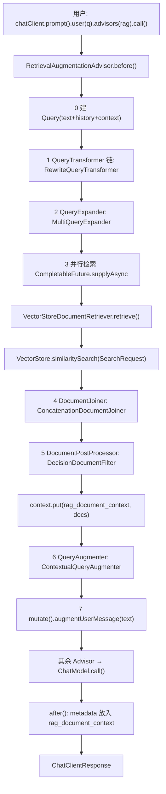
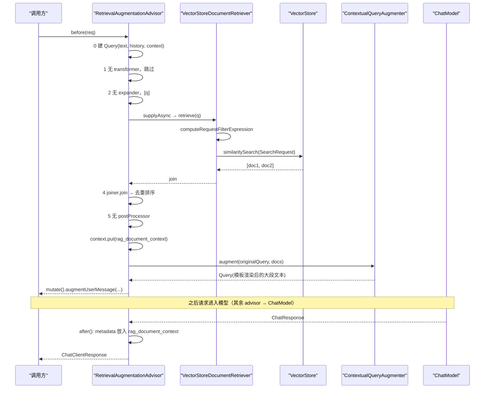
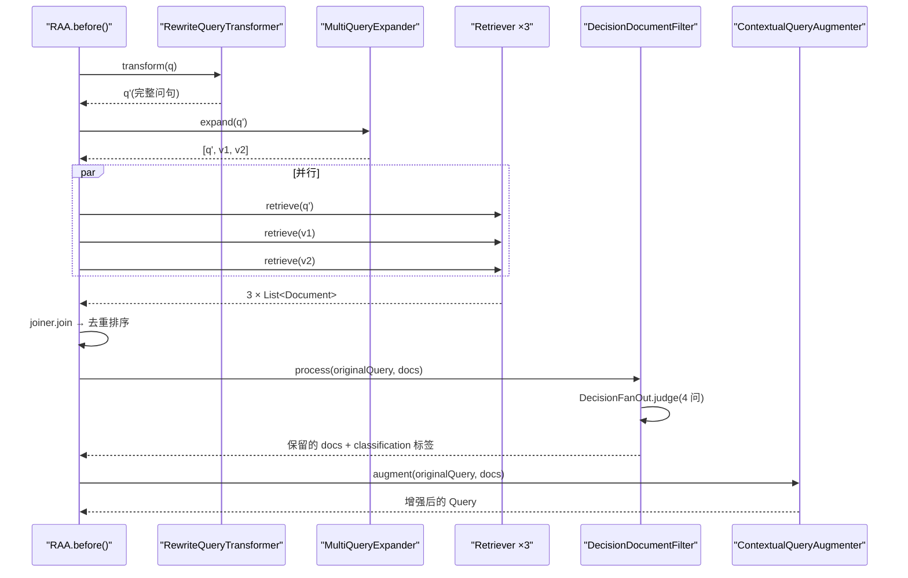

# RAG 检索增强源码解析：QuestionAnswerAdvisor 与 RetrievalAugmentationAdvisor 的七步流水线

> 一句话结论：Spring AI 2.1.0 的 RAG 核心是 `RetrievalAugmentationAdvisor.before()` 里一条编号 0–7 的流水线——建 Query → 改写 → 扩展 → 并行检索 → 合并 → 后处理 → 增强 → 替换用户消息；旧的 `QuestionAnswerAdvisor` 已被它取代，而 2.1.0 新增的 `DecisionDocumentFilter` 用 `DecisionModel` 给每段文档做"相关性/证据/矛盾/注入"四问筛查。
> 阅读前置：读过 [01-toolcalling-工具调用循环源码](01-toolcalling-工具调用循环源码.md) 第 1、2 节，知道 Advisor 的 `before()/after()` 钩子。
> 预计阅读: 45 分钟 ｜ 源码: `spring-ai-rag:2.1.0`、`spring-ai-vector-store:2.1.0`、`spring-ai-model:2.1.0`

---

## 0. 先看现象

### 0.1 三行代码接上一个"开卷考试"

先解释 **RAG（Retrieval-Augmented Generation，检索增强生成）**：大模型像一位"闭卷考试"的考生，只知道训练时学过的东西；RAG 就是在答题前先把相关资料（检索）塞进题目里（增强），让模型"开卷答题"。

下面是一段示例代码（不是源码，仅演示用法）：

```java
// 示例代码：非源码
RetrievalAugmentationAdvisor ragAdvisor = RetrievalAugmentationAdvisor.builder()
    .documentRetriever(VectorStoreDocumentRetriever.builder()
        .vectorStore(vectorStore)          // 一个向量库（PGVector / Redis / Milvus ...）
        .similarityThreshold(0.5)
        .topK(4)
        .build())
    .build();

String answer = chatClient.prompt()
    .user("我们公司的差旅报销标准是多少？")
    .advisors(ragAdvisor)
    .call()
    .content();
```

你只说了一句话，幕后却发生了：

1. `before()` 把这句话包成 `Query`；
2. 拿它去向量库做相似度搜索，取回 4 段最像的文档；
3. 用模板拼出 "Context information is below. …… Query: ……" 一大段；
4. **替换**掉原来的用户消息，再交给模型；
5. `after()` 把命中的文档放进响应 metadata，键为 `rag_document_context`。

### 0.2 几个反直觉的点

1. **用户消息被"篡改"了。** 模型看到的不是"差旅报销标准是多少"，而是几千字的资料 + 问题（[[源码:RetrievalAugmentationAdvisor.java#L150-L153]]）。
2. **检索是并行跑的。** 多个扩展查询用 `CompletableFuture.supplyAsync` 丢进线程池再 `join`（[[源码:RetrievalAugmentationAdvisor.java#L129-L134]]），不是串行。
3. **检索不到 ≠ 报错。** 默认会把用户消息**整个替换**成一句"请礼貌地告诉用户你答不了"（[[源码:ContextualQueryAugmenter.java#L72-L75]]、[[源码:ContextualQueryAugmenter.java#L126-L133]]）。
4. **`QuestionAnswerAdvisor` 已经不是主角。** 2.1.0 的 `spring-ai-rag` 里核心类是 `RetrievalAugmentationAdvisor`；`QuestionAnswerAdvisor` 在 1.0 时代属于 `spring-ai-advisors-vector-store` 模块，其 2.1.0 状态**未入库核实**（见第 7 节）。
5. **2.1.0 的文档过滤是"让模型判断模型"。** `DecisionDocumentFilter` 调一个 `DecisionModel` 对每段文档问四个问题，而不是靠阈值。

### 0.3 AI 概念速览

- **Embedding（向量化）**：把文字变成一串数字（向量），意思相近的向量距离近。
- **Vector Store（向量库）**：存向量并支持"相似度搜索"的数据库。
- **Top-K / Similarity Threshold**：取最相似的前 K 条；相似度低于阈值的丢掉。
- **Query Transform / Expand**：检索前先把问题改写（补全代词）或扩成多个变体，提高召回。
- **Document Joiner**：多路检索结果去重合并。
- **Context Window（上下文窗口）**：模型一次能读的字数上限，所以只能塞 Top-K 而不是全库。
- **Prompt Injection（提示注入）**：文档里藏着"忽略之前的指令"之类的话，诱导模型越轨。
- **DecisionModel**：2.1.0 新增，回答结构化的是/否或选择题并带概率的模型抽象（[[源码:DecisionModel.java#L25-L37]]）。

---

## 1. 整体地图



**读图说明**

| 图中节点 | 对应源码 | 一句话 |
|---|---|---|
| `before()` | [[源码:RetrievalAugmentationAdvisor.java#L107-L154]] | 七步流水线，本篇主线 |
| 建 Query | [[源码:Query.java#L36-L44]] | record：text + history + context |
| 改写 | [[源码:RewriteQueryTransformer.java#L74-L95]] | 用 ChatClient 让模型改写问题 |
| 扩展 | [[源码:MultiQueryExpander.java#L96-L137]] | 让模型生成 N 个变体 |
| 并行检索 | [[源码:RetrievalAugmentationAdvisor.java#L129-L134]] | 线程池 `ai-advisor-`，core 4 / max 16 |
| 检索器 | [[源码:VectorStoreDocumentRetriever.java#L85-L96]] | 构造 `SearchRequest` 调向量库 |
| 合并 | [[源码:ConcatenationDocumentJoiner.java#L46-L64]] | 按 id 去重，按 score 降序 |
| 后处理 | [[源码:DecisionDocumentFilter.java#L151-L207]] | 2.1.0 新增，DecisionModel 四问 |
| 增强 | [[源码:ContextualQueryAugmenter.java#L105-L124]] | 模板渲染 `{context}` `{query}` |
| `after()` | [[源码:RetrievalAugmentationAdvisor.java#L166-L182]] | 文档进响应 metadata |

类比：这像图书馆的**参考咨询员**——先听清你的问题（建 Query），帮你把模糊的问题问准确（改写），从几个角度分别去找书（扩展），同时去几个书架拿（并行检索），把重复的书去掉按相关度排好（合并），把明显不对题或夹带小纸条的书挑走（后处理），最后把资料和你的问题一起交给专家（增强 + 模型）。

---

## 2. 关键类

| 类 / 接口 | 模块 | 职责 | 关键点 |
|---|---|---|---|
| `RetrievalAugmentationAdvisor` | rag | RAG 总调度，实现 `BaseAdvisor` | `final`，`DOCUMENT_CONTEXT="rag_document_context"` |
| `Query` | rag | 检索用的"问题"载体 | record(text, history, context)，`mutate()` 复制修改 |
| `QueryTransformer` | rag | 接口：Query → Query | 默认无 |
| `RewriteQueryTransformer` | rag | 用 LLM 改写问题 | 占位符 `target`、`query` |
| `QueryExpander` | rag | 接口：Query → List\<Query\> | 默认无 |
| `MultiQueryExpander` | rag | 用 LLM 生成 N 个变体 | 默认 N=3，默认包含原查询 |
| `DocumentRetriever` | rag | 接口：Query → List\<Document\> | `Builder` 里必填 |
| `VectorStoreDocumentRetriever` | rag | 向量库检索 | 支持运行时 filter（按租户/用户） |
| `DocumentJoiner` | rag | 接口：合并多路结果 | 默认 `ConcatenationDocumentJoiner` |
| `DocumentPostProcessor` | rag | 接口：过滤/重排 | 默认空 |
| `DecisionDocumentFilter` | rag | DecisionModel 四问筛查 | 2.1.0 新增 |
| `QueryAugmenter` | rag | 接口：(Query, docs) → Query | 默认 `ContextualQueryAugmenter` |
| `SearchRequest` | vector-store | 向量库查询参数 | `topK=4`，`threshold=0.0` |
| `VectorStore` | vector-store | 接口：`similaritySearch` 等 | 2.1.0 新增 `upsert` 默认方法 |
| `Document` | commons | 一段文本 + 元数据 + score | 不可变，用 `mutate()` |
| `DecisionModel` | model | 结构化判断模型 | 2.1.0 新增，`@FunctionalInterface` |

术语解释：

- **Advisor 的 `before/after`**：请求进模型前 / 响应出模型后的两个钩子，RAG 全在 `before` 里发生。
- **`ChatClientRequest.context()`**：Advisor 之间传数据的 `Map`，不是给模型看的。
- **`Filter.Expression`**：向量库的元数据过滤表达式，如 `tenant == 'yunnan'`。

---

## 3. 源码逐段精读

### 3.1 流水线入口

[[源码:RetrievalAugmentationAdvisor.java#L107-L116]]

```java (src: RetrievalAugmentationAdvisor.java#L107-L116)
	public ChatClientRequest before(ChatClientRequest chatClientRequest, @Nullable AdvisorChain advisorChain) {
		Map<String, Object> context = new HashMap<>(chatClientRequest.context());

		// 0. Create a query from the user text, parameters, and conversation history.
		String text = chatClientRequest.prompt().getUserMessage().getText();
		Query originalQuery = Query.builder()
			.text(Objects.requireNonNullElse(text, ""))
			.history(chatClientRequest.prompt().getInstructions())
			.context(context)
			.build();
```

- **在干什么**：拷贝一份 context；取用户消息文本；用 text + 完整历史 + context 构造 `Query`。
- **为什么这么写**：`history` 放进 Query 是为了让后续改写器能看到前文（"它"指什么）；context 拷贝是为了后处理器能往里放 `rag_document_context` 而不污染原请求。
- **如果改成别的会怎样**：不拷贝 context 直接写 → 并发请求共享同一 map 时互相覆盖。
- **常见坑**：用户消息为 null（比如只有 system）时这里兜成 `""`，但 `Query` 的紧凑构造要求 `hasText`，会抛 `IllegalArgumentException`——所以纯 system 请求不要挂 RAG advisor。

### 3.2 步骤 1–2：改写与扩展

[[源码:RetrievalAugmentationAdvisor.java#L118-L126]]

```java (src: RetrievalAugmentationAdvisor.java#L118-L126)
		// 1. Transform original user query based on a chain of query transformers.
		Query transformedQuery = originalQuery;
		for (var queryTransformer : this.queryTransformers) {
			transformedQuery = queryTransformer.apply(transformedQuery);
		}

		// 2. Expand query into one or multiple queries.
		List<Query> expandedQueries = this.queryExpander != null ? this.queryExpander.expand(transformedQuery)
				: List.of(transformedQuery);
```

- **在干什么**：改写器链式串行（前一个输出是后一个输入）；扩展器可选，没有就 `[transformedQuery]`。
- **为什么这么写**：改写是"一对一"（链式），扩展是"一对多"（只有一个），两者职责分开，接口各自单一。
- **如果改成别的会怎样**：允许多个扩展器 → 结果是"多对多"，合并逻辑复杂且难以调试。
- **常见坑**：改写器和扩展器都要额外调一次 LLM，加上主调用至少 3 次模型请求；对延迟敏感的场景别默认开。

### 3.3 步骤 3：并行检索

[[源码:RetrievalAugmentationAdvisor.java#L128-L138]]

```java (src: RetrievalAugmentationAdvisor.java#L128-L138)
		// 3. Get similar documents for each query.
		Map<Query, List<List<Document>>> documentsForQuery = expandedQueries.stream()
			.map(query -> CompletableFuture.supplyAsync(() -> getDocumentsForQuery(query), this.taskExecutor))
			.toList()
			.stream()
			.map(CompletableFuture::join)
			.collect(Collectors.toMap(Map.Entry::getKey, entry -> List.of(entry.getValue())));

		// 4. Combine documents retrieved based on multiple queries and from multiple data
		// sources.
		List<Document> documents = this.documentJoiner.join(documentsForQuery);
```

- **在干什么**：每个 Query 一个异步任务丢进 `taskExecutor`，全部提交后逐个 `join`，结果收集成 `Map<Query, List<List<Document>>>`。
- **为什么这么写**：向量库检索是 I/O，串行 N 个查询要 N 倍延迟；并行后总延迟 ≈ 最慢的那个。`List<List<Document>>` 外层 list 是为将来"一个 Query 多个 retriever"留的余地。
- **如果改成别的会怎样**：先 `join` 再 `map` 就变成串行；用默认 `ForkJoinPool` 则无法定制线程名与上下文传播（见 3.9）。
- **常见坑**：`toMap` 的 key 是 `Query`（record，按值相等）——如果扩展器生成了与原查询完全相同的变体，`toMap` 会抛 `IllegalStateException: Duplicate key`。`MultiQueryExpander` 不过滤重复，这是真实风险。

[[源码:RetrievalAugmentationAdvisor.java#L160-L163]]

```java (src: RetrievalAugmentationAdvisor.java#L160-L163)
	private Map.Entry<Query, List<Document>> getDocumentsForQuery(Query query) {
		List<Document> documents = this.documentRetriever.retrieve(query);
		return Map.entry(query, documents);
	}
```

- **在干什么**：调 retriever，包成 `Map.Entry`。
- **为什么这么写**：抽成一个方法是因为 lambda 里需要返回 `Entry`；`Map.entry` 不允许 null value，retriever 返回 null 会立刻在这里炸，属于 fail-fast。
- **如果改成别的会怎样**：用 `Pair` 或自定义类 → 多一个类，没有收益。
- **常见坑**：自己实现 `DocumentRetriever` 时 `retrieve` 返回 `null` 而不是空 list。

### 3.4 步骤 4–7

[[源码:RetrievalAugmentationAdvisor.java#L140-L154]]

```java (src: RetrievalAugmentationAdvisor.java#L140-L154)
		// 5. Post-process the documents.
		for (var documentPostProcessor : this.documentPostProcessors) {
			documents = documentPostProcessor.process(originalQuery, documents);
		}
		context.put(DOCUMENT_CONTEXT, documents);

		// 6. Augment user query with the document contextual data.
		Query augmentedQuery = this.queryAugmenter.augment(originalQuery, documents);

		// 7. Update ChatClientRequest with augmented prompt.
		return chatClientRequest.mutate()
			.prompt(chatClientRequest.prompt().augmentUserMessage(augmentedQuery.text()))
			.context(context)
			.build();
	}
```

- **在干什么**：合并 → 逐个后处理（注意传的是 `originalQuery`，不是改写/扩展后的）→ 文档放进 context → 增强 → 用 `mutate()` 生成新请求。
- **为什么这么写**：后处理和增强用**原始**问题，是因为判断"这段文档是否相关"、"最后回答什么问题"都应该以用户原话为准，改写只是为了检索。
- **如果改成别的会怎样**：增强时用改写后的查询 → 模型看到的是机器改写的问题，可能丢失用户的细微限定词。
- **常见坑**：`augmentUserMessage` 会**替换**用户消息文本但保留原消息的 metadata；如果用户消息里有图片（media），要确认增强后 media 是否保留——2.1.0 `UserMessage` 的 media 已被 deprecate（[[源码:UserMessage.java#L67-L67]]，具体替代方案未入库核实）。

### 3.5 `after()`：文档去哪了

[[源码:RetrievalAugmentationAdvisor.java#L165-L182]]

```java (src: RetrievalAugmentationAdvisor.java#L165-L182)
	@Override
	public ChatClientResponse after(ChatClientResponse chatClientResponse, @Nullable AdvisorChain advisorChain) {
		ChatResponse.Builder chatResponseBuilder;
		if (chatClientResponse.chatResponse() == null) {
			chatResponseBuilder = ChatResponse.builder();
		}
		else {
			chatResponseBuilder = ChatResponse.builder().from(chatClientResponse.chatResponse());
		}
		Object ctx = chatClientResponse.context().get(DOCUMENT_CONTEXT);
		if (ctx != null) {
			chatResponseBuilder.metadata(DOCUMENT_CONTEXT, ctx);
		}
		return ChatClientResponse.builder()
			.chatResponse(chatResponseBuilder.build())
			.context(chatClientResponse.context())
			.build();
	}
```

- **在干什么**：从 context 取出文档列表，写到 `ChatResponse.metadata`。
- **为什么这么写**：调用方需要"引用了哪些资料"来做前端展示、审计、评估；context 是 Advisor 间的内部通道，metadata 才是对外暴露的。
- **如果改成别的会怎样**：只放 context 不放 metadata → 调用方拿不到引用来源。
- **常见坑**：`chatResponse()==null` 的分支（模型没返回）会造一个空 `ChatResponse`，此时取 metadata 仍可用，但 `content()` 为 null。

### 3.6 默认线程池

[[源码:RetrievalAugmentationAdvisor.java#L194-L202]]

```java (src: RetrievalAugmentationAdvisor.java#L194-L202)
	private static TaskExecutor buildDefaultTaskExecutor() {
		ThreadPoolTaskExecutor taskExecutor = new ThreadPoolTaskExecutor();
		taskExecutor.setThreadNamePrefix("ai-advisor-");
		taskExecutor.setCorePoolSize(4);
		taskExecutor.setMaxPoolSize(16);
		taskExecutor.setTaskDecorator(new ContextPropagatingTaskDecorator());
		taskExecutor.initialize();
		return taskExecutor;
	}
```

- **在干什么**：建一个 `ThreadPoolTaskExecutor`，线程名前缀 `ai-advisor-`，核心 4 最大 16，带 `ContextPropagatingTaskDecorator`。
- **为什么这么写**：`ContextPropagatingTaskDecorator` 把主线程的 ThreadLocal 上下文（Security 的登录用户、MDC、Observation）复制到工作线程——否则 retriever 里取"当前用户"会是 null。
- **如果改成别的会怎样**：去掉 decorator → 工作线程里 `SecurityContextHolder.getContext()` 为空，按用户过滤的检索返回空。
- **常见坑**：`ThreadPoolTaskExecutor` 默认队列容量 `Integer.MAX_VALUE`——意味着**永远只有 4 个线程在工作**（队列不满不会扩到 16）。高并发下检索会排队。

### 3.7 检索器

[[源码:VectorStoreDocumentRetriever.java#L61-L83]]

```java (src: VectorStoreDocumentRetriever.java#L61-L83)
	private final VectorStore vectorStore;

	private final Double similarityThreshold;

	private final Integer topK;

	// Supplier to allow for lazy evaluation of the filter expression,
	// which may depend on the execution content. For example, you may want to
	// filter dynamically based on the current user's identity or tenant ID.
	private final Supplier<Filter.Expression> filterExpression;

	public VectorStoreDocumentRetriever(VectorStore vectorStore, @Nullable Double similarityThreshold,
			@Nullable Integer topK, @Nullable Supplier<Filter.Expression> filterExpression) {
		Assert.notNull(vectorStore, "vectorStore cannot be null");
		Assert.isTrue(similarityThreshold == null || similarityThreshold >= 0.0,
				"similarityThreshold must be equal to or greater than 0.0");
		Assert.isTrue(topK == null || topK > 0, "topK must be greater than 0");
		this.vectorStore = vectorStore;
		this.similarityThreshold = similarityThreshold != null ? similarityThreshold
				: SearchRequest.SIMILARITY_THRESHOLD_ACCEPT_ALL;
		this.topK = topK != null ? topK : SearchRequest.DEFAULT_TOP_K;
		this.filterExpression = filterExpression != null ? filterExpression : () -> null;
	}
```

- **在干什么**：四个字段 + 构造校验 + 默认值兜底。
- **为什么这么写**：`filterExpression` 是 `Supplier` 而不是 `Expression`，因为过滤条件常常依赖"当前请求"（用户、租户），构造 retriever 时还不知道，必须延迟到 `retrieve()` 时求值。
- **如果改成别的会怎样**：改成 `Expression` → 只能静态配置，多租户场景无法按请求隔离。
- **常见坑**：`Supplier` 在**工作线程**里被调用（见 3.6），依赖 ThreadLocal 的过滤条件必须有 decorator 传播。

[[源码:VectorStoreDocumentRetriever.java#L85-L96]]

```java (src: VectorStoreDocumentRetriever.java#L85-L96)
	@Override
	public List<Document> retrieve(Query query) {
		Assert.notNull(query, "query cannot be null");
		var requestFilterExpression = computeRequestFilterExpression(query);
		var searchRequest = SearchRequest.builder()
			.query(query.text())
			.filterExpression(requestFilterExpression)
			.similarityThreshold(this.similarityThreshold)
			.topK(this.topK)
			.build();
		return this.vectorStore.similaritySearch(searchRequest);
	}
```

- **在干什么**：先算过滤表达式，构造 `SearchRequest`，调向量库。
- **为什么这么写**：`SearchRequest` 是 vector-store 模块的通用查询对象，retriever 只是"把 Query 翻译成 SearchRequest"的适配器。
- **如果改成别的会怎样**：直接传字符串 → 无法复用各向量库的统一过滤、阈值逻辑。
- **常见坑**：`topK` 是**每个 Query** 取 K 条，扩展 3 个变体 → 合并前最多 12 条。

[[源码:VectorStoreDocumentRetriever.java#L110-L121]]

```java (src: VectorStoreDocumentRetriever.java#L110-L121)
	private Filter.Expression computeRequestFilterExpression(Query query) {
		var contextFilterExpression = query.context().get(FILTER_EXPRESSION);
		if (contextFilterExpression != null) {
			if (contextFilterExpression instanceof Filter.Expression) {
				return (Filter.Expression) contextFilterExpression;
			}
			else if (StringUtils.hasText(contextFilterExpression.toString())) {
				return new FilterExpressionTextParser().parse(contextFilterExpression.toString());
			}
		}
		return this.filterExpression.get();
	}
```

- **在干什么**：优先用 context 里的 `vector_store_filter_expression`（可以是 `Expression` 对象或文本），否则用构造时的 Supplier。
- **为什么这么写**：让**调用方按请求**覆盖过滤条件（`.toolContext` 风格），比全局配置灵活。
- **如果改成别的会怎样**：去掉 context 优先级 → 每个请求都得新建 retriever。
- **常见坑**：传文本时用 `FilterExpressionTextParser` 解析，语法错误会抛异常；传对象更安全。

### 3.8 增强器

[[源码:ContextualQueryAugmenter.java#L49-L77]]

```java (src: ContextualQueryAugmenter.java#L49-L77)
public final class ContextualQueryAugmenter implements QueryAugmenter {

	private static final Log logger = LogFactory.getLog(ContextualQueryAugmenter.class);

	private static final PromptTemplate DEFAULT_PROMPT_TEMPLATE = new PromptTemplate("""
			Context information is below.

			---------------------
			{context}
			---------------------

			Given the context information and no prior knowledge, answer the query.

			Follow these rules:

			1. If the answer is not in the context, just say that you don't know.
			2. Avoid statements like "Based on the context..." or "The provided information...".

			Query: {query}

			Answer:
			""");

	private static final PromptTemplate DEFAULT_EMPTY_CONTEXT_PROMPT_TEMPLATE = new PromptTemplate("""
			The user query is outside your knowledge base.
			Politely inform the user that you can't answer it.
			""");

	private static final boolean DEFAULT_ALLOW_EMPTY_CONTEXT = false;
```

- **在干什么**：两个默认模板和一个默认开关。
- **为什么这么写**：主模板明确要求"不要用先验知识"、"答不了就说不知道"——这是抑制幻觉的关键；空上下文模板防止模型用训练记忆胡编。
- **如果改成别的会怎样**：删掉规则 1、2 → 模型更容易"根据资料……"这种废话开头，且资料不足时会编。
- **常见坑**：默认模板是英文，中文场景建议自定义模板（`.promptTemplate(...)`），但**必须**保留 `{query}` `{context}` 两个占位符（见构造里的 `PromptAssert`）。

[[源码:ContextualQueryAugmenter.java#L105-L133]]

```java (src: ContextualQueryAugmenter.java#L105-L133)
	@Override
	public Query augment(Query query, List<Document> documents) {
		Assert.notNull(query, "query cannot be null");
		Assert.notNull(documents, "documents cannot be null");

		logger.debug("Augmenting query with contextual data");

		if (documents.isEmpty()) {
			return augmentQueryWhenEmptyContext(query);
		}

		// 1. Collect content from documents.
		String documentContext = this.documentFormatter.apply(documents);

		// 2. Define prompt parameters.
		Map<String, Object> promptParameters = Map.of("query", query.text(), "context", documentContext);

		// 3. Augment user prompt with document context.
		return new Query(this.promptTemplate.render(promptParameters));
	}

	private Query augmentQueryWhenEmptyContext(Query query) {
		if (this.allowEmptyContext) {
			logger.debug("Empty context is allowed. Returning the original query.");
			return query;
		}
		logger.debug("Empty context is not allowed. Returning a specific query for empty context.");
		return new Query(this.emptyContextPromptTemplate.render());
	}
```

- **在干什么**：有文档 → 格式化 → 渲染模板；没文档 → 看开关，要么原样返回，要么渲染"答不了"模板。
- **为什么这么写**：`allowEmptyContext=false` 是保守默认：宁可让模型说"不知道"也不让它自由发挥。
- **如果改成别的会怎样**：默认 true → 检索失败时模型照常用自己的知识回答，用户分不清"有资料"还是"没资料"。
- **常见坑**：`documentFormatter` 默认只拼 `getText()`，不带文档名/来源。想让回答带引用，自定义 formatter 在每段前加 `[doc: id]`。

### 3.9 改写器与扩展器

[[源码:RewriteQueryTransformer.java#L74-L95]]

```java (src: RewriteQueryTransformer.java#L74-L95)
	@Override
	public Query transform(Query query) {
		Assert.notNull(query, "query cannot be null");

		if (logger.isDebugEnabled()) {
			logger.debug("Rewriting query to optimize for querying a " + this.targetSearchSystem + ".");
		}

		var rewrittenQueryText = this.chatClient.prompt()
			.user(user -> user.text(this.promptTemplate.getTemplate())
				.param("target", this.targetSearchSystem)
				.param("query", query.text()))
			.call()
			.content();

		if (!StringUtils.hasText(rewrittenQueryText)) {
			logger.warn("Query rewrite result is null/empty. Returning the input query unchanged.");
			return query;
		}

		return query.mutate().text(rewrittenQueryText).build();
	}
```

- **在干什么**：用 ChatClient 让模型把问题改写成"更适合向量库检索"的形式。
- **为什么这么写**：用户的原话常有代词、省略（"那它的价格呢？"），直接拿去向量化效果差；改写后变成完整、独立的问题。
- **如果改成别的会怎样**：不改写 → 多轮对话中 RAG 命中率显著下降。
- **常见坑**：改写返回空时原样返回并 warn；改写器用的 ChatClient **不应再挂 RAG advisor**，否则递归。

[[源码:MultiQueryExpander.java#L96-L137]]

```java (src: MultiQueryExpander.java#L96-L137)
	@Override
	public List<Query> expand(Query query) {
		Assert.notNull(query, "query cannot be null");

		if (logger.isDebugEnabled()) {
			logger.debug("Generating " + this.numberOfQueries + " query variants");
		}

		var response = this.chatClient.prompt()
			.user(user -> user.text(this.promptTemplate.getTemplate())
				.param("number", this.numberOfQueries)
				.param("query", query.text()))
			.call()
			.content();

		if (response == null) {
			logger.warn("Query expansion result is null. Returning the input query unchanged.");
			return List.of(query);
		}

		var queryVariants = Arrays.asList(response.split("\n"));

		if (CollectionUtils.isEmpty(queryVariants) || this.numberOfQueries != queryVariants.size()) {
			if (logger.isWarnEnabled()) {
				logger.warn("Query expansion result does not contain the requested " + this.numberOfQueries
						+ " variants. Returning the input query unchanged.");
			}
			return List.of(query);
		}

		var queries = queryVariants.stream()
			.filter(StringUtils::hasText)
			.map(queryText -> query.mutate().text(queryText).build())
			.collect(Collectors.toList());

		if (this.includeOriginal) {
			logger.debug("Including the original query in the result");
			queries.add(0, query);
		}

		return queries;
	}
```

- **在干什么**：让模型生成 N 个查询变体，按行切分，数量不符则放弃扩展。
- **为什么这么写**：严格校验数量（`numberOfQueries != queryVariants.size()` → 回退）是因为 LLM 输出不可控，宁可不要也不能拿到脏数据。
- **如果改成别的会怎样**：不校验数量 → 模型多输出一行解释文字也会被当成查询。
- **常见坑**：`includeOriginal=true` 时原查询放在 index 0；若某个变体与原查询**完全相同**，会在 3.3 的 `toMap` 处抛 `Duplicate key`。

### 3.10 合并器

[[源码:ConcatenationDocumentJoiner.java#L46-L64]]

```java (src: ConcatenationDocumentJoiner.java#L46-L64)
	@Override
	public List<Document> join(Map<Query, List<List<Document>>> documentsForQuery) {
		Assert.notNull(documentsForQuery, "documentsForQuery cannot be null");
		Assert.noNullElements(documentsForQuery.keySet(), "documentsForQuery cannot contain null keys");
		Assert.noNullElements(documentsForQuery.values(), "documentsForQuery cannot contain null values");

		logger.debug("Joining documents by concatenation");

		return new ArrayList<>(documentsForQuery.values()
			.stream()
			.flatMap(List::stream)
			.flatMap(List::stream)
			.collect(Collectors.toMap(Document::getId, Function.identity(), (existing, duplicate) -> existing))
			.values()
			.stream()
			.sorted(Comparator.comparingDouble((Document doc) -> doc.getScore() != null ? doc.getScore() : 0.0)
				.reversed())
			.toList());
	}
```

- **在干什么**：两层 `flatMap` 把 `List<List<Document>>` 摊平，`toMap(getId, identity, 保留已有)` 按 id 去重，再按 score 降序。
- **为什么这么写**：多路查询必然有重复文档，`toMap` 的 merge 函数 `(existing, duplicate) -> existing` 保证"第一次出现的留下"。
- **如果改成别的会怎样**：按内容而不是 id 去重 → 同一文档在不同 chunk 里文本不同，去重失效；按 id 但 id 为 null → `toMap` 抛 NPE。
- **常见坑**：`Document.getId()` 为 null（自己构造的 Document 没设 id）会直接 NPE；score 为 null 当 0.0 排最后。

### 3.11 `SearchRequest` 默认值

[[源码:SearchRequest.java#L37-L60]]

```java (src: SearchRequest.java#L37-L60)
public class SearchRequest {

	/**
	 * Similarity threshold that accepts all search scores. A threshold value of 0.0 means
	 * any similarity is accepted or disable the similarity threshold filtering. A
	 * threshold value of 1.0 means an exact match is required.
	 */
	public static final double SIMILARITY_THRESHOLD_ACCEPT_ALL = 0.0;

	/**
	 * Default value for the top 'k' similar results to return.
	 */
	public static final int DEFAULT_TOP_K = 4;

	/**
	 * Default value is empty string.
	 */
	private String query = "";

	private int topK = DEFAULT_TOP_K;

	private double similarityThreshold = SIMILARITY_THRESHOLD_ACCEPT_ALL;

	private Filter.@Nullable Expression filterExpression;
```

- **在干什么**：定义 `topK=4`、`similarityThreshold=0.0`（全接受）。
- **为什么这么写**：阈值默认 0.0 是因为不同向量库的相似度尺度不同（有的 0–1，有的 -1–1，有的是距离而非相似度），框架不敢替你定。
- **如果改成别的会怎样**：默认 0.7 → 对用"距离"的库（越小越好）完全相反，返回空。
- **常见坑**：不设阈值时，即使毫不相关的文档也会被塞进上下文，模型更容易被带偏；务必按你的向量库调阈值。

### 3.12 2.1.0 新增：DecisionDocumentFilter

[[源码:DecisionDocumentFilter.java#L151-L185]]

```java (src: DecisionDocumentFilter.java#L151-L185)
	@Override
	public List<Document> process(Query query, List<Document> documents) {
		Assert.notNull(query, "query must not be null");
		Assert.notNull(documents, "documents must not be null");
		if (documents.isEmpty()) {
			return List.of();
		}

		List<DecisionFanOut.Outcome> outcomes = DecisionFanOut.judge(this.decisionModel, query, documents, QUESTIONS,
				this.options, this.timeout, this.executor);

		List<Document> kept = new ArrayList<>();
		int unscreened = 0;
		DecisionFanOut.Outcome firstUnscreened = null;
		String firstUnscreenedReason = null;
		int unclassified = 0;
		String firstUnclassifiedReason = null;
		for (int i = 0; i < documents.size(); i++) {
			Document document = documents.get(i);
			DecisionFanOut.Outcome outcome = outcomes.get(i);
			// The injection answer is checked on its own, because it alone decides
			// whether the passage may be read at all. A refusal of another question must
			// not hide a clear injection answer, and under failClosed it must not drop a
			// passage the injection answer has cleared.
			String notScreened = outcome.unanswered(CONTAINS_PROMPT_INJECTION);
			if (notScreened != null) {
				unscreened++;
				if (firstUnscreened == null) {
					firstUnscreened = outcome;
					firstUnscreenedReason = notScreened;
				}
				if (!this.failClosed) {
					kept.add(document);
				}
				continue;
```

- **在干什么**：对每段文档并发调 `DecisionModel` 回答四个问题（是否相关、是否含答案证据、是否与问题前提矛盾、是否含提示注入），然后按结果决定丢弃或打标签。
- **为什么这么写**：注释说得很清楚——"注入问题单独检查，因为它独自决定这段话能不能被读"，即注入判断优先级最高，failClosed 时 unanswered 的直接扣下。
- **如果改成别的会怎样**：不单独处理注入 → 一段含注入的文档可能因为"相关"而被放行。
- **常见坑**：`failClosed=false`（默认放行）时，DecisionModel 挂了（API key 错）所有文档都 unscreened 直接通过，只有一条 warn 日志——生产环境要监控这条日志或开 `failClosed`。

[[源码:DecisionDocumentFilter.java#L199-L215]]

```java (src: DecisionDocumentFilter.java#L199-L215)
			if (classification != Classification.EXCLUDED) {
				// The map is copied by hand: Document.mutate() shares the original
				// metadata map, so metadata(key, value) would write into the caller's
				// document.
				Map<String, Object> metadata = new LinkedHashMap<>(document.getMetadata());
				metadata.put(CLASSIFICATION_METADATA_KEY, classification.name());
				kept.add(document.mutate().metadata(metadata).build());
			}
		}
		if (firstUnscreened != null) {
			// Failing open must not be silent. With a bad API key or an outage every
			// passage lands here, and without the warning the injection screen would
			// look as if it had run.
			logger.warn("Could not screen {} of {} documents, {}: {}", unscreened, documents.size(),
					this.failClosed ? "withholding them" : "passing them through unscreened", firstUnscreenedReason);
			if (firstUnscreened.failure() != null) {
				logger.debug("The first decision call that failed", firstUnscreened.failure());
```

- **在干什么**：非 `EXCLUDED` 的文档**手工拷贝** metadata 再加 `decision.classification` 标签；最后如果有 unscreened，打 warn 并记录首个失败原因。
- **为什么这么写**：注释指出 `Document.mutate()` 共享原 metadata map，直接写会污染调用方的对象——这是一个很细的防御性拷贝。
- **如果改成别的会怎样**：用 `document.mutate().metadata(k, v)` → 原文档对象被改，缓存里的文档也带上标签，下次请求行为变化。
- **常见坑**：看到 `Could not screen X of Y documents` 日志不要忽略，它意味着过滤实际没跑。

---

## 4. 完整时序

### 4.1 阻塞调用（单查询，无改写/扩展）



### 4.2 步骤表

| 步骤 | 位置 | 做什么 | 备注 |
|---|---|---|---|
| 0 | RAA L109 | 拷贝 context | `HashMap` 防污染 |
| 0 | L111–L116 | 建原始 Query | text 非空，history = 全部 instructions |
| 1 | L119–L122 | 改写器链 | 串行，每个调一次 LLM |
| 2 | L125–L126 | 扩展 | 可选，调一次 LLM |
| 3 | L129–L134 | 并行检索 + join | `ai-advisor-` 线程池 |
| 3 | VSDR L85–L96 | 构造 SearchRequest 调向量库 | filter 可来自 context |
| 4 | L138 | 合并 | 按 id 去重、score 降序 |
| 5 | L141–L143 | 后处理 | 传 `originalQuery` |
| 5 | L144 | 文档放 context | 键 `rag_document_context` |
| 6 | L147 | 增强 | 空文档时走"答不了"分支 |
| 7 | L150–L153 | 替换用户消息 | `mutate()` 不改原请求 |
| after | L166–L182 | 文档进 metadata | 供调用方展示引用 |

### 4.3 带改写 + 扩展 + 过滤的完整时序



---

## 5. 设计模式

| 模式 | 在哪里 | 体现 |
|---|---|---|
| 管道-过滤器 | RAA 的 0–7 步 | 每一步是一个接口，可替换可跳过 |
| 策略 | Transformer / Expander / Retriever / Joiner / PostProcessor / Augmenter | 六个扩展点 |
| 适配器 | `VectorStoreDocumentRetriever` 把 `Query` 适配成 `SearchRequest` | rag 模块不直接依赖向量库细节 |
| 桥接 | `DocumentRetriever` 接口 × 多种实现 | 同一流水线可接向量库、全文检索、API |
| 建造者 | 所有组件都有 Builder，默认值集中在 Builder 字段 | 与 Advisor 系列风格一致 |
| 值对象 | `Query`、`Document` 都是不可变 record / `mutate()` 复制 | 并行流水线里安全传递 |
| 异步并行 | `CompletableFuture.supplyAsync` + `join` | I/O 密集步骤并行化 |
| 上下文传播 | `ContextPropagatingTaskDecorator` | 把 ThreadLocal 带到工作线程 |

**一个值得学的取舍**：扩展器只有一个，而改写器是一个列表。为什么不对称？因为改写是 1→1 的链，组合是线性的；扩展是 1→N，两个扩展器会得到 N×M 的笛卡尔积，既贵又难调试。框架作者宁可少一个扩展点也不引入组合爆炸。

---

## 6. 踩坑调试

| 现象 | 原因 | 解法 |
|---|---|--- |
| `IllegalArgumentException: text cannot be null or empty` | 用户消息为空/仅空白 | 不要在无用户文本的请求上挂 RAG；或前置一个 advisor 补默认问题 |
| `IllegalStateException: Duplicate key` 在 `toMap` 处 | 扩展出的变体与原查询完全相同 | 自定义 Expander 去重；或关闭 `includeOriginal` |
| 检索总是空 | `similarityThreshold=0.0` 不代表"最低 0"——对用距离的向量库，0 是最严 | 按你的向量库设置阈值（PGVector `<->` 距离越小越好，需看实现文档，**未核实**具体实现） |
| 回答里全是"根据提供的资料……" | 用了默认英文模板且没加规则 | 自定义 promptTemplate，保留 `{query}` `{context}` |
| 检索不到时模型自由发挥 | `allowEmptyContext=true` | 保持默认 false；若开，监控 `Empty context is allowed` DEBUG 日志 |
| 工作线程里取不到登录用户 | 线程池没有上下文传播 | 用默认 `buildDefaultTaskExecutor`；自定义线程池必须加 `ContextPropagatingTaskDecorator` |
| 高并发下检索排队 | 默认线程池队列无界，永远只有 4 线程 | 传入自定义 `TaskExecutor`（Builder 有 `taskExecutor` 方法，**未入库核实**具体签名） |
| 文档里出现 `Could not screen X of Y documents` | DecisionModel 调用失败（key/配额/网络） | 检查 DecisionModel 配置；安全敏感场景开 `failClosed` |
| 引用来源拿不到 | 只看了 `content()` | `chatResponse().getMetadata().get("rag_document_context")` |
| 多轮对话命中率低 | 没配改写器 | 加 `RewriteQueryTransformer`，但注意它用的 ChatClient 不能再挂 RAG |

**调试手法**

1. 开 `logging.level.org.springframework.ai.rag=DEBUG`：能看到 `Rewriting query…`、`Generating N query variants`、`Joining documents by concatenation`、`Augmenting query…`。
2. 在 `before()` 后、模型调用前加一个 `CallAdvisor`（order 比 RAG 小）打印 prompt，肉眼检查增强后的用户消息。
3. 打印 `chatResponse().getMetadata().get(RetrievalAugmentationAdvisor.DOCUMENT_CONTEXT)` 看命中了哪些文档及其 score。
4. 临时 `topK(1)` + `similarityThreshold(0.9)` 验证阈值方向是否正确。

---

## 7. ⚠️ 版本差异（1.0 → 2.x）

| 主题 | 1.0.x | 2.x | 说明 |
|---|---|---|---|
| RAG 入口类 | `QuestionAnswerAdvisor`（`spring-ai-advisors-vector-store`） | `RetrievalAugmentationAdvisor`（`spring-ai-rag`） | 2.x 主推模块化流水线；`QuestionAnswerAdvisor` 在 2.1.0 的状态**未入库核实**（写作规范提及其被取代） |
| 检索 | `VectorStoreDocumentRetriever` + `SearchRequest` | 同，新增 `Filter` 表达式与 context 覆盖 | `FILTER_EXPRESSION` 常量 2.x 存在，引入版本**未核实** |
| 查询改写/扩展 | 无 | `RewriteQueryTransformer`、`MultiQueryExpander` | 2.x 新增（引入版本**未核实**） |
| 文档后处理 | 无 | `DocumentPostProcessor` + `DecisionDocumentFilter`（`@since 2.1.0`） | 2.1.0 新增，依赖 `DecisionModel` |
| `DecisionModel` | 无 | 新模型抽象 | 2.1.0 新增（[[源码:DecisionModel.java#L25-L37]]） |
| 向量库 `upsert` | 无 | `VectorStore.upsert` 默认抛 `UnsupportedOperationException` | 2.1.0 新增（[[源码:VectorStore.java#L80-L82]]） |
| 对话记忆 | `ChatMemory` | deprecate → `SessionService`/`SessionMemoryAdvisor` | 详见 [advisor 篇 §7](../01-ChatClient与模型抽象/02-advisor-链与对话记忆.md) |
| `UserMessage` media | 可用 | deprecated | [[源码:UserMessage.java#L67-L67]]，替代方案**未入库核实** |

> **未验证声明**：1.0.x 列基于公开资料与写作规范，源码未入库。"MCP 2026-07-28 协议"与本篇无关，但同样在已入库源码中未出现，详见 [MCP 篇 §7](../03-MCP与Agent/01-mcp-协议与客户端源码.md)。

---

## 8. 面试问答

**Q1：用一句话说清 RAG 是什么，Spring AI 用哪个类实现？**
检索增强生成：先把相关资料检索出来塞进提示词，再让模型回答。Spring AI 2.x 的核心是 `RetrievalAugmentationAdvisor`，一个 `BaseAdvisor`，在 `before()` 里完成全部检索与增强。

**Q2：`RetrievalAugmentationAdvisor.before()` 的七个步骤是什么？**
0 建 Query；1 改写；2 扩展；3 并行检索；4 合并；5 后处理；6 增强；7 替换用户消息。

**Q3：为什么步骤 5 和 6 传的是 `originalQuery` 而不是改写后的查询？**
改写只是为了检索得更准；判断文档是否相关、最终回答什么问题，都应以用户原话为准，避免改写丢失限定词。

**Q4：检索为什么要并行？用了什么线程池？**
向量库检索是 I/O，N 个变体串行要 N 倍延迟。默认线程池 `ai-advisor-`，core 4 / max 16，带 `ContextPropagatingTaskDecorator` 传播 ThreadLocal。

**Q5：`similarityThreshold` 默认 0.0 是什么意思？为什么不默认 0.7？**
0.0 表示"接受所有"，即关闭阈值过滤。因为不同向量库的相似度尺度不同（有的是距离越小越好），框架不敢替用户定方向。

**Q6：`VectorStoreDocumentRetriever` 的 `filterExpression` 为什么是 `Supplier`？**
过滤条件常依赖当前请求（用户、租户），构造时未知，必须延迟到 `retrieve()` 时求值。另外 context 里的 `vector_store_filter_expression` 可以按请求覆盖它。

**Q7：检索不到文档时默认会发生什么？**
`ContextualQueryAugmenter` 用"空上下文模板"替换用户消息，让模型礼貌地说答不了；`allowEmptyContext=true` 时才原样返回。

**Q8：`ConcatenationDocumentJoiner` 怎么去重和排序？按什么键？**
`toMap(Document::getId, identity, 保留已有)` 按 id 去重，再按 score 降序（null 当 0.0）。

**Q9：命中的文档在响应的哪里能拿到？**
`chatResponse().getMetadata().get("rag_document_context")`，由 `after()` 从 context 搬到 metadata。

**Q10：2.1.0 的 `DecisionDocumentFilter` 做什么？为什么注入判断要单独处理？**
用 `DecisionModel` 对每段文档问四个问题（相关/含证据/矛盾/注入），按策略丢弃或打标签。注入判断单独处理是因为它独自决定"这段话能不能被读"，不能被其他问题的拒绝所掩盖。

**Q11：`failClosed=false` 时 DecisionModel 挂了会怎样？**
所有文档 `unscreened` 直接放行，只打一条 warn。生产要监控这条日志，安全敏感场景开 `failClosed`。

**Q12：默认线程池有什么隐患？**
`ThreadPoolTaskExecutor` 默认队列无界，永远只有 core 4 个线程工作，高并发下排队；需要时传自定义 `TaskExecutor`。

---

## 9. 动手练习

**练习 1：看见增强后的提示词**
挂一个 `SimpleLoggerAdvisor` 或自定义 `CallAdvisor`（order 比 RAG 小），打印发给模型的用户消息。

验收：能看到 `Context information is below.` 和资料内容，后面跟原问题。

**练习 2：调整 Top-K 与阈值**
用 20 段文档入库，分别设 `topK=1/4/10`，`threshold=0.0/0.5/0.8`，观察 `rag_document_context` 的数量与 score。

验收：能解释阈值方向（越大越严还是越严越大）在你的向量库上是哪个方向。

**练习 3：触发"答不了"分支**
问一个知识库里完全没有的问题，观察模型回答。

验收：回答是礼貌拒绝；`rag_document_context` 为空 list。

**练习 4：加改写器提升多轮命中**
先多轮对话："云南有哪些景区？" → "第一个门票多少？"。不加改写器看命中；再加 `RewriteQueryTransformer` 对比。

验收：加改写器后第二轮命中"门票"相关文档；改写器所用 ChatClient 没有挂 RAG（否则递归）。

**练习 5：观察并行线程名**
开 DEBUG 打印 `Thread.currentThread().getName()` 在自定义 `DocumentRetriever` 里。

验收：线程名以 `ai-advisor-` 开头；多个变体时能看到多个不同线程。

---

## 小结

- RAG = 检索 + 增强，Spring AI 2.x 用 `RetrievalAugmentationAdvisor.before()` 的 0–7 步流水线实现。
- 六个扩展点：Transformer（链）、Expander（单个）、Retriever、Joiner、PostProcessor、Augmenter。
- 检索并行（`ai-advisor-` 池，带上下文传播），合并按 id 去重、score 降序，增强用模板替换用户消息，`after()` 把文档搬到 metadata。
- 改写/扩展/后处理/增强都以 `originalQuery` 为基准；检索不到默认让模型说"不知道"。
- 2.1.0 新增 `DecisionDocumentFilter`（DecisionModel 四问，注入单独判断，`failClosed` 可选）与 `VectorStore.upsert`。
- 常见坑：默认阈值 0.0、变体重复导致 `Duplicate key`、线程池只有 4 线程、上下文传播缺失。

---

## 自测题

<details>
<summary>1. `RetrievalAugmentationAdvisor.before()` 第 0 步为什么用 `new HashMap<>(chatClientRequest.context())` 而不直接用原 map？</summary>

后面要往 context 里写 `rag_document_context`；拷贝一份避免修改原请求对象（Advisor 链上其他 advisor 可能还持有它），并行场景下也更安全。
</details>

<details>
<summary>2. 改写器（Transformer）和扩展器（Expander）在数量上有什么不对称？为什么？</summary>

改写器是列表（链式 1→1），扩展器只有一个（1→N）。多个扩展器会产生 N×M 组合爆炸，既贵又难调试。
</details>

<details>
<summary>3. 并行检索的结果类型为什么是 `Map<Query, List<List<Document>>>`（两层 List）？</summary>

外层 List 预留给"一个 Query 多个 retriever"的场景，当前每个 Query 只有一个 retriever，所以是 `List.of(entries)`。
</details>

<details>
<summary>4. `expandedQueries` 里出现两个完全相同的 Query 会发生什么？</summary>

`Collectors.toMap` 抛 `IllegalStateException: Duplicate key`。`MultiQueryExpander` 不去重，`includeOriginal=true` 且某个变体与原查询相同时会触发。
</details>

<details>
<summary>5. 步骤 5 后处理和步骤 6 增强传的是哪个 Query？为什么？</summary>

`originalQuery`（用户原话）。改写只为检索服务；判断相关性和最终回答都应以原话为准，避免改写丢失限定词。
</details>

<details>
<summary>6. `after()` 把文档放到了哪里？调用方怎么取？</summary>

`ChatResponse.metadata`，键 `rag_document_context`。`chatResponse().getMetadata().get(RetrievalAugmentationAdvisor.DOCUMENT_CONTEXT)`。
</details>

<details>
<summary>7. 默认线程池的 core/max 是多少？为什么实际上很难用到 16 个线程？</summary>

core 4 / max 16。`ThreadPoolTaskExecutor` 默认队列无界，任务永远先入队而不是创建新线程，所以实际只有 4 个工作线程。
</details>

<details>
<summary>8. `ContextPropagatingTaskDecorator` 的作用是什么？去掉会怎样？</summary>

把主线程的 ThreadLocal 上下文（Security 登录信息、MDC、Observation）复制到工作线程。去掉后工作线程里取"当前用户"为 null，按用户过滤的检索返回空。
</details>

<details>
<summary>9. `VectorStoreDocumentRetriever` 中过滤表达式的优先级是什么？</summary>

先看 Query context 里的 `vector_store_filter_expression`（`Expression` 对象或可解析文本），没有再用构造时的 `Supplier`。
</details>

<details>
<summary>10. 检索结果为空且 `allowEmptyContext=false` 时，用户消息会变成什么？</summary>

"空上下文模板"渲染出的文本："The user query is outside your knowledge base. Politely inform the user that you can't answer it."——原问题被整个替换掉。
</details>

<details>
<summary>11. `ConcatenationDocumentJoiner` 去重用什么键？重复时保留哪个？score 为 null 怎么排？</summary>

`Document.getId()`；保留先出现的（`(existing, duplicate) -> existing`）；null score 当 0.0 排最后。
</details>

<details>
<summary>12. `DecisionDocumentFilter` 问哪四个问题？哪个优先级最高、为什么？</summary>

是否相关、是否含答案证据、是否与问题前提矛盾、是否含提示注入。注入优先级最高，因为它独自决定"这段话能不能被读"，不能被其他问题的拒绝掩盖。
</details>

<details>
<summary>13. `DecisionDocumentFilter` 为什么手工 `new LinkedHashMap<>(document.getMetadata())` 而不用 `mutate().metadata(k,v)`？</summary>

`Document.mutate()` 共享原 metadata map，直接写会修改调用方（可能是缓存）的原文档对象。
</details>

<details>
<summary>14. 自定义 `ContextualQueryAugmenter` 的 promptTemplate 有什么硬性要求？在哪里校验？</summary>

必须包含 `{query}` 和 `{context}` 两个占位符；构造函数里 `PromptAssert.templateHasRequiredPlaceholders` 校验。
</details>
