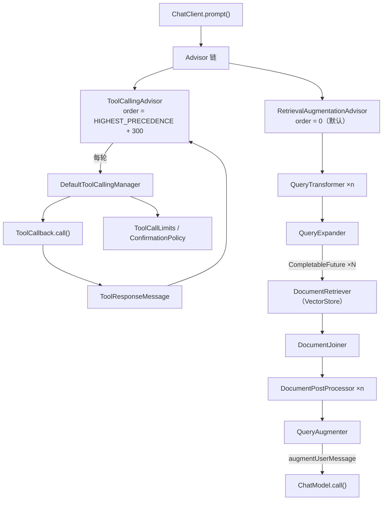

# 02-工具调用与 RAG

> 一句话结论：**工具调用**让模型从"只会说"变成"会动手"（Spring AI 用 `ToolCallingAdvisor` + `DefaultToolCallingManager` 跑一个可拦截的循环）；**RAG** 让模型回答前先去查资料（`RetrievalAugmentationAdvisor` 把"改写 → 扩展 → 检索 → 合并 → 过滤 → 拼提示词"做成一条流水线）。两者都是挂在 Advisor 链上的"横向能力"。

> 阅读前置：[01-ChatClient 与模型抽象](../01-ChatClient与模型抽象/README.md)（Advisor 链、`ChatClient`、`ChatModel`）。
> 源码基线：Spring AI **2.1.0**（`org.springframework.ai:spring-ai-model`、`spring-ai-client-chat`、`spring-ai-rag`、`spring-ai-vector-store`、`spring-ai-commons`）。

## 学习目标

读完本目录，你应该能：

1. 画出"模型要调工具 → 框架执行 → 结果回填 → 模型再想"这个循环的时序图，并指出循环在哪一行开始、哪一行结束、哪一行判 `returnDirect`。
2. 解释 `ToolCallback` / `ToolDefinition` / `ToolMetadata` / `ToolCallbackProvider` 四者的分工，以及 `@Tool` 方法是怎么被 `MethodToolCallback` 包起来的。
3. 说清 `ToolCallingChatOptions.mergeToolCallbacks` 的"运行时优先、不合并"规则，以及为什么重名工具会直接抛异常。
4. 背出 `RetrievalAugmentationAdvisor.before()` 的 7 个步骤，并说明哪一步是并行的、用的是哪个线程池。
5. 知道 `VectorStoreDocumentRetriever` 的过滤表达式可以从 `ToolContext` / `Query.context` 动态取，以及 `Supplier` 版本为什么要"懒加载"。
6. 理解 `ContextualQueryAugmenter` 的两个模板（有上下文 / 无上下文）分别解决什么问题，以及 `allowEmptyContext=false` 时会发生什么。
7. 能区分 `RewriteQueryTransformer`（把对话改成独立问题）与 `MultiQueryExpander`（一个问题变多个）各自的适用场景与失败回退。
8. 知道 2.1 新增的 `DecisionDocumentFilter` 是用 `DecisionModel` 给文档做"相关性 / 证据 / 注入"分类的。

## 整体地图

**读图说明**

- 左边是工具循环：`ToolCallingAdvisor` 内部反复 `copy(chain).nextCall(...)`，每一轮都重读 options、重新问 `ToolCallbackProvider` 要工具。
- 右边是 RAG 流水线：只发生在**请求下行**阶段（`before()`），检索结果一方面拼进用户消息，另一方面放进 `context` 供 `after()` 回填到响应 metadata。
- 两条线互不感知：RAG 可能把"搜索工具"的结果也当作上下文；工具循环里模型也可能决定调一个"检索工具"。
- 线程：工具循环在调用线程；RAG 的多路检索在 `ai-advisor-` 前缀的 `ThreadPoolTaskExecutor` 上并行。

## 两篇摘要

| 文章 | 解决的问题 | 关键类 |
| --- | --- | --- |
| [01-toolcalling-工具调用循环源码.md](01-toolcalling-工具调用循环源码.md) | `ToolCallingAdvisor` 的循环骨架；`DefaultToolCallingManager` 的一批调用执行；`ToolCallLimits` 防死循环；`ToolCallDecisions` 人工确认；`@Tool` 到 `MethodToolCallback` 的映射 | `ToolCallingAdvisor`、`ToolCallingManager`、`DefaultToolCallingManager`、`ToolCallingChatOptions`、`ToolCallback`、`MethodToolCallback`、`ToolCallLimits`、`ToolCallConfirmationPolicy`、`ToolCallDecisions` |
| [02-rag-questionanswer-与-检索增强.md](02-rag-questionanswer-与-检索增强.md) | `RetrievalAugmentationAdvisor` 七步流水线；`VectorStoreDocumentRetriever` 与 `SearchRequest`；`ContextualQueryAugmenter` 模板；`RewriteQueryTransformer` / `MultiQueryExpander`；`DecisionDocumentFilter` | `RetrievalAugmentationAdvisor`、`Query`、`DocumentRetriever`、`VectorStoreDocumentRetriever`、`ContextualQueryAugmenter`、`RewriteQueryTransformer`、`MultiQueryExpander`、`ConcatenationDocumentJoiner`、`DecisionDocumentFilter` |

## 建议阅读顺序

先读 01 把"模型 → 工具 → 模型"的循环打通，再读 02 看"回答前先查资料"。两篇都大量用到 01 目录的 Advisor 链知识。读完后继续 [03-MCP 与 Agent](../03-MCP与Agent/README.md)：MCP 是"工具从哪来"，Agent 是"循环 + 人工确认怎么组合"。

## 学习检查点

- [ ] 能指出 `ToolCallingAdvisor.adviseCall()` 里 `while (isToolCall)` 这一行，并说出跳出循环的三种条件（无 tool call、`returnDirect`、异常）。
- [ ] 能解释 `ToolCallingChatOptions.mergeToolCallbacks` 为什么"运行时优先、不合并"，以及 `validateToolCallbacks` 在什么时机被调。
- [ ] 能说出 `DefaultToolCallingManager` 的默认上限（每工具 40 / 总 150）和两种超限行为。
- [ ] 能画出 `RetrievalAugmentationAdvisor.before()` 的七步，并指出 `CompletableFuture.supplyAsync` 用的 executor 从哪来。
- [ ] 能解释 `VectorStoreDocumentRetriever.filterExpression(Supplier)` 的使用场景（按用户 / 租户动态过滤）。
- [ ] 能说出 `ContextualQueryAugmenter` 在 `documents` 为空且 `allowEmptyContext=false` 时走哪个模板。
- [ ] 能区分 `RewriteQueryTransformer` 与 `MultiQueryExpander`，并各自说出一个失败回退分支。
