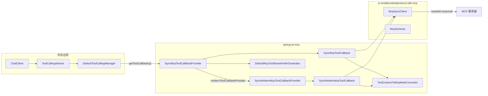
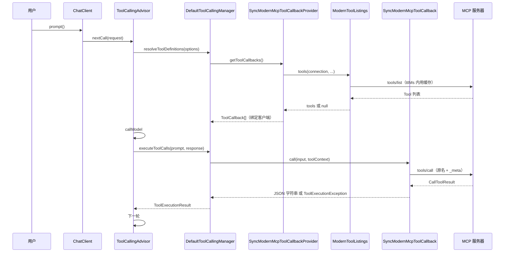

# MCP 协议与客户端源码解析：Spring AI 如何把外部工具服务器接进来

> 一句话结论：MCP 在 Spring AI 里不是一个新概念，只是一条"把别人家的工具搬进 `ToolCallback` 数组"的传送带——`ToolCallbackProvider` 负责"列出"，`ToolCallback` 负责"调用"，中间用工具名前缀防撞车、用 `_meta` 带上下文、用"现代/传统"两套实现对齐两代协议。
> 阅读前置：读过 [工具调用循环](../02-工具调用与RAG/01-toolcalling-工具调用循环源码.md)，知道 `ToolCallback`、`ToolCallingManager`、`ToolCallbackProvider` 是什么。
> 预计阅读: 50 分钟 ｜ 源码: `spring-ai-mcp:2.1.0`（Maven 坐标 `org.springframework.ai:spring-ai-mcp:2.1.0`），配套 `spring-ai-model:2.1.0`；协议本体在 `io.modelcontextprotocol.sdk:mcp:2.2.0`，该 jar 未入库，凡涉及协议常量处均标注"未验证（未入库）"。

## 0. 先看现象

先看一段最常见的用法：应用启动时把一个 MCP 客户端注册进 `ChatClient`，之后模型就能调用 MCP 服务器上的工具，就像调用本地 `@Tool` 方法一样。

```java
// 示例代码：非源码，省略了传输层配置
ToolCallbackProvider provider = SyncMcpToolCallbackProvider.builder()
    .mcpClients(mcpClient)
    .build();

ChatClient chatClient = ChatClient.builder(chatModel)
    .defaultToolCallbacks(provider)   // 注意：注册的是 provider，不是数组
    .build();

String answer = chatClient.prompt("帮我查一下昆明今天的天气")
    .call()
    .content();
```

跑起来后你会看到几件"反直觉"的事：

1. **模型看到的工具名不是服务器上的原名。** 服务器上的 `weather`，到模型那里可能变成 `myserver_weather`。前缀是为了防撞名，但调用时又会换回原名（见 §3.4）。
2. **`getToolCallbacks()` 可能每次请求都走网络。** 传统实现把结果缓存起来直到 `McpToolsChangedEvent` 到来；现代实现则**每次都重新列工具**，而且服务器不可达时**不抛异常**，只是把它的工具悄悄去掉。
3. **协议错误和业务错误走两条路。** 服务器返回 `isError=true`，会变成 `ToolExecutionException`，模型能看到；但 `McpError`（协议层错误）直接向上抛，整个对话失败——源码注释写得很直白："must not be conveyed to the model"。
4. **两代协议并存。** 2.1.0 同时有 `SyncMcpToolCallback`（旧）和 `SyncModernMcpToolCallback`（新，`@since 2.1.0`），而且旧 provider 可以通过 `modernToolCallbackProvider(...)` 把新 provider 挂进来，对外只暴露一个 provider。

**AI 概念速览**

- **MCP（Model Context Protocol）**：Anthropic 提出的开放协议，让模型应用以统一方式连接外部"工具/资源/提示词"提供方。可以把它理解成"AI 世界的 USB 接口"：应用是主机，MCP 服务器是外设。
- **MCP Server / Client**：服务器暴露工具；客户端负责握手（`initialize`）、列工具（`tools/list`）、调工具（`tools/call`）。
- **传输（Transport）**：stdio、HTTP（SSE / 流式）等，协议本身与传输无关。
- **`ToolCallback`**：Spring AI 对"一个可被模型调用的工具"的抽象，核心就两个方法——拿定义、执行。
- **`ToolCallbackProvider`**：按需产出 `ToolCallback[]` 的工厂。`ChatClient` 每次请求都调它一次。
- **`_meta`**：MCP 请求里的一块"附加信息"，Spring AI 用它携带 `ToolContext`。
- **协议版本 "2026-07-28"**：源码注释里称之为 "modern" 协议修订版；本文只引用 Spring AI 侧的注释，协议常量在 SDK jar 里，未验证（未入库）。

## 1. 整体地图



**读图说明**

| 图中节点 | 职责 | 对应源码 |
|---|---|---|
| `SyncMcpToolCallbackProvider` | 旧协议：列出工具、加前缀、缓存、监听变更事件 | `SyncMcpToolCallbackProvider.java` |
| `SyncModernMcpToolCallbackProvider` | 新协议：每请求解析、缓存规则由服务器的 `ttlMs/cacheScope` 决定、不可达冷却 | `SyncModernMcpToolCallbackProvider.java` |
| `SyncMcpToolCallback` / `SyncModernMcpToolCallback` | 一个 MCP 工具 = 一个 `ToolCallback`；把 JSON 参数转成请求、把结果转回字符串 | 同名 `.java` |
| `DefaultMcpToolNamePrefixGenerator` | 保证跨连接工具名唯一，重复时加 `alt_N_` | `DefaultMcpToolNamePrefixGenerator.java` |
| `ToolContextToMcpMetaConverter` | 把 `ToolContext` 变成请求里的 `_meta` | `ToolContextToMcpMetaConverter.java` |
| `McpSyncClient` / `McpSchema` | MCP Java SDK，协议本体 | 未入库 |

关键一点：**左边（Advisor → Manager）完全是 02 篇讲过的通用循环，它根本不知道工具来自 MCP。** MCP 模块只做了"适配"，把外部工具伪装成本地 `ToolCallback`。

## 2. 关键类

| 类 | 所在包 | 职责 | 关键点 |
|---|---|---|---|
| `ToolCallbackProvider` | `org.springframework.ai.tool` | 每次请求产出工具数组 | `defaultToolCallbacks(provider)` 注册它而非数组 |
| `SyncMcpToolCallbackProvider` | `org.springframework.ai.mcp` | 旧协议 provider | 双重检查锁缓存；实现 `ApplicationListener<McpToolsChangedEvent>` |
| `AsyncMcpToolCallbackProvider` | 同上 | 异步版旧 provider | 可挂 `modernToolCallbackProvider` |
| `SyncMcpToolCallback` | `org.springframework.ai.mcp` | 旧协议工具回调 | 调用用原名；`McpError` 直接抛 |
| `SyncModernMcpToolCallbackProvider` | `org.springframework.ai.mcp.modern.client` | 新协议 provider | `Ordered`，`getOrder()` 为最高优先级；不可达 30s 冷却 |
| `SyncModernMcpToolCallback` | 同上 | 新协议工具回调 | `ToolSpec` 预先绑定客户端；支持 `toolCallCustomizer` |
| `SyncModernMcpConnection` | 同上 | "一条连接 + 谁来服务当前请求"的规则 | `shared` / `perRequest` / `scoped` 三种工厂 |
| `SyncModernMcpClientScope` | 同上 | 按用户等维度选客户端 | 函数式接口，典型用法 `ConcurrentHashMap` 按用户名缓存 |
| `ModernToolListings` | 同上 | 新协议工具列表的缓存/冷却簿记 | 包私有；`UNAVAILABLE_HTTP_STATUSES = {408, 429}` |
| `McpToolNamePrefixGenerator` / `Default…` | `org.springframework.ai.mcp` | 工具名前缀策略 | 幂等：同一 (client, server, tool) 只生成一次 |
| `McpToolUtils` | 同上 | 前缀拼接、格式化、截断 | 超过 64 字符取**末尾** 64 个 |
| `McpToolFilter` | 同上 | 过滤哪些工具暴露给模型 | `BiPredicate<McpConnectionInfo, Tool>` |
| `ToolContextToMcpMetaConverter` | 同上 | `ToolContext` → `_meta` | 默认过滤 `exchange` 键与 null 值 |
| `McpToolsChangedEvent` | 同上 | 工具列表变更事件 | 旧 provider 收到后清缓存 |
| `McpSchemaConverter` | `org.springframework.ai.mcp.modern` | 旧/新 `McpSchema` 类型互转 | 靠 JSON 往返；新字段 `resultType/ttlMs/cacheScope` 取默认值 |
| `McpConnectionInfo` | `org.springframework.ai.mcp` | 客户端能力 + 双方信息 | record |

**术语解释**

- **前缀（prefix）**：给工具名加一段命名空间，避免两个服务器都有 `search` 时撞车。
- **冷却（cool-down）**：服务器不可达后一段时间内不再去问它，避免每个请求都卡满超时。
- **`ttlMs` / `cacheScope`**：新协议里服务器告诉客户端"这份工具列表能缓存多久、能不能在调用者之间共享"。
- **`ToolSpec`**：SDK 里"预先绑定到某个客户端、某个工具"的调用规格，每次调用只需填参数。

## 3. 源码逐段精读

### 3.1 旧 provider：缓存 + 双重检查锁

[[源码:SyncMcpToolCallbackProvider.java#L143-L184]]

```java (src: SyncMcpToolCallbackProvider.java#L143-L184)
	@Override
	public ToolCallback[] getToolCallbacks() {

		if (this.invalidateCache) {
			this.lock.lock();
			try {
				if (this.invalidateCache) {
					this.cachedToolCallbacks = this.mcpClients.stream()
						.flatMap(mcpClient -> mcpClient.listTools()
							.tools()
							.stream()
							.filter(tool -> this.toolFilter.test(connectionInfo(mcpClient), tool))
							.<ToolCallback>map(tool -> SyncMcpToolCallback.builder()
								.mcpClient(mcpClient)
								.tool(tool)
								.prefixedToolName(
										this.toolNamePrefixGenerator.prefixedToolName(connectionInfo(mcpClient), tool))
								.toolContextToMcpMetaConverter(this.toolContextToMcpMetaConverter)
								.build()))
						.toList();

					this.validateToolCallbacks(this.cachedToolCallbacks);
					this.invalidateCache = false;
				}
			}
			finally {
				this.lock.unlock();
			}
		}

		List<ToolCallback> toolCallbacks = this.cachedToolCallbacks;

		if (this.modernToolCallbackProvider != null) {
			// Modern callbacks are bound to the client that serves the current request,
			// so they are resolved on every call and are not part of the cache.
			toolCallbacks = new ArrayList<>(toolCallbacks);
			toolCallbacks.addAll(List.of(this.modernToolCallbackProvider.getToolCallbacks()));
			this.validateToolCallbacks(toolCallbacks);
		}

		return toolCallbacks.toArray(new ToolCallback[0]);
	}
```

- **在干什么**：`invalidateCache` 为真时加锁，遍历所有客户端 `listTools()`，过滤、生成前缀名、构建 `SyncMcpToolCallback`，校验后写入缓存并把标志清零。末尾如果挂了现代 provider，则**每次**都把它的结果追加进来再校验一遍。
- **为什么这么写**：`ChatClient` 每个请求都会调 `getToolCallbacks()`，而 `listTools()` 是网络调用，所以必须缓存；但工具可能在运行期变化，所以留了 `invalidateCache()` 和事件监听两个口子。现代回调"绑定到服务当前请求的客户端"，天然不能缓存，所以放在锁外面每次解析。
- **如果改成别的会怎样**：去掉锁 → 两个请求同时发现缓存失效，各做一次 `listTools`，浪费且可能短暂出现两份不同列表；把现代 provider 也塞进缓存 → 按用户 scoped 的连接会拿到别人的工具列表。
- **常见坑**：以为 `defaultToolCallbacks(provider)` 只调一次；实际上 `ToolCallingAdvisor` 每轮都会重读 options（见 02 篇 §3.1），所以 provider 的 `getToolCallbacks()` 必须快且幂等。

### 3.2 旧回调：调用时换回原名

[[源码:SyncMcpToolCallback.java#L106-L158]]

```java (src: SyncMcpToolCallback.java#L106-L158)
	@Override
	public String call(String toolCallInput) {
		return this.call(toolCallInput, null);
	}

	@Override
	public String call(String toolCallInput, @Nullable ToolContext toolContext) {

		// Handle the possible null parameter situation in streaming mode.
		if (!StringUtils.hasText(toolCallInput)) {
			if (logger.isWarnEnabled()) {
				logger.warn("Tool call arguments are null or empty for MCP tool: " + this.tool.name()
						+ ". Using empty JSON object as default.");
			}
			toolCallInput = "{}";
		}

		Map<String, Object> arguments = jsonHelper.fromJsonToMap(toolCallInput);

		CallToolResult response;
		try {
			var mcpMeta = toolContext != null ? this.toolContextToMcpMetaConverter.convert(toolContext) : null;

			// Use the original tool name, not the prefixed one from getToolDefinition
			var request = CallToolRequest.builder(this.tool.name()).arguments(arguments).meta(mcpMeta).build();

			// Note that we use the original tool name here, not the adapted one from
			// getToolDefinition
			response = this.mcpClient.callTool(request);
		}
		catch (McpError ex) {
			// A protocol-level error indicates the tool invocation itself failed and
			// must not be conveyed to the model. Rethrow it as a hard failure, mirroring
			// how @Tool treats checked exceptions and Errors. Since the tool calling
			// manager only handles ToolExecutionException, this bubbles up and fails the
			// model interaction.
			logger.error("Protocol error while calling tool: ", ex);
			throw ex;
		}
		catch (Exception ex) {
			logger.error("Exception while tool calling: ", ex);
			throw new ToolExecutionException(this.getToolDefinition(), ex);
		}

		if (response.isError() != null && response.isError()) {
			if (logger.isErrorEnabled()) {
				logger.error("Error calling tool: " + response.content());
			}
			throw new ToolExecutionException(this.getToolDefinition(),
					new IllegalStateException("Error calling tool: " + response.content()));
		}
		return jsonHelper.toJson(response.content());
	}
```

- **在干什么**：空参数兜底为 `{}`；JSON 转 Map；用 `this.tool.name()`（**原名**）构造 `CallToolRequest`，附上 `_meta`；`McpError` 原样抛，其它异常包成 `ToolExecutionException`；`isError` 也包成 `ToolExecutionException`；最后把 `content()` 序列化为 JSON 字符串返回。
- **为什么这么写**：模型只知道带前缀的名字，但服务器只认原名，所以 `ToolDefinition` 用前缀名、请求用原名，这就是"两套名字"的设计。协议错误直接抛是为了不让模型"看到"一个它无法处理的底层故障然后开始编。
- **如果改成别的会怎样**：把 `McpError` 也包成 `ToolExecutionException` → 模型会收到"工具失败"并可能重试，掩盖真正的配置/协议问题；把 `isError` 不抛 → 模型拿到一段错误文本但不知道这是错误。
- **常见坑**：流式模式下参数可能为 null（注释原话 "Handle the possible null parameter situation in streaming mode"），所以第一行就兜底。

### 3.3 前缀生成：幂等 + 撞名加 `alt_N_`

[[源码:DefaultMcpToolNamePrefixGenerator.java#L55-L87]]

```java (src: DefaultMcpToolNamePrefixGenerator.java#L55-L87)
	// generate a unique tool name only once and return the same name on later calls.
	private final Map<ConnectionId, String> existingConnections = new ConcurrentHashMap<>();

	private final Set<String> allUsedToolNames = ConcurrentHashMap.newKeySet();

	private final AtomicInteger counter = new AtomicInteger(1);

	@Override
	public String prefixedToolName(McpConnectionInfo mcpConnectionInfo, McpSchema.Tool tool) {
		var serverInfo = mcpConnectionInfo.initializeResult() != null
				? mcpConnectionInfo.initializeResult().serverInfo() : null;
		ConnectionId connectionId = new ConnectionId(mcpConnectionInfo.clientInfo(), serverInfo, tool);

		return this.existingConnections.computeIfAbsent(connectionId, id -> uniqueToolName(tool));
	}

	private String uniqueToolName(McpSchema.Tool tool) {
		String uniqueToolName = McpToolUtils.format(tool.name());
		if (!this.allUsedToolNames.add(uniqueToolName)) {
			uniqueToolName = "alt_" + this.counter.getAndIncrement() + "_" + uniqueToolName;
			this.allUsedToolNames.add(uniqueToolName);
			if (logger.isWarnEnabled()) {
				logger.warn("Tool name '" + tool.name() + "' already exists. Using unique tool name '" + uniqueToolName
						+ "'");
			}
		}
		return uniqueToolName;
	}

	private record ConnectionId(@Nullable Implementation clientInfo, @Nullable Implementation serverInfo, Tool tool) {
	}

}
```

- **在干什么**：用 `(clientInfo, serverInfo, tool)` 组成 `ConnectionId` 做 key，`computeIfAbsent` 保证同一连接同一工具只生成一次；名字已被占用则改成 `alt_1_xxx`、`alt_2_xxx` 并打 warn。
- **为什么这么写**：模型供应商大多限制工具名字符集与长度，前缀生成器既要保证唯一又要稳定——同一工具每次请求都得拿到同一个名字，否则模型上一轮学到的名字这一轮就失效了。
- **如果改成别的会怎样**：用随机后缀 → 每次重启名字都变，缓存与日志对不上；不加锁 → 并发下两个连接同时发现重名，可能拿到同一个 `alt_N`。
- **常见坑**：`McpToolUtils.prefixedToolName` 超过 64 字符时**保留末尾**，前缀可能被截掉，看日志时对不上服务器。

`McpToolUtils.prefixedToolName` 的截断逻辑：

[[源码:McpToolUtils.java#L92-L111]]

```java (src: McpToolUtils.java#L92-L111)
	public static String prefixedToolName(String prefix, @Nullable String title, String toolName) {

		if (StringUtils.isEmpty(prefix) || StringUtils.isEmpty(toolName)) {
			throw new IllegalArgumentException("Prefix or toolName cannot be null or empty");
		}

		String input = shorten(format(prefix));
		if (!StringUtils.isEmpty(title)) {
			input = input + "_" + format(title); // Do not shorten the title.
		}

		input = input + "_" + format(toolName);

		// If the string is longer than 64 characters, keep the last 64 characters
		if (input.length() > 64) {
			input = input.substring(input.length() - 64);
		}

		return input;
	}
```

- **在干什么**：`prefix_title_toolName` 拼接后，长度大于 64 就取最后 64 个字符。
- **为什么这么写**：工具名对模型来说是 token，越短越好；截前缀比截工具名安全，因为工具名是服务器真正要匹配的。
- **如果改成别的会怎样**：截末尾 → 两个不同服务器的同名工具前缀不同、名字相同，撞车。
- **常见坑**：`prefix` 或 `toolName` 为空直接抛 `IllegalArgumentException`，不是静默跳过。

### 3.4 新协议 provider：每请求解析，不可达不失败

[[源码:SyncModernMcpToolCallbackProvider.java#L139-L175]]

```java (src: SyncModernMcpToolCallbackProvider.java#L139-L175)
	@Override
	public ToolCallback[] getToolCallbacks() {
		List<ToolCallback> toolCallbacks = new ArrayList<>();
		for (SyncModernMcpConnection connection : this.connections) {
			McpModernConnectionInfo connectionInfo = connection.info();
			if (this.listings.isCoolingDown(connection)) {
				continue;
			}
			McpSyncClient mcpClient = connection.client();
			List<Tool> tools = this.listings.tools(connection, connectionInfo, connection.clientPerRequest(), mcpClient,
					SyncModernMcpToolCallbackProvider::list);
			if (tools == null) {
				// The server cannot be reached.
				continue;
			}
			for (Tool tool : tools) {
				if (this.toolFilter.test(connectionInfo, tool)) {
					SyncModernMcpToolCallback.Builder toolCallback = SyncModernMcpToolCallback.builder()
						.mcpClient(mcpClient)
						.tool(tool)
						.prefixedToolName(this.toolNamePrefixGenerator.prefixedToolName(connectionInfo, tool))
						.toolContextToMcpMetaConverter(this.toolContextToMcpMetaConverter)
						.connectionInfo(connectionInfo);
					if (this.toolCallCustomizer != null) {
						toolCallback.toolCallCustomizer(this.toolCallCustomizer);
					}
					toolCallbacks.add(toolCallback.build());
				}
			}
		}
		List<String> duplicateToolNames = ToolUtils.getDuplicateToolNames(toolCallbacks);
		if (!duplicateToolNames.isEmpty()) {
			throw new IllegalStateException(
					"Multiple tools with the same name (%s)".formatted(String.join(", ", duplicateToolNames)));
		}
		return toolCallbacks.toArray(new ToolCallback[0]);
	}
```

- **在干什么**：遍历连接，冷却中跳过；向连接要当前请求的客户端；由 `ModernToolListings` 决定用缓存还是去服务器拿（返回 null 表示不可达，直接 `continue`）；过滤后为每个工具构建回调，绑定客户端、连接信息与可选 customizer；最后用 `ToolUtils.getDuplicateToolNames` 查重，重名抛 `IllegalStateException`。
- **为什么这么写**：新协议里"谁来服务请求"是动态的（按用户、按请求），所以回调不能复用；一个服务器挂了不应该拖垮其它服务器，所以不可达就跳过；但鉴权失败等"必须让人处理"的错误照常抛出（见类注释 §3.6）。
- **如果改成别的会怎样**：缓存回调 → 用户 B 可能用到用户 A 的客户端凭证；不可达就抛异常 → 一个无关的 MCP 服务器宕机会让整个应用的所有对话失败。
- **常见坑**：类注释明确要求用 `defaultToolCallbacks(provider)` 注册 **provider**，而不是把它返回的数组注册进去——数组是某一瞬间的快照，绑定的是某个具体客户端。

类注释里关于缓存规则与不可达处理的原话（这段是理解新协议的钥匙）：

[[源码:SyncModernMcpToolCallbackProvider.java#L48-L78]]

```java (src: SyncModernMcpToolCallbackProvider.java#L48-L78)
 * The server decides how long a tool listing may be kept and who may share it, with the
 * {@code ttlMs} and {@code cacheScope} of the listing:
 * <ul>
 * <li>A listing with a {@code ttlMs} of zero is never kept, and every call to
 * {@link #getToolCallbacks()} lists the tools again. Servers send zero unless configured
 * otherwise.</li>
 * <li>A {@code public} listing is the same for every caller. The provider keeps it for
 * its {@code ttlMs} and uses it for all requests, whichever client serves them.</li>
 * <li>A {@code private} listing may differ from caller to caller, so the provider does
 * not keep it. It is only kept by a client that outlives a request, as the client of a
 * {@link SyncModernMcpConnection#shared shared} connection does, or the client that a
 * {@link SyncModernMcpConnection#scoped scoped} connection keeps for a user. Use a shared
 * connection when the application calls the server under a single identity.</li>
 * </ul>
 * A tool call is never served from a kept listing: it always goes to the server, through
 * the client of the request that resolved the callback.
 * <p>
 * A kept listing is used until its {@code ttlMs} has passed. To drop it as soon as the
 * server reports that its tools changed, register the provider as a listener of a
 * {@link SyncModernMcpChangeSubscriber}, which keeps a listen stream open to the server.
 * <p>
 * A server that cannot be reached does not fail the call: its tools are left out and a
 * warning is logged, so the tools of the other connections stay usable. A server counts
 * as unreachable when the connection cannot be established, the exchange times out or
 * breaks, or the server answers with a {@code 5xx}, {@code 408} or {@code 429} status.
 * Every other failure is thrown, in particular an authorization failure, so that the
 * application can ask the user to log in again.
 * <p>
 * A server that could not be reached is not asked again until a cool-down time has passed
 * (30 seconds unless set otherwise). Otherwise a server that accepts connections but does
 * not answer would hold up every request for the whole timeout of the listing.
```

- **在干什么**：文档化了三件事——`ttlMs=0` 不缓存、`public` 列表 provider 会按 `ttlMs` 保留并给所有请求用、`private` 列表只由活得比请求久的客户端保留；工具调用永远不走缓存；不可达（5xx/408/429/超时/断连）不失败但进入 30 秒冷却。
- **为什么这么写**：把策略写进接口文档而不是藏在实现里，是因为调用方要据此选择 `shared` 还是 `perRequest` 连接。
- **如果改成别的会怎样**：如果不冷却，一个"接受连接但不响应"的服务器会让每个请求都等满超时。
- **常见坑**：鉴权失败（非 5xx/408/429）会抛出，这是故意的——"so that the application can ask the user to log in again"。

### 3.5 连接：谁服务当前请求

[[源码:SyncModernMcpConnection.java#L61-L90]]

```java (src: SyncModernMcpConnection.java#L61-L90)

	/**
	 * Returns the client that serves the current request.
	 * @return the client
	 */
	McpSyncClient client();

	/**
	 * Returns a client for what the application does for itself, outside of any request:
	 * a listen stream, or listing the tools, prompts or resources after the server
	 * reported a change. The caller keeps the client for as long as it needs it. By
	 * default this is {@link #client()}.
	 * @return the client
	 */
	default McpSyncClient applicationClient() {
		return this.client();
	}

	/**
	 * Whether a client of this connection serves one request only, so that nothing it
	 * keeps, such as a tool listing that the server marks as {@code private}, lasts
	 * beyond that request. {@link SyncModernMcpToolCallbackProvider} uses the answer to
	 * tell when such a listing could be kept with another kind of connection.
	 * @return {@code true} if {@link #client()} returns a new client each time,
	 * {@code false} by default
	 */
	default boolean clientPerRequest() {
		return false;
	}

```

- **在干什么**：`client()` 返回服务当前请求的客户端；`applicationClient()` 给应用自己用（监听变更流等），默认等于 `client()`；`clientPerRequest()` 告诉 provider 这个客户端是否只活一个请求。
- **为什么这么写**：把"连接"和"客户端生命周期"解耦。`shared` 适合单一身份；`perRequest` 天然隔离；`scoped` 配合 `SyncModernMcpClientScope` 可以按用户保留客户端，从而让 `private` 列表也能被缓存。
- **如果改成别的会怎样**：如果没有 `applicationClient()`，一个 `perRequest` 连接在后台开监听流时会不断创建新客户端，流永远建不起来。
- **常见坑**：`scoped` 的 scope 必须返回**本连接工厂**建的客户端，返回别的连接的客户端会被拒绝（接口注释 L117-L130）。

### 3.6 新回调：`ToolSpec` 预绑定 + customizer

[[源码:SyncModernMcpToolCallback.java#L125-L160]]

```java (src: SyncModernMcpToolCallback.java#L125-L160)
	@Override
	public String call(String toolCallInput, @Nullable ToolContext toolContext) {

		Map<String, Object> arguments = ModernToolCalls.arguments(toolCallInput);

		CallToolResult result;
		try {
			McpSyncClient.ToolSpec callSpec = this.toolSpec.arguments(arguments)
				.meta(ModernToolCalls.requestMeta(this.toolContextToMcpMetaConverter, toolContext));
			if (this.toolCallCustomizer != null && this.connectionInfo != null) {
				callSpec = this.toolCallCustomizer.customize(this.connectionInfo, callSpec, toolContext);
				Assert.state(callSpec != null, "toolCallCustomizer must not return null");
			}
			result = callSpec.call();
		}
		catch (McpException ex) {
			// A protocol-level error of the server indicates the tool invocation itself
			// failed and must not be conveyed to the model. Rethrow it as a hard failure,
			// as the legacy callbacks do with their protocol errors. Since the tool
			// calling manager only handles ToolExecutionException, this bubbles up and
			// fails the model interaction.
			logger.error("Protocol error while calling tool: " + this.tool.name(), ex);
			throw ex;
		}
		catch (Exception ex) {
			logger.error("Exception while calling tool: " + this.tool.name(), ex);
			throw new ToolExecutionException(this.getToolDefinition(), ex);
		}

		if (Boolean.TRUE.equals(result.isError())) {
			throw new ToolExecutionException(this.getToolDefinition(),
					new IllegalStateException("Error calling tool: " + result.content()));
		}

		return ModernToolCalls.toModelResponse(result);
	}
```

- **在干什么**：参数转 Map；`toolSpec.arguments(...).meta(...)` 派生出本次调用的规格；若有 customizer 则再改一改（不得返回 null）；`call()`；`McpException` 原样抛，其它异常包成 `ToolExecutionException`；`isError` 同样包；返回 `ModernToolCalls.toModelResponse(result)`。
- **为什么这么写**：`ToolSpec` 在构造时就绑定了"哪个客户端、哪个工具"（`mcpClient.tool(tool)`），而且注释说"每个请求会问好几次定义"，所以 `toolDefinition` 只建一次。customizer 让你在不改 SDK 的情况下塞鉴权头、改 `_meta`。
- **如果改成别的会怎样**：把 `McpException` 吞掉 → 协议错误被当作"工具失败"喂给模型；不预建 `ToolSpec` → 每次调用都要重新解析工具定义。
- **常见坑**：构造器断言"设置了 customizer 就必须有 connectionInfo"，否则 builder 阶段就报错。

### 3.7 `_meta` 与结果格式

[[源码:ModernToolCalls.java#L63-L117]]

```java (src: ModernToolCalls.java#L63-L117)
			.name(prefixedToolName)
			.description(tool.description())
			.inputSchema(JsonSchemaUtils.ensureValidInputSchema(jsonHelper.toJson(tool.inputSchema())))
			.build();
	}

	/**
	 * The arguments of a tool call. A streaming model may send no arguments at all.
	 * @param toolCallInput the arguments as the model sent them
	 * @return the arguments
	 */
	static Map<String, Object> arguments(String toolCallInput) {
		return jsonHelper.fromJsonToMap(StringUtils.hasText(toolCallInput) ? toolCallInput : "{}");
	}

	/**
	 * The {@code _meta} entries of a request: the {@link ToolContext} entries without the
	 * keys the modern client sets itself.
	 * @param toolContextToMcpMetaConverter turns the tool context into {@code _meta}
	 * entries
	 * @param toolContext the tool context of the call, if any
	 * @return the {@code _meta} entries
	 */
	static Map<String, Object> requestMeta(ToolContextToMcpMetaConverter toolContextToMcpMetaConverter,
			@Nullable ToolContext toolContext) {
		if (toolContext == null) {
			return Map.of();
		}
		Map<String, Object> meta = new LinkedHashMap<>();
		toolContextToMcpMetaConverter.convert(toolContext).forEach((key, value) -> {
			if (!MetaKeys.PROGRESS_TOKEN.equals(key) && !key.startsWith(RESERVED_META_PREFIX)) {
				meta.put(key, value);
			}
		});
		return meta;
	}

	/**
	 * The text returned to the model. A result without structured content is returned as
	 * the JSON of its content blocks, like the legacy callbacks do. A result with
	 * structured content is returned as a JSON object that holds both.
	 * @param result the result of the tool call
	 * @return the text for the model
	 */
	static String toModelResponse(CallToolResult result) {
		if (result.structuredContent() == null) {
			return jsonHelper.toJson(result.content());
		}
		Map<String, Object> response = new LinkedHashMap<>();
		response.put("content", result.content());
		response.put("structuredContent", result.structuredContent());
		return jsonHelper.toJson(response);
	}

}
```

- **在干什么**：`requestMeta` 把 `ToolContext` 转成 `_meta`，但剔除 progress token 和以 `io.modelcontextprotocol/` 开头的保留键；`toModelResponse` 在有 `structuredContent` 时返回 `{content, structuredContent}` 的 JSON，否则像旧回调一样只返回 `content` 的 JSON。
- **为什么这么写**：保留前缀是 SDK 自己要用的，应用若覆盖会破坏协议；结构化内容单独放，方便下游解析又不丢文本块。
- **如果改成别的会怎样**：允许应用写保留键 → 可能伪造 SDK 内部状态；不返回 `structuredContent` → 新协议服务器的结构化输出被丢弃。
- **常见坑**：`toolContext == null` 时返回 `Map.of()`（不可变），customizer 里若直接 `put` 会抛 `UnsupportedOperationException`。

旧回调的 `_meta` 转换器：

[[源码:ToolContextToMcpMetaConverter.java#L44-L68]]

```java (src: ToolContextToMcpMetaConverter.java#L44-L68)
	Map<String, Object> convert(ToolContext toolContext);

	static ToolContextToMcpMetaConverter defaultConverter() {

		return toolContext -> {
			if (toolContext == null || CollectionUtils.isEmpty(toolContext.getContext())) {
				return Map.of();
			}

			return toolContext.getContext()
				.entrySet()
				.stream()
				.filter(entry -> !McpToolUtils.TOOL_CONTEXT_MCP_EXCHANGE_KEY.equals(entry.getKey())
						&& entry.getValue() != null)
				.collect(Collectors.toMap(Map.Entry::getKey, Map.Entry::getValue));
		};
	}

	/**
	 * Static factory method to create a no-op converter that returns an empty map.
	 * @return a no-op converter
	 */
	static ToolContextToMcpMetaConverter noOp() {
		return toolContext -> Map.of();
	}
```

- **在干什么**：默认实现过滤掉 `exchange` 键与 null 值；`noOp()` 永远返回空 map。
- **为什么这么写**：`exchange` 是 SDK 内部的请求上下文对象，不是给服务器看的业务数据。
- **如果改成别的会怎样**：不过滤 → 一个不可序列化的对象进了 `_meta`，请求序列化失败。
- **常见坑**：默认实现用 `Collectors.toMap`，`ToolContext` 里若有 null 值会先被过滤掉，但**重复 key**不会——`ToolContext` 构造时已是 `unmodifiableMap`，正常不会出现。

### 3.8 新旧类型互转

[[源码:McpSchemaConverter.java#L30-L45]]

```java (src: McpSchemaConverter.java#L30-L45)
/**
 * Converts between the legacy ({@code io.modelcontextprotocol.spec.McpSchema}) and the
 * modern ({@code io.modelcontextprotocol.modern.McpSchema}) schema types.
 * <p>
 * Both type hierarchies serialize to the same JSON shapes, so the conversion is a
 * mapper-based round trip. Modern-only fields such as {@code resultType}, {@code ttlMs}
 * and {@code cacheScope} take their default values. This is what allows annotated methods
 * and {@code ToolCallback}s written against the legacy types to be served by a 2026-07-28
 * server without changes.
 *
 * @author Christian Tzolov
 * @since 2.1.0
 */
public final class McpSchemaConverter {

	private McpSchemaConverter() {
```

- **在干什么**：注释说明旧 `io.modelcontextprotocol.spec.McpSchema` 与新 `io.modelcontextprotocol.modern.McpSchema` 序列化成同样的 JSON，所以转换就是一次 mapper 往返；新字段取默认值。注释直接点名 "served by a 2026-07-28 server without changes"。
- **为什么这么写**：让基于旧类型写的 `@Tool` 方法和 `ToolCallback` 不用改就能跑在新协议服务器上。
- **如果改成别的会怎样**：如果手写字段级映射，每加一个协议字段都要改两处。
- **常见坑**：往返转换会丢掉新字段（取默认值），依赖 `ttlMs` 的逻辑不要经过这个转换器。

### 3.9 旧 provider 挂载现代 provider

[[源码:SyncMcpToolCallbackProvider.java#L326-L337]]

```java (src: SyncMcpToolCallbackProvider.java#L326-L337)
		/**
		 * Sets the provider of the tools of the MCP connections that speak the 2026-07-28
		 * ("modern") protocol revision, typically a
		 * {@code SyncModernMcpToolCallbackProvider}. Its callbacks are returned together
		 * with those of the MCP clients, so that an application that talks to legacy and
		 * modern servers registers a single provider. They are resolved on every call to
		 * {@link SyncMcpToolCallbackProvider#getToolCallbacks()} and are neither cached
		 * nor affected by {@link SyncMcpToolCallbackProvider#invalidateCache()}.
		 * @param modernToolCallbackProvider provider of the modern connections' tools
		 * @return this builder
		 * @since 2.1.0
		 */
```

- **在干什么**：Builder 方法 `modernToolCallbackProvider(...)`（`@since 2.1.0`），文档说明其回调每次解析、不缓存、不受 `invalidateCache()` 影响。
- **为什么这么写**：一个应用同时连旧服务器和新服务器时只注册一个 provider。
- **如果改成别的会怎样**：若让它受 `invalidateCache()` 影响，会造成"清了缓存但现代部分本来就不缓存"的语义混乱。
- **常见坑**：两部分的工具名会一起过 `validateToolCallbacks`，重名直接抛异常。

## 4. 完整时序

一次"模型调用 MCP 工具"的完整链路（以现代 provider 为例）：



| 步骤 | 发生什么 | 源码位置 |
|---|---|---|
| 1 | `ChatClient` 进入 advisor 链 | `DefaultChatClient`（01 篇） |
| 2 | `ToolCallingAdvisor` 每轮重读 options 并调用 provider | 02 篇 §3.1 |
| 3 | provider 遍历连接，冷却中跳过，不可达跳过 | §3.4 |
| 4 | `ModernToolListings` 按 `ttlMs/cacheScope` 决定缓存或拉取 | 类注释 §3.4 |
| 5 | 过滤、加前缀、构建回调、查重 | §3.4 |
| 6 | 模型返回 tool call | — |
| 7 | Manager 按名字找到回调，执行 | 02 篇 §3.3 |
| 8 | 回调用原名发请求，处理三类错误 | §3.6 |
| 9 | 结果进 `ToolResponseMessage`，进入下一轮 | 02 篇 §4 |

## 5. 设计模式

| 模式 | 用在哪 | 解决什么 |
|---|---|---|
| 适配器（Adapter） | `SyncMcpToolCallback` / `SyncModernMcpToolCallback` | 把 MCP 工具适配成 Spring AI `ToolCallback`，上层循环无感知 |
| 工厂 / 提供者（Provider） | `*ToolCallbackProvider` | 延迟到请求时才决定有哪些工具 |
| 策略（Strategy） | `McpToolNamePrefixGenerator`、`McpToolFilter`、`ToolContextToMcpMetaConverter`、`SyncModernMcpClientScope` | 命名、过滤、`_meta`、选客户端都可替换 |
| 观察者（Observer） | `McpToolsChangedEvent` + `ApplicationListener` | 工具变更时清缓存 |
| 双重检查锁单例缓存 | `SyncMcpToolCallbackProvider.getToolCallbacks()` | 高并发下只做一次网络列表 |
| 组合（Composite） | `SyncMcpToolCallbackProvider.modernToolCallbackProvider(...)` | 新旧 provider 对外合一 |
| 转换器（Converter） | `McpSchemaConverter` | 两套类型系统共用 JSON 形状 |
| 模板方法 / 钩子 | `SyncModernMcpToolCallCustomizer` | 调用前最后一次改请求 |

## 6. 踩坑调试

| 现象 | 原因 | 解法 |
|---|---|---|
| 模型调不到 MCP 工具，日志里没任何 MCP 工具名 | 用了 `defaultToolCallbacks(callbacks数组)`，数组是启动时快照 | 注册 **provider** |
| 日志 `Tool name 'x' already exists. Using unique tool name 'alt_1_x'` | 多个服务器有同名工具 | 正常防撞机制；可自定义 `McpToolNamePrefixGenerator` 让名字更可读 |
| 工具名被截得看不懂 | `McpToolUtils` 超 64 字符取末尾 | 缩短连接名/标题 |
| 某个 MCP 服务器宕机，但对话照常 | 新 provider 对不可达做了跳过 + 30s 冷却 | 预期行为；看 warn 日志确认 |
| 对话直接失败，日志 `Protocol error while calling tool` | 服务器返回协议级 `McpError` / `McpException` | 这是故意的：协议错误不喂给模型，检查服务器版本与传输配置 |
| 模型说"工具报错"，实际是业务错误 | `isError=true` 被包成 `ToolExecutionException` | 默认处理器会把 message 回给模型；要"失败即中止"可配 `ToolExecutionExceptionProcessor` |
| 用户 B 看到了用户 A 的工具 | `scoped` 连接用了共享 client，或缓存了回调 | 用 `perRequest` / 正确实现的 `SyncModernMcpClientScope` |
| 升级后 `SyncMcpToolCallback` 构造器报过时 | 2.1.0 把旧公开构造标 `@Deprecated` | 改用 `builder()` |
| `IllegalArgumentException: Prefix or toolName cannot be null or empty` | 连接名或工具名为空 | 检查 `McpConnectionInfo` 是否完整 |

**调试手法**

1. 把 `logging.level.org.springframework.ai.mcp=DEBUG` 打开，观察 `listTools` 时机与频率。
2. 在 `ToolCallbackProvider.getToolCallbacks()` 上打条件断点，看每次请求返回的数组是否绑定到预期客户端。
3. 在 `SyncModernMcpToolCallback.call` 的 `catch (McpException ex)` 处断点，区分协议错误与业务错误。
4. 用 Wireshark / 代理抓 `tools/call` 请求体，核对 `_meta` 是否只含你放进去的键。

## 7. ⚠️ 版本差异（1.0 → 2.x）

| 主题 | 1.0.x | 2.x（2.1.0 已入库） | 说明 |
|---|---|---|---|
| 协议修订 | 仅传统协议（具体版本号未验证，未入库） | 增加对 "2026-07-28"（"modern"）协议的支持，类注释多处点名 | 协议常量在 SDK jar，未验证（未入库） |
| 回调实现 | `SyncMcpToolCallback` / `AsyncMcpToolCallback` | 新增 `modern.client.SyncModernMcpToolCallback` / `Async…`（`@since 2.1.0`） | 旧实现公开构造已 `@Deprecated` |
| provider 缓存 | 缓存 + `McpToolsChangedEvent` 失效 | 旧 provider 不变；新 provider 由服务器 `ttlMs/cacheScope` 决定 | 新 provider 不实现 `ApplicationListener` |
| 连接抽象 | 直接持有 `McpSyncClient` | `SyncModernMcpConnection`（`shared/perRequest/scoped`）+ `SyncModernMcpClientScope` | 新增 |
| 不可达处理 | 列表失败即抛 | 新 provider：不可达跳过并冷却 30s；鉴权失败仍抛 | 类注释 |
| 旧新合并 | 无 | `modernToolCallbackProvider(...)`（`@since 2.1.0`） | 旧 provider 返回两者并集 |
| 类型转换 | 无 | `McpSchemaConverter`（`@since 2.1.0`） | JSON 往返 |
| Spring AI MCP starter 坐标 | `spring-ai-starter-mcp-client`（未验证） | 探测到 `spring-ai-autoconfigure-mcp-client` 等模块存在 | 自动配置类未入库，未验证 |

**未验证声明**：本篇只引用 `spring-ai-mcp:2.1.0` 的源码；MCP 协议本体（`io.modelcontextprotocol.sdk:mcp:2.2.0`）与 autoconfigure 模块未入库，协议版本号常量、`initialize` 握手细节、`tools/list_changed` 消息格式、"2026-07-28" 相对旧版本的具体字段差异均**未验证（未入库）**。1.0.x 行为未入库对照，按"未验证"处理。

## 8. 面试问答

1. **Q：Spring AI 里 MCP 工具是怎么被模型"看见"的？**
   A：`ToolCallbackProvider.getToolCallbacks()` 在每次请求时被 `ToolCallingAdvisor` 调用，返回的 `ToolCallback[]` 被转成 `ToolDefinition`（名字、描述、JSON Schema）放进请求体给模型。

2. **Q：为什么 `defaultToolCallbacks` 要注册 provider 而不是数组？**
   A：数组是启动时的快照，绑定的是当时的客户端和工具列表；provider 每次请求重新解析，能反映工具变更、按用户选客户端（现代 provider）。

3. **Q：工具名前缀是为了什么？调用时用哪个名字？**
   A：防多个服务器同名工具冲突；`ToolDefinition` 用前缀名给模型，真正调用时用 `tool.name()` 原名（§3.2 注释原话 "Use the original tool name, not the prefixed one"）。

4. **Q：`McpError` 和 `isError=true` 有什么区别？Spring AI 怎么处理？**
   A：前者是协议层错误，原样抛出，整个模型交互失败，避免模型"看到"底层故障后编造；后者是工具业务错误，包成 `ToolExecutionException`，默认处理器把 message 回给模型让它自行处理。

5. **Q：旧 provider 怎么知道工具列表变了？**
   A：实现了 `ApplicationListener<McpToolsChangedEvent>`，收到事件调 `invalidateCache()`，下次 `getToolCallbacks()` 在双重检查锁内重新 `listTools`。

6. **Q：新 provider 为什么"不可达不失败"？**
   A：多服务器场景下，一个无关服务器宕机不应拖垮整个应用；但为避免每个请求都等满超时，引入 30 秒冷却；鉴权失败等需要人介入的错误仍抛出。

7. **Q：`ttlMs` 与 `cacheScope` 是什么？**
   A：新协议里服务器在工具列表上标注的缓存策略：`ttlMs=0` 不缓存；`public` 列表 provider 会按 `ttlMs` 保留并共享；`private` 列表只由活得比请求久的客户端保留。工具**调用**永远不走缓存。

8. **Q：`shared`、`perRequest`、`scoped` 三种连接怎么选？**
   A：单一身份用 `shared`（能缓存 `private` 列表）；天然隔离用 `perRequest`；按用户保留客户端用 `scoped` + `SyncModernMcpClientScope`（如 `ConcurrentHashMap` 按用户名缓存）。

9. **Q：`_meta` 里能放什么？有什么限制？**
   A：`ToolContext` 中的键值；默认转换器剔除 `exchange` 与 null；新回调还剔除 progress token 与 `io.modelcontextprotocol/` 保留前缀。

10. **Q：新旧 schema 类型怎么共存？**
    A：`McpSchemaConverter` 利用"两套类型序列化成相同 JSON"做 mapper 往返，新字段取默认值，因此旧代码无需修改即可服务新协议服务器。

11. **Q：`SyncModernMcpToolCallback` 的 `ToolSpec` 为什么在构造时创建？**
    A：`ToolSpec` 绑定了客户端与工具且不可变，每次调用只需 `arguments().meta()` 派生新规格；`toolDefinition` 也只建一次，因为"每个请求会问好几次"。

12. **Q：`getOrder()` 为最高优先级意味着什么？**
    A：`SyncModernMcpToolCallbackProvider` 实现 `Ordered`，在存在多个 provider 时优先被解析（具体排序效果取决于调用方，未验证）。

## 9. 动手练习

1. **观察前缀**：连一个 MCP 服务器，打印 `provider.getToolCallbacks()` 的每个 `getToolDefinition().getName()`，再连第二个同名工具的服务器，确认出现 `alt_1_` 前缀。
   *验收*：能解释两个名字分别来自哪个服务器。
2. **触发缓存失效**：用旧 provider，手动调用 `invalidateCache()` 前后分别打印 `listTools` 日志次数。
   *验收*：失效前只有一次 `tools/list`，失效后多一次。
3. **模拟不可达**：新 provider 连两个服务器，停掉其中一个，观察对话是否成功、日志 warn、30 秒内不再重试。
   *验收*：对话成功且 warn 只出现一次。
4. **自定义 `_meta`**：通过 `toolContext(Map.of("tenantId","t1"))` 传租户 ID，用抓包工具核对 `tools/call` 请求体。
   *验收*：`_meta` 中出现 `tenantId`。
5. **自定义前缀策略**：实现 `McpToolNamePrefixGenerator`，用服务器名做前缀。
   *验收*：模型请求体中的工具名形如 `weatherSrv_forecast`。

## 小结

- MCP 模块只做一件事：把外部工具适配成 `ToolCallback`，上层的工具调用循环完全复用。
- 旧实现靠"缓存 + 事件失效"，新实现靠"每请求解析 + 服务器驱动的缓存策略 + 冷却"。
- 工具名两套：给模型看前缀名，给服务器发原名；前缀生成幂等，重名加 `alt_N_`，超长取末尾。
- 错误两条路：协议错误直接抛，业务错误回给模型。
- 连接生命周期与客户端生命周期解耦：`shared` / `perRequest` / `scoped`。
- 涉及协议本体的细节（版本常量、握手、变更通知格式）本次未入库，已标注未验证。

## 自测题

<details><summary>1. `ToolCallbackProvider` 的哪个方法被 `ChatClient` 每次请求调用？</summary>

`getToolCallbacks()`，返回 `ToolCallback[]`。
</details>

<details><summary>2. `SyncMcpToolCallbackProvider` 用什么同步机制保护缓存刷新？</summary>

`ReentrantLock` + `volatile boolean invalidateCache` 的双重检查锁（§3.1）。
</details>

<details><summary>3. 调用 MCP 工具时请求里的工具名是前缀名还是原名？</summary>

原名 `tool.name()`；前缀名只出现在 `ToolDefinition` 中给模型看。
</details>

<details><summary>4. `DefaultMcpToolNamePrefixGenerator` 用什么做幂等 key？</summary>

`record ConnectionId(clientInfo, serverInfo, tool)`，存入 `ConcurrentHashMap`，`computeIfAbsent`。
</details>

<details><summary>5. 工具名超过 64 字符时 `McpToolUtils` 保留哪一段？</summary>

末尾 64 个字符（`input.substring(input.length() - 64)`）。
</details>

<details><summary>6. `SyncModernMcpToolCallbackProvider` 对不可达服务器采取什么策略？</summary>

跳过其工具并 warn，进入 30 秒冷却（可配），其它服务器照常；鉴权等其它失败仍抛出。
</details>

<details><summary>7. 哪些 HTTP 状态被 `ModernToolListings` 视为"不可用"？</summary>

5xx、408、429（源码常量 `UNAVAILABLE_HTTP_STATUSES = Set.of(408, 429)` 加上类注释中的 5xx）。
</details>

<details><summary>8. `ttlMs=0` 的工具列表会怎样？</summary>

永不缓存，每次 `getToolCallbacks()` 都重新向服务器列出。服务器默认发 0。
</details>

<details><summary>9. `SyncModernMcpConnection` 的三个静态工厂方法是什么？</summary>

`shared(info, client)`、`perRequest(info, clientFactory)`、`scoped(info, clientFactory, clientScope)`。
</details>

<details><summary>10. `ModernToolCalls.requestMeta` 会剔除哪些键？</summary>

`MetaKeys.PROGRESS_TOKEN` 与以 `io.modelcontextprotocol/` 开头的保留键。
</details>

<details><summary>11. 有 `structuredContent` 时 `toModelResponse` 返回什么？</summary>

同时含 `content` 与 `structuredContent` 两个键的 JSON 对象。
</details>

<details><summary>12. 旧 provider 挂了现代 provider 后，现代部分会被缓存吗？</summary>

不会，每次 `getToolCallbacks()` 都重新解析，也不受 `invalidateCache()` 影响。
</details>

<details><summary>13. `McpSchemaConverter` 的转换原理是什么？会丢什么？</summary>

两套 `McpSchema` 序列化成相同 JSON，做 mapper 往返；新字段 `resultType/ttlMs/cacheScope` 取默认值。
</details>

<details><summary>14. 为什么协议错误不包成 `ToolExecutionException`？</summary>

源码注释：协议错误"must not be conveyed to the model"，否则模型会基于错误信息继续编造，掩盖真正的配置/协议问题。
</details>
