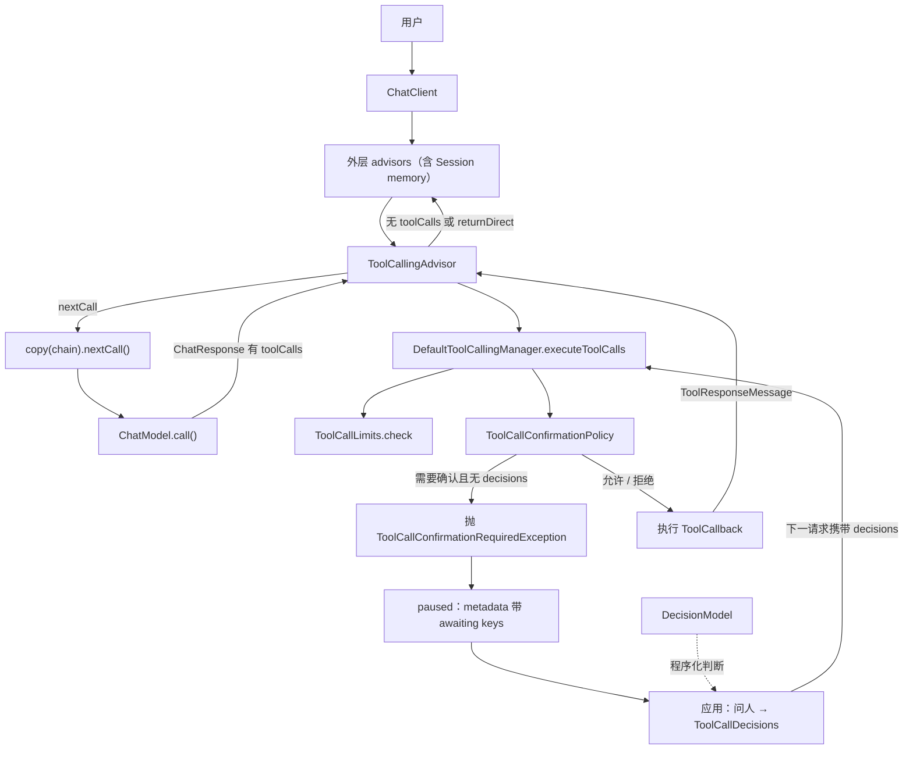
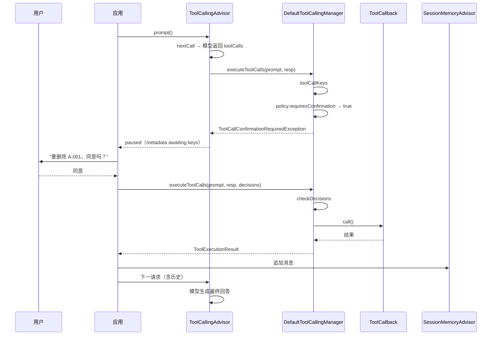

# Agent 多轮自治与 human-in-the-loop 源码解析：工具循环、调用上限、确认暂停与 Decision

> 一句话结论：Spring AI 2.1.0 没有独立的 "agent" 模块，所谓 Agent 就是一个会"自己决定调什么工具、调几轮"的 `ToolCallingAdvisor` 循环；给它加上三道闸——调用上限（`ToolCallLimits`）、人工确认（`ToolCallConfirmationPolicy` → 暂停 → `ToolCallDecisions` 续跑）、以及用 `DecisionModel` 让程序做结构化判断——就成了可控的自治系统。
> 阅读前置：读过 [工具调用循环](../02-工具调用与RAG/01-toolcalling-工具调用循环源码.md)（本文不重复讲循环骨架）与 [MCP 篇](01-mcp-协议与客户端源码.md)。
> 预计阅读: 45 分钟 ｜ 源码: `spring-ai-client-chat:2.1.0`、`spring-ai-model:2.1.0`、`spring-ai-session:2.1.0`（Maven 坐标 `org.springframework.ai:*:2.1.0`）。

## 0. 先看现象

```java
// 示例代码：非源码，展示"需要确认的工具"用法；resume 的 ChatClient API 形状未验证
@Tool(name = "deleteAsset", description = "删除资产记录", requiresConfirmation = true)
public String deleteAsset(@ToolParam(description = "资产 ID") String id) { ... }

// 第一轮：模型要调 deleteAsset → 循环暂停，什么都没执行
ChatClientResponse resp = chatClient.prompt("把资产 A-001 删了")
    .call().chatClientResponse();

if (ToolCallDecisions.isAwaitingDecision(resp.chatResponse())) {
    List<String> keys = ToolCallDecisions.awaitingDecision(resp.chatResponse());
    // 把 keys 拿给人看："要删 A-001，同意吗？"
    // 第二轮：用 decisions 续跑
    ToolCallDecisions decisions = ToolCallDecisions.of(ToolCallDecision.allow(keys.get(0)));
    ToolExecutionResult r = toolCallingManager.executeToolCalls(prompt, resp.chatResponse(), decisions);
}
```

几个反直觉的点：

1. **没有 `spring-ai-agent` 这个 artifact。** 探测 Maven Central 2.1.0：`spring-ai-agent`、`-agent-core`、`-agents`、`-agent-loop` 均 404。Agent 的全部机制都在 client-chat / model / session 里。
2. **需要确认时，整批调用都不跑。** 源码注释原话："none of the reply's tool calls run"。哪怕 3 个工具里只有 1 个需要确认，另外 2 个也一起停。
3. **循环不保存任何状态。** 暂停后 "The loop keeps nothing"——续跑是应用自己的事：拿着暂停的回复和 decisions 重新发一次请求。
4. **默认上限比你想象的大。** 每个工具 40 次、总共 150 次（`DefaultToolCallingManager` 常量），超出默认抛异常终止。
5. **被拒绝的工具调用不是"跳过"，而是给模型一条"用户不同意"的结果。** 模型会据此调整策略，而不是反复重试。

**AI 概念速览**

- **Agent（智能体）**：让模型在循环中自主决定"下一步做什么"（调工具、查资料、直接回答），直到它认为任务完成。比喻：一个会自己查资料的实习生，而不是一问一答的客服。
- **多轮自治（autonomous loop）**：模型 → 工具 → 模型 → 工具 … 直到模型不再要求调工具。
- **Human-in-the-loop**：在关键动作前插入人工审批。比喻：实习生的报销单要经理签字才能提交。
- **Decision（决策）**：`DecisionModel` 不生成文本，而是回答"是/否（附概率）"或"多选一（附概率）"这类结构化问题。比喻：让模型当裁判而不是解说员。
- **Session memory**：2.x 取代 `ChatMemory` 的会话存储抽象，循环外层的 memory advisor 负责把工具结果存进去。

## 1. 整体地图



**读图说明**

| 图中节点 | 职责 | 源码 |
|---|---|---|
| `ToolCallingAdvisor` | 循环骨架；捕获两种"停止原因" | `ToolCallingAdvisor.java` |
| `DefaultToolCallingManager` | 执行一批工具调用：先查确认、再查上限、再执行 | `DefaultToolCallingManager.java` |
| `ToolCallLimits` | 每工具 / 总次数上限 | `ToolCallLimits.java` |
| `ToolCallConfirmationPolicy` | 判断"这个调用需要人确认吗" | `ToolCallConfirmationPolicy.java` |
| `ToolCallConfirmationRequiredException` | 暂停信号，携带待决定的 key 列表 | 同名 `.java` |
| `ToolCallDecisions` / `ToolCallDecision` | 人的决定：允许 / 拒绝（可附理由） | 同名 `.java` |
| `DecisionModel` | 结构化是/否、多选判断 | `DecisionModel.java` |
| `SessionService` | 会话生命周期与事件追加 | `SessionService.java` |

## 2. 关键类

| 类 | 所在包 | 职责 | 关键点 |
|---|---|---|---|
| `ToolCallingAdvisor` | `org.springframework.ai.chat.client.advisor` | 工具循环 + 暂停 | `DEFAULT_ORDER = HIGHEST_PRECEDENCE + 300`；同时实现 `CallAdvisor`、`StreamAdvisor`、`ToolAdvisor` |
| `ToolCallingManager` / `DefaultToolCallingManager` | `org.springframework.ai.model.tool` | 执行一批调用 | `executeToolCalls(prompt, response, decisions)`（`@since 2.1.0`） |
| `ToolCallConfirmationPolicy` | 同上 | 函数式策略 | `none()` / `fromToolMetadata()`（默认）/ `forTools(...)` / `or(...)` |
| `ToolCallConfirmationRequiredException` | 同上 | 暂停信号 | 消息 `"Tool calls [...] need a person's confirmation before they run"` |
| `ToolCallDecisions` | 同上 | 决定集合 + 暂停元数据读取 | `AWAITING_DECISION_METADATA_KEY = "spring.ai.tool-calls-awaiting-decision"` |
| `ToolCallDecision` | 同上 | 单个决定 | `allow(id)` / `deny(id)` / `deny(id, message)` |
| `ToolCallLimits` / `ToolCallLimitBehavior` / `ToolCallLimitExceededException` | 同上 | 上限 | 默认每工具 40、总 150；`THROW` 或 `RETURN_ERROR_RESPONSE` |
| `ToolMetadata` / `@Tool(requiresConfirmation)` | `org.springframework.ai.tool` / `.annotation` | 工具级标记 | 默认 `false` |
| `DecisionModel` | `org.springframework.ai.decision` | 结构化判断 | `extends Model<DecisionPrompt, DecisionResponse>` |
| `YesNoQuestion` / `ChoiceQuestion` | `org.springframework.ai.decision.question` | 问题类型 | 答案附概率 |
| `SessionService` / `Session` | `org.springframework.ai.session` | 会话 | `Session` 无 owner 字段，靠 metadata 标记 principal |
| `SessionMemoryAdvisor` | `org.springframework.ai.session.advisor` | 把消息与工具结果存入会话 | 01 篇已讲 |

**术语解释**

- **暂停（paused）**：循环在执行前停下，回复原样返回，只在 metadata 里多了一个 key 列表。
- **key**：工具调用的标识。有唯一 id 用 id；没有就按位置 `#0`、`#1`。
- **decisions**：每个 key 一个决定，缺一不可。
- **returnDirect**：工具结果直接返回给用户，不再让模型总结。
- **冷却 / 上限**：防止模型"死循环调同一个工具"。

## 3. 源码逐段精读

### 3.1 循环的设计意图（类注释）

[[源码:ToolCallingAdvisor.java#L67-L80]]

```java (src: ToolCallingAdvisor.java#L67-L80)
 * <b>Tool calls that need confirmation.</b> When the model asks for a tool call that the
 * {@link ToolCallingManager}'s
 * {@link org.springframework.ai.model.tool.ToolCallConfirmationPolicy} says needs a
 * person's confirmation (by default, a tool marked {@code requiresConfirmation}), the
 * manager throws {@link ToolCallConfirmationRequiredException} and the loop
 * <em>pauses</em>: none of the reply's tool calls run, and the reply goes back to the
 * caller, listing the keys of the calls that wait for a decision
 * ({@link ToolCallDecisions#awaitingDecision}). A streamed reply pauses on a last chunk
 * with the tool calls and the keys. The loop keeps nothing. To resume, the application
 * runs the calls with the decisions through
 * {@link ToolCallingManager#executeToolCalls(Prompt, ChatResponse, ToolCallDecisions)}
 * and sends the conversation, with the paused reply and the tool results, as its next
 * request. A memory advisor outside the loop then stores the tool results like any other
 * message.
```

- **在干什么**：注释定义了"需要确认的调用"的完整协议：manager 抛异常 → 循环暂停、一个都不跑 → 回复列出等待决定的 key → 流式时在最后一个 chunk 上 → 循环不保存任何东西 → 应用用 `executeToolCalls(Prompt, ChatResponse, ToolCallDecisions)` 续跑 → 把对话（含暂停回复和工具结果）作为下一请求 → 外层 memory advisor 照常存储。
- **为什么这么写**：把"暂停"设计成**无状态**的，是为了让 advisor 链保持纯函数风格——任何有状态的暂停都会让 advisor 难以组合与测试。代价是续跑逻辑落在应用层。
- **如果改成别的会怎样**：如果 advisor 内部保存暂停的 batch，就得处理序列化、过期、并发同一会话两次暂停等一堆问题。
- **常见坑**：用 `content()` 判断是否暂停——注释明说要用 `chatResponse()` / `chatClientResponse()`，`content()` 返回的是暂停回复的文本，常为空。

### 3.2 暂停的两副面孔：阻塞 vs 流式

[[源码:ToolCallingAdvisor.java#L534-L563]]

```java (src: ToolCallingAdvisor.java#L534-L563)
	private static ChatClientResponse pausedChunk(ChatClientResponse aggregated, ChatResponse chatResponse,
			ToolCallConfirmationRequiredException ex) {
		Generation toolCallGeneration = toolCallGeneration(chatResponse);
		AssistantMessage reply = toolCallGeneration.getOutput();
		List<MessagePart> toolCallParts = reply.getParts().stream().filter(ToolCallPart.class::isInstance).toList();
		AssistantMessage toolCallsOnly = AssistantMessage.builder()
			.parts(toolCallParts)
			.properties(reply.getMetadata())
			.build();
		ChatResponse chunk = ChatResponse.builder()
			.from(chatResponse)
			.generations(List.of(new Generation(toolCallsOnly, toolCallGeneration.getMetadata())))
			.metadata(ToolCallDecisions.AWAITING_DECISION_METADATA_KEY, ex.getToolCallIds())
			.build();
		return aggregated.mutate().chatResponse(chunk).build();
	}

	/**
	 * The paused reply as the model gave it, with the keys of the tool calls that wait
	 * for a decision.
	 */
	private static ChatClientResponse paused(ChatClientResponse response, ChatResponse chatResponse,
			ToolCallConfirmationRequiredException ex) {
		return response.mutate()
			.chatResponse(ChatResponse.builder()
				.from(chatResponse)
				.metadata(ToolCallDecisions.AWAITING_DECISION_METADATA_KEY, ex.getToolCallIds())
				.build())
			.build();
	}
```

- **在干什么**：`pausedChunk` 给流式用——只保留 `ToolCallPart`，把 metadata key 设为 `ex.getToolCallIds()`，包成一个 chunk 放到聚合结果上；`paused` 给阻塞用——原回复加同一个 metadata key。
- **为什么这么写**：流式场景下文本 chunk 已经发出去了，客户端只能靠"最后一个 chunk"得知暂停，所以这个 chunk 必须带工具调用与 key。
- **如果改成别的会怎样**：流式时不发这个 chunk，客户端会在 `content()` 静默结束时一头雾水。
- **常见坑**：聚合后的响应**不带**这个 key（`ToolCallDecisions` 注释原话 "the aggregated response does not carry it"），要在最后一个 chunk 上读。

### 3.3 manager 入口：先查确认

[[源码:DefaultToolCallingManager.java#L273-L295]]

```java (src: DefaultToolCallingManager.java#L273-L295)
	private InternalToolExecutionResult executeToolCall(Prompt prompt, AssistantMessage assistantMessage,
			ToolContext toolContext, @Nullable ToolCallDecisions decisions) {
		List<ToolCallback> toolCallbacks = List.of();
		if (prompt.getOptions() instanceof ToolCallingChatOptions toolCallingChatOptions) {
			if (!CollectionUtils.isEmpty(toolCallingChatOptions.getToolCallbacks())) {
				toolCallbacks = toolCallingChatOptions.getToolCallbacks();
			}
		}

		// Before any call runs: a call that needs a person's confirmation pauses the
		// whole batch, unless the decisions cover it
		// Decisions name the calls by key: the id, or the position when there is none
		List<String> toolCallKeys = ToolCallDecisions.toolCallKeys(assistantMessage);
		if (decisions == null) {
			List<String> awaiting = this.getAwaitingConfirmationIds(assistantMessage, toolCallKeys, toolCallbacks);
			if (!awaiting.isEmpty()) {
				throw new ToolCallConfirmationRequiredException(awaiting);
			}
		}
		else {
			checkDecisions(decisions, assistantMessage, toolCallKeys, toolCallbacks);
		}

```

- **在干什么**：取出 prompt 携带的 `ToolCallback` 列表；算出每个调用的 key；**若 `decisions == null`**，用策略找出需要确认的 key，非空就抛 `ToolCallConfirmationRequiredException`——注意这发生在任何执行之前；**若有 decisions**，转去 `checkDecisions`。
- **为什么这么写**：把确认检查放在最前面，保证"需要确认时一个都不跑"的语义；`decisions == null` 与"有 decisions"是两条互斥路径，避免"部分决定"这种模糊状态。
- **如果改成别的会怎样**：先执行不需要确认的、再暂停需要确认的 → 续跑时要处理"哪些已经跑过"，状态复杂且容易重复执行。
- **常见坑**：有 decisions 时**不再重新评估策略**（见 §3.5 注释），所以 decisions 必须覆盖**全部**调用。

### 3.4 找出需要确认的 key

[[源码:DefaultToolCallingManager.java#L426-L439]]

```java (src: DefaultToolCallingManager.java#L426-L439)
	private List<String> getAwaitingConfirmationIds(AssistantMessage assistantMessage, List<String> toolCallKeys,
			List<ToolCallback> toolCallbacks) {
		List<AssistantMessage.ToolCall> toolCalls = assistantMessage.getToolCalls();
		List<String> awaiting = new ArrayList<>();
		for (int i = 0; i < toolCalls.size(); i++) {
			AssistantMessage.ToolCall toolCall = toolCalls.get(i);
			ToolCallback toolCallback = this.resolveToolCallback(toolCallbacks, toolCall.name());
			ToolMetadata toolMetadata = (toolCallback != null) ? toolCallback.getToolMetadata() : null;
			if (this.toolCallConfirmationPolicy.requiresConfirmation(toolCall, toolMetadata)) {
				awaiting.add(toolCallKeys.get(i));
			}
		}
		return awaiting;
	}
```

- **在干什么**：遍历调用，按名字解析 `ToolCallback`，拿 `ToolMetadata`（找不到工具为 `null`），交给策略判断；需要的就把对应 key 加入列表。
- **为什么这么写**：策略看到的是**工具元数据**而不是整个回调，避免策略依赖具体实现；传 `null` 让策略可以决定"未知工具是否需要确认"。
- **如果改成别的会怎样**：找不到工具时直接抛异常 → 模型幻觉出一个工具名时会先报"找不到工具"而不是"需要确认"，两种错误难区分。
- **常见坑**：默认策略 `fromToolMetadata()` 对 `null` 元数据返回 `false`，即未知工具**不需要确认**，随后在执行阶段才抛 `IllegalStateException`。

### 3.5 策略接口：四种开箱即用

[[源码:ToolCallConfirmationPolicy.java#L36-L75]]

```java (src: ToolCallConfirmationPolicy.java#L36-L75)
@FunctionalInterface
public interface ToolCallConfirmationPolicy {

	/**
	 * Whether the tool call needs a confirmation before it runs.
	 * @param toolCall the call the model asked for
	 * @param toolMetadata the metadata of the tool the call names, or {@code null} when
	 * the manager finds no tool for the call
	 */
	boolean requiresConfirmation(AssistantMessage.ToolCall toolCall, @Nullable ToolMetadata toolMetadata);

	/** A call needs confirmation when either policy says so. */
	default ToolCallConfirmationPolicy or(ToolCallConfirmationPolicy other) {
		Assert.notNull(other, "other must not be null");
		return (toolCall, toolMetadata) -> requiresConfirmation(toolCall, toolMetadata)
				|| other.requiresConfirmation(toolCall, toolMetadata);
	}

	/** No call needs confirmation. */
	static ToolCallConfirmationPolicy none() {
		return (toolCall, toolMetadata) -> false;
	}

	/**
	 * The calls of tools whose metadata says so
	 * ({@link ToolMetadata#requiresConfirmation()},
	 * {@code @Tool(requiresConfirmation = true)}). The default of
	 * {@link DefaultToolCallingManager}.
	 */
	static ToolCallConfirmationPolicy fromToolMetadata() {
		return (toolCall, toolMetadata) -> toolMetadata != null && toolMetadata.requiresConfirmation();
	}

	/** The calls of the named tools. */
	static ToolCallConfirmationPolicy forTools(String... toolNames) {
		Set<String> names = Set.of(toolNames);
		return (toolCall, toolMetadata) -> names.contains(toolCall.name());
	}

}
```

- **在干什么**：`@FunctionalInterface`，一个方法 `requiresConfirmation(toolCall, toolMetadata)`；`or` 组合、`none` 全放行、`fromToolMetadata` 看 `@Tool(requiresConfirmation)`、`forTools` 按名字点名。
- **为什么这么写**：默认 `fromToolMetadata` 让"工具作者"决定风险等级；`forTools` 让"应用运维"按环境加码（生产环境对 `sendEmail` 一律确认）；`or` 让两者叠加。
- **如果改成别的会怎样**：如果默认是 `none`，工具作者标了 `requiresConfirmation` 也不生效，安全隐患。
- **常见坑**：策略是 `DefaultToolCallingManager.builder()` 级别的配置，不是每次请求级别的（请求级如何动态覆盖未验证）。

### 3.6 校验 decisions：一个都不能少

[[源码:DefaultToolCallingManager.java#L446-L466]]

```java (src: DefaultToolCallingManager.java#L446-L466)
	private static void checkDecisions(ToolCallDecisions decisions, AssistantMessage assistantMessage,
			List<String> toolCallKeys, List<ToolCallback> toolCallbacks) {
		Set<String> assistantToolCallIds = new LinkedHashSet<>(toolCallKeys);
		for (ToolCallDecision decision : decisions.decisions()) {
			Assert.isTrue(assistantToolCallIds.contains(decision.toolCallId()), () -> "No tool call has the key '"
					+ decision.toolCallId() + "'; the reply's tool call keys: " + assistantToolCallIds);
		}
		Set<String> missing = new LinkedHashSet<>(assistantToolCallIds);
		decisions.decisions().forEach(decision -> missing.remove(decision.toolCallId()));
		Assert.isTrue(missing.isEmpty(), () -> "Every tool call of the reply needs a decision; missing: " + missing);
		List<AssistantMessage.ToolCall> toolCalls = assistantMessage.getToolCalls();
		for (int i = 0; i < toolCalls.size(); i++) {
			AssistantMessage.ToolCall toolCall = toolCalls.get(i);
			ToolCallDecision decision = decisions.decisionOn(toolCallKeys.get(i));
			if (decision != null && decision.allowed() && findToolCallback(toolCallbacks, toolCall.name()) == null) {
				throw new IllegalArgumentException(
						"The prompt does not carry the tool '" + toolCall.name() + "' of the allowed call '"
								+ toolCallKeys.get(i) + "'; an allowed call runs only with a tool of the prompt");
			}
		}
	}
```

- **在干什么**：三步断言——每个 decision 的 key 必须在回复里；回复里每个 key 都必须有 decision；**被允许**的调用只能用 prompt 携带的工具，不能用按名字解析出来的。
- **为什么这么写**：注释说得很清楚——续跑时策略不再评估，所以必须保证"人批准的就是这次要跑的"；第三条防止续跑时 prompt 换了一批工具，人批准的 A 被解析成别的东西。
- **如果改成别的会怎样**：允许缺 decision → 未决定的调用会被静默跳过或默认执行，语义不清；允许名字解析 → 存在"批准后偷换工具"的风险。
- **常见坑**：错误信息 `Every tool call of the reply needs a decision; missing: [...]` 就是漏了一个 key。

### 3.7 暂停信号与决定对象

[[源码:ToolCallConfirmationRequiredException.java#L46-L57]]

```java (src: ToolCallConfirmationRequiredException.java#L46-L57)
	public ToolCallConfirmationRequiredException(List<String> toolCallIds) {
		super("Tool calls " + toolCallIds + " need a person's confirmation before they run");
		Assert.notEmpty(toolCallIds, "toolCallIds must not be empty");
		Assert.noNullElements(toolCallIds, "toolCallIds must not contain null elements");
		this.toolCallIds = List.copyOf(toolCallIds);
	}

	/**
	 * The keys of the tool calls that need a confirmation (see
	 * {@link ToolCallDecisions#toolCallKeys}), in the order the model asked for them.
	 */
	public List<String> getToolCallIds() {
```

- **在干什么**：构造器断言列表非空、无 null，复制后保存；`getToolCallIds()` 返回 key。
- **为什么这么写**：异常本身就是"消息"，携带的数据让 advisor 不必再算一遍。
- **如果改成别的会怎样**：不复制 → 调用方修改原列表会影响异常内容。
- **常见坑**：`toolCallIds` 里可能是 `#0` 这种位置 key（模型没给 id 时）。

[[源码:ToolCallDecision.java#L36-L68]]

```java (src: ToolCallDecision.java#L36-L68)
public record ToolCallDecision(String toolCallId, boolean allowed, @Nullable String message) {

	/** The result a denied call answers the model with when the decision gives none. */
	public static final String DEFAULT_DENY_MESSAGE = "The user did not allow this tool call.";

	public ToolCallDecision {
		Assert.hasText(toolCallId, "toolCallId must not be empty");
		Assert.isTrue(message == null || !message.isBlank(),
				"message must not be blank; leave it null for the default deny message");
	}

	/** Allows the tool call to run. */
	public static ToolCallDecision allow(String toolCallId) {
		return new ToolCallDecision(toolCallId, true, null);
	}

	/**
	 * Denies the tool call; the model receives the {@linkplain #DEFAULT_DENY_MESSAGE
	 * default} message.
	 */
	public static ToolCallDecision deny(String toolCallId) {
		return new ToolCallDecision(toolCallId, false, null);
	}

	/** Denies the tool call; the model receives the message as the call's result. */
	public static ToolCallDecision deny(String toolCallId, String message) {
		return new ToolCallDecision(toolCallId, false, message);
	}

	/** The result a denied call answers the model with. */
	public String denyMessage() {
		return (this.message != null) ? this.message : DEFAULT_DENY_MESSAGE;
	}
```

- **在干什么**：record `(toolCallId, allowed, message)`；`allow` / `deny` / `deny(id, msg)`；`denyMessage()` 给默认拒绝文案 `"The user did not allow this tool call."`。
- **为什么这么写**：拒绝时给模型一条明确的"用户不同意"结果（而不是空或报错），模型才会换思路，不会死循环重试。
- **如果改成别的会怎样**：拒绝时直接抛异常 → 整个对话失败；什么都不给 → 模型不知道发生了什么，可能再次请求同一工具。
- **常见坑**：`message` 传空白字符串会被断言拒绝（"leave it null for the default deny message"）。

### 3.8 key 的生成规则

[[源码:ToolCallDecisions.java#L105-L114]]

```java (src: ToolCallDecisions.java#L105-L114)
	public static List<String> toolCallKeys(AssistantMessage message) {
		Assert.notNull(message, "message must not be null");
		List<AssistantMessage.ToolCall> toolCalls = message.getToolCalls();
		List<String> keys = new ArrayList<>(toolCalls.size());
		for (int i = 0; i < toolCalls.size(); i++) {
			String id = toolCalls.get(i).id();
			keys.add(isOwnId(id, toolCalls) ? id : POSITION_KEY_PREFIX + i);
		}
		return keys;
	}
```

- **在干什么**：遍历 tool calls，id 是"自己的"（非空、不以 `#` 开头、且在列表里唯一）就用 id，否则 `#` + 下标。
- **为什么这么写**：有些模型供应商不返回 tool call id；用位置兜底，并禁止真实 id 以 `#` 开头，避免歧义。
- **如果改成别的会怎样**：只用位置 → 有 id 的模型在多轮里 key 不稳定；只用 id → 无 id 模型无法续跑。
- **常见坑**：`isOwnId` 还要求 id 在本条消息里唯一，重复 id 也退化为位置 key。

### 3.9 上限：防死循环

[[源码:DefaultToolCallingManager.java#L96-L110]]

```java (src: DefaultToolCallingManager.java#L96-L110)
	 * Default cap applied to every tool name unless overridden via
	 * {@link Builder#maxCallsPerTool(String, int)}, exempted via
	 * {@link Builder#excludeToolFromLimit(String)}, or disabled entirely via
	 * {@link Builder#unlimitedCallsPerTool()}. Generous enough for legitimate iterative
	 * tool use (pagination, retries) while still catching a runaway loop long before it
	 * becomes expensive.
	 */
	public static final int DEFAULT_MAX_CALLS_PER_TOOL = 40;

	/**
	 * Default cap on the total number of tool calls, across all tools combined, allowed
	 * within a turn, unless disabled entirely via
	 * {@link Builder#unlimitedTotalToolCalls()}.
	 */
	public static final int DEFAULT_MAX_TOTAL_TOOL_CALLS = 150;
```

- **在干什么**：定义默认上限常量：每工具 40、总 150。
- **为什么这么写**：模型可能陷入"调同一工具 → 结果不满意 → 再调"的死循环，上限是最后一道保险。
- **如果改成别的会怎样**：无上限 → 一次请求可能烧掉大量 token；上限太低 → 合理的多步任务被截断。
- **常见坑**：超出默认 `THROW`，`ToolCallingAdvisor` 捕获后 `break`，用 `buildGeneration` 把部分结果包进回复；也可配 `RETURN_ERROR_RESPONSE` 让模型收到错误继续。

### 3.10 Decision：让模型当裁判

[[源码:DecisionModel.java#L25-L45]]

```java (src: DecisionModel.java#L25-L45)
/**
 * A model that answers typed questions about an input instead of generating text. Each
 * answer carries the probabilities the model assigned, so that the application decides
 * what to do with them.
 *
 * @author Thomas Vitale
 * @since 2.1.0
 */
@FunctionalInterface
public interface DecisionModel extends Model<DecisionPrompt, DecisionResponse> {

	@Override
	DecisionResponse call(DecisionPrompt prompt);

	/**
	 * Ask the given questions about a text, with the model's default options.
	 */
	default DecisionResponse call(String text, Map<String, ? extends DecisionQuestion> questions) {
		return call(DecisionPrompt.builder().text(text).questions(questions).build());
	}

```

- **在干什么**：`DecisionModel` 继承 `Model<DecisionPrompt, DecisionResponse>`，`call` 返回带概率的结构化答案；两个 default 方法方便直接问"对这段文本的几个问题"。
- **为什么这么写**：human-in-the-loop 之前往往要先过一道**程序化**筛查（"这条工具调用是否涉及删除？"），用生成文本再正则解析很脆，直接让模型输出概率更可靠。
- **如果改成别的会怎样**：用普通 `ChatModel` 输出 "yes/no" 文本 → 需要解析、容易被多余文字干扰、拿不到置信度。
- **常见坑**：`@since 2.1.0`，具体供应商实现未入库，是否所有模型都支持未验证。

[[源码:YesNoQuestion.java#L26-L45]]

```java (src: YesNoQuestion.java#L26-L45)

/**
 * A question with a yes or no answer, answered with the probability of "yes" as a
 * {@link YesNoAnswer}. The optional criteria describe when the answer is yes and when it
 * is no; a blank criterion counts as none. Providers whose API has a place for them send
 * them as such, the others add them to the question text.
 *
 * @author Thomas Vitale
 * @since 2.1.0
 */
public final class YesNoQuestion implements DecisionQuestion {

	private final String text;

	private final @Nullable String whenYes;

	private final @Nullable String whenNo;

	private YesNoQuestion(String text, @Nullable String whenYes, @Nullable String whenNo) {
		Assert.hasText(text, "text cannot be null or empty");
```

- **在干什么**：是/否问题，可选 `whenYes` / `whenNo` 判据；构造时把空白判据归一化为 `null`。
- **为什么这么写**：判据让概率更有依据；归一化避免下游判空。
- **如果改成别的会怎样**：不提供判据 → 模型对"是"的定义可能与业务不一致。
- **常见坑**：注释说明不同供应商对判据的处理不同（放进 API 字段或拼进问题文本），行为可能有差异。

### 3.11 Session：循环外的记忆

[[源码:SessionService.java#L41-L60]]

```java (src: SessionService.java#L41-L60)
public interface SessionService {

	// Sessions

	/**
	 * Creates a session with the request's id, a random UUID when it has none, its time
	 * to live and its metadata.
	 * @throws SessionAlreadyExistsException if a session with the requested id exists
	 */
	Session create(CreateSessionRequest request);

	/**
	 * The session with the request's id, created from the request when there is none.
	 * Safe under concurrent first use: when another caller creates it first, the stored
	 * session is returned, not this request's. The default finds, creates, and on a
	 * {@link SessionAlreadyExistsException} finds again, through this service's own
	 * {@link #findById} and {@link #create}.
	 * @throws IllegalArgumentException if the request has no id, null or blank
	 */
	default Session findOrCreate(CreateSessionRequest request) {
```

- **在干什么**：`SessionService` 定义 `create`（可带 id、TTL、metadata）与 `findOrCreate`（并发安全：别人先建了就返回已有的）。
- **为什么这么写**：暂停后续跑是"下一请求"，工具结果必须已经被存进会话，下一请求才能带上；`findOrCreate` 解决多请求并发首次访问。
- **如果改成别的会怎样**：循环内部自己存记忆 → advisor 有状态，且与 memory advisor 重复存储。
- **常见坑**：暂停的那一轮，外层 memory advisor 存的是"暂停回复"（含 tool call），续跑后工具结果才会作为新消息追加。

## 4. 完整时序

带确认的完整一轮（阻塞调用）：



| 步骤 | 发生什么 | 源码 |
|---|---|---|
| 1 | 模型返回 toolCalls | — |
| 2 | manager 算 key、查策略 | §3.3、§3.4 |
| 3 | 需要确认 → 抛异常 | §3.7 |
| 4 | advisor 捕获，标记 paused，不执行 | §3.2 |
| 5 | 应用读 `awaitingDecision`，问人 | §3.8 |
| 6 | 应用带 decisions 续跑 | §3.3 |
| 7 | manager 校验 decisions | §3.6 |
| 8 | 执行（拒绝的给 denyMessage） | 02 篇 §3.3 |
| 9 | 工具结果入会话，下一请求 | §3.11 |

## 5. 设计模式

| 模式 | 用在哪 | 解决什么 |
|---|---|---|
| 策略 | `ToolCallConfirmationPolicy` | 确认规则可替换、可组合 |
| 异常即控制流 | `ToolCallConfirmationRequiredException` / `ToolCallLimitExceededException` | 在不改变 `ToolExecutionResult` 返回类型的前提下表达"停止原因" |
| 值对象 | `ToolCallDecision` / `ToolCallDecisions` | 不可变、自校验 |
| 无状态暂停 | advisor 不保存暂停 batch | 可组合、可测试、可序列化 |
| 门面 | `ToolCallingManager` | 把解析、确认、上限、执行收口 |
| 规格 / 断言 | `checkDecisions` | 续跑前保证一致性 |
| 解释器 | `DecisionModel` + 问题类型 | 把"判断"从文本生成中分离 |

## 6. 踩坑调试

| 现象 | 原因 | 解法 |
|---|---|---|
| 用 `content()` 判断暂停，永远 false | metadata 只在 `chatResponse()` 上 | 用 `ToolCallDecisions.isAwaitingDecision(resp.chatResponse())` |
| 流式最后没拿到 key | 读了聚合响应 | 读最后一个 chunk |
| `Every tool call of the reply needs a decision; missing: [...]` | decisions 漏了某个 key | 对每个 key 都给 allow/deny |
| `No tool call has the key '...'` | key 写错，或模型没给 id 应用却用了 id | 用 `ToolCallDecisions.toolCallKeys(assistantMessage)` |
| `The prompt does not carry the tool ... of the allowed call` | 续跑时 prompt 没带那个工具 | 续跑请求携带同一批 `ToolCallbacks` |
| 工具标了 `requiresConfirmation` 却直接执行 | manager 的策略被改成 `none()` | 用默认 `fromToolMetadata()` |
| 跑了很久后 `ToolCallLimitExceededException` | 模型死循环 | 修工具描述/返回值；或调上限；或 `RETURN_ERROR_RESPONSE` |
| 暂停后下一请求丢工具结果 | 没配 memory advisor，或续跑时没把结果放进历史 | 外层放 `SessionMemoryAdvisor`，续跑走正常请求 |

**调试手法**

1. 日志开 `org.springframework.ai.model.tool=DEBUG`，看 `toolCallKeys` 与 awaiting 列表。
2. 在 `DefaultToolCallingManager.executeToolCall` 的 `throw new ToolCallConfirmationRequiredException` 处断点。
3. 打印 `resp.chatResponse().getMetadata()`，确认 key `spring.ai.tool-calls-awaiting-decision`。
4. 对 decisions 做单元测试：构造 `AssistantMessage` 无 id 的 tool calls，验证 key 为 `#0`。

## 7. ⚠️ 版本差异（1.0 → 2.x）

| 主题 | 1.0.x | 2.x（2.1.0 已入库） | 说明 |
|---|---|---|---|
| 工具循环位置 | 模型内部执行（`internalToolExecutionEnabled`，未验证） | `ToolCallingAdvisor`（`@since 2.0.0`）在 advisor 链中循环 | 可被其它 advisor 拦截 |
| 人工确认 | 无（未验证） | `ToolCallConfirmationPolicy`、`@Tool(requiresConfirmation)`、`executeToolCalls(..., decisions)`（`@since 2.1.0`） | 暂停无状态 |
| 调用上限 | 无（未验证） | `ToolCallLimits`、`ToolCallLimitBehavior` | 引入版本未核实 |
| 结构化判断 | 无（未验证） | `DecisionModel` 及 `decision.*` 包（`@since 2.1.0`） | 供应商实现未入库 |
| 对话记忆 | `ChatMemory` | `ChatMemory` 已 `@Deprecated`，改用 `Session` / `SessionService` / `SessionMemoryAdvisor`（`@since 2.1.0`） | 见 01 篇 |
| Agent 模块 | — | 无独立 artifact（探测 404） | 以 advisor 组合实现 |

**未验证声明**：1.0.x 行为未入库；`ToolCallLimits` 引入版本、`DecisionModel` 的供应商实现、`ChatClient` 层面续跑 API 的最终形状均**未验证（未入库）**。

## 8. 面试问答

1. **Q：Spring AI 2.x 的 Agent 核心是什么？**
   A：`ToolCallingAdvisor`——一个递归 advisor，关闭模型内部工具执行，在链里自己跑"模型 → 工具 → 模型"循环。
2. **Q：为什么把循环放到 advisor 链而不是模型内部？**
   A：这样其它 advisor 能拦截每一轮，便于日志、审计、记忆；同时所有模型统一一套循环逻辑。
3. **Q：human-in-the-loop 在 2.1.0 怎么实现？**
   A：工具标 `requiresConfirmation=true`（或策略点名）；manager 在执行前发现需要确认且无 decisions 就抛异常；advisor 标记 paused 返回；应用拿到 key 问人，再带 `ToolCallDecisions` 续跑。
4. **Q：暂停时为什么一个工具都不执行？**
   A：保证原子性与可续跑语义——若部分执行，续跑要跟踪哪些已跑，容易重复或遗漏。
5. **Q：decisions 必须覆盖所有调用吗？为什么？**
   A：必须。续跑时策略不再评估，所以必须由 decisions 显式决定每个调用。
6. **Q：被拒绝的调用模型会看到什么？**
   A：一条工具结果，内容是 decision 的 message 或默认 `"The user did not allow this tool call."`。
7. **Q：tool call 的 key 是怎么来的？**
   A：有唯一 id 用 id，否则 `#` + 位置。
8. **Q：默认调用上限是多少？超了怎么办？**
   A：每工具 40、总 150；默认抛 `ToolCallLimitExceededException` 终止，可改为 `RETURN_ERROR_RESPONSE`。
9. **Q：`DecisionModel` 和 `ChatModel` 的区别？**
   A：前者回答带概率的结构化问题（是/否、多选），用于程序化判断；后者生成文本。
10. **Q：流式时如何得知暂停？**
    A：最后一个 chunk 的 `ChatResponse.metadata` 带 `AWAITING_DECISION_METADATA_KEY`；聚合响应不带。
11. **Q：循环暂停后状态存在哪？**
    A：循环不存；应用自己保存暂停回复，续跑时作为请求的一部分重新提交。
12. **Q：`SessionService.findOrCreate` 解决什么问题？**
    A：并发首次访问同一会话时的竞态：创建失败就返回已存在的。

## 9. 动手练习

1. **给工具加确认**：写一个 `requiresConfirmation = true` 的 `@Tool`，观察第一轮暂停、第二轮续跑。
   *验收*：第一轮无工具执行日志；第二轮执行。
2. **拒绝路径**：用 `deny(id, "用户拒绝：金额过大")` 续跑，观察模型下一步回复。
   *验收*：模型不再重试该工具，并解释原因。
3. **按名字点名**：用 `ToolCallConfirmationPolicy.forTools("sendEmail")` 让普通工具也需确认。
   *验收*：`sendEmail` 暂停，其它工具直接执行。
4. **无 id 的 key**：构造一个不返回 tool call id 的假 `ChatModel`，验证 key 为 `#0`。
   *验收*：`awaitingDecision` 返回 `["#0"]`。
5. **上限触发**：写一个总返回"再查一次"的工具，把上限调到 3，观察异常与 `RETURN_ERROR_RESPONSE` 的差异。
   *验收*：`THROW` 抛异常；`RETURN_ERROR_RESPONSE` 模型收到错误文本。

## 小结

- 2.1.0 的 Agent = `ToolCallingAdvisor` 循环 + 三道闸：上限、确认、Decision。
- 确认是**无状态暂停**：manager 抛异常 → advisor 标记 → 应用带 decisions 续跑；暂停时整批不执行。
- decisions 必须完整，允许的调用只能用 prompt 携带的工具；拒绝给模型明确文案。
- 上限默认 40/150，防死循环；`DecisionModel` 把"判断"从文本生成里分离出来。
- 独立 agent 模块在 2.1.0 不存在；1.0 对照与供应商实现未入库，已标注未验证。

## 自测题

<details><summary>1. 2.1.0 有没有 `spring-ai-agent` 这个 artifact？</summary>

没有。探测 Maven Central 返回 404；Agent 机制在 client-chat / model / session 中。
</details>

<details><summary>2. 工具循环由哪个 advisor 实现？它的默认 order 是？</summary>

`ToolCallingAdvisor`；`Ordered.HIGHEST_PRECEDENCE + 300`。
</details>

<details><summary>3. 需要确认时，manager 抛什么异常？</summary>

`ToolCallConfirmationRequiredException`，携带待决定的 key 列表。
</details>

<details><summary>4. 暂停状态下同一回复里不需要确认的工具会执行吗？</summary>

不会，整批都不执行。
</details>

<details><summary>5. `AWAITING_DECISION_METADATA_KEY` 的值是什么？</summary>

`spring.ai.tool-calls-awaiting-decision`。
</details>

<details><summary>6. 默认的确认策略是什么？</summary>

`ToolCallConfirmationPolicy.fromToolMetadata()`，即看 `@Tool(requiresConfirmation)`。
</details>

<details><summary>7. 续跑时 decisions 缺一个会怎样？</summary>

断言失败：`Every tool call of the reply needs a decision; missing: [...]`。
</details>

<details><summary>8. 默认拒绝文案是什么？</summary>

`The user did not allow this tool call.`
</details>

<details><summary>9. tool call 没有 id 时 key 是什么形式？</summary>

`#` 加位置，如 `#0`、`#1`。
</details>

<details><summary>10. 默认每工具 / 总调用上限？</summary>

40 / 150。
</details>

<details><summary>11. `ToolCallLimitBehavior` 有哪两个值？</summary>

`THROW`、`RETURN_ERROR_RESPONSE`。
</details>

<details><summary>12. `DecisionModel.call` 返回什么？</summary>

`DecisionResponse`，答案附模型给出的概率。
</details>

<details><summary>13. 流式暂停时 awaiting key 在哪里？</summary>

最后一个 chunk 的 `ChatResponse.metadata`；聚合响应不带。
</details>

<details><summary>14. 续跑用 manager 的哪个方法？</summary>

`executeToolCalls(Prompt, ChatResponse, ToolCallDecisions)`。
</details>
