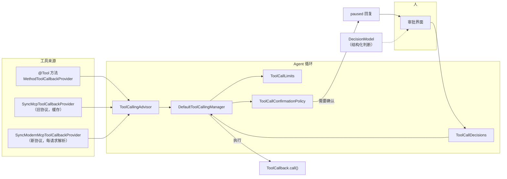

# 03-MCP 与 Agent

> 一句话结论：**MCP** 是"工具从哪来"——Spring AI 用 `ToolCallbackProvider` + `ToolCallback` 把外部工具服务器适配成和本地 `@Tool` 一样的东西；**Agent** 是"循环怎么管"——2.1.0 没有独立的 agent 模块，所谓 Agent 就是 `ToolCallingAdvisor` 循环加上调用上限、人工确认暂停和 `DecisionModel` 结构化判断这三道闸。

> 阅读前置：[01-ChatClient 与模型抽象](../01-ChatClient与模型抽象/README.md)、[02-工具调用与 RAG](../02-工具调用与RAG/README.md)（工具循环是本目录的基础）。
> 源码基线：Spring AI **2.1.0**（`org.springframework.ai:spring-ai-mcp`、`spring-ai-client-chat`、`spring-ai-model`、`spring-ai-session`）；MCP 协议本体在 `io.modelcontextprotocol.sdk:mcp:2.2.0`，未入库。

## 学习目标

读完本目录，你应该能：

1. 说清 MCP 工具"被模型看见"的路径：`ToolCallbackProvider.getToolCallbacks()` → `ToolDefinition` → 请求体；以及为什么要注册 provider 而不是数组。
2. 解释工具名"两套名字"的设计：给模型的是前缀名，发给服务器的是原名；`DefaultMcpToolNamePrefixGenerator` 如何做到幂等与撞名加 `alt_N_`。
3. 对比旧 `SyncMcpToolCallbackProvider`（缓存 + 事件失效）与新 `SyncModernMcpToolCallbackProvider`（每请求解析 + 服务器 `ttlMs/cacheScope` + 不可达冷却）。
4. 说清 `SyncModernMcpConnection` 的 `shared` / `perRequest` / `scoped` 三种连接各自适合什么身份场景。
5. 区分协议错误（`McpError` / `McpException`，直接抛）与业务错误（`isError=true`，包成 `ToolExecutionException` 回给模型）。
6. 画出 human-in-the-loop 的完整时序：策略判断 → 抛 `ToolCallConfirmationRequiredException` → 暂停 → 应用问人 → `ToolCallDecisions` 续跑。
7. 解释为什么暂停时"整批不执行"、为什么 decisions 必须"一个都不能少"、为什么被拒绝的调用要给模型一条明确文案。
8. 知道 `DecisionModel` 是什么（回答带概率的是/否、多选问题），以及它和 `ChatModel` 的分工。

## 整体地图

**读图说明**

- 左边三种工具来源在 `ToolCallingAdvisor` 眼里没有区别——都是 `ToolCallback[]`。MCP 模块的全部工作就是把外部工具"伪装"成本地回调。
- 中间是 02 篇讲过的循环，本目录关注的是它的两道闸：上限（`ToolCallLimits`）与确认（`ToolCallConfirmationPolicy`）。
- 右下是 human-in-the-loop：暂停 → 人决定 → 续跑，循环本身不保存任何状态。
- `DecisionModel` 是可选的"程序化前置筛查"：先把明显安全的自动放行、明显危险的直接拒绝，只把模糊的交给人。

## 两篇摘要

| 文章 | 解决的问题 | 关键类 |
| --- | --- | --- |
| [01-mcp-协议与客户端源码.md](01-mcp-协议与客户端源码.md) | MCP 工具怎么被列出、加前缀、缓存、调用；新旧两代实现的差异；连接生命周期；`_meta` 与结果格式；`McpSchemaConverter` | `ToolCallbackProvider`、`SyncMcpToolCallbackProvider`、`SyncMcpToolCallback`、`SyncModernMcpToolCallbackProvider`、`SyncModernMcpToolCallback`、`SyncModernMcpConnection`、`SyncModernMcpClientScope`、`DefaultMcpToolNamePrefixGenerator`、`McpToolUtils`、`ToolContextToMcpMetaConverter`、`McpSchemaConverter` |
| [02-agent-多轮自治与-human-in-the-loop.md](02-agent-多轮自治与-human-in-the-loop.md) | 2.1.0 的 Agent 到底是什么；确认暂停的无状态协议；`ToolCallDecisions` 校验规则；tool call key 的生成；调用上限；`DecisionModel`；`SessionService` 在续跑中的角色 | `ToolCallingAdvisor`、`DefaultToolCallingManager`、`ToolCallConfirmationPolicy`、`ToolCallConfirmationRequiredException`、`ToolCallDecisions`、`ToolCallDecision`、`ToolCallLimits`、`DecisionModel`、`YesNoQuestion`、`SessionService` |

## 建议阅读顺序

先读 01 理解"外部工具怎么进来"，再读 02 理解"循环怎么被管住"。02 的循环骨架不重复讲，依赖 [02-工具调用与RAG/01](../02-工具调用与RAG/01-toolcalling-工具调用循环源码.md)。如果你只关心安全性，可以直接跳到 02 的 §3.1–§3.8（确认协议）。

## 学习检查点

- [ ] 能说出 `defaultToolCallbacks(provider)` 与 `defaultToolCallbacks(array)` 的区别，以及现代 provider 为什么必须用前者。
- [ ] 能解释 `McpToolUtils.prefixedToolName` 超过 64 字符时保留哪一段、为什么。
- [ ] 能说出新 provider 对不可达服务器的处理（跳过 + 30 秒冷却）与哪些状态算"不可达"（5xx / 408 / 429 / 超时 / 断连）。
- [ ] 能画出确认暂停的时序，并指出 `AWAITING_DECISION_METADATA_KEY` 在阻塞与流式两种模式下分别从哪里读。
- [ ] 能解释 `checkDecisions` 的三条断言，尤其是"允许的调用只能用 prompt 携带的工具"。
- [ ] 能说出 tool call 没有 id 时 key 的形式，以及 `#` 前缀为什么被保留。
- [ ] 能区分 `DecisionModel` 与 `ChatModel`，并各举一个使用场景。
- [ ] 能列出 2.1.0 中未入库、本文标注"未验证"的至少三项（如 MCP 协议常量、`DecisionModel` 供应商实现、1.0 对照行为）。
