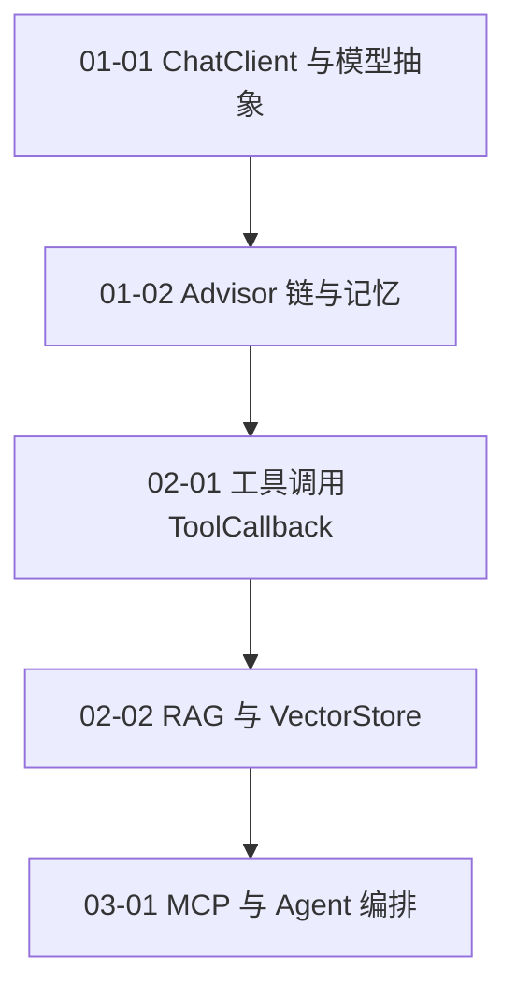

# 06 Spring AI（ChatClient / 工具调用 / RAG / MCP）

> 目标：Spring AI 的源码阅读方式与前面几块**完全一致**——先找入口类，再逐层看责任链。
> 版本基线：`spring-ai@v2.1.0`
> ⚠️ 2.1 起 `ChatMemory` 被标记 deprecate，新的记忆抽象是 **Session memory / `SessionService`**；MCP 采用 2026-07-28 "modern" 协议；新增 `DecisionModel` 与工具调用确认（tool call confirmation）。

## 学习目标

- 能讲清 `ChatClient` 的 `prompt() → advisors → call()/stream()` 如何组装一次模型调用。
- 知道 `Advisor` 链借鉴了 AOP 拦截器链的思想（`CallAdvisor` / `StreamAdvisor`）。
- 能说清工具调用（tool call）的"模型返回 → 框架执行本地方法 → 回填结果再请求"回路。
- 理解 RAG 的 `VectorStore` 检索与 `QuestionAnswerAdvisor` 的位置。
- 了解 MCP 客户端/服务端在 Spring AI 中的接入方式。

## 文章顺序

> 读图说明：`Advisor` 是横切层（类似 AOP），工具调用与 RAG 都通过 Advisor/工具注册挂进主链路，所以先讲 ChatClient 与 Advisor。

## 子目录

| 目录 | 内容 | 学完能做到 |
| --- | --- | --- |
| `01-ChatClient与模型抽象` | `DefaultChatClient`、`ChatModel`、`Advisor` 链 | 自定义 Advisor 做日志/审计 |
| `02-工具调用与RAG` | `ToolCallback`、`ToolCallAdvisor`、`VectorStore` | 让模型调用你的业务方法 |
| `03-MCP与Agent` | MCP 协议接入、`DecisionModel` | 搭建可用的 Agent 工作流 |

## 依赖关系

- 前置：`01-Spring框架/02-AOP`（Advisor 链）、`02-SpringBoot/02-自动配置`。
- 说明：Spring AI 迭代很快，凡涉及 API 的结论都要写清版本，并优先以**已入库源码**为证。

## 学习检查点

- [ ] 能画出 `ChatClient.prompt().user(...).call()` 的调用链。
- [ ] 能解释工具调用的完整回合（含模型二次请求）。
- [ ] 能说清 2.1 中记忆抽象的变化，以及为什么 `ChatMemory` 被替换。
