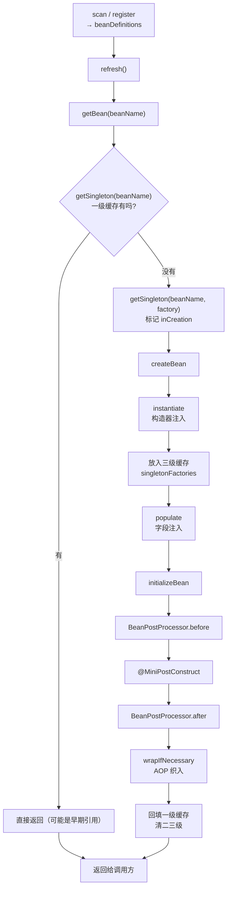
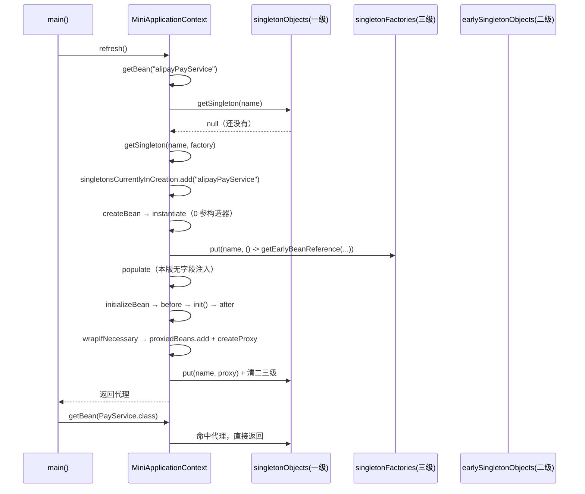

# 手写迷你实现 01：400 行写出 MiniIoC —— 从"能 new 出对象"到"能织入代理"

> 一句话结论：Spring IoC 容器剥掉工程化的壳，只剩 **五件事**：①扫描/登记 BeanDefinition → ②反射实例化（构造器注入）→ ③属性填充（字段注入）→ ④单例缓存 + 三级缓存解决循环依赖 → ⑤生命周期回调（`BeanPostProcessor` 是唯一的总闸门，AOP 只是它的一个使用者）。本文用一份能 `javac` 通过、能 `java` 运行的教学实现，把这五件事**分 6 个版本**逐个加上去，每一版都对照真实 Spring 的类和方法。
> 阅读前置：[01-Spring框架/01-IoC容器与Bean生命周期/02-bean-创建全流程-getbean与createbean.md](../../01-Spring框架/01-IoC容器与Bean生命周期/02-bean-创建全流程-getbean与createbean.md)、[03-循环依赖与三级缓存.md](../../01-Spring框架/01-IoC容器与Bean生命周期/03-循环依赖与三级缓存.md)
> 预计阅读：40 分钟 ｜ 源码：`org.springframework:spring-beans:7.1.0`、`org.springframework:spring-aop:7.1.0`

---

## 0. 先看现象（3 分钟上手）

### 0.1 真实可运行的那份实现

先看**能跑起来**的那份。本仓库随文档提供的教学实现是单文件 [`examples/mini-frameworks/ioc/MiniIoC.java`](../../examples/mini-frameworks/ioc/MiniIoC.java)：零第三方依赖，`javac` 一把编译，`main` 里自带断言（自测）。

在 `learning-docs/24-源码分析` 目录下执行（JDK 17；若你的 `java` / `javac` 不在 `PATH` 里，就像下面这样用绝对路径）：

```powershell
$javac = "D:\DevTools\jdk\jdk17.0.19\bin\javac.exe"
$java  = "D:\DevTools\jdk\jdk17.0.19\bin\java.exe"
& $javac -encoding UTF-8 -d .source-cache/mini-check/ioc examples/mini-frameworks/ioc/MiniIoC.java
& $java  -cp .source-cache/mini-check/ioc mini.ioc.MiniIoC
```

实测输出（退出码 0）：

```text
PASS ioc: by-type constructor injection and singleton identity
PASS ioc: missing dependency rejected
PASS ioc: ambiguous dependency rejected
PASS ioc: constructor cycle rejected
```

这四行是本文的**验收线**：① 按类型的构造器注入成功，且「按接口取」与「按实现类取」拿到的是同一个单例；② 依赖缺失时报 `No bean for ...`；③ 依赖歧义时报 `Multiple beans for ...`；④ 构造器循环依赖被拦住、报 `Constructor cycle detected: ...`，而不是一路递归到 `StackOverflowError`。

教学实现里的名字要记一下：`mini.ioc.MiniIoC` 内部的静态嵌套类 `Container`（下文简称 `Container`）、接口 `Repository` 与它的两个实现 `MemoryRepository` / `OtherRepository`、以及消费者 `OrderService`。这份实现**没有**做包扫描、字段注入、三级缓存、`@PostConstruct`、AOP 织入——这几层是真实 Spring 的主体，本文会逐层对照真实源码讲清楚，并用「延伸示意」标出「示例里没有、但你应该能自己写出来」的部分。

### 0.2 完整目标形态（设计示意，非本仓库示例）

把上面那些能力都补齐之后，调用方代码会变成下面这样。**注意：这段实现不在本仓库的 `examples/` 里，也没有实测**，它只用来告诉你「终局长什么样」，正文 §3 会解释每一处为什么这样设计：

以下为教学实现，非 Spring 源码

```java
public static void main(String[] args) {
    MiniApplicationContext ctx = new MiniApplicationContext("mini06")
            .register(AlipayPayService.class)                 // 注册一个 @MiniComponent
            .addAdvisor(new MiniApplicationContext.MiniAdvisor(
                    MiniApplicationContext.MiniAround.class,  // 切点：标了 @MiniAround 的方法
                    invocation -> {                            // 环绕通知
                        System.out.println("before " + invocation.getMethod().getName()
                                + " args=" + java.util.Arrays.toString(invocation.getArguments()));
                        Object ret = invocation.proceed();
                        System.out.println("after ret=" + ret);
                        return ret;
                    },
                    10));                                      // order：越小越外层
    ctx.refresh();                                             // 触发全部单例创建

    PayService payService = ctx.getBean(PayService.class);
    System.out.println(payService.pay(42));
}
```

这段示意实现的设计预期输出是（**预测，不是实测**）：

```text
    [init] AlipayPayService.init()
    [aop] alipayPayService 被织入代理: AlipayPayService
[v6] rawClass   = jdk.proxy2.$Proxy4
[v6] proxyClass = jdk.proxy2.$Proxy4
    [aop] before pay args=[42]
    [aop] after  ret=paid order-42
[v6] result = paid order-42
[v6] 同一实例 = true
```

注意三件事，它们就是本文后面几节要解释的设计点：

1. `@MiniPostConstruct` 的 `init()` 被调用了 → **生命周期回调**；
2. `getBean()` 拿到的类名是 `jdk.proxy2.$Proxy4`，不是 `AlipayPayService` → **AOP 在容器里完成了替换**；
3. `rawClass` 也是代理类 → 说明**连"提前暴露的早期引用"都是代理**，这是真实 Spring 里 `getEarlyBeanReference` 存在的唯一理由。

## 1. 整体地图（先图后码）



> 读图说明：图里有两个"分水岭"（一个方法里 `if` 决定后面所有行为的点）。第一个是 `D` 节点的一级缓存判断，对应真实 Spring `AbstractBeanFactory#doGetBean` 的 `if (sharedInstance != null && args == null)`；第二个是 `F2` 节点"实例化完立刻放进三级缓存"，对应 `AbstractAutowireCapableBeanFactory#createBean` 里的 `addSingletonFactory`。**只有这两处都在，A、B 字段互相注入才不会无限递归**。

六个概念阶段的递进关系。「示例」列说明本仓库 `examples/` 里那份单文件实现覆盖到哪一档——**没打勾的就是本文只讲原理、不给可运行代码**的部分：

| 阶段 | 新增能力 | 关键方法 | 对应真实 Spring | 本仓库示例 |
| --- | --- | --- | --- | --- |
| v1 | 登记 + 反射 new + 一层单例缓存 | `Container#getBean` / `#resolve` | `DefaultSingletonBeanRegistry#addSingleton` | ✅ 已实现（§3.1） |
| v2 | 构造器注入（按参数个数从多到少尝试） | `Container#instantiate` | `AbstractAutowireCapableBeanFactory#autowireConstructor` | ✅ 已实现（§3.2） |
| v3 | 包扫描 + 字段注入 | `scan` / `populate` | `ClassPathScanningCandidateComponentProvider`、`AutowiredAnnotationBeanPostProcessor` | ❌ 未实现（§3.3 延伸示意） |
| v4 | 三级缓存解决字段循环依赖 | `getSingleton(name)` / `getSingleton(name, factory)` | `DefaultSingletonBeanRegistry` 的三个 Map | ❌ 未实现：示例选择**显式报错**（§3.4） |
| v5 | `@MiniPostConstruct` + `BeanPostProcessor` | `initializeBean` / `invokeInitMethods` | `initializeBean` L1810-L1834 | ❌ 未实现（§3.5 延伸示意） |
| v6 | AOP 织入点 | `getEarlyBeanReference` / `wrapIfNecessary` | `AbstractAutoProxyCreator#wrapIfNecessary` | ➡️ 拆成独立示例 [MiniAop.java](../../examples/mini-frameworks/aop/MiniAop.java)（见 02 篇） |

## 2. 关键类逐个拆

| 教学类/接口（本仓库 [`MiniIoC.java`](../../examples/mini-frameworks/ioc/MiniIoC.java)） | 职责 | 对应真实 Spring 的类 | 备注 |
| --- | --- | --- | --- |
| `MiniIoC.Container` | 容器本体：登记图纸、按类型解析、缓存单例 | `DefaultListableBeanFactory#getBean(Class)` + `DefaultSingletonBeanRegistry` | 真实 Spring 把"注册表""单例缓存""容器生命周期"拆成好几个类，教学版合成一个 |
| `Container#definitions`（`List<Class<?>>`） | Bean 的"图纸" | `beanDefinitionMap` 里的 `RootBeanDefinition` | 真实版图纸有 scope、lazyInit、dependsOn、factoryMethod 等几十个字段；示例直接把 `Class` 当图纸 |
| `Container#singletons`（`Map<Class<?>, Object>`） | 一级缓存（成品单例） | `singletonObjects`（`Map<String, Object>`） | **key 不同**：示例按类存，真实 Spring 按 bean 名字符串存 |
| `Container#inCreation`（`List<Class<?>>`） | "正在创建中"标记 | `DefaultSingletonBeanRegistry#singletonsCurrentlyInCreation` | 示例只拿它做**循环检测**；真实 Spring 还靠它配合三级缓存做**提前暴露** |
| `MiniIoC.Repository` / `MemoryRepository` | 被注入的依赖 | 任意业务接口与其实现 | 用来验证"按接口取到实现类那个单例" |
| `MiniIoC.OrderService` | 构造器注入的消费者 | 任意 `@Service` | 构造器只有一个参数 `Repository` |
| `ObjectFactory`（示例里**没有**） | 延迟创建钩子 | `org.springframework.beans.factory.ObjectFactory` | 三级缓存里存的不是对象而是"能产出对象的函数"，见 §3.4 |
| `MiniBeanPostProcessor`（示例里**没有**） | 创建期的统一拦截口 | `BeanPostProcessor` [[源码:BeanPostProcessor.java#L82-L111]] | `postProcessBeforeInitialization` / `postProcessAfterInitialization`，见 §3.5 |
| `MiniAdvisor` + `MiniMethodInterceptor`（在 02 篇的示例里） | 切点 + 通知 | `Advisor` + `MethodInterceptor` | 见下一篇 [02-手写miniaop代理.md](02-手写miniaop代理.md) |

## 3. 实现逐段精读 + 与真实源码对照

> 本节每一小节都是"教学代码片段 → 它做了什么 → 真实 Spring 对应哪一行 → 坑"。
> 标注「✅ 示例代码」的片段**逐字取自** [`examples/mini-frameworks/ioc/MiniIoC.java`](../../examples/mini-frameworks/ioc/MiniIoC.java)，那份文件已实测编译运行通过（命令与输出见 §0.1）；标注「延伸示意」的片段属于**练习目标**，不在本仓库示例中、**未实测**，只用来对照真实 Spring 的结构。
> 抄代码时注意：示例用了 `java.util.List` / `Map` / `Arrays` / `LinkedHashMap`，正文为省篇幅省略了 `import`。

### 3.1 v1：登记 + 反射 new + 一层单例缓存（✅ 示例代码）

以下为教学实现，非 Spring 源码

```java
public static final class Container {
    /** 图纸：登记进来的候选类型（真实 Spring 里是 beanDefinitionMap 里的 BeanDefinition） */
    private final List<Class<?>> definitions = new ArrayList<Class<?>>();
    /** 一级缓存：已创建完成的单例，key 是实例的真实类（对应 singletonObjects） */
    private final Map<Class<?>, Object> singletons = new LinkedHashMap<Class<?>, Object>();
    /** "正在创建中"的类型栈，用来在递归回到自己时立刻报错，而不是栈溢出 */
    private final List<Class<?>> inCreation = new ArrayList<Class<?>>();

    public Container(Class<?>... types) {
        definitions.addAll(Arrays.asList(types));   // register：登记图纸，不 new
    }

    /** 按类型取 bean。真实 Spring 的 getBean(Class) 最终也走到按类型解析这一层 */
    public <T> T getBean(Class<T> type) {
        return type.cast(resolve(type));
    }

    private Object resolve(Class<?> type) {
        Object cached = lookupCache(type);       // 分水岭 1：先查缓存（单例语义的全部实现）
        if (cached != null) {
            return cached;
        }
        Class<?> candidate = pickCandidate(type); // 再在图纸里挑一个能被 new 的实现类
        if (inCreation.contains(candidate)) {
            throw new IllegalStateException("Constructor cycle detected: "
                    + candidate.getSimpleName() + " is already being created");
        }
        inCreation.add(candidate);
        Object instance;
        try {
            instance = instantiate(candidate);
        } finally {
            inCreation.remove(candidate);        // 出栈，保证下一次解析不受影响
        }
        singletons.put(candidate, instance);     // ← 创建完立刻回填一级缓存
        return instance;
    }

    /** 先按实例的真实类精确命中；没有再按"接口 / 父类兼容"找。 */
    private Object lookupCache(Class<?> type) {
        Object direct = singletons.get(type);
        if (direct != null) {
            return direct;
        }
        for (Object instance : singletons.values()) {
            if (type.isInstance(instance)) {
                return instance;
            }
        }
        return null;
    }
}
```

- **在干什么**：把"类型 → 图纸"登记进去；`getBean(类型)` 先查缓存，没有就在图纸里挑一个"能被赋值给该类型"的具体类，反射 `new` 一个，放进缓存再返回。
- **为什么这么写**：`singletons` 就是"单例"的全部实现——**单例不是设计模式，是一个 Map**。真实 Spring 的 `DefaultSingletonBeanRegistry#addSingleton` [[源码:DefaultSingletonBeanRegistry.java#L159-L173]] 做的也是 `this.singletonObjects.put(beanName, singletonObject)`，外加把二、三级缓存里的同名项清掉。
- **对应真实 Spring 的哪个类/方法**：`DefaultSingletonBeanRegistry#registerSingleton`（[[源码:DefaultSingletonBeanRegistry.java#L141]]）、`#getSingleton(String)`（[[源码:DefaultSingletonBeanRegistry.java#L196]]）、`DefaultListableBeanFactory#getBean(Class)`。
- **和真实 Spring 的两处关键简化**：① 真实 Spring 用 **bean 名字符串**做 key（`payService`），示例直接用 `Class` 做 key，于是没有 `decapitalize`、没有 bean name 冲突这类复杂度；② `pickCandidate` 只接受"非接口、非抽象"的实现类——接口本身不能 `new`，这正是"`getBean(Repository.class)` 拿到的其实是 `MemoryRepository` 那个对象"的原因。
- **常见坑**：用 `Class` 当 key 时，`getBean(Repository.class)` 与 `getBean(MemoryRepository.class)` 是**两个不同的 key**。示例靠 `lookupCache` 里的 `isInstance` 兜底才让它们指向同一个对象；如果你自己写时只用 `singletons.get(type)`，按接口取会报"找不到 bean"，而按实现类又能取到——非常容易被误判成"注入失败"。

§0.1 的第 1 行 PASS（`by-type constructor injection and singleton identity`）验证的正是这一档：注入成功、接口与实现类共享同一个实例、两次 `getBean` 返回同一对象。

如果只走到这一档（`instantiate` 只会调 0 参构造器），那么"构造器需要一个 `Repository`"的 `OrderService` 会立刻崩——`newInstance(new Object[0])` 对 1 参构造器抛的是 `IllegalArgumentException: wrong number of arguments`（**不是** `NoSuchMethodException`，这一点很多人认错）。引出 v2。

### 3.2 v2：构造器注入（✅ 示例代码）

以下为教学实现，非 Spring 源码

```java
/** 在登记的图纸里找"能被赋值给 type"的具体类；0 个 → 报缺失，多个 → 报歧义 */
private Class<?> pickCandidate(Class<?> type) {
    List<Class<?>> found = new ArrayList<Class<?>>();
    for (Class<?> definition : definitions) {
        if (type.isAssignableFrom(definition) && !definition.isInterface()
                && !java.lang.reflect.Modifier.isAbstract(definition.getModifiers())) {
            found.add(definition);
        }
    }
    if (found.isEmpty()) {
        throw new IllegalStateException("No bean for " + type.getSimpleName()
                + " (registered: " + names(definitions) + ")");
    }
    if (found.size() > 1) {
        throw new IllegalStateException("Multiple beans for " + type.getSimpleName()
                + ": " + names(found));
    }
    return found.get(0);
}

/**
 * 构造器注入：参数多的优先（Spring 也是"最贪婪且能解析成功"的那一个）。
 * 任何一个参数解析失败就换下一个构造器；全失败则抛出第一个失败原因，
 * 这样"缺依赖""歧义""循环依赖"三种错误不会被包装成一句含糊的 "创建失败"。
 */
private Object instantiate(Class<?> type) {
    Constructor<?>[] constructors = type.getDeclaredConstructors();
    Arrays.sort(constructors, (a, b) -> Integer.compare(b.getParameterCount(), a.getParameterCount()));
    IllegalStateException firstFailure = null;
    for (Constructor<?> constructor : constructors) {
        Class<?>[] parameterTypes = constructor.getParameterTypes();
        Object[] args = new Object[parameterTypes.length];
        try {
            for (int i = 0; i < parameterTypes.length; i++) {
                args[i] = resolve(parameterTypes[i]);   // 分水岭 2：每个参数都去容器里要
            }
        } catch (IllegalStateException ex) {
            if (firstFailure == null) {
                firstFailure = ex;
            }
            continue;
        }
        try {
            constructor.setAccessible(true);
            return constructor.newInstance(args);
        } catch (ReflectiveOperationException ex) {
            throw new IllegalStateException("Failed to instantiate " + type.getSimpleName(), ex);
        }
    }
    throw firstFailure != null ? firstFailure
            : new IllegalStateException("No usable constructor for " + type.getSimpleName());
}
```

- **在干什么**：从参数最多的构造器开始试；每个参数都回头递归 `resolve(参数类型)`；任何一个参数解析失败就换下一个构造器，全失败就把**第一个**失败原因抛出去。
- **为什么这么写**：这就是"**构造器注入**"的全部语义——依赖从容器里拿，而不是自己 `new`。递归 `resolve` 也顺带保证了"依赖先创建"（`OrderService` 一定在 `MemoryRepository` 之后被创建）。
- **为什么要把"第一个失败原因"留着**：如果统一包成一句"创建失败"，调用方就分不清到底是"缺依赖"（`No bean for Repository ...`）、"歧义"（`Multiple beans for Repository: MemoryRepository, OtherRepository`）还是"循环依赖"（`Constructor cycle detected: ...`）。示例的 `main` 恰好分别断言了这三条消息，对应 §0.1 的第 2~4 行 PASS——**错误消息本身也是契约**，这一点真实 Spring 做得比你想象的更细（`NoSuchBeanDefinitionException` / `NoUniqueBeanDefinitionException` / `BeanCurrentlyInCreationException` 各司其职）。
- **对应真实 Spring 的哪个类/方法**：`AbstractAutowireCapableBeanFactory#createBeanInstance` 内部的 `autowireConstructor(...)` 分支；参数解析最终落到 `DefaultListableBeanFactory#doResolveDependency`（`resolveDependency` 家族）。Spring 的"贪婪"规则见 `ConstructorResolver#createArgumentArray`：能解析成功的构造器里挑参数最多的那个。
- **如果改成"固定用无参构造器"**：单例 bean 只要声明了带参构造器（且没写 `@Autowired`），就会 `BeanInstantiationException`。这是新手最常见的启动失败原因之一。
- **常见坑（示例已修）**：只做构造器注入、**没有**"正在创建中"标记时，`CycleA(CycleB)` 与 `CycleB(CycleA)` 会互相递归到 `StackOverflowError`——报错信息里看不出跟循环依赖有关，只看到一屏 `at ...instantiate`。示例在 `resolve` 里用 `inCreation` 集合提前拦截，抛的是可读的 `Constructor cycle detected: CycleA is already being created`。真实 Spring 对应 `AbstractBeanFactory#doGetBean` 的 `isPrototypeCurrentlyInCreation` 检查 [[源码:AbstractBeanFactory.java#L274-L276]]，报 `BeanCurrentlyInCreationException`。注意：**这只是"拦住并说清楚"，不是"解决"**——构造器循环依赖在真实 Spring 里同样无解（它靠 setter/字段注入 + 三级缓存解决的是另一类循环）。

这一档齐活之后，`main` 的 4 条断言就全过了：1 条注入成功 + 3 类失败（缺依赖、歧义、构造器循环）都被明确拒绝。再往下（包扫描、字段注入、AOP 织入、Boot 自动配置）**不在这个单文件示例里**，见 3.3~3.6 的"延伸示意"与各自独立的示例文件。

### 3.3 v3：包扫描 + 字段注入（延伸示意，未实测）

以下为**延伸示意**实现，不在 `MiniIoC.java` 里，也**未实测**：

```java
public void scan(String basePackage) {
    for (String className : findClassNames(basePackage)) {
        Class<?> c = Class.forName(className);
        if (!c.isInterface() && !Modifier.isAbstract(c.getModifiers())) {
            addBeanDefinition(c);       // 只收带 @MiniComponent 的
        }
    }
}

protected void populate(String beanName, Object instance) {
    Class<?> clazz = instance.getClass();
    while (clazz != null && clazz != Object.class) {          // 沿继承链向上
        for (Field field : clazz.getDeclaredFields()) {
            if (field.isAnnotationPresent(MiniAutowired.class)) {
                field.setAccessible(true);
                field.set(instance, getBean(field.getType()));  // ← 字段注入
            }
        }
        clazz = clazz.getSuperclass();
    }
}
```

- **在干什么**：把"包里带 `@MiniComponent` 的类"自动登记成图纸；对象创建后再反射把带 `@MiniAutowired` 的字段填上。
- **为什么这么写**：`populate` 必须在**实例化之后**调用，因为字段注入拿不到构造器参数；而字段能注入成功的前提是"对象已经存在"，这恰恰是循环依赖能靠三级缓存解决而构造器注入不能的根因。
- **对应真实 Spring 的哪个类/方法**：
  - 扫描：`ClassPathScanningCandidateComponentProvider`（Spring 5 之后依赖 `org.springframework.core.io.support.PathMatchingResourcePatternResolver`，能读 jar 内条目；教学版只支持 `file:` 协议）；
  - 字段注入：`AutowiredAnnotationBeanPostProcessor#postProcessProperties`，它在 `populateBean` 里被调用——`AbstractAutowireCapableBeanFactory#populateBean` 的调用点在 [[源码:AbstractAutowireCapableBeanFactory.java#L600]]。
- **常见坑**：`getBean(Class)` 在"同类型多个 bean"时必须抛歧义错误，真实 Spring 报 `NoUniqueBeanDefinitionException`（消息形如 `expected single matching bean but found 2`）。示例对应的是 `pickCandidate` 里那句 `Multiple beans for Repository: MemoryRepository, OtherRepository`——§0.1 的第 3 行 PASS 断言的就是它。扫描还有个隐蔽的坑：`findClassNames` 只认目录里的 `.class`，打进 jar 之后 `file:` 协议失效，这正是真实 Spring 要用 `PathMatchingResourcePatternResolver` 的原因。

v3 这一段**没有随示例入库**，因此这里不贴"实测输出"——把上面两个方法接到 `Container` 上以后，你能观察到的只是图纸条目变多、`getBean` 仍然按类型解析。要一份跑得起来、断言全过的验证，请回到 §0.1。

### 3.4 v4：三级缓存解决字段循环依赖（延伸示意，未实测）

这是全文最核心的 40 行。先看真实 Spring 的三个 Map 和读缓存的顺序：`getSingleton(beanName, allowEarlyReference)` 先读 `singletonObjects`，再看 `isSingletonCurrentlyInCreation`，然后读 `earlySingletonObjects`，最后才从 `singletonFactories` 里取工厂、调用它、并把结果升级到二级缓存 [[源码:DefaultSingletonBeanRegistry.java#L196-L220]]。下面是原文（spring-beans 7.1.0）：
```java
 (src: DefaultSingletonBeanRegistry.java#L196-L220)
	protected Object getSingleton(String beanName, boolean allowEarlyReference) {
		// Quick check for existing instance without full singleton lock
		Object singletonObject = this.singletonObjects.get(beanName);
		if (singletonObject == null && isSingletonCurrentlyInCreation(beanName)) {
			singletonObject = this.earlySingletonObjects.get(beanName);
			if (singletonObject == null && allowEarlyReference) {
				synchronized (this.singletonObjects) {
					// Consistent creation of early reference within full singleton lock
					singletonObject = this.singletonObjects.get(beanName);
					if (singletonObject == null) {
						singletonObject = this.earlySingletonObjects.get(beanName);
						if (singletonObject == null) {
							ObjectFactory<?> singletonFactory = this.singletonFactories.get(beanName);
							if (singletonFactory != null) {
								singletonObject = singletonFactory.getObject();
								this.earlySingletonObjects.put(beanName, singletonObject);
								this.singletonFactories.remove(beanName);
							}
						}
					}
				}
			}
		}
		return singletonObject;
	}
```

- **在干什么**：一次 `getSingleton` 依次尝试 一级 → 二级 → 三级；从三级取出来的对象会**升级到二级并删除三级项**（保证 `getEarlyBeanReference` 只被调用一次）。
- **为什么这么写**：`singletonFactories` 里存的是 `ObjectFactory` 而不是对象，是为了**延迟决定**"早期引用到底是原对象还是代理对象"。只有发生循环依赖时才调用工厂，正常路径永不做无谓的 AOP 判断——这是性能与功能的折中。
- **如果去掉二级缓存**（只剩一级 + 三级）：工厂会被反复调用，代理对象会被创建多次，`a.b.a != a`。这就是"三级缓存能不能退化成二级"的经典面试题答案：**如果不需要 AOP，二级就够；需要 AOP 且要让早期引用也是代理，就必须三级**。
- **常见坑**：`isSingletonCurrentlyInCreation(beanName)` 这个条件不能省。否则一个**已创建完成**的 bean 也会因为三级缓存里残留项而被二次创建。

下面是**延伸示意**的 v4 实现（与真实代码一一对应，只是去掉了锁）。注意：**这段代码不在本仓库的 `MiniIoC.java` 里**，示例为了保持单文件、能一把编译，只做到"构造器注入 + 三类失败明确报错"，字段注入与三级缓存留给读者按本段自己加——所以下面的输出是**设计预期，不是我实测的输出**。

以下为教学实现，非 Spring 源码

```java
/** 一级 → 二级 → 三级；从三级取出的对象升级到二级 */
protected Object getSingleton(String beanName) {
    Object singletonObject = singletonObjects.get(beanName);
    if (singletonObject != null) {
        return singletonObject;
    }
    if (singletonsCurrentlyInCreation.contains(beanName)) {
        singletonObject = earlySingletonObjects.get(beanName);
        if (singletonObject != null) {
            return singletonObject;
        }
        ObjectFactory factory = singletonFactories.get(beanName);
        if (factory != null) {
            singletonObject = factory.getObject();          // 真实 Spring 在这里调 getEarlyBeanReference
            earlySingletonObjects.put(beanName, singletonObject);
            singletonFactories.remove(beanName);
            System.out.println("    [cache] " + beanName + " 从三级缓存提前暴露 -> 二级缓存");
        }
    }
    return singletonObject;
}

/** 对应 getSingleton(String, ObjectFactory)：标记 inCreation + 创建 + 回填一级 + 清二三级 */
protected Object getSingleton(String beanName, ObjectFactory factory) {
    Object singletonObject = singletonObjects.get(beanName);
    if (singletonObject != null) {
        return singletonObject;
    }
    singletonsCurrentlyInCreation.add(beanName);
    try {
        singletonObject = factory.getObject();               // ← 真正 createBean
    } finally {
        singletonsCurrentlyInCreation.remove(beanName);
    }
    singletonObjects.put(beanName, singletonObject);
    singletonFactories.remove(beanName);
    earlySingletonObjects.remove(beanName);
    return singletonObject;
}

protected Object createBean(String beanName, Class<?> clazz) {
    Object instance = instantiate(beanName, clazz);
    if (singletonsCurrentlyInCreation.contains(beanName)) {
        // 三级缓存里放"能产出早期引用的工厂"，而不是对象本身
        singletonFactories.put(beanName, () -> getEarlyBeanReference(beanName, instance));
    }
    populate(beanName, instance);
    return initializeBean(beanName, instance);
}

protected Object getEarlyBeanReference(String beanName, Object bean) {
    return bean;      // v4 还没 AOP，直接返回原对象；v6 会在这里织入
}
```

真实 `createBean` 里对应的三行是 `earlySingletonExposure` 的三条件判断 + `addSingletonFactory` [[源码:AbstractAutowireCapableBeanFactory.java#L587-L594]]；`getEarlyBeanReference` 的默认实现就在同一个类里（`applyBeanPostProcessors` 之前把 bean 交给 `SmartInstantiationAwareBeanPostProcessor`）。

v4 的**设计预期**输出（**预测，不是实测**；A/B 字段互注 + C/D 构造器互注反例）：

```text
    [cache] a 从三级缓存提前暴露 -> 二级缓存
[v4] a.b.a == a ? true
[v4] 一级缓存 keys = [b, a]
[v4] 构造器循环依赖 -> IllegalStateException
```

第三行是关键：**A、B 都在一级缓存里，且 `b.a` 就是缓存里那个 `a`**。第四行是 v4 里额外加的"构造器循环依赖"反例——它在 `instantiate` 里用 `prototypesCurrentlyInCreation` 集合拦截，抛 `IllegalStateException`（真实 Spring 抛 `BeanCurrentlyInCreationException`）。**如果把这个集合去掉，就是 v2 的 `StackOverflowError`**。这跟示例里的 `CycleA/CycleB` 是同一个思路，区别只是示例用 `inCreation` 列表、并且在**构造器**阶段就拦（所以示例的断言里能看到 `Constructor cycle detected` 这条消息）。

### 3.5 v5：`@MiniPostConstruct` 与 `BeanPostProcessor`（延伸示意，未实测）

真实 Spring 的 `initializeBean` 是四步，顺序不能换 [[源码:AbstractAutowireCapableBeanFactory.java#L1810-L1834]]，下面贴原文：
```java
 (src: AbstractAutowireCapableBeanFactory.java#L1810-L1834)
	protected Object initializeBean(String beanName, Object bean, @Nullable RootBeanDefinition mbd) {
		invokeAwareMethods(beanName, bean);

		Object wrappedBean = bean;
		if (mbd == null || !mbd.isSynthetic()) {
			wrappedBean = applyBeanPostProcessorsBeforeInitialization(wrappedBean, beanName);
		}

		try {
			invokeInitMethods(beanName, wrappedBean, mbd);
		}
		catch (Throwable ex) {
			throw new BeanCreationException(
					(mbd != null ? mbd.getResourceDescription() : null), beanName, "Invocation of init method failed", ex);
		}
		if (mbd == null || !mbd.isSynthetic()) {
			wrappedBean = applyBeanPostProcessorsAfterInitialization(wrappedBean, beanName);
		}

		return wrappedBean;
	}
```

- **在干什么**：Aware 回调 → **`before` 后置处理** → `@PostConstruct`/`afterPropertiesSet`/`init-method` → **`after` 后置处理** → 返回（可能已被替换的）bean。
- **为什么这么写**：**注意 `applyBeanPostProcessorsAfterInitialization` 的返回值被赋回 `wrappedBean`**。这一行是"BeanPostProcessor 能替换 bean"的唯一出处——AOP 就是靠它把原对象换成代理。写成 `apply...(bean)` 不接返回值，AOP 就静默失效。
- **如果顺序反过来（先 init 再 before）**：`@PostConstruct` 里拿到的还是原对象，自定义注解校验之类的逻辑拿不到代理，且 `@PostConstruct` 方法上的事务注解不会生效。
- **常见坑**：`mbd.isSynthetic()` 的判断意味着**合成 bean**（框架内部造的非用户 bean）不参与后置处理。教学版没有这个概念，一律处理。

教学版 `initializeBean`（**延伸示意，未实测**）：

以下为教学实现，非 Spring 源码

```java
protected Object initializeBean(String beanName, Object bean) {
    Object wrapped = bean;
    for (MiniBeanPostProcessor bpp : beanPostProcessors) {
        wrapped = bpp.before(wrapped, beanName);            // 对应 applyBeanPostProcessorsBeforeInitialization
        if (wrapped == null) {
            throw new IllegalStateException("before() returned null, beanName = " + beanName);
        }
    }
    invokeInitMethods(beanName, wrapped);                   // 对应 invokeInitMethods
    for (MiniBeanPostProcessor bpp : beanPostProcessors) {
        wrapped = bpp.after(wrapped, beanName);             // 对应 applyBeanPostProcessorsAfterInitialization
        if (wrapped == null) {
            throw new IllegalStateException("after() returned null, beanName = " + beanName);
        }
    }
    return wrapped;
}

/** 调所有 @MiniPostConstruct 方法：父类优先 */
protected void invokeInitMethods(String beanName, Object bean) {
    List<Method> methods = new ArrayList<>();
    for (Class<?> c = bean.getClass(); c != null && c != Object.class; c = c.getSuperclass()) {
        for (Method m : c.getDeclaredMethods()) {
            if (m.isAnnotationPresent(MiniPostConstruct.class) && m.getParameterCount() == 0) {
                methods.add(m);
            }
        }
    }
    methods.sort(Comparator.comparingInt(m -> depth(m.getDeclaringClass())));  // 深度小的（父类）先跑
    for (Method m : methods) {
        try {
            m.setAccessible(true);
            m.invoke(bean);
        } catch (Exception ex) {
            throw new IllegalStateException("init method failed: " + m.getName(), ex);
        }
    }
}
```

- **在干什么**：把 `BeanPostProcessor` 做成"列表 + 前后回调"，再在其中夹一次 `@MiniPostConstruct` 扫描。
- **为什么这么写**：真实 Spring 的 `@PostConstruct` **不是** `invokeInitMethods` 直接扫注解的（`invokeInitMethods` 只处理 `InitializingBean` 和 `init-method`，见 `invokeInitMethods` 方法体），而是 `CommonAnnotationBeanPostProcessor#postProcessBeforeInitialization` 通过 `InitDestroyAnnotationBeanPostProcessor` 反射调用的。教学版把这一步简化成"容器自己扫"，代价是**它不再能被替换/禁用**。
- **对应真实 Spring 的哪个类/方法**：`BeanPostProcessor#postProcessBeforeInitialization` [[源码:BeanPostProcessor.java#L82-L84]]、`#postProcessAfterInitialization` [[源码:BeanPostProcessor.java#L107-L109]]。
- **常见坑**：`@PostConstruct` 方法不能有参数，不能是 `static`，且**在父类里定义的 `@PostConstruct` 会在子类之前执行**（教学版用 `depth` 排序实现了这一点）。另外 `BeanPostProcessor` 本身**不会被它自己处理**（真实 Spring 会打印 "is not eligible for getting processed by all BeanPostProcessors"）——教学版因为 BPP 是手动 `add` 进去的，天然没这个问题。

v5 的**设计预期**输出（**预测，不是实测**；这段也不在示例里）：

```text
    [lifecycle] cacheWarmer -> @warmUp()
    [lifecycle] cacheWarmer -> @loadDict()
[v5] events = [before:cacheWarmer, warmUp, loadDict, after:cacheWarmer]
[v5] ready = cache ready
```

第二行到第三行的顺序 `before → warmUp → loadDict → after` 就是 `initializeBean` 的四步顺序，可以用它验证你对源码顺序的理解。**注意 `@MiniPostConstruct` 的父类优先排序、以及 BPP 的 `after` 能替换 bean**——后者是 AOP 的唯一织入入口，下一篇《02-手写miniaop代理》就用 `java.lang.reflect.Proxy` 把这件事真正跑通（那是**已实测**的）。

### 3.6 v6：AOP 织入点（为什么是 `getEarlyBeanReference`）（延伸示意，未实测）

真实 Spring 的循环依赖 + AOP 组合，最关键的一句在 `createBean` 里，下面贴原文：
```java
 (src: AbstractAutowireCapableBeanFactory.java#L587-L594)
		boolean earlySingletonExposure = (mbd.isSingleton() && this.allowCircularReferences &&
				isSingletonCurrentlyInCreation(beanName));
		if (earlySingletonExposure) {
			if (logger.isTraceEnabled()) {
				logger.trace("Eagerly caching bean '" + beanName +
						"' to allow for resolving potential circular references");
			}
			// 4.2.2 之后每次创建单例都要存入，便于 getBeanNamesForType 不做提前初始化
			addSingletonFactory(beanName, () -> getEarlyBeanReference(beanName, mbd, bean));
		}
```

- **在干什么**：只有"单例 + 允许循环依赖 + 正在创建中"三条同时成立，才把 `()->getEarlyBeanReference(...)` 放进三级缓存。
- **为什么这么写**：如果这里放的是 `bean` 本身，那么循环依赖时对方注入的是**原对象**，而最终一级缓存里是**代理对象**，两者 `!=`，Spring 会抛 `BeanCurrentlyInCreationException: Bean with name 'x' has been injected into other beans ... in its raw version as part of a circular reference`。这正是"为什么必须用工厂而不是直接用对象"的答案。
- **如果 `getEarlyBeanReference` 直接返回原对象**：A 被 B 提前引用成原对象，最终一级缓存是代理 → 报上面的错。教学版 v4 就是这么写的（还没 AOP，所以没暴露），v6 改成走 `wrapIfNecessary` 才正确。
- **常见坑**：`getEarlyBeanReference` 里调用 `wrapIfNecessary` 和 `initializeBean` 末尾再调一次，**必须保证幂等**（真实 Spring 用 `earlyProxyReferences` 记录已提前代理的 bean）。教学版用一个 `proxiedBeans` 集合挡第二次。

教学版 v6 的织入点（**延伸示意，未实测**，不在 `MiniIoC.java` 里）：

以下为教学实现，非 Spring 源码

```java
/** 对应 AbstractAutowireCapableBeanFactory#getEarlyBeanReference */
protected Object getEarlyBeanReference(String beanName, Object bean) {
    return wrapIfNecessary(beanName, bean);
}

/** 对应 AbstractAutoProxyCreator#wrapIfNecessary */
protected Object wrapIfNecessary(String beanName, Object bean) {
    if (proxiedBeans.contains(beanName)) {
        return bean;                       // 幂等：已经织过就直接返回
    }
    Class<?> targetClass = bean.getClass();
    boolean hasPointcut = false;
    for (Method m : targetClass.getDeclaredMethods()) {
        for (MiniAdvisor advisor : advisors) {
            if (advisor.matches(m)) {
                hasPointcut = true;
                break;
            }
        }
    }
    if (advisors.isEmpty() || !hasPointcut) {
        return bean;                       // 对应 Spring 返回 DO_NOT_PROXY
    }
    proxiedBeans.add(beanName);
    System.out.println("    [aop] " + beanName + " 被织入代理: " + targetClass.getSimpleName());
    return createProxy(bean);              // 教学版：只支持 JDK 动态代理
}
```

真实版本对应 `AbstractAutoProxyCreator#wrapIfNecessary` 的 `if (specificInterceptors != DO_NOT_PROXY)` 分水岭 [[源码:AbstractAutoProxyCreator.java#L321-L345]]，原文如下：
```java
 (src: AbstractAutoProxyCreator.java#L321-L345)
	protected Object wrapIfNecessary(Object bean, String beanName, Object cacheKey) {
		// Create proxy if we have advice.
		Object[] specificInterceptors = getAdvicesAndAdvisorsForBean(bean.getClass(), beanName, null);
		if (specificInterceptors != DO_NOT_PROXY) {
			this.advisedBeans.put(cacheKey, Boolean.TRUE);
			Object proxy = createProxy(
					bean.getClass(), beanName, specificInterceptors, new SingletonTargetSource(bean));
			this.proxyTypes.put(cacheKey, proxy.getClass());
			return proxy;
		}

		this.advisedBeans.put(cacheKey, Boolean.FALSE);
		return bean;
	}
```

- **在干什么**：问子类"这个 bean 有匹配的通知吗"（`getAdvicesAndAdvisorsForBean`，抽象方法 [[源码:AbstractAutoProxyCreator.java#L611]]），有就 `createProxy`，没有就把 `advisedBeans` 记成 `FALSE` 并原样返回。
- **为什么这么写**：`DO_NOT_PROXY` 是个空数组常量，用"数组身份比较 `!=`"来判断"没有拦截器"，避免每次比较内容。`advisedBeans` 缓存结果，防止重复判断。
- **常见坑**：`isInfrastructureClass`（判断 `Advice`/`Pointcut`/`Advisor` 本身）与 `shouldSkip` 的判断在方法更靠前的位置，**这决定了"切面 bean 自己不会被代理"**。漏掉它，你的 `@Aspect` bean 会被自己的切面代理，启动即死循环。

v6 这一档把"AOP 织入"和"IoC 生命周期"接在一起，但**本仓库没有这个 v6 版本的 IoC 容器**（示例只做到 v2）。真正的 AOP 织入已经用一个独立示例跑通了，见 [`examples/mini-frameworks/aop/MiniAop.java`](../../examples/mini-frameworks/aop/MiniAop.java)，实测输出是这样的：

```text
PASS aop: [outer.before, inner.before, target, inner.after, outer.after]
PASS aop: same checked exception propagated; after advice ran in reverse order
PASS aop: unmatched method bypasses advice
```

它演示的正是这一节的核心：`java.lang.reflect.Proxy` 只能对**接口**生成代理，方法上有没有 `@Logged` 要去**实现类**上找（接口方法上没有注解），以及"拦截器链的顺序 + 异常穿透"这两件最容易写错的事。要看完整讲解，转 [02-手写miniaop代理](02-手写miniaop代理.md)。

## 4. 一次完整执行时序（端到端串起来）

以 v6 的 `AlipayPayService` 为例，`ctx.refresh()` 到 `getBean` 的完整时序（**示意**：它对应 3.6 那段延伸设计，不是本仓库示例的运行轨迹；示例里能实测的只有 §0.1 那 4 行）：



> 读图说明：注意 `Fact.put` 发生在 `populate` **之前**——这不是随意顺序，而是"一旦有人在我填充属性时反过来要我，三级缓存里必须有东西给他"的唯一保证。真实 Spring 的 `addSingletonFactory` 同样在 `populateBean` 之前 [[源码:AbstractAutowireCapableBeanFactory.java#L594-L600]]。

## 5. 设计模式与设计取舍

| 设计点 | 教学版做法 | 真实 Spring 做法 | 取舍 |
| --- | --- | --- | --- |
| 对象工厂 | `ObjectFactory` 函数接口 | 同名接口 `ObjectFactory<T>` | 延迟创建 = 延迟决策，是三级缓存的基础 |
| 后置处理器 | `List<MiniBeanPostProcessor>` 顺序遍历 | `BeanPostProcessor` 列表 + `PriorityOrdered`/`Ordered` 排序 | 教学版不排序，**顺序即注册顺序**；真实版有严格的四段排序 |
| 模板方法 | 无继承，一个类干完 | `AbstractAutowireCapableBeanFactory` 模板 + 子类覆写钩子 | 教学版牺牲扩展性换可读性 |
| AOP 织入 | 硬编码 `wrapIfNecessary` 调用 | `AbstractAutoProxyCreator` 作为 `BeanPostProcessor` 自动注册 | 真实版让 AOP"从容器外插进来"，教学版写死 |
| 并发安全 | 无锁 | `synchronized (this.singletonObjects)` + `singletonFactories` 的 `ConcurrentHashMap` | 教学版单线程，真实版必须考虑并发（见 `getSingleton` 的锁注释） |

**最重要的一条取舍**：真实 Spring 里 `BeanPostProcessor` 是在 `refresh()` 的 `registerBeanPostProcessors` 步骤**从 BeanDefinition 里实例化**的（[[源码:AbstractApplicationContext.java#L606]]），而不是手动 `add`。教学版手动 `add` 省略了"BPP 自身也是 bean"这个鸡生蛋问题——这是读懂 `refresh` 12 步里"为什么 BPP 要单独一步注册"的关键。

## 6. 踩坑与调试手法

1. **无参构造器 `newInstance(new Object[0])` 调 1 参构造器**：抛 `IllegalArgumentException: wrong number of arguments`，不是 `NoSuchMethodException`。v1 的坑，写代码时先按参数个数排序就不会踩。
2. **`setAccessible(true)` 漏了**：`private` 构造器/字段会抛 `IllegalAccessException`。JDK 17 上对 JDK 内部类 `setAccessible` 会被 `InaccessibleObjectException` 拦（需要 `--add-opens`），对**自己的类**没影响。
3. **`getDeclaredFields()` 只拿本类字段**：父类字段必须手动 `getSuperclass()` 循环，v3 的 `populate` 里那个 `while` 就是干这个的。
4. **循环依赖时打印对象直接踩 `toString`**：§3.6 示意里的 `AlipayPayService` 没有重写 `toString`；如果你重写了，并在 `populate` 之前打印它（此时字段还是 `null`），很容易 `NullPointerException`。调试 A/B 互注时请打印 `b.a == a` 而不是 `b` 本身。
5. **代理后 `getBean(A.class)` 拿不到**：JDK 代理只实现接口，`getBean(实现类.class)` 会找不到（`AlipayPayService` 是 `PayService` 的实现，只能按 `PayService` 取；仓库里的 `MiniAop` 示例正是这个前提——它按 `Service` 接口取代理）。真实 Spring 里同理——这正是"必须面向接口编程"的容器级原因。诊断方法：打印 `bean.getClass().getName()`，看到 `jdk.proxy` 或 `$$SpringCGLIB$$` 就说明拿到了代理。
6. **`@PostConstruct` 不生效**：先确认它被谁调用。教学版是容器自己扫；真实 Spring 见 `CommonAnnotationBeanPostProcessor`，如果你用 `new AnnotationConfigApplicationContext()` 但没注册该 BPP（极少见），就不会执行。

用 IDEA 或命令行验证本文结论的最短路径（**不需要先写出 v6**，用仓库里的 `MiniIoC.java` 就够）：在 `Container#instantiate` 的 `constructor.newInstance(args)` 与 `Container#resolve` 的 `singletons.put(candidate, instance)` 各下一个断点，运行练习 1 的第二条命令，观察"参数先创建完 → 才轮到外层对象"的递归顺序；再把局部变量 `singletons` 展开，你会看到 key 是**真实类** `MemoryRepository`，而 `getBean(MemoryRepository.class)` 是精确命中、`getBean(Repository.class)` 是靠 `isInstance` 兜底命中——这就是 §3.1 那条"常见坑"的现场。

## 7. 与真实 Spring 的 5 处关键差异

| # | 差异 | 教学版 | 真实 Spring | 影响 |
| --- | --- | --- | --- | --- |
| 1 | **BeanDefinition 的表达力** | 只有 `beanName + beanClass` | `RootBeanDefinition` 含 scope/lazyInit/dependsOn/factoryMethod/primary/autowireMode 等；还分 `GenericBeanDefinition`、`ScannedGenericBeanDefinition`、`ConfigurationClassBeanDefinition` | 教学版无法表达 `@Bean` 方法、`@Scope("prototype")`、`@Lazy`、`dependsOn` |
| 2 | **BeanFactory 的层级与后处理** | 一个类，直连 Map | `BeanFactory` → `ListableBeanFactory` → `ConfigurableListableBeanFactory` → `DefaultListableBeanFactory`；前面还有 `BeanFactoryPostProcessor`（改图纸）与 `BeanPostProcessor`（改对象）两层扩展 | 教学版省略了"先改图纸再创建"的阶段，也没有 `FactoryBean` 的 `&name` 语义 |
| 3 | **后置处理器的注册时机与顺序** | 手动 `addBeanPostProcessor` | `refresh()` 的 `registerBeanPostProcessors` 步骤从容器里实例化并按 `PriorityOrdered`/`Ordered`/无序 分三段注册（[[源码:AbstractApplicationContext.java#L606]]） | 教学版无法解释"为什么 AOP 代理晚于事务代理"这类顺序问题 |
| 4 | **并发与单例锁** | 无锁 `LinkedHashMap` | `ConcurrentHashMap` + `synchronized (this.singletonObjects)`，`getSingleton` 里有三段 double-check | 教学版多线程下会造出两个实例 |
| 5 | **AOP 接入方式** | 容器内部硬编码调用 `wrapIfNecessary` | AOP 完全通过 `AbstractAutoProxyCreator`（一个 `SmartInstantiationAwareBeanPostProcessor`）从外部接入；容器对 AOP **零耦合** | 教学版把 AOP 和 IoC 揉在一起，真实 Spring 证明了"扩展点设计得对，功能就能外挂" |

> 第 5 条是本章最想传达的结论：**IoC 容器的价值不在"帮你 new 对象"，而在"定义了 `BeanPostProcessor` 这一个洞，让 AOP、事务、校验、`@Async` 全部能外挂进来"**。

## 8. 面试高频问与答

1. **Spring 单例 Bean 存在哪？** → `DefaultSingletonBeanRegistry#singletonObjects`，一个 `ConcurrentHashMap<String, Object>`。
2. **三级缓存分别存什么？** → 一级 `singletonObjects` 成品；二级 `earlySingletonObjects` 早期引用（已可能是代理）；三级 `singletonFactories` 是 `ObjectFactory`，调用后才产出早期引用。
3. **为什么三级缓存要放工厂而不是对象？** → 为了延迟决定早期引用是否需要被 AOP 包装（`getEarlyBeanReference`）。放对象就会导致"注入原对象、缓存代理对象"的不一致。
4. **构造器循环依赖能解决吗？** → 不能。对象还没 new 出来，没有引用可暴露；Spring 抛 `BeanCurrentlyInCreationException` / `BeanInstantiationException`。
5. **二级缓存能去掉吗？** → 若不存在"提前引用需要被代理"的场景可以；否则工厂会被多次调用产生多个代理对象。
6. **`@PostConstruct` 谁调用的？** → `CommonAnnotationBeanPostProcessor`（继承 `InitDestroyAnnotationBeanPostProcessor`）在 `postProcessBeforeInitialization` 里反射调用。
7. **`BeanPostProcessor` 和 `BeanFactoryPostProcessor` 区别？** → 前者处理**对象**（bean 实例），后者处理**图纸**（`BeanDefinition`），时机分别在 `registerBeanPostProcessors` 与 `invokeBeanFactoryPostProcessors`。
8. **`initializeBean` 四步顺序？** → `invokeAwareMethods` → `before` BPP → `invokeInitMethods` → `after` BPP（[[源码:AbstractAutowireCapableBeanFactory.java#L1810-L1834]]）。
9. **AOP 代理是什么时候创建的？** → 正常情况下在 `applyBeanPostProcessorsAfterInitialization`；循环依赖时提前到 `getEarlyBeanReference`。
10. **为什么 `getBean(实现类.class)` 在 JDK 代理下失败？** → 代理类只实现接口，不是实现类的子类，`type.isInstance(proxy)` 为 false。CGLIB 代理则是子类，可以按实现类类型取到。
11. **`refresh()` 里 `finishBeanFactoryInitialization` 做了什么？** → `preInstantiateSingletons()` 遍历所有非懒加载单例的 BeanDefinition，逐个 `getBean`（[[源码:AbstractApplicationContext.java#L622]]）。

## 9. 动手练习（含验收标准）

> 只有练习 1 的命令是**本仓库实测过的**（它跑的就是 §0.1 那份 `MiniIoC.java`）。练习 2~4 需要你先按 3.3~3.6 的延伸示意把对应的 v3~v6 自己补出来，属于练习题，仓库里**没有**对应可运行代码，验收标准写的是"你应该观察到什么"。

### 练习 1：先把真实的那份跑起来

在 `learning-docs/24-源码分析` 目录下执行（§0.1 的命令就是全部）：

```powershell
$javac="D:\DevTools\jdk\jdk17.0.19\bin\javac.exe"; $java="D:\DevTools\jdk\jdk17.0.19\bin\java.exe"
& $javac -encoding UTF-8 -d .source-cache/mini-check/ioc examples/mini-frameworks/ioc/MiniIoC.java
& $java -cp .source-cache/mini-check/ioc mini.ioc.MiniIoC
```

**验收**：输出 4 行 `PASS ioc: ...`，且 `$LASTEXITCODE` 为 0。

### 练习 2：制造构造器循环依赖

示例的 `main` 里已经有 `CycleA`/`CycleB` 这一组。你把 `resolve` 里 `if (inCreation.contains(candidate))` 那三行注释掉，重新编译运行。**验收**：程序不再打出 `PASS ioc: constructor cycle rejected`，而是 `StackOverflowError`（一屏 `at mini.ioc.MiniIoC$Container.instantiate`）；同时你要能说出"为什么真实 Spring 报的是 `BeanCurrentlyInCreationException` 而不是 `StackOverflowError`"（因为它在 `doGetBean` 里提前拦截）。

### 练习 3：让 v4 变成"只有二级缓存"

把 `getSingleton(String)` 里"三级 → 二级"的升级逻辑改成"直接从工厂取，不写二级"，跑 A/B 互注。**验收**：`b.a == a` 仍为 `true`（因为只有一次创建），但如果你加一行计数器打印工厂被调用次数，会发现它 > 1——这就是"三级缓存真正解决的是重复创建代理"的实验证据。

### 练习 4：给 v5 加一个 `@MiniOrder` 排序

让两个 `MiniBeanPostProcessor` 按 order 排序执行。**验收**：`events` 里 `before` 的顺序随 order 变化，且 `after` 是**逆序**（真实 Spring 的 after 不逆序，请说明你的实现与 Spring 的差异）。

### 练习 5：v3~v6 的片段怎么用

3.3~3.6 的片段是**给你加在 `MiniIoC.java` 上的练习目标**，不随仓库入库（`assets/source/` 只放真实 Spring 源码，教学实现不进那里）。仓库里唯一实测通过的是 [`examples/mini-frameworks/ioc/MiniIoC.java`](../../examples/mini-frameworks/ioc/MiniIoC.java)：单文件 193 行，做到 **v2**（构造器注入 + 三类失败明确报错），命令与输出见 §0.1。3.3~3.6 里出现的输出都是**设计预期**（正文已逐处标注"预测，不是实测"），请以你自己跑出来的结果为准；如果你跑出来和预期不一致，那多半是本文的示意代码漏了细节——那正是最好的练习。

## 小结

- 本仓库**可运行**的最小实现只到 **v2**：登记图纸 → 按类型挑实现类 → 构造器递归解析 → 一级缓存回填 + 三类失败（缺依赖 / 歧义 / 构造器循环）明确报错。v3~v6 是延伸设计，正文已标注"未实测"。

- IoC 容器的最小充分集：**图纸（BeanDefinition）+ 反射实例化 + 字段填充 + 三级缓存 + 生命周期回调**。
- `getSingleton(beanName)` 的"一级 → 二级 → 三级"是循环依赖的入口分水岭；`createBean` 里"实例化后立刻 `addSingletonFactory`"是能提前暴露的前提，两者缺一不可。
- `initializeBean` 的 `wrappedBean = applyBeanPostProcessorsAfterInitialization(...)` 这一赋值，是 `BeanPostProcessor` 能替换 bean 的唯一通道——AOP 全靠它。
- 三级缓存里放 `ObjectFactory` 而不是对象，是为了让**早期引用也能是代理**；`getEarlyBeanReference` 因此成为 AOP 与循环依赖的交点。
- 与真实 Spring 的 5 处差异里，最重要的是 **AOP 是外挂的**：容器只提供洞，不提供功能。

## 自测题

1. 一级缓存用 `Map<String, Object>`，为什么三级缓存要用 `Map<String, ObjectFactory>`？
2. `getSingleton(String)` 里为什么必须先判断 `isSingletonCurrentlyInCreation`？
3. 构造器循环依赖为什么无解？Spring 抛什么异常？
4. A、B 字段互注时，A 的代理对象是什么时候生成的？
5. 如果 `initializeBean` 写成 `applyBeanPostProcessorsAfterInitialization(bean, beanName);`（不接返回值）会怎样？
6. `@PostConstruct` 在真实 Spring 里由哪个 `BeanPostProcessor` 执行？
7. `getBean(实现类.class)` 在 JDK 代理下为什么拿不到？CGLIB 呢？
8. `refresh()` 里 `registerBeanPostProcessors` 为什么必须在 `finishBeanFactoryInitialization` 之前？
9. 教学版 `scan` 为什么只支持 `file:` 协议？真实 Spring 怎么支持 jar 内扫描？
10. 三级缓存"升级"到二级缓存后为什么要 `singletonFactories.remove(beanName)`？
11. 如何用一次断点证明"早期引用是代理"？

<details><summary>参考答案</summary>

1. 因为早期引用可能是代理也可能是原对象，取决于有没有匹配的切面。存工厂就能延迟到"真的有人要早期引用"时再决定，避免正常路径上的无谓代理创建。
2. 否则一个已创建完成的 bean 会因三级缓存里的残留项被二次创建；同时保证"只有正在创建中的 bean 才允许被提前暴露"。
3. 因为对象还没实例化完，没有 `this` 可以暴露给三级缓存；Spring 在 `doGetBean` 里用 `isPrototypeCurrentlyInCreation` 检测并抛 `BeanCurrentlyInCreationException`（构造器场景通常在 `autowireConstructor` 里抛 `BeanCreationException` 包裹）。
4. 在 `getEarlyBeanReference`（由三级缓存里的 `ObjectFactory` 触发）——也就是 B 填充 `a` 字段、向容器要 A 的那一刻。
5. 返回的代理被丢弃，一级缓存里仍是原对象，AOP 静默失效（`@Transactional` 不生效是最常见的表现）。
6. `CommonAnnotationBeanPostProcessor`（父类 `InitDestroyAnnotationBeanPostProcessor`），在 `postProcessBeforeInitialization` 阶段。
7. JDK 代理只实现接口，不是实现类的子类，`实现类.isInstance(proxy)` 为 false；CGLIB 代理是子类，按实现类类型能取到。
8. BPP 是"创建其他 bean 时的钩子"，必须先于任何业务 bean 实例化完成注册；`finishBeanFactoryInitialization` 会 `preInstantiateSingletons` 把所有非懒加载 bean 造出来。
9. 教学版用 `File` 遍历目录；真实 Spring 用 `PathMatchingResourcePatternResolver` + `classpath*:` 能读 jar 内条目（`JarURLConnection`/`FileSystem` 两套 `Resource` 实现）。
10. 表示"工厂已被消费"，防止再次产出第二个早期引用；后来的请求从二级缓存拿同一个对象。
11. 在 `getEarlyBeanReference` 与 `initializeBean` 各下一个条件断点（条件 `beanName.equals("alipayPayService")`），观察返回值 `getClass().getName()` 是否已是 `$Proxy`，并且两次返回的引用 `==`。

</details>
