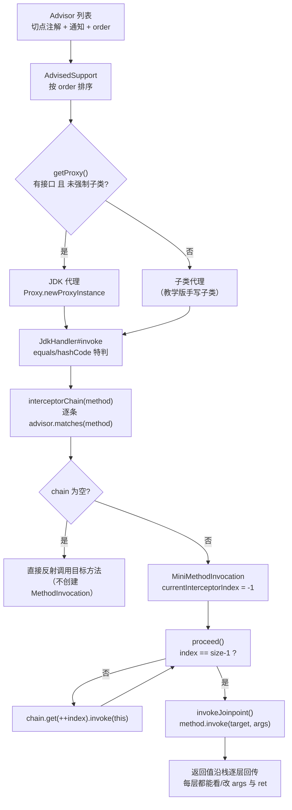
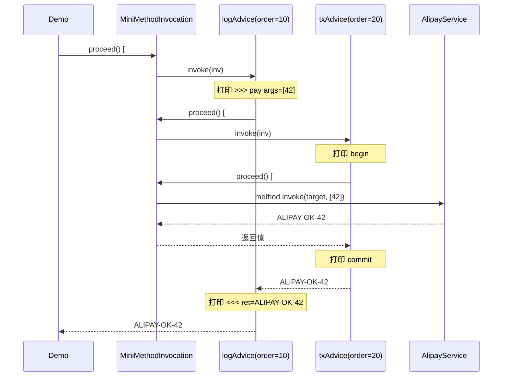

# 手写迷你实现 02：300 行写出 MiniAOP —— 注解切点、两种代理、一条有序拦截器链

> 一句话结论：Spring AOP 的全部魔法可以压成三步：**①"这个方法要不要被拦"由 Advisor 的切点算出来（静态决策）→ ②"用哪种代理"由一个布尔值 `proxyTargetClass` 决定（JDK 接口代理 or 子类代理）→ ③"拦下来之后怎么串"由一个带下标的 `MethodInvocation#proceed()` 自递归决定（顺序 = Advisor 的 order）**。搞清这三步，`@Transactional` 不生效、`this.xxx()` 不走代理、`$Proxy` 与 `$$SpringCGLIB$$` 的差别就全都能自己推出来。
> 阅读前置：[01-Spring框架/02-AOP与代理/01-aop-原理与自动代理创建.md](../../01-Spring框架/02-AOP与代理/01-aop-原理与自动代理创建.md)、[02-代理方式-jdk与cglib.md](../../01-Spring框架/02-AOP与代理/02-代理方式-jdk与cglib.md)、[03-拦截器链-调用与通知顺序.md](../../01-Spring框架/02-AOP与代理/03-拦截器链-调用与通知顺序.md)、上一篇 [01-手写miniioc容器.md](01-手写miniioc容器.md)
> 预计阅读：35 分钟 ｜ 源码：`org.springframework:spring-aop:7.1.0`、`org.springframework:spring-beans:7.1.0`

---

## 0. 先看现象（3 分钟上手）

### 0.1 真实可运行的那份：`examples/mini-frameworks/aop/MiniAop.java`

仓库里有一份**单文件、零第三方依赖、自测断言全过**的实现（153 行）。在 `learning-docs/24-源码分析` 目录下执行：

```powershell
$javac="D:\DevTools\jdk\jdk17.0.19\bin\javac.exe"; $java="D:\DevTools\jdk\jdk17.0.19\bin\java.exe"
& $javac -encoding UTF-8 -d .source-cache/mini-check/aop examples/mini-frameworks/aop/MiniAop.java
& $java -cp .source-cache/mini-check/aop mini.aop.MiniAop
```

实测输出（3 行，退出码 0）：

```text
PASS aop: [outer.before, inner.before, target, inner.after, outer.after]
PASS aop: same checked exception propagated; after advice ran in reverse order
PASS aop: unmatched method bypasses advice
```

这 3 行正好对应本文三个核心结论：

1. 第一行 = **拦截器链的顺序**：先注册的 `outer` 在最外层，`before` 由外向内、`after` 由内向外，目标方法只在最中间执行一次。这正是真实 Spring 里"order 小的在外层"的同一件事。
2. 第二行 = **异常穿透**：业务方法抛出的受检异常（`BusinessException`）原样穿过两层通知，`InvocationTargetException` 必须被拆掉；同时 `after` 部分依然按逆序执行（示例用 `try/finally` 实现）。
3. 第三行 = **切点不匹配直接放行**：`ServiceImpl#plain()` 上没有 `@Logged`，代理原样转调，根本不建链。

示例的公开 API 很小，后面每一节都会拿它跟真实 Spring 对照：

| 示例里的东西 | 作用 | 真实 Spring 的对应物 |
| --- | --- | --- |
| `@Logged` | 切点：只有标了它的方法才拦 | `@Transactional` 这类注解 + `AnnotationMatchingPointcut` |
| `Interceptor#invoke(Proceeding)` | 环绕通知 | `org.aopalliance.intercept.MethodInterceptor#invoke(MethodInvocation)` |
| `Proceeding#proceed()` | 通知用来"放行到下一层" | `MethodInvocation#proceed()` |
| `Chain`（私有类，持 `index`） | 带下标的自递归链 | `ReflectiveMethodInvocation` |
| `MiniAop.proxy(Class<T> api, T target, List<Interceptor>)` | `Proxy.newProxyInstance` 造代理 | `ProxyFactory#getProxy()` / `JdkDynamicAopProxy` |

### 0.2 完整目标形态（设计示意，未实测）

真实 Spring 的 AOP 比示例多两件事：**Advisor 抽象**（切点 + 通知 + order 三元组）和**两种代理**（JDK 接口代理 / 子类代理）。把这两件事补上，调用方代码会变成下面这样。**注意：这段代码不在本仓库里，也没有实测**，它只用来告诉你"终局长什么样"，§3 会逐段解释为什么这样设计：

```java
MiniProxyFactory.PaymentService proxy = MiniProxyFactory.proxy(new MiniProxyFactory.AlipayService(),
        logAdvice(10),      // @MiniLog，order = 10
        txAdvice(20));      // @MiniTx ，order = 20
System.out.println(proxy.pay(42));
System.out.println(proxy.refund(42));
```

`AlipayService#pay` 上同时标了 `@MiniLog` 和 `@MiniTx`，`#refund` 上只标了 `@MiniTx`。这段示意实现的设计预期输出是（**预测，不是实测**；缩进保留以看清层次）：

```text
[aop] jdkProxyClass = jdk.proxy1.$Proxy0, isJdkProxy = true
    [log-10] >>> pay args=[42]
    [tx-20] begin
        [target] AlipayService.pay(42)
    [tx-20] commit
    [log-10] <<< ret=ALIPAY-OK-42
[aop] result = ALIPAY-OK-42
    [tx-20] begin
        [target] AlipayService.refund(42)
    [tx-20] commit
[aop] refund = REFUND-OK-42
[aop] inventory -> teaching subclass proxy only supports PaymentService
[aop] subclassProxyClass = miniaop.MiniProxyFactory$PaymentServiceCglibProxy, isJdkProxy = false
    [log-10] >>> pay args=[99]
    [tx-20] begin
        [target] AlipayService.pay(99)
    [tx-20] commit
    [log-10] <<< ret=ALIPAY-OK-99
[aop] result2 = ALIPAY-OK-99
```

如果真把它跑起来，请盯住四件事，它们就是本文的全部内容：

1. **`jdk.proxy1.$Proxy0`**：`pay` 被代理了，代理类是 JDK 动态生成的，名字形如 `$Proxy0`（真实 Spring 里 CGLIB 代理长这样：`XxxService$$SpringCGLIB$$0`）；
2. **`[log-10]` 在最外层、`[tx-20]` 在里面**：order 小的在外层。所以 **order 决定的是"包装层次"，不是"执行先后"**——`begin` 和 `>>>` 的先后完全由这个层次决定；
3. **`refund` 只有 `[tx-20]`**：`@MiniLog` 没标在 `refund` 上，切点不匹配 → 这条通知根本**没进链**（不是"进了链再判断跳过"）；
4. **`InventoryService`（没有接口）走 JDK 路线直接报错、走子类路线才成功**：这就是 Spring 里 `proxyTargetClass` 存在的理由。

## 1. 整体地图（先图后码）



> 读图说明：这张图画的是 **§0.2 的目标形态**（有 Advisor、有两种代理）。仓库里的 `MiniAop.java` 只走了 `C -- 是 --> D` 那条 JDK 路线（外加 `F`~`M` 的链与最后反射调用），`B` 的排序与 `E` 的子类代理属于延伸示意。图里有三个需要你停下来看的地方。
> 第一个是 `C` 节点——**"用哪种代理"不是在调用时决定的，而是在创建代理对象那一刻决定的一次性选择**；所以 `AopUtils.isJdkDynamicProxy()` 只在创建后才有意义。
> 第二个是 `H` 节点——对应真实源码 `JdkDynamicAopProxy#invoke` 里的 `if (chain.isEmpty())`；没有通知的方法会走一条"完全没有 `MethodInvocation` 对象"的快路径，这也是为什么你在 `ReflectiveMethodInvocation#proceed` 上给一个没有 `@Transactional` 的方法打断点是打不到的。
> 第三个是 `K`/`L` 形成的**环**——`proceed()` 不是"遍历"，而是一个每层通知都重新进入 `proceed()` 的**递归**；`currentInterceptorIndex` 这个下标是共享的（同一个 invocation 对象），所以顺序天然正确、也不需要下标回退。真实源码那句话的注释写得很直白：*"We start with an index of -1 and increment early."*

本文教学代码与真实 Spring 的对照关系（先记住这张表，后面每一节都在填它的细节）。**表里的教学类属于 §0.2 的"目标形态"**——其中 `JdkHandler`/`invokeJoinpoint`/链的 `proceed()` 在示例 `MiniAop.java` 里有对应的实现（叫 `Chain`），而 `Advisor`、`AdvisedSupport`、`PaymentServiceCglibProxy` 是延伸示意，不在仓库里：

| 教学类/方法 | 真实 Spring 的对应物 | 一句话说明 |
| --- | --- | --- |
| `MiniProxyFactory.Advisor` | `org.springframework.aop.Advisor` | 切点（Pointcut）+ 通知（Advice）的二元组 |
| `Advisor#matches(Method)` | `Pointcut#getMethodMatcher()` + `MethodMatcher#matches` | 静态方法匹配：只看"方法有没有标注解" |
| `AdvisedSupport` | `org.springframework.aop.framework.AdvisedSupport` [[源码:AdvisedSupport.java#L153-L159]] | 存 target、interfaces、advisors、`proxyTargetClass` |
| `interceptorChain(Method)` | `AdvisedSupport#getInterceptorsAndDynamicInterceptionAdvice` | 算出"这个方法要过哪几条通知"，并按 order 排好 |
| `MiniProxyFactory#getProxy()` | `ProxyFactory#getProxy()` [[源码:ProxyFactory.java#L96-L98]] | 干活只有一行：`createAopProxy().getProxy()` |
| `JdkHandler#invoke` | `JdkDynamicAopProxy#invoke` [[源码:JdkDynamicAopProxy.java#L163-L220]] | `InvocationHandler` 的全部逻辑都在这里 |
| `MiniMethodInvocation#proceed` | `ReflectiveMethodInvocation#proceed` [[源码:ReflectiveMethodInvocation.java#L155-L181]] | 带下标的递归，决定通知的嵌套顺序 |
| `invokeJoinpoint(...)` | `AopUtils#invokeJoinpointUsingReflection` | 最后一层反射调用，并把 `InvocationTargetException` 拆掉 |

## 2. 关键类逐个拆

| 教学类/接口 | 职责 | 对应真实 Spring 的类 | 备注 |
| --- | --- | --- | --- |
| `@MiniLog` / `@MiniTx` | 切点：标在方法上表示"要拦" | `@Transactional` 这类注解 + `AnnotationMatchingPointcut` | 真实版是"注解 → Pointcut"，教学版把 Pointcut 简化成"注解类型" |
| `MethodInterceptor` | 环绕通知 | `org.aopalliance.intercept.MethodInterceptor` | 契约只有 `Object invoke(MethodInvocation)`，没有任何 Spring 类型 |
| `MethodInvocation` | 通知能拿到的上下文 | `org.aopalliance.intercept.MethodInvocation` | `getMethod` / `getArguments` / `getThis` / `proceed` 四个方法就够用了 |
| `Advisor` | 切点 + 通知 + order | `DefaultPointcutAdvisor` / `AspectJPointcutAdvisor` | 教学版把 order 直接塞进 Advisor，真实版是 Advisor 实现了 `Ordered` |
| `AdvisedSupport` | 代理配置中心 | `AdvisedSupport` / `ProxyCreatorSupport` / `ProxyConfig` | 真实版三层继承：配置（ProxyConfig）→ 通知链（AdvisedSupport）→ 造代理（ProxyCreatorSupport） |
| `JdkHandler` | JDK 代理的 `InvocationHandler` | `JdkDynamicAopProxy`（它自己就实现了 `InvocationHandler`） | 真实版还实现了 `Serializable`、`SpringProxy`、`Advised` 等标记接口 |
| `PaymentServiceCglibProxy` | 手写"生成子类" | CGLIB 生成的 `Xxx$$SpringCGLIB$$0` | 教学版不能真生成字节码，所以手写一个固定子类来演示语义 |
| `MiniMethodInvocation` | 拦截器链的执行上下文 | `ReflectiveMethodInvocation` | 真实版还支持"动态切点"（`InterceptorAndDynamicMethodMatcher`）、`invocableClone` |
| `invokeJoinpoint(...)` | 反射调目标方法 | `AopUtils#invokeJoinpointUsingReflection` | 关键动作：把 `InvocationTargetException` 转成业务异常本身 |

## 3. 实现逐段精读 + 与真实源码对照

> 本节每一小节都是"教学代码片段 → 它做了什么 → 真实 Spring 对应哪几行 → 坑"。
> 本文片段分两类：**标注「✅ 示例代码」的逐字取自** [`examples/mini-frameworks/aop/MiniAop.java`](../../examples/mini-frameworks/aop/MiniAop.java)（153 行，已实测编译运行，命令与输出见 §0.1）；**标注「延伸示意」的（`Advisor`、`AdvisedSupport`、手写子类代理）不在仓库里、未实测**，只用来演示 §0.2 的目标形态。教学代码与真实源码用**同名方法/同结构**刻意对齐，方便你左右对照；为省篇幅，正文省略了 `import`。

### 3.1 "要不要拦"：切点是静态决策

以下为**延伸示意**（把切点/通知/order 合成一个 `Advisor` 的写法不在 `MiniAop.java` 里，未实测）：

```java
/** Advisor = pointcut (which annotation) + advice (what to do) + order. */
public static class Advisor {
    private final Class<? extends java.lang.annotation.Annotation> pointcutAnnotation;
    private final MethodInterceptor advice;
    private final int order;

    public Advisor(Class<? extends java.lang.annotation.Annotation> pointcutAnnotation,
                   int order, MethodInterceptor advice) {
        this.pointcutAnnotation = pointcutAnnotation;
        this.order = order;
        this.advice = advice;
    }

    boolean matches(Method method) {
        return method.isAnnotationPresent(pointcutAnnotation);
    }
}
```

- **在干什么**：把"AOP 三要素"压成一个对象——**切点**（哪个注解）、**通知**（干什么）、**顺序**（order）。`matches` 只做一件事：这个方法上有没有这个注解。
- **为什么这么写**：Spring AOP 的切点分两层：静态匹配（`MethodMatcher#isRuntime() == false`，只看方法签名/注解，可以在创建代理时算完并缓存）与动态匹配（要看运行时实参，每条调用都得再算一次）。教学版只有静态匹配——**这正是真实世界里 95% 的切面的样子**（`@Transactional`、`@Cacheable`、`@Async` 全是静态切点）。
- **如果改成别的**：如果把 `matches` 改成"类上有注解就算"，你立刻会得到"代理类上所有方法都被拦"的效果——这就是 `@Transactional` 标在类上时的行为（`AnnotationTransactionAttributeSource` 会先用类级注解兜底）。反过来，如果匹配写成"方法名以 pay 开头"，你就在实现 `NameMatchMethodPointcut`。
- **常见坑**：`method.isAnnotationPresent(...)` 拿到的是**这个方法上直接标的注解**，不包含从接口继承来的注解（`@Inherited` 只对类有效）。这一点后面 §3.5 会用一个真实 bug 兑现。
- **对应真实源码**：Advisor 是 `PointcutAdvisor` 的最小形态；Spring 的 `Pointcut` 拆成 `ClassFilter` + `MethodMatcher` 两半，因为它要支持"先筛类、再筛方法"这种两级剪枝。对照阅读：[01-aop-原理与自动代理创建.md](../../01-Spring框架/02-AOP与代理/01-aop-原理与自动代理创建.md)。

**示例里对应的这一步（✅ 示例代码）**：`MiniAop.java` 没有 `Advisor` 这个类，它把"切点"退化成一个注解类型、把"匹配"退化成一次 `isAnnotationPresent`，直接写在 `InvocationHandler` 里：

```java
Method targetMethod = findTargetMethod(target, method);
if (!targetMethod.isAnnotationPresent(Logged.class)) {
    return invokeTarget(target, targetMethod, args);   // 不匹配 → 直接放行，不进链
}
```

两处差别值得记住：① 示例判的是**实现类上的方法**——`findTargetMethod` 用 `target.getClass().getMethod(名, 参数类型)` 拿到实现类方法，而不是 `api` 接口上的方法，因为接口 `Service#call` 上根本没有 `@Logged`；② 示例的"切点"就是一个注解类型，真实 Spring 是一个 `Pointcut` 对象，但"匹配结果算一次、之后只查结果"这个思路完全一样。§0.1 第 3 行 PASS 验证的正是这段放行分支。

### 3.2 "按 order 组装"：一条链，先排序再匹配

以下为**延伸示意**（`AdvisedSupport` 与 order 排序不在 `MiniAop.java` 里；示例的链由调用方直接按顺序传入，未实测）：

```java
public static class AdvisedSupport {
    private Object target;
    private final List<Advisor> advisors = new ArrayList<>();

    public AdvisedSupport addAdvisor(Advisor advisor) {
        advisors.add(advisor);
        advisors.sort(Comparator.comparingInt(a -> a.order));   // like AnnotationAwareOrderComparator
        return this;
    }

    List<MethodInterceptor> interceptorChain(Method method) {
        List<MethodInterceptor> chain = new ArrayList<>();
        for (Advisor advisor : advisors) {
            if (advisor.matches(method)) {
                chain.add(advisor.advice);
            }
        }
        return chain;
    }
}
```

> 这一块为了聚焦"排序 + 匹配"两件事，略去了 `setTarget`/`getTarget`/`setProxyTargetClass`/`getProxyTargetClass` 四个访问器；其中 `proxyTargetClass` 为 `true` 表示"永远用子类代理"，对应真实 Spring 的 `ProxyConfig#setProxyTargetClass(true)`（也就是 `@EnableAspectJAutoProxy(proxyTargetClass = true)`）。

- **在干什么**：`addAdvisor` 时按 order 升序排好，`interceptorChain(method)` 时按"排好的顺序"逐条匹配，匹配上就放进链。
- **为什么这么写**：真实 Spring 里这一步叫 `getInterceptorsAndDynamicInterceptionAdvice(method, targetClass)`，它做三件事：**①对每个 Advisor 用 `AdvisorAdapterRegistry` 把 Advice 适配成 `MethodInterceptor`**（`@Before` 变成 `MethodBeforeAdviceInterceptor`，`@AfterReturning` 变成 `AfterReturningAdviceInterceptor`……）；**②用 `Pointcut#getMethodMatcher()` 过滤**；**③按 `Ordered`/`@Order` 排序**（`AnnotationAwareOrderComparator`）。
- **如果改成别的**：如果不在 `addAdvisor` 时排序、而在 `interceptorChain` 里排序，结果一样但每条调用都要排一次（真实 Spring 把链缓存在 `AdvisedSupport#advisors` 与 `MethodCache` 里）。如果**删掉排序**，你得到的是"注册顺序"——Spring Boot 里各 starter 注册 Advisor 的顺序完全不可控，于是 order 失效、`@Transactional` 可能跑到 `@Async` 外层，事务就覆盖不了异步线程。
- **常见坑**：链的**顺序就是嵌套顺序**：order 小的在最外层（先 `begin` 后 `>>>`）。所以"日志要包住事务"就得让日志的 order 更小；反了就会出现"事务已经提交了、日志里还能看到异常"这种诡异现象。真实案例：[03-拦截器链-调用与通知顺序.md](../../01-Spring框架/02-AOP与代理/03-拦截器链-调用与通知顺序.md)。
- **对应真实源码**：`AdvisedSupport#setTarget` 只是把 target 包成 `SingletonTargetSource` [[源码:AdvisedSupport.java#L153-L159]]——**这一层包装不白加**，它是 `@Scope("prototype")`、`@Lazy` 注入、`HotSwappableTargetSource` 全都能生效的地方：代理永远只依赖 `TargetSource`，不依赖具体对象。

### 3.3 "用哪种代理"：一个布尔值决定全部分支

先看真实 Spring 的入口，只有一行：

```java (src: ProxyFactory.java#L96-L98)
	public Object getProxy() {
		return createAopProxy().getProxy();
	}
```


- **在干什么**：`createAopProxy()` 是 `ProxyCreatorSupport` 里的模板方法，它看两件事：**`hasNoUserSuppliedProxyInterfaces()`？** 和 **`isProxyTargetClass()`**。选出来的要么是 `JdkDynamicAopProxy`，要么是 `ObjenesisCglibAopProxy`，然后 `.getProxy()` 造对象。
- **为什么这么写**：把"选择实现"和"创建对象"分成两步，就可以让 `getProxy()` 与 `getProxy(ClassLoader)` 共用同一套选择逻辑；再加上一个 `createAopProxy()` 返回的 `AopProxy` 接口只有 `getProxy()` 与 `getProxyClass()` 两个方法，测试时可以换成假实现。
- **如果改成别的**：`ProxyCreatorSupport#createAopProxy` 的实参来自 `AopProxyFactory`，而默认实现 `DefaultAopProxyFactory` 的判据是：*"没有接口 **或** 指定了 `proxyTargetClass` **或** 只有 `SpringProxy` 这类标记接口" → CGLIB*。这就是你在源码里看到"明明实现了接口却还是 CGLIB"的唯一原因。
- **常见坑**：`ProxyFactory(Object target)` 这个构造器顺手干了 `setInterfaces(ClassUtils.getAllInterfaces(target))` [[源码:ProxyFactory.java#L49-L52]]；而 `ProxyFactory(Class<?>... proxyInterfaces)` 不设 target，必须自己 `setTarget` 或 `addAdvice`。很多人手写 demo 时用错构造器，得到"调用目标为 null"的 `NullPointerException`。

教学版的同一个分支（**延伸示意**，`MiniProxyFactory` 不在仓库里；示例只实现了 JDK 这一条路）：

以下为**延伸示意**（未实测）：

```java
public Object getProxy(ClassLoader classLoader) {
    Class<?> targetClass = advised.getTarget().getClass();
    boolean hasInterfaces = targetClass.getInterfaces().length > 0;
    if (!advised.proxyTargetClass && hasInterfaces) {
        return jdkProxy(classLoader, targetClass);
    }
    return subclassProxy();
}

private Object jdkProxy(ClassLoader classLoader, Class<?> targetClass) {
    return Proxy.newProxyInstance(classLoader, targetClass.getInterfaces(), new JdkHandler(targetClass));
}
```

真实 Spring 里对应的那一句是：

```java (src: JdkDynamicAopProxy.java#L121-L122)
		return Proxy.newProxyInstance(determineClassLoader(classLoader), this.cache.proxiedInterfaces, this);
	}
```


- **在干什么**：三个参数：类加载器、要实现的接口数组、`InvocationHandler`。注意第三个参数是 **`this`**——`JdkDynamicAopProxy` 自己就是 handler，它没有另写一个内部类。
- **为什么这么写**：把 handler 与"代理配置"放同一个对象里，`invoke` 里就能直接用 `this.advised` 拿切点、拿 target、拿 exposeProxy 开关；而且这个对象天然可以 `Serializable`，代理也就可序列化。
- **如果改成别的**：如果把 `proxiedInterfaces` 换成 `targetClass.getInterfaces()`（教学版的做法），你得到的是同样效果；但如果代理**目标本身已是代理**（二次代理），接口列表就得去重、还得把 `SpringProxy`、`Advised` 加进去——真实版 `AopProxyUtils.completeProxiedInterfaces` 干的就是这事。
- **常见坑**：**JDK 代理只能按接口取**——`Proxy.newProxyInstance` 的第二个参数必须是接口数组，传进去一个类会立刻抛 `IllegalArgumentException: not an interface`。所以"目标没有接口"时必须换子类代理路线（这正是 `proxyTargetClass` 存在的理由）；真实 Spring 在这种情况下会**静默降级为 CGLIB**，你不会看到报错——但也因此经常"不知道自己用的是 CGLIB"。示例 `MiniAop.java` 把这件事显式化了：它的签名是 `proxy(Class<T> api, T target, List<Interceptor>)`，第一个参数就是要代理的接口。

下面先看真实源码这一段（spring-aop 7.1.0）：

```java (src: JdkDynamicAopProxy.java#L163-L171)
	public @Nullable Object invoke(Object proxy, Method method, Object[] args) throws Throwable {
		Object oldProxy = null;
		boolean setProxyContext = false;

		TargetSource targetSource = this.advised.targetSource;
		Object target = null;

		try {
			if (!this.cache.equalsDefined && AopUtils.isEqualsMethod(method)) {
```

(src: JdkDynamicAopProxy.java#L163-L171)

- **在干什么**：前面 8 行是"准备工作"：备份 `oldProxy`、标记 `setProxyContext`、从 `advised` 里取 `TargetSource`，`target` 先置 `null`（注意——**到这里目标对象还没取**）。
- **为什么这么写**：`target` 必须"尽量晚地取"（源码注释：*"Get as late as possible to minimize the time we 'own' the target"*），因为 `TargetSource` 可能来自连接池、可能是 `ThreadLocal` 的请求作用域对象。提前取 = 提前占用。
- **如果改成别的**：如果方法一开始就 `target = targetSource.getTarget()`，`@RequestScope` 的 bean 会在代理创建的那一刻就被解析，直接抛"no thread-bound request"。
- **常见坑**：`equals`/`hashCode` 的判断是**以"目标类有没有自己实现"为前提**的（`equalsDefined`），所以两个代理对象的 `equals` 行为取决于目标类而不是代理类。`Set<OrderService>` 里放代理时踩过的坑都是这里来的。

接着是"算链 + 走链"，这一段有两个分水岭，原文如下：

```java (src: JdkDynamicAopProxy.java#L207-L220)
			if (chain.isEmpty()) {
...
				@Nullable Object[] argsToUse = AopProxyUtils.adaptArgumentsIfNecessary(method, args);
				retVal = AopUtils.invokeJoinpointUsingReflection(target, method, argsToUse);
			}
			else {
				// We need to create a method invocation...
				MethodInvocation invocation =
						new ReflectiveMethodInvocation(proxy, target, method, args, targetClass, chain);
				// Proceed to the joinpoint through the interceptor chain.
				retVal = invocation.proceed();
			}
```

- **在干什么**：分水岭一 `if (chain.isEmpty())`：没有通知就走"直调"快路径，**不创建 `MethodInvocation`**；否则 new 一个 `ReflectiveMethodInvocation` 并 `proceed()`。
- **为什么这么写**：`MethodInvocation` 对象要拷贝实参数组、要存 proxy/target/method/chain，对无通知的方法（`toString`、`getXxx`、大部分查询）是纯开销。这个快路径是 Spring AOP 性能能接受的关键之一。
- **如果改成别的**：如果永远走 `else` 分支，功能完全正确、只是每个被代理的调用都多一次对象分配和一次数组拷贝 —— 而且你的断点会"无处不在"，调试体验更差。
- **常见坑**：**"没有通知的方法不会出现在 `ReflectiveMethodInvocation` 里"**。所以你在那里下条件断点 `method.getName().equals("findById")` 却打不到，先要确认这个方法真的被某个切面匹配上了（用 §6 的方法验证）。

分水岭二在返回处：`retVal == target && returnType.isInstance(proxy)` 时把返回值换成 `proxy` 本身 [[源码:JdkDynamicAopProxy.java#L224-L226]]。意思是"目标方法返回了 `this`，而调用方期望拿到代理"，于是 Spring 帮你换。示例 `MiniAop.java` 没有做这件事——它的 `ServiceImpl` 里没有返回 `this` 的方法。

### 3.4 代理的 `invoke`：算链 + 空链直调

教学版的 `JdkHandler#invoke` 是上面那段真实源码的"去注释版"（**延伸示意**，未实测；示例 `MiniAop.java` 里对应的实现是 `proxy()` 方法里的那个 lambda，三步完全一样：取实现类方法 → 判注解 → 进链）：

以下为**延伸示意**（未实测）：

```java
private class JdkHandler implements InvocationHandler {
    private final Class<?> targetClass;

    @Override
    public Object invoke(Object proxy, Method method, Object[] args) throws Throwable {
        if (method.getDeclaringClass() == Object.class) {
            return invokeJoinpoint(method, advised.getTarget(), args);   // equals/hashCode/toString
        }
        Method targetMethod = targetClass.getMethod(method.getName(), method.getParameterTypes());
        List<MethodInterceptor> chain = advised.interceptorChain(targetMethod);
        if (chain.isEmpty()) {
            return invokeJoinpoint(targetMethod, advised.getTarget(), args);  // like if (chain.isEmpty())
        }
        return new MiniMethodInvocation(advised.getTarget(), targetMethod, args, chain).proceed();
    }
}
```

- **在干什么**：把 `Object` 的三个方法直接转给目标；用**实现类**重新解析出 `targetMethod`；算链；空链直调、非空链走 invocation。
- **为什么多此一举地 `targetClass.getMethod(...)`**：因为 `invoke` 收到的 `method` 是**接口方法**（`PaymentService#pay`），而注解标在**实现方法**（`AlipayService#pay`）上。用接口方法去匹配切点，注解一个也读不到。这个问题极为真实：Spring 里对应的方法叫 `AopUtils.getMostSpecificMethod(method, targetClass)`，再加上 `BridgeMethodResolver` 处理泛型桥方法。教学版 `getMethod(name, paramTypes)` 是它的极简版。
- **如果改成别的**：如果把这一步去掉、直接拿 `invoke` 收到的接口方法去匹配切点，你的 `@MiniLog`/`@MiniTx` 就全部失效——**而且一句错都不报**：链永远是空的，代理静默放行。示例 `MiniAop.java` 在 `proxy()` 里专门用注释钉住了这个坑：*"接口 Service.call 上没有 @Logged，只有 ServiceImpl.call 上有 —— 所以这里必须用 target.getClass()，不能用 api。"*
- **常见坑**：`method.getDeclaringClass() == Object.class` 判断必须放在最前面。否则 `toString()` 会被当成业务方法去目标类里找（找不到就抛 `NoSuchMethodException`），而 Spring 自己重写了 `toString` 用来打印代理信息（见 §6.3）。

### 3.5 `proceed()`：一行下标 + 一行递归 = 有序嵌套

真实源码的入口：
```java (src: ReflectiveMethodInvocation.java#L154-L162)
	@Override
	public @Nullable Object proceed() throws Throwable {
		// We start with an index of -1 and increment early.
		if (this.currentInterceptorIndex == this.interceptorsAndDynamicMethodMatchers.size() - 1) {
			return invokeJoinpoint();
		}

		Object interceptorOrInterceptionAdvice =
				this.interceptorsAndDynamicMethodMatchers.get(++this.currentInterceptorIndex);
```


- **在干什么**（继续上一块）：先判断这一段之后的两条路：动态匹配器 vs 普通拦截器。
- **在干什么**：`currentInterceptorIndex` 初始 `-1`。每进一次 `proceed()` 先判断"是不是已经到最后一条"，是就直接调目标方法；否则把下标 `++` 并取出这条通知。
- **为什么这么写**：`proceed()` 是**由通知自己调用的**。所以"下一条是谁"必须记在 invocation 对象上，而不能用 for 循环——这就是它必须是有状态对象的原因。用 `++this.currentInterceptorIndex`（前置自增）在 `get` 的那一刻完成推进，省掉一行代码，也让"最后一条"的判断变得简单：`index == size - 1` 说明已经没人可取了。
- **如果改成别的**：如果改成"for 循环遍历 + 回调"，就无法实现环绕通知的洋葱模型（`before → 其它通知 → 目标 → 其它通知 → after`），`@Transactional` 也就无法包住整个方法。
- **常见坑**：**这个 invocation 对象不能被复用**。同一次调用的多条通知共享它，但如果调用之间共享（比如把它放进缓存），`currentInterceptorIndex` 就不可能回到 `-1`。真实 Spring 为此提供了 `invocableClone()`，用于"重试、多次调用"场景 [[源码:ReflectiveMethodInvocation.java#L203-L203]]。

紧接着是分支：
```java (src: ReflectiveMethodInvocation.java#L163-L181)
		if (interceptorOrInterceptionAdvice instanceof InterceptorAndDynamicMethodMatcher dm) {
...
		}
		else {
			// It's an interceptor, so we just invoke it: The pointcut will have
			// been evaluated statically before this object was constructed.
			return ((MethodInterceptor) interceptorOrInterceptionAdvice).invoke(this);
		}
	}
```

> 注：`...` 处原文是 11 行动态匹配器分支（L164-L175：`dm.matcher().matches(this.method, targetClass, this.arguments)` 成立则 `dm.interceptor().invoke(this)`，否则 `return proceed()` 跳过），为了聚焦主线略过，行号范围仍是 L163-L181。

- **在干什么**：分水岭——如果这条是"带动态匹配器"的通知，就**再判一次**（`dm.matcher().matches(method, targetClass, args)`），失败则跳过（递归调 `proceed()`）；否则直接 `invoke(this)`。
- **为什么这么写**：动态切点（`@args()`、`args()` 这种要看实参的）不能在创建代理时算完，只能在每次调用时算。而"跳过"的方式是**再调用一次 `proceed()`**——因为 `getId` 已经 `++` 过了，再来一次自然取到下一条。
- **如果改成别的**：如果把动态匹配器也当普通拦截器调，`args(String)` 这种切点就会对 `args(Integer)` 也生效。
- **常见坑**：`(MethodInterceptor) x` 这个强转能成立，是因为 `AdvisorAdapterRegistry` 已经把一切 Advice 适配成了 `MethodInterceptor`；如果你自己往链里塞了一个裸 `Advice`，这里就 `ClassCastException`。这也是"Spring AOP 只支持方法拦截"的物理原因——没有方法就没有 joinpoint。

去掉动态匹配后，链的执行就只剩两件事：**判断"到尾了吗"，没到尾就取出这一条交出去**。示例 `MiniAop.java` 里的 `Chain` 干的就是这件事（**✅ 示例代码**，逐字）：

```java
/** 一条拦截器链：每 proceed 一次就推进一格，走到链尾才反射调用目标方法 */
private static final class Chain implements Proceeding {
    private final List<Interceptor> interceptors;
    private final Object target;
    private final Method method;
    private final Object[] args;
    private final int index;      // 当前该执行第几条拦截器（关键状态）

    Chain(List<Interceptor> interceptors, Object target, Method method, Object[] args, int index) {
        this.interceptors = interceptors;
        this.target = target;
        this.method = method;
        this.args = args;
        this.index = index;
    }

    public Object proceed() throws Throwable {
        if (index == interceptors.size()) {
            return invokeTarget(target, method, args);          // 链尾 → 真正调用目标
        }
        return interceptors.get(index).invoke(
                new Chain(interceptors, target, method, args, index + 1));   // 把"下一格"交出去
    }
}
```

> 两处与真实源码的差异，都是为了"一个文件讲清楚"：① 真实版把下标存在 invocation 对象上（`currentInterceptorIndex`），在 `proceed()` 里 `++`；示例把下标做成**不可变字段**，每次 `proceed()` **新建**一个 `index + 1` 的 `Chain` 往下传——语义等价（谁也污染不了别人的下标），代价是多几次小对象分配。② 真实版的链尾判断是 `index == size - 1`，示例是 `index == size`，因为示例"先判断、后取值"，序号从 0 开始。其余部分——"通知自己调 `proceed()` 才继续往下"、"到链尾才反射调用目标"、"返回值沿栈回传"——一模一样。§0.1 第 1 行 PASS 打印的 `outer.before, inner.before, target, inner.after, outer.after` 就是这段代码跑出来的。

一次调用的栈展开可以画成下图。图是**延伸示意**（用 §0.2 的 `pay(42)`、`log`(order=10)、`tx`(order=20) 举例）；示例 `MiniAop.java` 里同一件事的对应物是 `trace("outer", events)`、`trace("inner", events)` 两个拦截器 + `ServiceImpl#call`，events 列表打印出来正是 §0.1 的第 1 行：



> 读图说明：注意 `#idx` 只有一份、在被所有人共享——三条竖线看到的是**同一个 invocation 对象**。`commit` 之所以在 `[target]` 之后打印，不是因为它"排在后面"，而是因为它在 `proceed()` 的**返回路径**上。这就是"环绕通知能拿到返回值"的机制：`Object ret = invocation.proceed();` 之后你手上就有 `ret` 了，可以打日志、可以改、可以返回缓存。

### 3.6 子类代理：为什么它能读到实现类注解

真实 CGLIB 代理的做法是"运行时生成一个子类，覆写所有非 final 方法，在方法体里调 `MethodInterceptor`"。示例不能生成字节码，这里**手写**一个等价子类——**这一节不在 `MiniAop.java` 里、未实测**，属于 §0.2 的延伸示意：

以下为**延伸示意**（未实测）：

```java
/** Hand-written "generated subclass": stands in for AlipayService$$EnhancerByCGLIB. */
public static class PaymentServiceCglibProxy implements PaymentService {
    private final PaymentService target;
    private final AdvisedSupport advised;

    @Override
    public String pay(long orderId) {
        try {
            // The "generated subclass" resolves the method on AlipayService (the concrete class),
            // not on the interface - that is why annotations on the impl class are visible here.
            Method method = AlipayService.class.getMethod("pay", long.class);
            List<MethodInterceptor> chain = advised.interceptorChain(method);
            if (chain.isEmpty()) {
                return target.pay(orderId);
            }
            return (String) new MiniMethodInvocation(target, method, new Object[]{orderId}, chain).proceed();
        } catch (Throwable ex) {
            throw new IllegalStateException(ex);
        }
    }
}
```

- **在干什么**：`pay` 里算链 → 走链或直调。`refund` 故意写成直调 `target.refund(...)`，用来演示"**没被覆写的方法就没有切面**"。
- **为什么这么写**：CGLIB 生成的子类在覆写方法里能拿到 `Method` 对象，而那个 `Method` 是**实现类上的**（因为子类继承自实现类），所以 `isAnnotationPresent` 能读到注解。这解释了真实世界里一个高频困惑：*"为什么 JDK 代理下 `@Transactional` 有时不生效、换成 CGLIB 就好了？"*——不完全是代理方式的问题，而是**注解标在实现类还是接口上**的问题。
- **如果改成别的**：如果子类只能代理 `final` 类或 `final` 方法，CGLIB 会抛 `IllegalArgumentException: Cannot subclass final class`。Spring 6 之后改用 ByteBuddy 生成子类，但语义没变：`final` 方法永远织不进去。
- **常见坑**：**`this.xxx()` 不走代理**。子类代理里，`target.pay(...)` 内部若调用 `this.refund(...)`，走的是**目标对象自己的方法**，不经过子类覆写 → 切面失效。这就是"同一个类里方法互调、事务不生效"的根因；解法是 `AopContext.currentProxy()` 或拆类。对照：[04-aop-实战-自定义注解切面与坑位.md](../../01-Spring框架/02-AOP与代理/04-aop-实战-自定义注解切面与坑位.md)。

如果强制走子类路线，**设计预期**输出是（**预测，不是实测**；`[log-10]` 的 `>`/`<` 缩进表示嵌套层数）：

```text
[aop] subclassProxyClass = miniaop.MiniProxyFactory$PaymentServiceCglibProxy, isJdkProxy = false
    [log-10] >>> pay args=[99]
    [tx-20] begin
        [target] AlipayService.pay(99)
    [tx-20] commit
    [log-10] <<< ret=ALIPAY-OK-99
[aop] result2 = ALIPAY-OK-99
```

`isJdkProxy = false` 来自 `Proxy.isProxyClass(...)`——**真实的 CGLIB 代理同样返回 `false`**，因为它不是 `Proxy` 的子类。这条判断在生产排障里非常有用：`aopContext` 里怀疑"代理没生效"时，先打印 `Proxy.isProxyClass(bean.getClass())`，false 且类名含 `$$` 就是 CGLIB。

## 4. 一次完整执行时序（端到端串起来）

从"用户拿到一个 service 并调用一次"的视角，把 §3 的片段串成一条线。图里的类名（`MiniProxyFactory`、`MiniMethodInvocation`、`$Proxy0`）取自 §0.2 的延伸示意，示例 `MiniAop.java` 里对应的是 `MiniAop.proxy` / `Chain` / `jdk.proxy…$Proxy0`：

```mermaid
flowchart LR
  S1["1 new AdvisedSupport<br/>setTarget + addAdvisor×2"] --> S2["2 getProxy()<br/>看 interfaces / proxyTargetClass"]
  S2 --> S3["3 Proxy.newProxyInstance<br/>得到 $Proxy0"]
  S3 --> S4["4 业务代码调用 proxy.pay(42)"]
  S4 --> S5["5 JdkHandler#invoke<br/>Object 方法特判"]
  S5 --> S6["6 targetClass.getMethod(...)<br/>拿实现类 Method"]
  S6 --> S7["7 interceptorChain<br/>log-10, tx-20"]
  S7 --> S8["8 new MiniMethodInvocation(...).proceed()"]
  S8 --> S9["9 log → tx → 目标 → tx → log<br/>返回值逐层回传"]
  S9 --> S10["10 调用方拿到 ALIPAY-OK-42"]
```



> 读图说明：`S2`→`S3` 是**创建期**（只发生一次），`S4`→`S10` 是**调用期**（每次调用都发生）。把这两段分开看，很多问题就自动分流了：
> "代理类名字不对 / 用了哪种代理"→ 看创建期；"切面没生效 / 顺序不对 / 事务没回滚"→ 看调用期。
> 另外注意 `S7` 与 `S8` 之间那条"空链快路径"被省略了：链为空时压根不会有 `S8`。

## 5. 设计模式与设计取舍

| 设计点 | 教学版做法 | 真实 Spring 做法 | 取舍 |
| --- | --- | --- | --- |
| 代理创建 | `if` 直接分流到两个方法 | `AopProxyFactory#createAopProxy` 返回 `AopProxy`，再 `getProxy()` | 真实版是**工厂 + 策略**，可插拔（`ProxyTargetClass` 之外的定制都能换） |
| 切点 | 一个注解类型 | `Pointcut` = `ClassFilter` + `MethodMatcher`，再加 `ComposablePointcut` 做 `&&`/`||` | 真实版支持"类级剪枝"，一个包 1000 个类时只解析可能命中的 |
| 通知适配 | 通知本身就是 `MethodInterceptor` | `AdvisorAdapterRegistry` 把 `@Before`/`@AfterReturning` 适配成 `MethodInterceptor` | 真实版对用户屏蔽"链里只有一种元素"这件事 |
| 链的执行 | 下标递归 | 同一个思路 + `InterceptorAndDynamicMethodMatcher` + `invocableClone` | 真实版多一层"可克隆"，服务重试/递归调用 |
| 代理选择 | `hasInterfaces && !proxyTargetClass` | `DefaultAopProxyFactory` 的三条判据 + `completeProxiedInterfaces` | 真实版多考虑"已是代理"、`SpringProxy` 等标记接口 |
| 与容器集成 | 手动 `proxy(target, advisors...)` | `AbstractAutoProxyCreator` 作为 `BeanPostProcessor` 自动包装 | 教学版是"程序化 AOP"，真实版是"声明式 AOP"；后者见上一篇 §3.6 |

**最重要的一条取舍**：Spring AOP 只做**方法级**拦截，不碰字段、不碰构造器、不支持自调用。原因是它的实现手段只有两个：JDK 接口代理、子类覆写。这两条路都**绕不过"方法调用必须从代理对象发出"**这个前提。AspectJ 之所以能做字段织入，是因为它改字节码（编译期/加载期织入）。理解这条边界，你就不会再问"为什么 `@Transactional` 标在 private 方法上无效"。

## 6. 踩坑与调试手法

### 6.1 链为空（切面"静默失效"）

现象：`@Transactional`/自定义注解切面完全不生效，无任何报错。排查顺序：

1. **看代理有没有生成**：`System.out.println(service.getClass().getName())`。`$Proxy` 或 `$$SpringCGLIB$$` 都没有 → 压根没代理，问题在 `AbstractAutoProxyCreator#wrapIfNecessary`，不在链上；
2. **看是不是同一个类里自调用**：`this.methodB()` 不经过代理；
3. **看注解标在哪一层**：注解标在**接口**上、而实际代理的是实现类（CGLIB），`getMostSpecificMethod` 会拿到实现方法、读不到接口上的注解 → 失效（教学版 §3.4 的坑就是这个的真实版）；
4. **看方法修饰符**：`private` / `static` / `final` 方法织不进去。

### 6.2 `InvocationTargetException` 吃掉了业务异常

这层拆包在延伸示意里叫 `invokeJoinpoint`、在示例 `MiniAop.java` 里叫 `invokeTarget`。先看延伸示意的命名（**未实测**）：

```java
static Object invokeJoinpoint(Method method, Object target, Object[] args) throws Throwable {
    try {
        method.setAccessible(true);
        return method.invoke(target, args);
    } catch (InvocationTargetException ex) {
        throw ex.getTargetException();
    }
}
```

示例 `MiniAop.java` 里等价的方法是 `invokeTarget(target, method, args)`，它用 `throw ex.getCause();` 拆包（`getTargetException()` 的同一件事，JDK 1.4 之后两个方法等价），并把 `IllegalAccessException` 包成 `IllegalStateException`。§0.1 第 2 行 PASS 就是在验证这一点：`main` 里 `catch (BusinessException ex)` 之后断言 `ex == target.failure`（异常**对象身份**没变），并且 `events` 列表仍是完整的 `outer.before, inner.before, target, inner.after, outer.after`（`try/finally` 保证 `after` 在异常路径上也逆序执行）。

不写 `getTargetException()` / `getCause()` 的后果：业务代码抛 `BizException`，经过代理变成 `InvocationTargetException`，`@Transactional` 的 `rollbackFor` 判不到 `BizException` → **事务不回滚**；`@ControllerAdvice` 也接不住。真实 Spring 在 `AopUtils#invokeJoinpointUsingReflection` 里做了同样的拆包。

### 6.3 打印代理对象导致 `StackOverflowError`

Spring 的代理对象重写了 `toString()`（会打印 "Spring AOP proxy: ..." 和 target 信息），如果你的 target 又反向持有代理（循环引用），`toString` 就会互相递归。教学版在 `JdkHandler` 里把 `toString` 直接转给 target，同样会踩。**调试打印时用 `AopUtils.getTargetClass(bean)` 或 `bean.getClass().getName()`，不要直接 `println(bean)`**。

### 6.4 断点打不到

- 打在 `ReflectiveMethodInvocation#proceed` 却进不去：这个方法没有通知（§3.4 的空链快路径）；
- 打在 `TransactionInterceptor#invoke` 却进不去：没走代理（§6.1）；
- 打在 `JdkDynamicAopProxy#invoke` 却进不去：你用的是 CGLIB 代理，应该打 `DynamicAdvisedInterceptor#intercept`（在 `CglibAopProxy` 里）。
- 完整的断点清单见 [../02-源码阅读方法论/02-断点清单-按框架速查.md](../02-源码阅读方法论/02-断点清单-按框架速查.md)。

### 6.5 用示例复现问题的三步法

1. 把打印的东西收窄：只打 `proxy.getClass().getName()`、`Proxy.isProxyClass(proxy.getClass())`、拦截器的条数（示例里就是传给 `proxy(...)` 的那个 `List` 的 `size()`）；
2. 在自己写的拦截器第一行加一句打印或者往 events 列表里塞一个标记，立刻能看出"哪个方法进了链、进了几层"——示例的 `trace(name, events)` 就是这么干的；
3. 把传给 `proxy(...)` 的两个拦截器**对调顺序**再跑一次，观察 `outer.before`/`inner.before` 的先后翻转——**这是理解"注册顺序决定嵌套层次"最快的实验**，改完输出就是 §0.1 第 1 行倒过来。

## 7. 与真实 Spring 的 5 处关键差异

| # | 差异 | 教学版 | 真实 Spring | 影响 |
| --- | --- | --- | --- | --- |
| 1 | **切点的表达力** | 只有"注解存在"一种 | `Pointcut` = `ClassFilter` + `MethodMatcher`；支持 `execution()`、`@within`、`args()`、`@annotation`；`ControlFlowPointcut`、`ComposablePointcut` 可以组合 | 教学版无法表达"只拦 service 包下的 public 方法"这类常见诉求 |
| 2 | **通知的适配层** | 只有 `MethodInterceptor` 一种 | `AdvisorAdapterRegistry` 把 `MethodBeforeAdvice`/`AfterReturningAdvice`/`ThrowsAdvice`/`@Around` 统一适配成 `MethodInterceptor`，链里元素类型唯一 | 教学版解释不了"`@Before` 和 `@Around` 谁的 order 更靠前"（真实版：同一套 order 规则，先适配再排序） |
| 3 | **动态切点与克隆** | 无 | `InterceptorAndDynamicMethodMatcher` 支持运行时再匹配；`invocableClone()` 支持重试/多轮调用 | 教学版的 invocation 一旦 `proceed` 到底就不可重放 |
| 4 | **CGLIB 代理的实现** | 手写一个固定子类 | 运行时字节码生成（Spring 6+ 用 ByteBuddy），类名 `Xxx$$SpringCGLIB$$0`，带 `SpringProxy`/`Advised`/`Factory` 等标记接口；`final` 类/方法不可代理 | 教学版无法演示"`final` 方法织不进去"，也无法演示 `AopContext.currentProxy()` 需要的 `exposeProxy` |
| 5 | **与 IoC 的接入方式** | 手动 `proxy(target, interceptors)`（示例 `MiniAop.proxy(api, target, interceptors)`） | AOP 是 `AbstractAutoProxyCreator`（一个 `SmartInstantiationAwareBeanPostProcessor`）自动完成的：`wrapIfNecessary` 里 `if (specificInterceptors != DO_NOT_PROXY)` 才建代理，且**在循环依赖场景下提前到 `getEarlyBeanReference`** | 教学版是"程序化 AOP"，读不到"BPP 在 `refresh` 里何时注册、为什么循环依赖时早期引用也是代理"这层信息 |

> 第 5 条与上一篇的结论完全一致：**AOP 是外挂在 `BeanPostProcessor` 上的**。容器不认识 `@Transactional`，它只会在创建完每个 bean 之后问一句"你们这些 BPP 要不要换掉它"。

## 8. 面试高频问与答

1. **JDK 代理和 CGLIB 代理的区别？** → JDK：`Proxy.newProxyInstance` 生成"实现了目标接口"的类，只能通过接口调用；CGLIB/ByteBuddy：生成"目标类的子类"，能代理类（非 final），调用方可以按实现类类型引用。Spring 默认"有接口就 JDK，`proxyTargetClass=true` 或没有接口就 CGLIB"。
2. **Spring Boot 2.x 之后为什么默认 `proxyTargetClass=true`？** → `AopAutoConfiguration` 里 `@ConditionalOnProperty(prefix="spring.aop", name="proxy-target-class", matchIfMissing=true)`；原因是 CGLIB 能避免"注入实现类类型失败"的问题，且 JDK 17 之后 CGLIB 生成已足够快。
3. **一条通知链是怎么排出来的？** → `AdvisedSupport#getInterceptorsAndDynamicInterceptionAdvice`：遍历 advisors → 适配成 `MethodInterceptor` → 静态切点过滤 → `AnnotationAwareOrderComparator` 排序（`@Order`/`Ordered`）。结果缓存在 `MethodCache` 里。
4. **`proceed()` 为什么用下标而不是 for 循环？** → 因为控制权在通知手里：通知决定"什么时候调用下一个"。下标记在 invocation 上，才能既保证顺序又支持环绕。
5. **`@Transactional` 加在 private 方法上为什么无效？** → 代理只能覆写/拦截可见的虚方法；private 方法既不能被覆写，也不会经过 `InvocationHandler`。
6. **同一个类里 A 方法调 B 方法，B 上的 `@Transactional` 为什么无效？** → 自调用不经过代理对象（`this` 是原始对象）。解法：注入自身代理、`AopContext.currentProxy()`（需 `exposeProxy=true`）、或拆类。
7. **`Proxy.isProxyClass` 有什么用？** → 判断是不是 JDK 动态代理。CGLIB 代理返回 `false`，但类名含 `$$`。排障时两者结合看。
8. **为什么 `method.invoke` 要拆 `InvocationTargetException`？** → 否则业务异常被包装，`rollbackFor`、`@ExceptionHandler`、`instanceof` 判断全部失效。
9. **`exposeProxy` 是什么？** → `AopContext.setCurrentProxy(proxy)`，把当前代理放进 `ThreadLocal`，供自调用时取出来重新走一遍切面。真实实现见 [[源码:JdkDynamicAopProxy.java#L191-L195]]。
10. **`@Around` 的返回值能改吗？** → 能。`Object ret = pjp.proceed(); return modify(ret);` —— 因为环绕通知在返回路径上，这也是“缓存型切面”的实现方式。教学版 §3.5 的时序图就是这个机制。
11. **为什么 Spring AOP 不支持字段拦截？** → 手段只有接口代理和子类覆写，二者都只能拦截方法调用。

## 9. 动手练习

> 只有**练习 1 的命令是本仓库实测过的**（就是 §0.1 那两条命令 + 3 行 PASS）。练习 2~6 都建立在 `examples/mini-frameworks/aop/MiniAop.java` 上，改法已经写清，但**我没有逐个跑过**——你跑出来是什么就是什么，别把我的描述当实测结果。

### 练习 1：把示例跑起来，确认你拿到的是 JDK 代理

在 `learning-docs/24-源码分析` 目录下：

```powershell
$javac="D:\DevTools\jdk\jdk17.0.19\bin\javac.exe"; $java="D:\DevTools\jdk\jdk17.0.19\bin\java.exe"
& $javac -encoding UTF-8 -d .source-cache/mini-check/aop examples/mini-frameworks/aop/MiniAop.java
& $java -cp .source-cache/mini-check/aop mini.aop.MiniAop
```

**验收**：3 行 PASS（内容见 §0.1）且 `$LASTEXITCODE` 为 0。然后在 `main` 里加一句 `System.out.println(service.getClass().getName());`，你会看到 `jdk.proxy…$Proxy0` 这类类名（`jdk.proxy1`/`jdk.proxy2` 这种编号因 JVM 内部计数而变，别惊讶）——`Proxy.isProxyClass(service.getClass())` 为 `true` 就是 JDK 动态代理。

### 练习 2：把两个拦截器对调，亲手看"注册顺序 = 嵌套层次"

把 `main` 里 `Arrays.asList(trace("outer", events), trace("inner", events))` 换成先 `inner` 再 `outer`，同时把 `expected` 列表也改成 `inner.before, outer.before, target, outer.after, inner.after`。**验收**：第一行 PASS 打印的就是这个新顺序——嵌套层次翻了，但"目标方法只执行一次"没变（只改拦截器顺序、不改 `expected`，会在第 2 组断言报 `Wrong success order`）。

### 练习 3：删掉"实现类解析"那一步，观察静默失效

把 `proxy(...)` 里的 `Method targetMethod = findTargetMethod(target, method);` 改成 `Method targetMethod = method;`（直接用接口方法）。**验收**：程序在第 1 组断言就抛 `AssertionError: Wrong success order: [target]`——链永远是空的、没有任何异常提示，这就是"切面静默失效"，也正是本示例修复前的那条报错。

### 练习 4：给 `plain()` 也加上 `@Logged`

在 `ServiceImpl#plain()` 上加 `@Logged`。**验收**：第 3 组断言变成失败（`Unmatched method was advised`），因为 `plain` 也进链了——把断言里的期望值改成带 `outer`/`inner` 的 5 步，它就重新 PASS。这一步是让你确认"拦不拦只看注解，与调用方无关"。

### 练习 5：写出一个"缓存切面"

写一个拦截器 `cache`：第一次真调目标（`next.proceed()`）并按参数缓存返回值，第二次直接返回缓存、**不调** `proceed()`。**验收**：`service.call("Spring")` 连调两次，`events` 里 `target` 只出现一次，两次返回值相同。仓库里没有这个拦截器（10 行以内就能写完）。

### 练习 6：让目标方法内部也能走代理（`exposeProxy` 的效果）

在 `proxy(...)` 里把 `proxy` 参数（JDK 传给 handler 的第一个参数）存进一个 `ThreadLocal`，再写一个拦截器/辅助方法，让目标方法内部通过它回头调用代理。**验收**：内部那次调用**又走了一遍链**（`events` 里出现两轮 `outer/inner`）——这就是 `AopContext.currentProxy()` + `exposeProxy=true` 想解决的问题；不存这个 `ThreadLocal`，目标方法里的 `this.xxx()` 永远绕过代理。

## 小结

- **本仓库实测到哪一档**：`MiniAop.java` 只走了"JDK 接口代理 + 注解切点 + 链 + 异常拆包"这一段，跑出来是 §0.1 的 3 行 PASS；`Advisor`/`order` 排序/子类代理是延伸示意，正文各处已标注**未实测**。
- **切点是静态决策**：创建代理时就算出"这个方法要过哪几条通知"，缓存起来；运行时只按链执行。
- **一条链，按 order 升序**：order 小 = 外层 = 先 `before` 后 `after`。排序发生在 `AdvisedSupport#getInterceptorsAndDynamicInterceptionAdvice`。
- **两种代理由一个布尔值分流**：`hasInterfaces && !proxyTargetClass` → JDK，否则子类。JDK 代理只能按接口取，子类代理能读到实现类注解。
- **`proceed()` 是下标递归**：`currentInterceptorIndex` 初始 -1、每次 `++`，到底了就反射调目标。返回值沿栈回传，这就是环绕通知能拿到返回值的原因。
- **两处必须拆包的异常**：`InvocationTargetException`（否则事务不回滚、全局异常处理接不住）。
- **AOP 的边界**：只能拦方法调用；`private`/`static`/`final`/自调用 一律无效。

## 自测题

1. `Advisor` 在教学版里由哪三部分组成？真实 Spring 的 `PointcutAdvisor` 多提供了什么？
2. 为什么教学版 `getProxy()` 要先判 `targetClass.getInterfaces().length > 0`？
3. `ProxyFactory(Object target)` 这个构造器除了 `setTarget` 还做了什么？
4. `JdkDynamicAopProxy#invoke` 里 `if (chain.isEmpty())` 走了什么快路径？为什么值得单独写这个分支？
5. `currentInterceptorIndex` 初值是多少？为什么 `proceed()` 里用 `++this.currentInterceptorIndex` 而不是 `i++`？
6. 顺序为 `log(10)`、`tx(20)` 时，`commit` 打印在 `[target]` 之前还是之后？为什么？
7. 为什么 `JdkHandler#invoke` 里要用 `targetClass.getMethod(...)` 重新解析方法？不做会怎样？
8. `@Transactional` 标在接口方法上、用 CGLIB 代理会不会失效？原理是什么？
9. `Proxy.isProxyClass(bean.getClass())` 返回 `false` 但类名含 `$$`，说明什么？
10. 为什么 `method.invoke` 里必须把 `InvocationTargetException` 拆掉？不拆会引发哪三类问题？
11. `AopContext.currentProxy()` 依赖哪个开关？它解决什么场景？
12. 教学版 `PaymentServiceCglibProxy#refund` 故意写成直调 target，用来演示什么？

<details><summary>参考答案</summary>

1. 切点（哪个注解）、通知（`MethodInterceptor`）、order。真实 `PointcutAdvisor` 把切点拆成 `ClassFilter`+`MethodMatcher`，支持类级剪枝与 `execution()` 等表达式，并且 Advisor 本身实现 `Ordered`。
2. 因为它模仿 `DefaultAopProxyFactory` 的判据：有接口才能用 JDK 动态代理（`Proxy.newProxyInstance` 必须传接口数组），没有接口只能走子类代理。
3. 还调了 `setInterfaces(ClassUtils.getAllInterfaces(target))`，把目标实现的所有接口设成代理接口——否则 `createAopProxy()` 会因为"没有接口"而选 CGLIB。
4. 走 `AopUtils.invokeJoinpointUsingReflection(target, method, argsToUse)` 直接反射调用，**不创建 `MethodInvocation`**。省掉对象分配、数组拷贝和一次递归，是 Spring AOP 性能可接受的重要原因。
5. 初值 `-1`。用前置自增是因为要在"取元素"的同一步完成推进，并且让"最后一条"的判断保持为 `index == size - 1`，代码更短、语义更直白（源码注释："increment early"）。
6. 之后（`commit` 在返回路径上）。因为 `tx` 在 `proceed()` 之后才打印 commit，返回值沿栈回传，外层 `log` 更晚。
7. 因为 `invoke` 收到的是接口 `Method`，而注解标在实现类方法上；不重新解析就读不到注解，链永远为空，切面**静默失效**。真实对应 `AopUtils.getMostSpecificMethod` + `BridgeMethodResolver`。
8. 会失效。接口上的注解属于接口方法，CGLIB 代理拿到的是实现类方法，`getMostSpecificMethod` 优先返回实现方法，读不到接口注解。要么把注解标在实现类上，要么使用 `AnnotatedElementUtils` 的合并查找（Spring 的 `AnnotationTransactionAttributeSource` 对 `publicMethod` 与 `specificMethod` 都查一遍，所以 `@Transactional` 在接口上其实能查到；但自定义切面用 `isAnnotationPresent` 就会漏）。
9. 说明它不是 JDK 动态代理，而是 CGLIB/ByteBuddy 生成的子类代理（`$$SpringCGLIB$$` 或 `$$ByteBuddy$$`）。
10. 不拆的话业务异常被包成 `InvocationTargetException`，导致：①`@Transactional` 的 `rollbackFor`/`noRollbackFor` 判断失败、事务不回滚；②`@ExceptionHandler` 匹配不到真实异常类型；③调用方 `catch (BizException)` 失效，日志里全是 `UndeclaredThrowableException`。
11. 依赖 `exposeProxy=true`（Spring Boot 默认 false，`@EnableAspectJAutoProxy(exposeProxy = true)` 打开）。解决"同类自调用不走代理"的场景：用 `AopContext.currentProxy()` 拿到代理再调，等于自己绕过 `this`。
12. 演示"没被代理覆写的方法不会有切面"——这正是自调用不生效、以及 `final`/`private` 方法织不进去的同一类现象。

</details>
