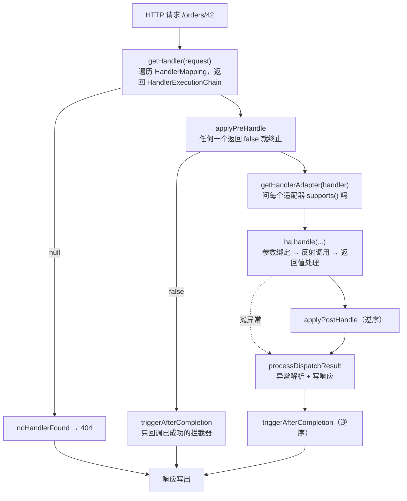
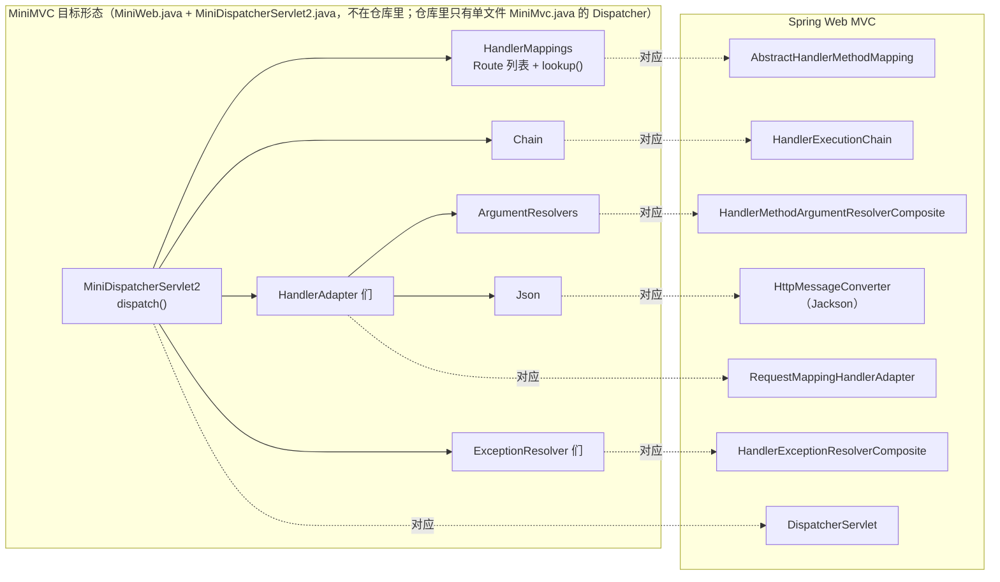
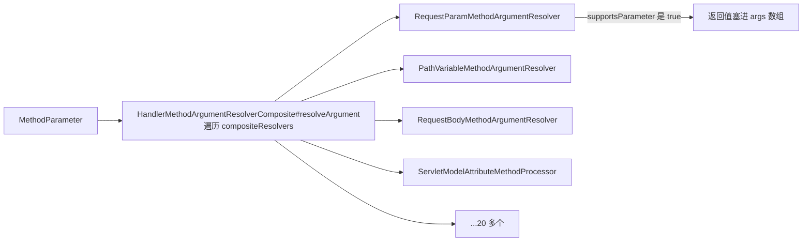
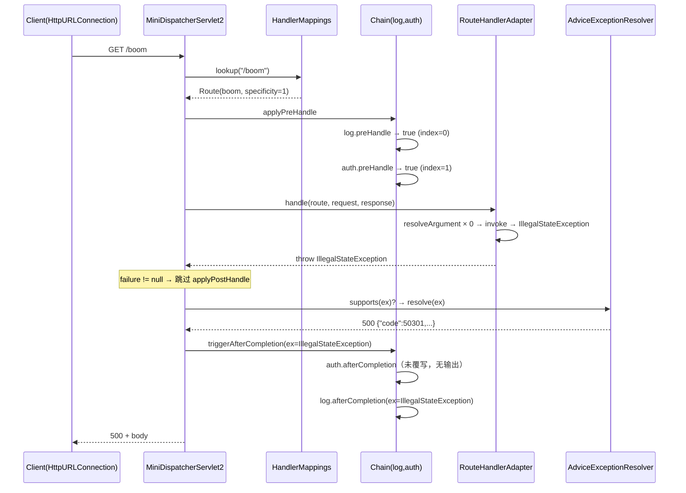

# 手写迷你实现 03：手写 MiniMVC 分发器 —— 从"找一个方法"到"把 HTTP 请求变成一次方法调用"

> 一句话结论：`DispatcherServlet#doDispatch` 只有 **9 个步骤**：`getHandler` → `applyPreHandle` → `getHandlerAdapter` → `handle` → `applyPostHandle` → `processDispatchResult`（异常解析 + 视图/消息转换）→ `triggerAfterCompletion`。你把这条主线写出来，再补上"**怎么按路径找到方法**（`lookupHandlerMethod`）"和"**怎么把参数塞进方法**（`HandlerMethodArgumentResolver`）"两块肉，就得到了一个能跑、能返回 JSON、能拦请求、能统一处理异常的迷你 MVC。
> 阅读前置：[04-SpringMVC/01-dispatcherservlet-一次请求的完整旅程.md](../../01-Spring框架/04-SpringMVC/01-dispatcherservlet-一次请求的完整旅程.md)、[04-SpringMVC/02-处理器映射与适配器-handlermapping与handleradapter.md](../../01-Spring框架/04-SpringMVC/02-处理器映射与适配器-handlermapping与handleradapter.md)、[04-SpringMVC/03-参数解析与返回值处理-argumentresolver与converter.md](../../01-Spring框架/04-SpringMVC/03-参数解析与返回值处理-argumentresolver与converter.md)
> 预计阅读：45 分钟 ｜ 源码：`org.springframework:spring-webmvc:7.1.0`、`org.springframework:spring-web:7.1.0`

---

## 0. 先看现象（3 分钟上手）

### 0.1 真实可运行的那份：`examples/mini-frameworks/mvc/MiniMvc.java`

先说清楚本文和你手上代码的关系：**仓库里能跑的 MVC 示例只有一个 245 行的单文件** [`examples/mini-frameworks/mvc/MiniMvc.java`](../../examples/mini-frameworks/mvc/MiniMvc.java)，零第三方依赖，`javac` 一把编译，`main` 里自带断言——断言全过才打印 PASS。它**没有**起 HTTP 服务器、**没有**拦截器、**没有** `@ControllerAdvice`，只做"分发"这一件事：注册表 → 选路由 → 绑参数 → 出状态码。

在 `learning-docs/24-源码分析` 目录下跑这两条命令（JDK 17；Windows PowerShell）：

```powershell
$javac="D:\DevTools\jdk\jdk17.0.19\bin\javac.exe"; $java="D:\DevTools\jdk\jdk17.0.19\bin\java.exe"
& $javac -encoding UTF-8 -d .source-cache/mini-check/mvc examples/mini-frameworks/mvc/MiniMvc.java
& $java -cp .source-cache/mini-check/mvc mini.mvc.MiniMvc
```

实测输出（7 行，退出码 0）：

```text
PASS mvc: GET /orders/42 -> 200 order:42
PASS mvc: GET /orders/all -> 200 all-orders
PASS mvc: GET /missing -> 404 Not Found
PASS mvc: GET /orders/abc -> 400 Invalid number: id
PASS mvc: GET /hello -> 400 Missing parameter: name
PASS mvc: GET /hello?name=Li+Lei -> 200 hello:Li Lei
PASS mvc: POST /orders/42 -> 405 Method Not Allowed
```

这 7 行正好是分发的 7 个分水岭，一行一个：

| 输出行 | 它在证明什么 | 真实 Spring 里谁负责 |
| --- | --- | --- |
| `/orders/42 -> 200 order:42` | 路径模板 `{id}` 捕获到 `42`，并转成 `long` | `lookupHandlerMethod` + `PathVariableMethodArgumentResolver` |
| `/orders/all -> 200 all-orders` | 静态段多的路由优先，不被 `/orders/{id}` 抢走 | `AbstractHandlerMethodMapping` 的比具体度 |
| `/missing -> 404 Not Found` | 没有路由认领 → 404 | `DispatcherServlet#noHandlerFound` |
| `/orders/abc -> 400 Invalid number: id` | 绑定时类型转换失败 → 400 | `TypeMismatchException` → 400 |
| `/hello -> 400 Missing parameter: name` | 必填参数缺失 → 400 | `MissingServletRequestParameterException` → 400 |
| `/hello?name=Li+Lei -> 200 hello:Li Lei` | 查询串要 URL 解码（`+` → 空格） | Servlet 引擎解码 `queryString` |
| `POST /orders/42 -> 405 Method Not Allowed` | 路径有人认领但动词不对 → 405 | `HttpRequestMethodNotSupportedException` → 405 |

### 0.2 完整目标形态（设计示意，未实测）

下面这段是**另一个版本**：起一个真的 `HttpServer`、带拦截器、带 `@ControllerAdvice`、返回 JSON，也就是本文 §3 后来一路讲到的"教学版最终形态"（`MiniDispatcherServlet2`）。**它不在仓库里，我没有跑过它**——所以下面贴的是**设计预期输出**（预测，不是实测；控制台原为 GBK，这里按 UTF-8 重写；只保留前半段与异常相关的两段）。

```text
[mvc] routes = 8
  /orders/{id} -> OrderController#detail specificity=11 order=0
  /admin/orders -> OrderController#adminOrders specificity=2 order=0
  /boom -> OrderController#boom specificity=1 order=0
  /orders -> OrderController#list specificity=1 order=5
  /scan/{code} -> OrderController#scan specificity=11 order=0
  /view -> OrderController#view specificity=1 order=0
  /orders/all -> OrderController#all specificity=2 order=0
  /orders/{id}/items/{itemId} -> OrderController#item specificity=22 order=0
[server] started on http://127.0.0.1:18091
[interceptor:log] preHandle /orders/42
[interceptor:auth] preHandle /orders/42
[interceptor:log] postHandle /orders/42
[interceptor:log] afterCompletion /orders/42 ex=none
/orders/42 -> 200 {"id":42,"status":"PAID","amount":4200}
...
--- /boom (advice handles the exception) ---
[interceptor:log] preHandle /boom
[interceptor:auth] preHandle /boom
[interceptor:log] afterCompletion /boom ex=IllegalStateException
/boom -> 500 {"code":50301,"message":"downstream timeout"}
...
[interceptor:log] preHandle /admin/orders
[interceptor:auth] preHandle /admin/orders
[interceptor:log] afterCompletion /admin/orders ex=none
/admin/orders -> 403 {"error":"forbidden by auth interceptor"}
/missing -> 404 {"error":"no handler for /missing"}
...
/orders/abc -> 500 {"code":40000,"message":"For input string: \"abc\""}
```

这段**示意**输出里有四件事，恰好是本文的四条主线：

1. `/orders/42` 被 `/orders/{id}` 命中、`id` 被转成 `long` → **路径匹配 + 参数绑定**（§0.1 的第 1 行 PASS 就是它，只是把 JSON 换成了 `order:42` 这样的字符串）；
2. `/orders/all` 没有走 `/orders/{id}` → **多命中时按"具体度"挑最精确的那个**（真实 Spring 用 `MatchComparator`；示例里是"静态段多的排前面"，见 §0.1 第 2 行 PASS）；
3. `/boom` 抛的是 `IllegalStateException`，但**没有 `postHandle`**、`afterCompletion` 收到了异常，响应还是 `500 {"code":50301...}` → **异常解析器**（`@ControllerAdvice` 的等价物）；
4. `/admin/orders` 有 handler，但 `preHandle` 返回 `false` → **拦截器短路**，`afterCompletion` 照样被回调。

第 3、4 件属于 §3.3~§3.6 的**延伸示意**（拦截器、`@ControllerAdvice`、JSON 序列化在 `MiniMvc.java` 里都没有）；第 1、2 件和第 1 张表里的 404/400/405 则是**示例里实测过的**。

真实 Spring 里，这四件事分别发生在 `DispatcherServlet`、`AbstractHandlerMethodMapping`、`HandlerExecutionChain`、`ExceptionHandlerExceptionResolver` 里。本文的目标就是把这四个类"瘦身"到一屏能看完，然后告诉你**你写的那 400 行在真实源码里是哪 40 行**。

## 1. 整体地图（先图后码）

真实 `doDispatch` 的主线（这也是教学版 `dispatch()` 的骨架）：



> 读图说明：**这张图是"控制流"而不是"调用栈"**。`B`（找 handler）和 `D`（找 adapter）是两个不同的"问一遍所有实现"的循环，分别对应请求处理的两个阶段——先决定"谁来处理"，再决定"怎么处理"。
> 注意虚线：**`handle` 抛异常时 `applyPostHandle` 被跳过**，直接走 `processDispatchResult`；而 `triggerAfterCompletion` 无论成败都会执行（`preHandle` 短路那条路径里也会执行，而且只对"已经 `preHandle` 成功"的拦截器执行）。这三条规则的真实实现在 [HandlerExecutionChain.java](../../assets/source/HandlerExecutionChain.java.md) 的 `applyPreHandle`/`applyPostHandle`/`triggerAfterCompletion` 三个方法里，§3.3 的教学版 `Chain` 逐行照抄了它（`Chain` 不在 `MiniMvc.java` 里，属延伸示意）。

教学版**目标形态**的类拆分（刻意和真实 Spring 一一对应）。⚠️ 先说清楚：仓库里的 `MiniMvc.java` 是一个单文件，其中的 `MiniMvc.Dispatcher` 只对应图里的 `D`（分发）+ `M`（注册表与匹配）；图里的 `Chain`、`ArgumentResolvers`、`HandlerAdapter 们`、`ExceptionResolver 们`、`Json` 都**不在示例里**，是 §3.3~§3.6 的延伸示意。



> 读图说明：**左边是"我写的"，右边是"它写的"，中间虚线是你可以背下来的映射表**。注意真实 Spring 里 `DispatcherServlet` 自己不干活：它只是把活分给 6 组"策略接口"（`HandlerMapping`、`HandlerAdapter`、`HandlerExceptionResolver`、`ViewResolver`、`LocaleResolver`、`MultipartResolver`）。这些策略都在 `DispatcherServlet#initStrategies` 里从容器里"按类型取所有实现"填进来——**这就是为什么 MVC 的每个扩展点都是一个接口**。教学版把这 6 组砍到 4 组（没有 view resolver / locale / multipart）。

## 2. 关键类逐个拆

| 教学类/接口 | 职责 | 对应真实 Spring 的类 | 备注 |
| --- | --- | --- | --- |
| `MiniDispatcherServlet2#dispatch` | 请求分发主线 | `DispatcherServlet#doDispatch` [[源码:DispatcherServlet.java#L935-L1008]] | 真实版把"读 HTTP、写 HTTP"放在外层 `service()` 里 |
| `HandlerMappings` / `Route` | 注册表 + 匹配算法 | `AbstractHandlerMethodMapping#lookupHandlerMethod` [[源码:AbstractHandlerMethodMapping.java#L393-L434]]、`RequestMappingInfo` | 真实版还有 `mappingRegistry`（url → 映射 的索引） |
| `Chain` | 拦截器三阶段 | `HandlerExecutionChain` [[源码:HandlerExecutionChain.java#L142-L181]] | 索引 `interceptorIndex` 是"只回调已成功的"关键 |
| `HandlerInterceptor` | 拦截器接口 | `org.springframework.web.servlet.HandlerInterceptor` | 真实版还有 `AsyncHandlerInterceptor` |
| `ArgumentResolvers` | 参数解析组合 | `HandlerMethodArgumentResolverComposite` | 真实 Spring 有 20+ 个实现 |
| `RouteHandlerAdapter` | 绑定参数 + 调用 + 处理返回值 | `RequestMappingHandlerAdapter` | 真实版把"调用"和"返回值处理"也拆成策略 |
| `AdviceExceptionResolver` | 全局异常处理 | `ExceptionHandlerExceptionResolver` + `@RestControllerAdvice` | 真实版按异常类型排序、支持 `@ResponseStatus` |
| `Json` | 把返回值写成 JSON | `MappingJackson2HttpMessageConverter` | 教学版只处理 Map/Collection/数字/字符串 |

上表要有取舍地读：仓库里的 `MiniMvc.java` 实际提供的教学类叫 `MiniMvc.Dispatcher`（一个类同时干了 `MiniDispatcherServlet2#dispatch` + `HandlerMappings` + `ArgumentResolvers` + `RouteHandlerAdapter` 的活）、`MiniMvc.Route`（注册表条目：模板分段 + 静态段个数 + 控制器方法）和 `MiniMvc.Response`（`status` + `body` 两个字段）；`Chain`、`HandlerInterceptor`、`AdviceExceptionResolver`、`Json` 这四行**不在示例里**，本文把它们写成"延伸示意"，供你按 §9 的练习自己补。

**先记住一句话**：MVC 的"可扩展性"不是设计出来的花活，而是**6 个策略接口 + 一个 initStrategies 注册中心**。你想插手哪一步，就实现哪一步的接口，然后把它注册成 bean。

## 3. 实现逐段精读 + 与真实源码对照

> 本文片段分三类，读的时候先看清标注：**标注「✅ 示例代码」的逐字取自** [`examples/mini-frameworks/mvc/MiniMvc.java`](../../examples/mini-frameworks/mvc/MiniMvc.java)（245 行，已实测编译运行，命令与 7 行输出见 §0.1）；**标注「延伸示意」的（`MiniDispatcherServlet2` 的 HTTP 外壳、`Chain` 拦截器、`ArgumentResolvers`、`AdviceExceptionResolver`、`Json`）不在仓库里、我没有跑过**，只用来演示 §0.2 的目标形态；**标注 `(src: ...)` 的是真实 Spring 源码原文**，由仓库校验脚本逐字核对，不要改。为省篇幅，教学片段省略了 `import`。

### 3.1 主线：`dispatch()` 与 `doDispatch` 逐行对照

先把真实源码贴出来，专心看它的**顺序**：

```java (src: DispatcherServlet.java#L935-L1004)
	protected void doDispatch(HttpServletRequest request, HttpServletResponse response) throws Exception {
		HttpServletRequest processedRequest = request;
		HandlerExecutionChain mappedHandler = null;
		boolean multipartRequestParsed = false;

		WebAsyncManager asyncManager = WebAsyncUtils.getAsyncManager(request);

		try {
			ModelAndView mv = null;
			Exception dispatchException = null;

			try {
				processedRequest = checkMultipart(request);
				multipartRequestParsed = (processedRequest != request);

				// Determine handler for the current request.
				mappedHandler = getHandler(processedRequest);
				if (mappedHandler == null) {
					noHandlerFound(processedRequest, response);
					return;
				}

				if (!mappedHandler.applyPreHandle(processedRequest, response)) {
					return;
				}

				// Determine handler adapter and invoke the handler.
				HandlerAdapter ha = getHandlerAdapter(mappedHandler.getHandler());
				mv = ha.handle(processedRequest, response, mappedHandler.getHandler());

				if (asyncManager.isConcurrentHandlingStarted()) {
					return;
				}

				applyDefaultViewName(processedRequest, mv);
				mappedHandler.applyPostHandle(processedRequest, response, mv);
			}
			catch (Exception ex) {
				dispatchException = ex;
			}
			catch (Throwable err) {
				// As of 4.3, we're processing Errors thrown from handler methods as well,
				// making them available for @ExceptionHandler methods and other scenarios.
				dispatchException = new ServletException("Handler dispatch failed: " + err, err);
			}
			processDispatchResult(processedRequest, response, mappedHandler, mv, dispatchException);
		}
		catch (Exception ex) {
			triggerAfterCompletion(processedRequest, response, mappedHandler, ex);
		}
		catch (Throwable err) {
			triggerAfterCompletion(processedRequest, response, mappedHandler,
					new ServletException("Handler processing failed: " + err, err));
		}
		finally {
			if (asyncManager.isConcurrentHandlingStarted()) {
				// Instead of postHandle and afterCompletion
				if (mappedHandler != null) {
					mappedHandler.applyAfterConcurrentHandlingStarted(processedRequest, response);
				}
				asyncManager.setMultipartRequestParsed(multipartRequestParsed);
			}
			else {
				// Clean up any resources used by a multipart request.
				if (multipartRequestParsed || asyncManager.isMultipartRequestParsed()) {
					cleanupMultipart(processedRequest);
				}
			}
		}
	}
```

- **在干什么**：一次请求的处理被切成三段——①内层 `try` 里"找 handler → 前置拦截 → 找 adapter → 调用 → 后置拦截"；②内层 `catch` 把异常**收进变量而不抛出**；③`processDispatchResult` 统一"把结果/异常变成响应"，外层的 `triggerAfterCompletion` 兜"连结果处理都炸了"的情况。
- **为什么把异常"收进变量"（`dispatchException = ex`）**：因为 `@ExceptionHandler` 必须在**拦截器的 `afterCompletion` 之前**执行完，而 `afterCompletion` 需要知道"到底有没有异常"。如果直接 `throw`，控制流会跳出内层 `try`，`processDispatchResult` 就没机会运行了。用变量接住，才能"先解析异常、再回调拦截器"——**顺序是：postHandle（仅成功）→ 异常解析 → afterCompletion（带异常）**。
- **为什么 `catch (Throwable)` 也接**：`@ExceptionHandler` 要能处理 `Error` 之外的绝大多数问题，`OutOfMemoryError` 这类被包成 `ServletException` 后仍交给 `processDispatchResult` 走"500"路径，同时**不吞掉**（日志里能看到 `Handler dispatch failed`）。
- **如果改成别的**：如果你把 `applyPostHandle` 写进 `finally`，那么"抛异常时 `postHandle` 也会执行"——这恰好是**反的**。真实规则是：`postHandle` 只在对目标方法**已成功返回**时执行，因为此时才有 `ModelAndView` 可改。教学版 `dispatch()` 里用 `if (failure == null) chain.applyPostHandle(...)` 表达这一条。
- **常见坑**：`getHandlerAdapter` 返回 `null` 时，真实 Spring 在 `ha.handle` 那行会直接 NPE（它信任 `initStrategies` 至少注册了 `RequestMappingHandlerAdapter`）。你在自定义 `HandlerMapping` 时返回了一个"没有适配器认识"的 handler，症状就是 NPE + 一行堆栈指向 `doDispatch`，而不是"404"。教学版把它变成显式异常：`no adapter for handler ...`。

**示例里对应的那一段（✅ 示例代码）**：`MiniMvc.java` 的 `Dispatcher#dispatch` 是上面 40 行的"单文件浓缩版"——它没有 multipart、没有 async、没有拦截器，但"找 handler → 核对动词 → 绑参数 → 调方法 → 出状态码"这条顺序一丝不差：

```java
        public Response dispatch(String method, String target) {
            String path = target;
            String queryString = "";
            int questionMark = target.indexOf('?');
            if (questionMark >= 0) {
                path = target.substring(0, questionMark);
                queryString = target.substring(questionMark + 1);
            }
            String[] requested = splitPath(path);
            Map<String, String> query = parseQuery(queryString);

            Route matched = null;
            Map<String, String> pathVariables = null;
            for (Route route : routes) {
                Map<String, String> variables = route.match(requested);
                if (variables != null) {
                    matched = route;
                    pathVariables = variables;
                    break;                     // 已按"具体度"排好序，第一个匹配的就是最优解
                }
            }
            if (matched == null) {
                return new Response(404, "Not Found");          // 没有任何路由认领这个路径
            }
            if (!"GET".equals(method)) {
                return new Response(405, "Method Not Allowed"); // 路径有人认领，但动词不对
            }
            Object[] args;
            try {
                args = bindArguments(matched, pathVariables, query);
            } catch (IllegalArgumentException ex) {
                return new Response(400, ex.getMessage());      // 绑定失败统一是 400
            }
            try {
                return new Response(200, String.valueOf(matched.method.invoke(matched.controller, args)));
            } catch (InvocationTargetException ex) {
                return new Response(500, String.valueOf(ex.getCause()));
            } catch (ReflectiveOperationException ex) {
                return new Response(500, String.valueOf(ex));
            }
        }
```

对照真实源码有四处刻意简化：①`getHandler` 和 `lookup` 合成了 `routes` 列表 + `route.match(...)` 循环，没有索引；②没有 `HandlerExecutionChain`，所以 `applyPreHandle`/`applyPostHandle` 整段消失；③参数绑定直接写在 `bindArguments` 里，没有"组合器问每个 resolver 支不支持"这一层；④异常不解析，只分 400（绑定失败）和 500（目标方法抛了）。§3.2~§3.6 会把 ②③④ 逐块补回来——那些是**延伸示意**。

上面这段是**目标形态**的教学版（多了拦截器链、参数解析器组合、异常解析器），以下为**延伸示意**（未实测，`MiniWeb.java` + `MiniDispatcherServlet2.java` 不在仓库里）：

```java
public MiniWeb.MiniResponse dispatch(String method, String url) {
    String path = pathOf(url);
    String rawQuery = queryOf(url);
    MiniWeb.MiniResponse response = new MiniWeb.MiniResponse();
    Map<String, String> variables = new LinkedHashMap<>();
    Object handler = mappings.lookup(path, variables);          // = getHandler(...)
    if (handler == null) {
        response.sendError(404, "no handler for " + path);      // = noHandlerFound(...)
        return response;
    }
    MiniWeb.MiniRequest request =
            new MiniWeb.MiniRequest(method, path, variables, MiniWeb.parseQuery(rawQuery));
    MiniWeb.Chain chain = newChain(handler);
    if (!chain.applyPreHandle(request, response)) {             // = mappedHandler.applyPreHandle(...)
        if (response.getBody().isEmpty()) {
            response.sendError(403, "intercepted");
        }
        return response;
    }
    Exception failure = null;
    try {
        MiniWeb.HandlerAdapter adapter = getHandlerAdapter(handler);   // = getHandlerAdapter(...)
        if (adapter == null) {
            throw new IllegalStateException("no adapter for handler " + handler.getClass().getName());
        }
        adapter.handle(handler, request, response, resolvers, viewPrefix);  // = ha.handle(...)
    } catch (Exception ex) {
        failure = ex;                                             // = dispatchException = ex
    } catch (Throwable error) {
        failure = new IllegalStateException(error);
    }
    if (failure == null) {
        chain.applyPostHandle(request, response);                 // = applyPostHandle(...)
    }
    processDispatchResult(request, response, chain, failure);      // = processDispatchResult(...)
    return response;
}
```

- **在干什么**：和上面 40 行真实源码一一对应，只少了 `checkMultipart`、`applyDefaultViewName`、async 三条支线。
- **为什么 `if (response.getBody().isEmpty())`**：真实 Spring 里 `preHandle` 返回 `false` 时**默认认为拦截器已经自己写了响应**（`HandlerExecutionChain#applyPreHandle` 的注释就是这么说的）。教学版为了演示"什么都不写也能得到 403"补了个兜底；真实世界里如果你 `preHandle` 返回 `false` 却没写响应，浏览器会收到一个空 200。
- **常见坑**：`processDispatchResult` 这个名字容易被理解成"处理结果"，实际它做的是"**异常解析 + 视图渲染 + 触发 afterCompletion**"三件事。改成别的名字（比如 `handleResultAndComplete`）你会更好记。

### 3.2 找 handler：`lookupHandlerMethod` 的"先精确、再全量、再比具体度"

真实源码（Spring 7.1 已经把 `getMappingsByUrl` 换成 `getMappingsByDirectPath`，注意版本差异）：

```java (src: AbstractHandlerMethodMapping.java#L393-L401)
	protected @Nullable HandlerMethod lookupHandlerMethod(String lookupPath, HttpServletRequest request) throws Exception {
		List<Match> matches = new ArrayList<>();
		List<T> directPathMatches = this.mappingRegistry.getMappingsByDirectPath(lookupPath);
		if (directPathMatches != null) {
			addMatchingMappings(directPathMatches, matches, request);
		}
		if (matches.isEmpty()) {
			addMatchingMappings(this.mappingRegistry.getRegistrations().keySet(), matches, request);
		}
```

- **在干什么**：①先用 `lookupPath` 去**索引**里查"完全等于这个字符串的映射"；②如果一条都没匹配上，才退化成**遍历全部映射**逐个匹配。
- **为什么这么写**：`/orders/42` 这种带路径变量的请求占少数，绝大多数请求的 URL 是**字面量**（`/orders/all`、`/users/list`）。为字面量维护一张 `HashMap<String, List<T>>` 索引，命中时只比较 1~2 条候选；只有带变量的 URL 才走 O(n) 全量。
- **如果改成别的**：把所有匹配一律全量遍历（教学版就是这么干的），**功能完全正确**，只是有 500 个接口时会慢一个数量级。这是"正确"和"工程"的差别，不是"对"和"错"的差别。
- **常见坑**：`directPathMatches` 命中了也**不能直接返回**——因为 `/orders/all` 可能既精确匹配到 `@GetMapping("/orders/all")`，又被 `/orders/{id}` 匹配。所以命中索引后仍要走 `addMatchingMappings` 收集，再比具体度。真实 Spring 的顺序是"索引是加速器，不是结论"。

多命中时怎么比（`MatchComparator` 那段）：

```java (src: AbstractHandlerMethodMapping.java#L402-L434)
		if (!matches.isEmpty()) {
			Match bestMatch = matches.get(0);
			if (matches.size() > 1) {
				Comparator<Match> comparator = new MatchComparator(getMappingComparator(request));
				matches.sort(comparator);
				bestMatch = matches.get(0);
				if (logger.isTraceEnabled()) {
					logger.trace(matches.size() + " matching mappings: " + matches);
				}
				if (CorsUtils.isPreFlightRequest(request)) {
					if (matches.stream().allMatch(Match::hasCorsConfig)) {
						return PREFLIGHT_AMBIGUOUS_MATCH;
					}
				}
				else {
					Match secondBestMatch = matches.get(1);
					if (comparator.compare(bestMatch, secondBestMatch) == 0) {
						Method m1 = bestMatch.getHandlerMethod().getMethod();
						Method m2 = secondBestMatch.getHandlerMethod().getMethod();
						String uri = request.getRequestURI();
						throw new IllegalStateException(
								"Ambiguous handler methods mapped for '" + uri + "': {" + m1 + ", " + m2 + "}");
					}
				}
			}
			request.setAttribute(BEST_MATCHING_HANDLER_ATTRIBUTE, bestMatch.getHandlerMethod());
			handleMatch(bestMatch.mapping, lookupPath, request);
			return bestMatch.getHandlerMethod();
		}
		else {
			return handleNoMatch(this.mappingRegistry.getRegistrations().keySet(), lookupPath, request);
		}
	}
```

- **在干什么**：多条命中 → 排序 → 取第一条；**如果第一条和第二条"打平"（comparator 返回 0）就抛 `Ambiguous handler methods mapped for '/xxx'`**，而不是随便挑一个。最后把"选的哪条"塞进 request 属性（`BEST_MATCHING_HANDLER_ATTRIBUTE`），并把 URI 模板变量写进 request（`handleMatch`）。
- **为什么"打平就抛"**：随机挑一个的后果是**今天能用、明天换启动顺序就 500**。启动期报错（其实这里是请求期）虽然吵，但至少是确定的、可复现的。工程上还有一个原因：`Ambiguous` 一旦被人"顺手修成随便挑一个"，就会变成长期的技术债。
- **如果改成别的**：Spring Boot 里你写两个 `@GetMapping("/orders/{id}")`（不同方法），启动时就会在 `RequestMappingHandlerMapping` 注册阶段报 `Ambiguous mapping`；而"`/orders/all` 与 `/orders/{id}` 同时存在"不算歧义（具体度不同）。这两件事容易混：**注册期查重**看的是"完全相同的 `RequestMappingInfo`"，**请求期排序**看的是"具体度比较"。
- **常见坑**：**`@RequestMapping("/orders/{id}")` 与 `@GetMapping("/orders/all")` 都命中 `/orders/all` 时，后者赢**——但如果你把 `{id}` 声明成正则 `{id:\\d+}`，那么 `/orders/all` 就只会命中字面量那条。这就是"用正则约束路径变量"的真实用途。

**示例里对应的那一层（✅ 示例代码）**：`MiniMvc.java` 没有"分数"，它把"具体度"简化成一个可数的事实——**模板里有几个静态段**（`literalCount`）。构造 `Dispatcher` 时算一遍并按它降序排好，请求期"第一个匹配上的就是最优解"，于是"比具体度"退化成了"排序 + 短路"：

```java
    private static final class Route {
        final Object controller;
        final Method method;
        final String[] segments;
        final int literalCount;

        Route(Object controller, Method method, String template) {
            this.controller = controller;
            this.method = method;
            this.segments = splitPath(template);
            int literals = 0;
            for (String segment : segments) {
                if (!segment.startsWith("{")) {
                    literals++;
                }
            }
            this.literalCount = literals;
        }

        /** 返回路径变量表；不匹配返回 null */
        Map<String, String> match(String[] requested) {
            if (requested.length != segments.length) {
                return null;
            }
            Map<String, String> variables = new LinkedHashMap<String, String>();
            for (int i = 0; i < segments.length; i++) {
                String declared = segments[i];
                if (declared.startsWith("{") && declared.endsWith("}")) {
                    variables.put(declared.substring(1, declared.length() - 1), requested[i]);
                } else if (!declared.equals(requested[i])) {
                    return null;
                }
            }
            return variables;
        }
    }
```

排序发生在 `Dispatcher` 的构造器里，只有一行：

```java
            // 越具体的路由排越前：静态段多的优先。这样 /orders/all 先被匹配到，
            // 不会落到 /orders/{id} 上再因为 "all" 转不成 long 而报 400。
            routes.sort((a, b) -> Integer.compare(b.literalCount, a.literalCount));
```

放到示例的三条路由上看：`/orders/all` 有 2 个静态段（`orders`、`all`），`/orders/{id}` 只有 1 个（`{id}` 是变量），`/hello` 有 1 个。排序后 `/orders/all` 排在最前，所以请求 `/orders/all` 时先被它认领——这正是 §0.1 第 2 行 PASS（`GET /orders/all -> 200 all-orders`）在验证的东西。**注意这只是"够用的近似"**：真实 Spring 的具体度是"通配少、变量少、路径短"多维度比较（`AntPatternComparator`/`MatchComparator`），示例既不支持通配也不处理同分。

上面提到的"分数 + 手写 `order` + 打平就抛"是**目标形态**的做法（能处理通配、能处理同分冲突）。以下为**延伸示意**（未实测；`MiniWeb.java` 不在仓库里）：

```java
public Route lookup(String path, Map<String, String> variablesOut) {
    List<Route> matches = new ArrayList<>();
    List<Map<String, String>> variableSets = new ArrayList<>();
    for (Route route : routes) {
        Map<String, String> variables = route.match(path);
        if (variables != null) {
            matches.add(route);
            variableSets.add(variables);
        }
    }
    if (matches.isEmpty()) {
        return null;
    }
    int best = 0;
    for (int i = 1; i < matches.size(); i++) {
        Route candidate = matches.get(i);
        Route current = matches.get(best);
        if (candidate.specificity() < current.specificity()
                || (candidate.specificity() == current.specificity() && candidate.order < current.order)) {
            best = i;
        }
    }
    Route bestRoute = matches.get(best);
    int bestScore = matches.get(best).specificity() + bestRoute.order;
    for (int i = 0; i < matches.size(); i++) {
        if (i == best) {
            continue;
        }
        Route other = matches.get(i);
        if (other.specificity() + other.order == bestScore) {
            throw new IllegalStateException("Ambiguous handler methods mapped for '" + path + "': {"
                    + bestRoute.getMethod() + ", " + other.getMethod() + "}");
        }
    }
    variablesOut.putAll(variableSets.get(best));
    return bestRoute;
}
```

- **在干什么**：收集全部匹配 → 取分数最小（越具体分越低）→ 同分比 `order` → 仍打平就抛 `Ambiguous handler methods mapped for`（**和真实 Spring 用同一个异常文案**，方便你在日志里一眼认出）。
- **为什么分数要"字面量 +1、变量 +10"**：要保证"字面量多一段"一定优于"变量多一段"。`/orders/all`（4+1=5... 实际是 2 段：`orders`=1、`all`=1，共 2）对比 `/orders/{id}`（1 + 10 = 11），所以字面量赢。真实 Spring 用的是 `RequestMethodsRequestCondition`、`PatternsRequestCondition#compareTo`（逐段比较，字面量 > 变量 > `*` > `**`）等一串比较器，思想一样。
- **如果改成别的**：把"打平就抛"改成"挑第一个"（很多手写 MVC 的默认行为），你就会遇到"`/orders` 与 `/orders/{id}` 都是 1 段、都命中 `/orders/`"这种边界——结果取决于**注册顺序**，也就是 `getDeclaredMethods()` 的返回顺序。**这是 JDK 不保证的**，换句话说，同样的代码在不同 JDK 上行为可能不同。
- **常见坑**：教学版里 `specificity()` 那段代码留了一个无用变量（`int score = segments.length == 0 ? 0 : 0;`），这是我在写的时候的笔误，后来没删——真实项目里这类"无用赋值"是 Sonar 最爱报的那类异味。你自己实现时写成 `int score = 0;` 即可。

### 3.3 拦截器与链：`interceptorIndex` 是"只回调已成功的"

```java (src: HandlerExecutionChain.java#L142-L181)
	boolean applyPreHandle(HttpServletRequest request, HttpServletResponse response) throws Exception {
		for (int i = 0; i < this.interceptorList.size(); i++) {
			HandlerInterceptor interceptor = this.interceptorList.get(i);
			if (!interceptor.preHandle(request, response, this.handler)) {
				triggerAfterCompletion(request, response, null);
				return false;
			}
			this.interceptorIndex = i;
		}
		return true;
	}

	/**
	 * Apply postHandle methods of registered interceptors.
	 */
	void applyPostHandle(HttpServletRequest request, HttpServletResponse response, @Nullable ModelAndView mv)
			throws Exception {

		for (int i = this.interceptorList.size() - 1; i >= 0; i--) {
			HandlerInterceptor interceptor = this.interceptorList.get(i);
			interceptor.postHandle(request, response, this.handler, mv);
		}
	}

	/**
	 * Trigger afterCompletion callbacks on the mapped HandlerInterceptors.
	 * Will just invoke afterCompletion for all interceptors whose preHandle invocation
	 * has successfully completed and returned true.
	 */
	void triggerAfterCompletion(HttpServletRequest request, HttpServletResponse response, @Nullable Exception ex) {
		for (int i = this.interceptorIndex; i >= 0; i--) {
			HandlerInterceptor interceptor = this.interceptorList.get(i);
			try {
				interceptor.afterCompletion(request, response, this.handler, ex);
			}
			catch (Throwable ex2) {
				logger.error("HandlerInterceptor.afterCompletion threw exception in interceptor [" + interceptor + "]", ex2);
			}
		}
	}
```

- **在干什么**：`preHandle` 正序、`postHandle` 逆序、`afterCompletion` **从 `interceptorIndex` 开始逆序**。`interceptorIndex` 只在 `preHandle` 成功后被更新，所以"第 2 个拦截器短路"时，第 3 个、第 4 个的 `afterCompletion` 不会被误调。
- **为什么 `afterCompletion` 要 catch `Throwable` 并只记日志**：此时响应可能已经写出，如果你的拦截器在 `afterCompletion` 里抛异常，再往上抛只会污染日志、不会改变结果。**每个 `afterCompletion` 都要执行**（资源释放、MDC 清理），不能因为前一个抛了就中断。
- **如果改成别的**：如果 `interceptorIndex` 在循环外统一设成 `size-1`，那你就会在 `preHandle` 失败时把所有拦截器的 `afterCompletion` 都调一遍——真实世界里这会导致"没拿到 userId 的拦截器也去清理缓存"，属于典型的**NPE 来源**。
- **常见坑**：`postHandle` 是**逆序**，但传的是**同一个 `ModelAndView`**。所以"最后一个执行的 `postHandle`（也就是最先注册的那个）看到的是别人改完之后的结果"。§3.3 教学版 `Chain` 完全照抄了这个顺序：`/orders/42` 会是 `preHandle(log) → preHandle(auth) → postHandle(log)`（`auth` 没覆写 `postHandle`，所以只看到 `log` 那一行）——注意这是**延伸示意的预期行为，不是我跑出来的输出**，`MiniMvc.java` 里没有拦截器。

`Chain` 不在 `MiniMvc.java` 里（示例连 HTTP 都没有，自然没有拦截器），所以下面是**延伸示意**（未实测）；它的三段和上面一一对应：

```java
public boolean applyPreHandle(MiniRequest request, MiniResponse response) {
    for (int i = 0; i < interceptors.size(); i++) {
        if (!interceptors.get(i).preHandle(request, response, handler)) {
            triggerAfterCompletion(request, response, null);
            return false;
        }
        interceptorIndex = i;
    }
    return true;
}

public void applyPostHandle(MiniRequest request, MiniResponse response) {
    for (int i = interceptors.size() - 1; i >= 0; i--) {
        interceptors.get(i).postHandle(request, response, handler);
    }
}

public void triggerAfterCompletion(MiniRequest request, MiniResponse response, Exception ex) {
    for (int i = Math.min(interceptorIndex, interceptors.size() - 1); i >= 0; i--) {
        interceptors.get(i).afterCompletion(request, response, handler, ex);
    }
}
```

- **在干什么**：三个循环，一个索引。`Math.min` 是教学版多出来的保护（真实版 `interceptorIndex` 初值是 `-1`，本身就安全）。
- **常见坑（这是设计这一段时最容易搞错的地方）**：**`afterCompletion` 拿到的 `ex` 到底是什么**。如果 `processDispatchResult` 传的是"解析后的 `unresolved`"，那么 `/boom` 的 `afterCompletion` 会打印 `ex=none`——因为异常已经被 `@ControllerAdvice` 处理掉了。真实 Spring 传的是 `dispatchException`（`processDispatchResult` 的入参，**原始异常**），只要你配了 `@ExceptionHandler`，`afterCompletion` 收到的仍是那个业务异常，所以预期是 `ex=IllegalStateException`。**这条差异很容易被忽略，但它是"链路追踪里能不能看到真实错误"的关键**。

### 3.4 参数绑定：`HandlerMethodArgumentResolver` 的"我能处理吗"

真实 Spring 的参数解析是一个"责任链 + 组合"：



> 读图说明：**每个 resolver 都只回答一个问题："这个参数我认识吗？"** 认识就返回对象，不认识就交给下一个。真实的组合器（`HandlerMethodArgumentResolverComposite`）内部还会维护一个 `Map<MethodParameter, HandlerMethodArgumentResolver>` 缓存，避免每次请求都遍历 20 多个 resolver。
> 关键设计点：**"认识吗"（`supportsParameter`）和"取值"（`resolveArgument`）必须分开**。因为前者可以在**启动期**跑（甚至缓存），后者只能在**请求期**跑。这也是为什么 Spring 能在启动时校验"你的 `@RequestParam` 类型是否被支持"。

**示例里对应的这一层（✅ 示例代码）**是 `MiniMvc.Dispatcher#bindArguments` + `#convert`：它没有 `supportsParameter` 这个接口，而是直接看参数上挂的是 `@Path` 还是 `@Query`，去对应的 Map 里取值，再按参数类型转换：

```java
        private Object[] bindArguments(Route route, Map<String, String> pathVariables,
                Map<String, String> query) {
            Class<?>[] types = route.method.getParameterTypes();
            Annotation[][] annotations = route.method.getParameterAnnotations();
            Object[] args = new Object[types.length];
            for (int i = 0; i < types.length; i++) {
                String name = null;
                String raw = null;
                for (Annotation annotation : annotations[i]) {
                    if (annotation instanceof Path) {
                        name = ((Path) annotation).value();
                        raw = pathVariables.get(name);
                    } else if (annotation instanceof Query) {
                        name = ((Query) annotation).value();
                        raw = query.get(name);
                    }
                }
                if (name == null) {
                    throw new IllegalArgumentException("Unsupported parameter at index " + i);
                }
                if (raw == null) {
                    throw new IllegalArgumentException("Missing parameter: " + name);
                }
                args[i] = convert(types[i], name, raw);
            }
            return args;
        }

        private Object convert(Class<?> type, String name, String raw) {
            if (type == String.class) {
                return raw;
            }
            if (type == long.class || type == Long.class
                    || type == int.class || type == Integer.class) {
                try {
                    long value = Long.parseLong(raw);
                    return type == int.class || type == Integer.class ? (Object) (int) value : (Object) value;
                } catch (NumberFormatException ex) {
                    throw new IllegalArgumentException("Invalid number: " + name);
                }
            }
            throw new IllegalArgumentException("Unsupported parameter type: " + type.getSimpleName());
        }
```

两处刻意简化：①没有 `supportsParameter`/`resolveArgument` 的接口拆分——那串 `if (annotation instanceof Path) … else if (… Query)` 就是极简版；②缺参数和转数字失败都直接抛 `IllegalArgumentException`，由 `dispatch` 统一接成 400（§0.1 第 4、5 行 PASS 就是它），而真实 Spring 抛的是 `MissingServletRequestParameterException` / `MethodArgumentTypeMismatchException`，再由 `DefaultHandlerExceptionResolver` 映射成 400。

下面这份"接口两方法 + 组合器 + `Map` 缓存"的结构是**目标形态**的写法，属**延伸示意**（未实测，`MiniWeb.java` 不在仓库里）：

```java
public interface ArgumentResolver {
    boolean supportsParameter(java.lang.reflect.Parameter parameter);

    Object resolveArgument(java.lang.reflect.Parameter parameter, MiniRequest request);
}

public static class ArgumentResolvers implements ArgumentResolver {
    private final List<ArgumentResolver> resolvers = new ArrayList<>();

    public ArgumentResolvers add(ArgumentResolver resolver) {
        resolvers.add(resolver);
        return this;
    }

    @Override
    public boolean supportsParameter(java.lang.reflect.Parameter parameter) {
        return find(parameter) != null;
    }

    @Override
    public Object resolveArgument(java.lang.reflect.Parameter parameter, MiniRequest request) {
        ArgumentResolver resolver = find(parameter);
        if (resolver == null) {
            throw new IllegalStateException("no argument resolver for parameter " + parameter);
        }
        return resolver.resolveArgument(parameter, request);
    }

    private ArgumentResolver find(java.lang.reflect.Parameter parameter) {
        for (ArgumentResolver resolver : resolvers) {
            if (resolver.supportsParameter(parameter)) {
                return resolver;
            }
        }
        return null;
    }
}
```

延伸示意里共有两个 resolver，其中 `MiniParamResolver` 演示了一条真实规则：**路径变量优先于查询参数**（`@PathVariable` 与 `@RequestParam` 同名时的真实行为是"各自绑定"，但这里把两者合成了一个注解）。以下为**延伸示意**（未实测，`MiniWeb.java` 不在仓库里）：

```java
public static class MiniParamResolver implements ArgumentResolver {
    @Override
    public boolean supportsParameter(java.lang.reflect.Parameter parameter) {
        return parameter.isAnnotationPresent(MiniParam.class);
    }

    @Override
    public Object resolveArgument(java.lang.reflect.Parameter parameter, MiniRequest request) {
        MiniParam annotation = parameter.getAnnotation(MiniParam.class);
        String name = annotation.value();
        String raw = request.getPathVariables().get(name);
        if (raw == null) {
            raw = request.getParams().get(name);
        }
        if (raw == null) {
            if (annotation.required()) {
                throw new IllegalArgumentException("required parameter '" + name + "' is not present");
            }
            return null;
        }
        return convert(raw, parameter.getType());
    }

    static Object convert(String raw, Class<?> type) {
        if (type == String.class) {
            return raw;
        }
        if (type == int.class || type == Integer.class) {
            return Integer.valueOf(raw);
        }
        if (type == long.class || type == Long.class) {
            return Long.valueOf(raw);
        }
        if (type == boolean.class || type == Boolean.class) {
            return raw.isEmpty() ? Boolean.FALSE : Boolean.valueOf(raw);
        }
        throw new IllegalArgumentException("unsupported argument type " + type.getName());
    }
}
```

- **在干什么**：读注解取名字 → 路径变量 → 查询参数 → 缺失时按 `required` 决定抛错还是给 `null` → 按目标类型转换。
- **为什么转换必须在这里做**：`Method#invoke` 需要的是 `long`（装箱成 `Long`），HTTP 里全是 `String`。真实 Spring 把这一步交给 `ConversionService` + `TypeConverterDelegate`，支持 20 多种内置转换和 `@DateTimeFormat` 这类注解。
- **常见坑（示例里能直接验证的一条）**：`Long.parseLong("abc")` 抛的是 `NumberFormatException`（`IllegalArgumentException` 的子类）。示例 `MiniMvc.java` 的 `convert` 把它包成 `IllegalArgumentException("Invalid number: id")`，`dispatch` 接住后返回 **400**——这就是 §0.1 第 4 行 PASS；同一个异常在 §0.2 的目标形态里被 `@MiniExceptionHandler({IllegalArgumentException.class})` 接成 `500 {"code":40000,...}`（**status 写死了 500**），而真实 Spring 会把 `MethodArgumentTypeMismatchException` 映射成 400。这就是"异常处理"和"HTTP 语义"必须分两层的原因：业务异常 → 你的 advice；框架异常 → 框架的 resolver。真实 Spring 的 resolver 顺序是 `ExceptionHandlerExceptionResolver` → `ResponseStatusExceptionResolver` → `DefaultHandlerExceptionResolver`。
- **另一个坑**：`parameter.getName()` 在没有 `-parameters` 编译时是 `arg0`。§0.2 延伸示意的 Demo 里有个 `RequestParamByNameResolver`（`String` 类型 + 无注解 → 按参数名取值），它会按 `arg0` 去查而不是 `id`，于是取到 `null`。**结论：别依赖参数名反射，永远显式写名字**（`@RequestParam("id")`；示例里就是 `@Path("id")`、`@Query("name")`）。

### 3.5 返回值与 JSON：`HttpMessageConverter` 的三行本质

真实 Spring 里"把返回值写成 JSON"靠 `HttpMessageConverter` + 内容协商（`ContentNegotiationManager`）：方法标注了 `@ResponseBody`（或控制器是 `@RestController`）时，`RequestMappingHandlerAdapter` 走 `ServletInvocableHandlerMethod#invokeAndHandle` → `HandlerMethodReturnValueHandler`（`RequestResponseBodyMethodProcessor`）→ `HttpMessageConverter#write`。

示例 `MiniMvc.java` 里没有这一层：控制器方法返回 `String`，`dispatch` 直接 `String.valueOf(...)` 当作响应体（§0.1 的 7 行 PASS 都是 `200 order:42` 这种纯文本，不是 JSON）。目标形态把它压成一个 `Json.write`（约 60 行），足够覆盖 90% 的返回类型——以下为**延伸示意**（未实测）：

```java
public static final class Json {
    public static String write(Object value) {
        StringBuilder out = new StringBuilder();
        writeValue(value, out);
        return out.toString();
    }

    private static void writeValue(Object value, StringBuilder out) {
        if (value == null) {
            out.append("null");
        } else if (value instanceof Number || value instanceof Boolean) {
            out.append(value);
        } else if (value instanceof Map<?, ?> map) {
            out.append('{');
            boolean first = true;
            for (Map.Entry<?, ?> entry : map.entrySet()) {
                if (!first) {
                    out.append(',');
                }
                first = false;
                quote(String.valueOf(entry.getKey()), out);
                out.append(':');
                writeValue(entry.getValue(), out);
            }
            out.append('}');
        } else if (value instanceof Collection<?> collection) {
            out.append('[');
            boolean first = true;
            for (Object element : collection) {
                if (!first) {
                    out.append(',');
                }
                first = false;
                writeValue(element, out);
            }
            out.append(']');
        } else if (value instanceof Object[] array) {
            out.append('[');
            for (int i = 0; i < array.length; i++) {
                if (i > 0) {
                    out.append(',');
                }
                writeValue(array[i], out);
            }
            out.append(']');
        } else {
            quote(String.valueOf(value), out);
        }
    }
}
```

- **在干什么**：递归写 JSON。`Map` 用 `LinkedHashMap` 保证字段顺序稳定（`Map.of` 的顺序**不保证**，我第一版 Demo 用 `Map.of` 导致两次运行输出顺序不同，调试时很容易误以为代码有问题）。
- **常见坑**：教学版没有处理"对象 → JSON"（`String.valueOf(bean)`），也没有转义控制字符。真实世界里你如果自己写 JSON，最容易漏的是：`\n`、`\u0000`、循环引用（Jackson 会抛 `JsonMappingException: Infinite recursion`）。**所以生产代码别自己拼 JSON**，这一段的唯一价值是让你知道 `HttpMessageConverter` 到底在干嘛。

### 3.6 异常处理：一个 advice 覆盖全部控制器

真实 Spring 的选择逻辑在 `ExceptionHandlerExceptionResolver#getExceptionHandlerMethod`：先在**当前控制器**里找 `@ExceptionHandler`，找不到再去 `@ControllerAdvice` 里找；同一个 advice 里多个 handler 都能处理时，选**异常类型最接近**的那个（用 `ExceptionDepthComparator` 按继承距离排序）。

示例 `MiniMvc.java` 里**没有 advice 这一层**：`dispatch` 的 `catch (InvocationTargetException ex)` 就是把异常变成 `500` + `String.valueOf(ex.getCause())`，不做类型匹配——所以 §0.1 里没有一条 500 的 PASS。目标形态这边实现了"按继承距离选最具体的"，以下为**延伸示意**（未实测，`MiniWeb.java` 不在仓库里）：

```java
private Method findHandler(Throwable ex) {
    Method best = null;
    int bestDistance = Integer.MAX_VALUE;
    for (Object advice : advices) {
        for (Method method : advice.getClass().getDeclaredMethods()) {
            MiniExceptionHandler annotation = method.getAnnotation(MiniExceptionHandler.class);
            if (annotation == null || method.getParameterCount() != 1) {
                continue;
            }
            for (Class<? extends Throwable> type : annotation.value()) {
                if (!type.isInstance(ex)) {
                    continue;
                }
                int distance = distance(type, ex.getClass());
                if (distance < bestDistance) {
                    best = method;
                    bestDistance = distance;
                }
            }
        }
    }
    return best;
}
```

- **在干什么**：遍历所有 `@MiniRestControllerAdvice` 的方法，算"声明的异常类型"到"实际异常类型"的继承距离，取最小。按 §0.2 的设计，`/boom` 抛 `IllegalStateException`，advice 里同时有 `IllegalStateException`（距离 0）和 `RuntimeException`（距离 1）两个 handler → 选前者，得到 `{"code":50301,...}`；如果把 `IllegalStateException` 那个删掉，就会命中 `RuntimeException` 的 `{"code":50000,...}`（这些是**设计预期**，不是实测输出）。
- **为什么用继承距离而不是"注册顺序"**：注册顺序取决于 bean 扫描顺序（不可控），继承距离是**确定的**。真实 Spring 的做法是 `ExceptionDepthComparator`，思路完全一样。
- **常见坑**：`@ExceptionHandler` **不能处理 `Error`**（`Throwable` 那层的 `OutOfMemoryError` 之类），因为 `doDispatch` 把 `Throwable` 包成了 `ServletException`——所以你的 handler 声明 `Throwable` 是有意义的，但别指望它救回 OOM。

## 4. 一次完整执行时序（端到端串起来）

取 `/boom`（有拦截器 + 抛异常 + 被 advice 处理）这一条路径，把 §3 的片段连起来。**提醒：这条路径在仓库里跑不出来**——它需要 `MiniWeb.java` + `MiniDispatcherServlet2.java`（延伸示意）。所以下面是**设计预期**输出（预测，不是实测；原设计是 66 行，这里取关键部分）。示例 `MiniMvc.java` 能实测的端到端，是 `main` 里那 7 行 PASS（§0.1）。

```text
[mvc] routes = 8
[server] started on http://127.0.0.1:18091
[interceptor:log] preHandle /boom
[interceptor:auth] preHandle /boom
[interceptor:log] afterCompletion /boom ex=IllegalStateException
/boom -> 500 {"code":50301,"message":"downstream timeout"}
```

对应的时序：



> 读图说明：三个细节值得盯住。
> ①`applyPostHandle` **整个消失了**，因为 `failure != null`；这对应真实源码里 `catch` 之后直接 `processDispatchResult`，中间那句 `applyPostHandle` 没执行。
> ②`afterCompletion` 的**逆序**在输出里看不出来（因为 `auth` 没覆写），但真实顺序是 `auth` → `log`。
> ③`500` 的 status 是**教学版写死的**（`AdviceExceptionResolver#resolve` 里 `response.setStatus(500)`），真实 Spring 由 `@ResponseStatus` 或 `ResponseEntity` 决定。

再看一条"拦截器短路"的路径（`/admin/orders`）：

```text
[interceptor:log] preHandle /admin/orders
[interceptor:auth] preHandle /admin/orders
[interceptor:log] afterCompletion /admin/orders ex=none
/admin/orders -> 403 {"error":"forbidden by auth interceptor"}
```

`auth.preHandle` 返回 `false` 之前**自己写了 403**，于是 `dispatch()` 里那句"如果 body 还是空就补 403"没有生效；`applyPreHandle` 内部调了 `triggerAfterCompletion(null)`，所以 `log.afterCompletion` 还是跑了（但 `auth` 的 `afterCompletion` 没跑，因为它的 `preHandle` 没有返回 `true`、`interceptorIndex` 还停在 0）。**这条是最容易写错的一条**，也是真实 Spring `HandlerExecutionChain#interceptorIndex` 存在的全部理由。

## 5. 设计模式与取舍

| 设计点 | 教学版做法 | 真实 Spring 做法 | 取舍 |
| --- | --- | --- | --- |
| 请求分发 | 一个 `dispatch()` 方法 | `DispatcherServlet#doDispatch` + 6 组策略 | 真实版把"策略发现"放到 `initStrategies`，支持任意替换 |
| 路由匹配 | 遍历 + 分数 | 索引加速 + `MatchComparator`（多级比较器） | 真实版在"接口数量大"和"路径变量多"两个维度都做了优化 |
| 拦截器 | `Chain` 三个循环 + 一个索引 | 同构（`HandlerExecutionChain`） | 几乎一比一，值得原样照抄 |
| 参数绑定 | 组合器 + 2 个 resolver | 组合器 + 20+ resolver + `ConversionService` | 真实版把"类型转换"独立成可注册的服务 |
| 适配器 | `instanceof` 判断 | `supports()` 方法 | 真实版允许你为**自己的 handler 类型**写适配器（这才是 `HandlerAdapter` 的意义） |
| 异常处理 | 继承距离选最具体 | `ExceptionDepthComparator` + 控制器局部优先 | 真实版多一层"控制器内 `@ExceptionHandler` 优先" |
| JSON | 手写 `Json` | `HttpMessageConverter` + Jackson | 真实版支持内容协商（同一接口能返回 JSON 或 XML） |

**最值得记住的取舍**：`DispatcherServlet` 自己**几乎不含业务逻辑**，它只做"顺序"（谁先谁后）和"兜底"（异常、视图名、异步）。所有"具体怎么做"都在策略接口后面。这就是为什么 Spring MVC 能同时支持 `@Controller` + JSP、`@RestController` + JSON、WebFlux 风格函数式端点——**加一种处理方式 = 加一个 HandlerMapping/HandlerAdapter，不改分发器**。

## 6. 踩坑与调试手法

这一节讲的是**一旦你真的把分发器接到 HTTP 上**就会撞到的东西。说明白：前四条里的 HTTP 线程、`HttpServer`、`Map.of` 顺序都属于 §0.2 的延伸示意（`MiniWeb.java` + `MiniDispatcherServlet2.java`，不在仓库里、我没跑过），而**第 2 条（`InvocationTargetException` 拆包）和第 8 条（404 vs 没有 adapter）在示例 `MiniMvc.java` 里就能看到对应代码**——`dispatch` 里那个 `catch (InvocationTargetException ex)` 与"先 `matched == null` 再判动词"的顺序就是它们。

1. **`HttpServer` 的回调线程和主线程不是同一个**。第一版我把"路径变量"存在 servlet 的字段 `currentPathVariables` 里，然后在 `invokeHandler` 里读它——单请求测试通过，压两个并发请求就串了。**修法：所有请求态（路径变量、参数、属性）必须挂在 `request` 对象上显式传递**。这与真实 Spring 用 `HttpServletRequest` 当"请求作用域容器"是同一个理由。
2. **`InvocationTargetException` 必须拆包**。`method.invoke` 抛的永远是这个包装异常。不拆的话：`@ExceptionHandler` 匹配到的是 `InvocationTargetException` 而不是 `IllegalStateException`，`afterCompletion` 也一样。真实 Spring 在 `InvocableHandlerMethod#doInvoke` 里 catch `InvocationTargetException` 然后 `throw ex.getTargetException()`。
3. **`getParameters()` 的名字可能是 `arg0`**。加 `-parameters` 才有真实名字；不加的话只能靠 `@MiniParam("id")` 这种显式命名。这条坑在生产里表现为"明明参数名对得上，绑定却是 null"。
4. **`Map.of` 的迭代顺序不稳定**。教学版第一版用 `Map.of("k", ..., "s", ...)` 造返回体，两次运行 JSON 字段顺序不同。换成 `LinkedHashMap` 就稳定了。**调试时"输出不可复现"优先怀疑哈希顺序**。
5. **`HttpServer` 的线程池默认非守护线程**，`server.stop(0)` 之后 JVM 仍可能不退出（典型症状是 `[shutdown] done` 打印了但进程挂住，只能杀进程）。修法是给 `setExecutor` 传一个 `Thread::setDaemon(true)` 的工厂，并且只在 `stop()` 里 `server.stop(0)`。
6. **`exchange.sendResponseHeaders(status, len)` 传 0 表示 chunked，传 -1 表示没有响应体**。写 `0` 但 `body.length == 0` 时，客户端会一直等到超时。教学版对空 body 用 `-1`。
7. **调试时怎么定位是哪一步出错**：在 `dispatch()` 里打三行日志（handler 是哪个 method、chain 大小、failure 是什么），比在 6 个类里各打一行有效得多。真实排障里对应的是打开 `org.springframework.web.servlet.DispatcherServlet` 的 `TRACE` 日志（`logging.level.org.springframework.web=TRACE`），它会打印 "GET /orders/42" → "Using resolved handler" → "Completed 200 OK"。
8. **404 和"没有 adapter"要分开看**。`/missing` 返回 404 说明 `getHandler` 返回 null；如果返回 500 且堆栈里有 `no adapter for handler`，说明映射注册错了（handler 类型不支持）。这两类问题的排查方向完全不同。

## 7. 与真实 Spring 的 5 处关键差异

| # | 差异 | 教学版 | 真实 Spring | 影响 |
| --- | --- | --- | --- | --- |
| 1 | **handler 的表示** | `Route{pattern, bean, method}` 一个对象 | `HandlerMethod`（bean + `Method` + `BeanFactory`）与 `RequestMappingInfo`（各种条件组合）**分离** | 真实版能做"同一条映射、不同 HTTP 方法/请求头/参数"的多维匹配（`RequestMethodsRequestCondition` 等） |
| 2 | **匹配算法** | 线性遍历 + 分数 + order | 索引加速（`getMappingsByDirectPath`）+ `MatchComparator` + 注册期查重 | 真实版同时解决"性能"和"启动期发现歧义"两个问题 |
| 3 | **参数绑定** | 2 个 resolver + 手写 `convert` | 20+ resolver + `ConversionService` + `@Valid` + `WebDataBinder` | 真实版支持 `@RequestBody`（含反序列化）、`@ModelAttribute`（表单对象）、数据校验与错误收集 |
| 4 | **返回值处理** | `@MiniResponseBody` → 手写 `Json` | `HandlerMethodReturnValueHandler` 链 + `HttpMessageConverter` 链 + 内容协商 | 真实版能按 `Accept` 头返回 JSON/XML/流，也能返回 `ResponseEntity` 控制 status 与 header |
| 5 | **异常解析** | 继承距离 + 写死 500 | `ExceptionHandlerExceptionResolver` → `ResponseStatusExceptionResolver` → `DefaultHandlerExceptionResolver` **三级链**，且区分框架异常与业务异常 | 教学版会把"参数类型不对"也报成 500；真实版是 400 `MethodArgumentTypeMismatchException` |

另外还有一处**跨版本差异**值得单独提示：`AbstractHandlerMethodMapping#lookupHandlerMethod` 在 Spring 6.0 之前用的是 `getMappingsByUrl(lookupPath)` + `matches.isEmpty()` 后走 `getRegistrations()`；Spring 7.1 改成了 `getMappingsByDirectPath`（因为引入了 `PathPatternParser` 作为默认路径匹配器，`UrlPathHelper` 那套 `getLookupPathForRequest` 语义也变了）。**如果你手上的项目还是 5.x，行号和变量名都会不一样，但"索引 → 全量 → 排序 → 歧义报错"这个骨架一字不差。**

## 8. 面试高频问与答

1. **Q：`DispatcherServlet` 里 `HandlerMapping` 和 `HandlerAdapter` 为什么拆成两个接口？**
   A：因为它们回答两个不同的问题："请求该交给谁"（路由）与"交给它之后怎么调用"（执行）。拆开后你可以自定义 handler 类型（比如一个 `Function<HttpServletRequest, Map<String,Object>>`），只要为它写一个 `HandlerAdapter`，`DispatcherServlet` 一行都不用改。教学版 `SupplierHandlerAdapter` 就是这个思路的最小演示。

2. **Q：为什么 `applyPostHandle` 在方法抛异常时不执行？**
   A：`postHandle` 的参数里有 `ModelAndView`，语义是"在视图渲染前修改模型"。方法抛异常时没有 `ModelAndView` 可言；而且如果此时还去改模型，会干扰异常响应。所以 `doDispatch` 把 `applyPostHandle` 放在内层 `try` 的末尾，异常一抛就跳过。

3. **Q：`/orders/all` 同时能被 `/orders/all` 与 `/orders/{id}` 匹配，谁赢？**
   A：字面量赢（`PatternsRequestCondition` 逐段比较，字面量优先级高于变量）。如果两个映射"完全等价"（比如同一个类里两个 `@GetMapping("/orders/{id}")`），启动期就会报 `Ambiguous mapping`。

4. **Q：`@ResponseBody` 之后还需要视图解析器吗？**
   A：不需要。`RequestResponseBodyMethodProcessor` 直接调 `HttpMessageConverter#write` 把对象写进 `response`，返回 `null` 的 `ModelAndView`，`processDispatchResult` 判定 `mv == null` 就不走 `render`。

5. **Q：自定义 `HandlerInterceptor` 和 `Filter` 的区别？**
   A：`Filter` 在 Servlet 容器层，`DispatcherServlet` 之前；`Interceptor` 在 `DispatcherServlet` 内部，能拿到 `handler`（`HandlerMethod`）从而按注解/方法做判断。`Filter` 拿不到"这次请求会调到哪个 Controller 方法"。

6. **Q：拦截器的 `afterCompletion` 一定会执行吗？**
   A：只要该拦截器的 `preHandle` 返回过 `true`，就一定执行（成功、失败、异常都执行）；`preHandle` 返回 `false` 的那个拦截器自己不会执行 `afterCompletion`，但它前面的会。§4 里 `/admin/orders` 那段目标形态输出就是这个规则的体现。

7. **Q：异常解析为什么要在 `applyPostHandle` 之后、`afterCompletion` 之前？**
   A：`postHandle` 只能在成功路径跑；而 `afterCompletion` 需要一个"最终异常"——如果异常已经被 `@ExceptionHandler` 处理，`afterCompletion` 仍然要收到原始异常（用于日志/监控）。顺序因此必须是"postHandle（成功）→ 解析异常 → afterCompletion"。

8. **Q：你的教学版为什么把 `@PathVariable` 和 `@RequestParam` 合成一个 `@MiniParam`？**
   A：为了用 400 行讲清主线。真实 Spring 分成两个 resolver 的原因是它们的**来源和语义**不同：路径变量来自 URI 模板（一定存在），查询参数可缺省、支持多值、支持 `defaultValue`。合并后"同名时谁优先"就变成了一个需要人为约定的问题，真实 Spring 靠"两个都要"避免了这个约定。

9. **Q：`HandlerMethodArgumentResolver#supportsParameter` 为什么要单独一个方法？**
   A：因为它可以在**启动期**被校验（`RequestMappingHandlerAdapter#afterPropertiesSet` 会检查每个参数的 resolver 是否存在），而 `resolveArgument` 只能在请求期跑。另外真实实现会缓存"参数 → resolver"的映射，避免每请求遍历。

10. **Q：`MiniDispatcherServlet2` 起的是内嵌 `HttpServer`，这和 Tomcat 差在哪？**
    A：差在"Servlet 规范"。`HttpServer` 只是一个 HTTP/1.1 解析器，没有 `ServletContext`、`Filter` 链、`Session`、异步 Servlet、`web.xml`/`ServletContainerInitializer`。真实 `DispatcherServlet` 是一个 `HttpServlet`，由 Tomcat 调用它的 `service()`——**"谁调用 `doDispatch`"是 Tomcat，不是 Spring**。这一点决定了 `Filter`、`HandlerInterceptor` 的分层。

## 9. 动手练习

每个练习都给了"改哪里"和"验收标准"。**先说清可执行的边界**：只有练习 1 的**前半段**（跑仓库里的示例）是我实测过的；练习 1 的后半段和练习 2~10 都建立在 `MiniWeb.java` + `MiniDispatcherServlet2.java`（延伸示意）或需要你自己补的代码上，**我没有逐个跑过**，验收标准是按设计写的。

1. **先跑能跑的那份**：在 `learning-docs/24-源码分析` 目录下执行 §0.1 那两条命令（`& $javac -encoding UTF-8 -d .source-cache/mini-check/mvc examples/mini-frameworks/mvc/MiniMvc.java` 与 `& $java -cp .source-cache/mini-check/mvc mini.mvc.MiniMvc`）。
   验收：打印 §0.1 那 7 行 PASS，`$LASTEXITCODE` 为 0。
   想再试**目标形态**（需你自己按 §3 补出 `MiniWeb.java` + `MiniDispatcherServlet2.java`，我未验证）：`javac -encoding UTF-8 -parameters -d out MiniWeb.java MiniDispatcherServlet2.java`，然后 `java -cp out minimvc.MiniDispatcherServlet2`；验收是看到 `[mvc] routes = 8` 与 §4 的输出行。
2. **加一条路由**：给 `OrderController` 加 `@MiniGetMapping("/orders/{id}/status")` 返回 `Map`。
   验收：`/orders/42/status` 返回 200；且 `/orders/42` 仍然命中 `detail`（说明具体度比较生效）。
3. **制造歧义**：再写一个 `@MiniGetMapping("/orders/{orderId}")`。
   验收：访问 `/orders/42` 时抛 `Ambiguous handler methods mapped for '/orders/42'`。
4. **删掉 `interceptorIndex`**：把 `triggerAfterCompletion` 改成从 `interceptors.size()-1` 开始。
   验收：`/admin/orders` 的输出里多出 `[interceptor:auth] afterCompletion`——体会真实 Spring 为什么只回调"成功过"的拦截器。
5. **让 `afterCompletion` 收到真实异常**：把 `chain.triggerAfterCompletion(request, response, failure)` 改回传 `unresolved`。
   验收：`/boom` 的 `afterCompletion` 变成 `ex=none`。这就是 §3.3 提到的那个"传 `unresolved` 还是 `dispatchException`"的坑。
6. **换掉 JSON**：把 `Json.write` 换成 `String.valueOf(result)`。
   验收：`/orders/42` 返回 `{id=42, status=PAID, amount=4200}`——这就是"没有 `HttpMessageConverter` 的世界"。
7. **给 advice 加 `@MiniExceptionHandler({NumberFormatException.class})`**，返回 `{"code":40001}`。
   验收：`/orders/abc` 命中新 handler 而不是 `IllegalArgumentException` 那个（距离更近）。
8. **让 400 真正返回 400**：给 `AdviceExceptionResolver` 加一条规则——参数解析阶段的异常 status 用 400。
   验收：`/orders/abc` 返回 `400 {"code":40001,...}`。真实对应 `DefaultHandlerExceptionResolver` 对 `MethodArgumentTypeMismatchException` 的处理。
9. **加一个 `HandlerAdapter`**：让 handler 可以是 `java.util.function.Supplier<String>`，写一个 `SupplierHandlerAdapter`。
   验收：往 `mappings` 里塞一个 `Supplier` 也能被正确调用——体会 `HandlerAdapter` 的意义。
10. **对比真实日志**：在一个真实 Spring Boot 项目里打开 `logging.level.org.springframework.web=TRACE`，访问一个接口，把日志里的 "GET /xxx"、"Using resolved handler"、""Completed 200 OK"" 三行与你教学版的 `preHandle/postHandle/afterCompletion` 对齐。
    验收：能画出"Tomcat → Filter → DispatcherServlet → Interceptor → Controller"的五层图。

## 小结

- **本仓库实测到哪一档**：`MiniMvc.java`（245 行、单文件）做到了"注册表 + 具体度排序 + 路径变量/查询参数绑定 + 404/405/400/200 分水岭"，跑出来是 §0.1 的 7 行 PASS。拦截器 `Chain`、参数解析器组合、`@ControllerAdvice` 异常解析、JSON 序列化这四块**不在仓库里**，是本文的延伸示意，正文各处已标注**未实测**。
- `doDispatch` 是**9 步顺序**，不是 9 个概念：`getHandler` → `applyPreHandle` → `getHandlerAdapter` → `handle` → `applyPostHandle`（仅成功）→ `processDispatchResult`（异常解析 + 视图/消息转换）→ `triggerAfterCompletion`。教学版 `dispatch()` 就是它的瘦身版。
- **找 handler** 是"索引加速 + 全量兜底 + 具体度排序 + 歧义报错"。歧义报错不是啰嗦，是把不确定性变成确定性。
- **拦截器** 三阶段：`preHandle` 正序、`postHandle` 逆序、`afterCompletion` 从 `interceptorIndex` 逆序。`interceptorIndex` 决定"只回调成功过的"。
- **参数绑定** 的本质是"`supportsParameter` 问一遍 + `resolveArgument` 取一次"，中间夹一个 `ConversionService`。名字反射不可靠，永远显式写参数名。
- **异常处理** 分两层：业务异常走 `@ExceptionHandler`（按继承距离选最具体），框架异常走 `DefaultHandlerExceptionResolver`（决定 400/405/415）。§0.2 的目标形态把两者混在一起，所以 `/orders/abc` 错成了 500；示例 `MiniMvc.java` 里 `dispatch` 直接把绑定失败当 400，反而更接近真实语义。
- MVC 的可扩展性来自 **6 组策略接口 + `initStrategies`**。`DispatcherServlet` 本身几乎不含业务逻辑，只负责顺序与兜底。

## 自测题

1. `doDispatch` 里一共有几个 `try`/`catch`？各自兜的是什么？
2. 为什么 `dispatchException` 要先存进变量、再由 `processDispatchResult` 处理，而不是直接 `throw`？
3. `applyPostHandle` 逆序执行的参数是什么？为什么它必须拿到同一个 `ModelAndView`？
4. `HandlerExecutionChain#interceptorIndex` 的作用是什么？不维护它会怎样？
5. `lookupHandlerMethod` 为什么要"先查索引、再全量"？索引命中后能直接返回吗？
6. 什么情况下会抛 `Ambiguous handler methods mapped for '/xxx'`？和启动期的 `Ambiguous mapping` 有什么区别？
7. `/orders/all` 与 `/orders/{id}` 同时存在时谁赢？判断依据是什么？
8. `HandlerAdapter#supports` 存在的意义是什么？举一个"自定义 handler 类型"的例子。
9. `HandlerMethodArgumentResolver#supportsParameter` 和 `resolveArgument` 为什么要分开？
10. 为什么 `@ExceptionHandler` 选 handler 时用"异常继承距离"而不是"注册顺序"？
11. `method.invoke` 的 `InvocationTargetException` 不拆包会导致哪三类问题？
12. 为什么 `afterCompletion` 必须 catch `Throwable` 而不往外抛？
13. `HttpServer` 回调线程里读 servlet 字段为什么危险？正确做法是什么？
14. 教学版的 `/orders/abc` 返回 500，真实 Spring 返回什么？为什么？
15. `@ResponseBody` 生效时，`DispatcherServlet` 还会走视图渲染吗？

<details><summary>参考答案</summary>

1. 内层一个 `try` 带 `catch (Exception)` 与 `catch (Throwable)`（把异常转成 `dispatchException`）；外层再一个 `try` 带 `catch (Exception)` 与 `catch (Throwable)`（兜 `processDispatchResult` 本身失败，调 `triggerAfterCompletion`）；再加 `finally` 清理 multipart/async 资源。
2. 因为 `@ExceptionHandler` 必须在拦截器 `afterCompletion` 之前执行完，而 `afterCompletion` 需要知道"是否有异常"。直接 `throw` 会跳出内层 `try`，`processDispatchResult` 就没机会跑，异常响应也就写不出来。
3. 参数是 `(request, response, ModelAndView mv)`，所有拦截器共享同一个 `mv`。因为 `postHandle` 的语义是"渲染前修改视图/模型"，先执行的（后注册的）改完后，后执行的（先注册的）能看到累积结果；如果每个拦截器拿一个新 `mv`，修改就丢了。
4. 记录"最后一个 `preHandle` 返回成功的下标"。`triggerAfterCompletion` 从它开始逆序回调，保证只对"真正开始执行过"的拦截器做清理。不维护它就只能在短路时回调全部拦截器，造成未初始化资源的 NPE。
5. 索引（`getMappingsByDirectPath`）对占多数的字面量 URL 做 O(1) 命中，全量遍历只在"带路径变量"时发生。索引命中了**不能**直接返回，因为那条 URL 可能还被带变量的映射匹配，必须收集所有候选再比具体度。
6. 多条映射都匹配同一请求，且排序比较器判定"前两条完全等价"时抛出。启动期 `Ambiguous mapping` 发生在 `RequestMappingHandlerMapping` 注册阶段，判断依据是"`RequestMappingInfo` 完全重复"；请求期的判定依据是"具体度打平"。
7. `/orders/all`（字面量）赢。依据是 `PatternsRequestCondition#compareTo`：逐段比较，字面量 > 路径变量 > `*` > `**`。教学版用 `specificity()`（字面 +1、变量 +10、通配 +100）表达同一规则。
8. 让 `DispatcherServlet` 不依赖具体 handler 类型，只依赖"这个适配器能否驱动它"。举例：把 handler 写成 `Function<HttpServletRequest, Object>`，只要写一个 `SupplierHandlerAdapter` 就能纳入同一条分发主线（教学版 `SupplierHandlerAdapter` 即此）。
9. `supportsParameter` 可以在启动期校验（参数类型是否被支持）、并缓存"参数 → resolver"映射；`resolveArgument` 只能在请求期执行。分开后两者生命周期不同，也便于单测。
10. 注册顺序取决于 bean 扫描顺序（不可控、跨环境可能不同），继承距离是确定的、可复现的。真实 Spring 用 `ExceptionDepthComparator`，名字就点明了这一点。
11. ①`@ExceptionHandler` 匹配不到真实异常类型；②`@Transactional` 的 `rollbackFor`/`noRollbackFor` 判不到业务异常、事务不回滚；③调用方 `catch (BizException)` 失效，日志里全是 `InvocationTargetException`/`UndeclaredThrowableException`。
12. 因为 `afterCompletion` 阶段响应可能已经提交，往外抛既无法改变结果，又会中断后续拦截器的清理逻辑。真实实现只 `logger.error` 并继续循环。
13. `HttpServer` 用线程池处理请求，多个线程共享同一个 servlet 实例；把请求态写进字段会被并发请求互相覆盖（这是把分发器接到 HTTP 上时最典型的一类 bug）。正确做法是把请求态挂在 `request` 对象上显式传递，等价于真实 Spring 用 `HttpServletRequest` 作为请求作用域容器。
14. 返回 400。`Integer` 转换失败抛 `NumberFormatException`（`IllegalArgumentException` 子类），Spring 包装成 `MethodArgumentTypeMismatchException`，由 `DefaultHandlerExceptionResolver` 映射为 400 Bad Request。教学版只有业务 advice、没有框架异常 resolver，所以错成 500。
15. 不会。`RequestResponseBodyMethodProcessor` 直接把对象写进 `response`，返回的 `ModelAndView` 为 `null`；`processDispatchResult` 判定 `mv == null` 就跳过 `render`。

</details>
