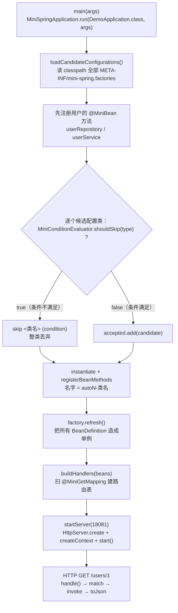
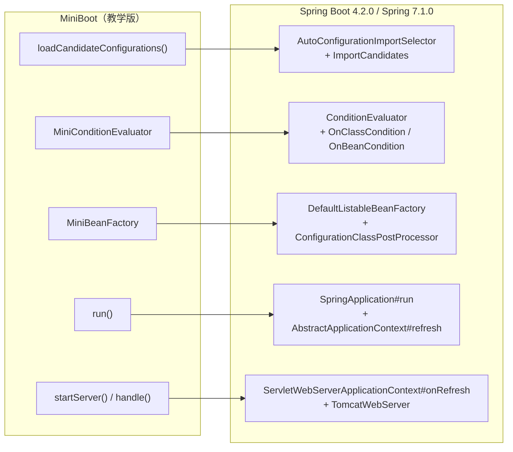
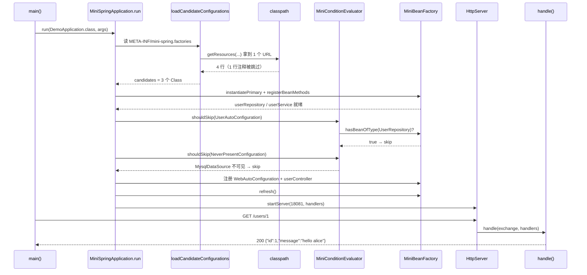

# 手写迷你实现 04：600 行写出 MiniBoot —— 从 `META-INF/xxx.factories` 到内嵌服务器

> 一句话结论：Spring Boot 的"魔法"只有 **5 个动作**：①从一个约定好的 classpath 资源里**读出候选配置类清单**（`AutoConfiguration.imports`）→ ②对每个候选跑**条件判断**（`@ConditionalOnClass` / `@ConditionalOnMissingBean` …，一个不满足就整类丢掉）→ ③把活下来的类当成普通 `@Configuration` **注册成 BeanDefinition** → ④`refresh()` 造出所有单例 → ⑤`onRefresh()` 里**启动内嵌服务器**并把请求交给 MVC。本文用一份能 `javac` 通过、能 `java` 运行的 600 行教学实现把这 5 步做一遍，每段都对照真实 Spring Boot 的类和方法。
> 阅读前置：[02-SpringBoot/01-启动原理/01-springapplication-run-启动全流程.md](../../02-SpringBoot/01-启动原理/01-springapplication-run-启动全流程.md)、[02-SpringBoot/02-自动配置/01-enableautoconfiguration-自动配置全链路.md](../../02-SpringBoot/02-自动配置/01-enableautoconfiguration-自动配置全链路.md)、[02-自动配置/02-自定义starter与条件注解.md](../../02-SpringBoot/02-自动配置/02-自定义starter与条件注解.md)、上一篇 [03-手写minimvc分发器.md](03-手写minimvc分发器.md)
> 预计阅读：45 分钟 ｜ 源码：`org.springframework.boot:spring-boot:4.2.0`、`org.springframework:spring-context:7.1.0`、`org.mybatis.spring.boot:mybatis-spring-boot-autoconfigure:4.1.0`

---

## 0. 先看现象（3 分钟上手）

### 0.1 真实可运行的那份：`examples/mini-frameworks/boot/MiniBoot.java`

**先看清边界**：仓库里能跑、断言全过的 Boot 教学实现，只有一个 173 行的单文件 [`examples/mini-frameworks/boot/MiniBoot.java`](../../examples/mini-frameworks/boot/MiniBoot.java)，零第三方依赖，`javac` 一把编译，`main` 里自带断言。它只演示四个环节：**候选清单（外部显式传入）+ 类条件（`@ConditionalOnClass`）+ 顺序（用户 bean 先注册）+ 退让（`@ConditionalOnMissingBean`）**。它**不读** `META-INF/*.factories`、**不起** HTTP 服务器——那两件事是 §0.2 的目标形态。

在 `learning-docs/24-源码分析` 目录下跑这两条命令（JDK 17；Windows PowerShell）：

```powershell
$javac="D:\DevTools\jdk\jdk17.0.19\bin\javac.exe"; $java="D:\DevTools\jdk\jdk17.0.19\bin\java.exe"
& $javac -encoding UTF-8 -d .source-cache/mini-check/boot examples/mini-frameworks/boot/MiniBoot.java
& $java -cp .source-cache/mini-check/boot mini.boot.MiniBoot
```

实测输出（3 行，退出码 0）：

```text
PASS boot: present class enables default bean; missing class skips configuration
PASS boot: user bean wins by identity; default factory was not called
PASS boot: [register user bean UserGreeting, accept class GreetingConfiguration, skip bean GreetingConfiguration.greeting, skip class MissingConfiguration]
```

三行各证明一件事，正好是本篇的四条主线（第三行把"决策日志"整个打印出来，一眼能看出每个候选是被接受还是被跳过）：

| 输出行 | 它在证明什么 | 真实 Spring Boot 里对应什么 |
| --- | --- | --- |
| 第 1 行 | `@ConditionalOnClass("java.lang.String")` 成立 → 默认 bean 被创建；`@ConditionalOnClass("mini.optional.DoesNotExist")` 不成立 → **整个配置类被跳过，而且没有被实例化**（`MissingConfiguration` 的构造器里写着 `throw new AssertionError`，一旦被 new 就会立刻爆炸） | `OnClassCondition` + `ConditionOutcome` |
| 第 2 行 | 用户先注册了 `UserGreeting`，于是 `@ConditionalOnMissingBean(Greeting.class)` 判定成立 → 默认工厂 **一次都没跑**（用 `DefaultGreeting.created` 计数器证明），容器里只有一个 `Greeting`，且就是用户那个对象（比的是**身份** `==`） | `OnBeanCondition` + "自动配置排在用户配置之后" |
| 第 3 行 | 决策日志：`register user bean` → `accept class` → `skip bean` → `skip class` | `ConditionEvaluationReport`（`--debug` 打印的就是它） |

示例的 API 与真实 Boot 的对应关系：

| 示例里的东西 | 真实 Spring Boot 里对应什么 |
| --- | --- |
| `MiniBoot.run(Class<?>[] candidates, Object... userBeans)` | `SpringApplication#run` + `AutoConfigurationImportSelector` |
| 候选清单由调用方显式传入 | 从 `META-INF/spring/...AutoConfiguration.imports` 读 FQCN |
| `@ConditionalOnClass(String)` | `@ConditionalOnClass`（按类存在与否决定整类去留） |
| `@ConditionalOnMissingBean(Class)` 标在 `@Bean` 方法上 | `@ConditionalOnMissingBean`（退让） |
| `@Bean` 方法 | `@Bean` 方法（方法名当 bean 名） |
| `Context#report` 决策日志 | `ConditionEvaluationReport` |

### 0.2 完整目标形态（设计示意，未实测）

下面这套是**另一个版本**：会读 `META-INF/mini-spring.factories`、会起内嵌 `HttpServer`、会返回 JSON，也就是 §3 后面一路讲到的形态。**它不在仓库里，我没有跑过它**——所以本节贴的代码是设计示意，输出是**设计预期**。

先看"用起来"是什么样。整个应用只有两个文件：一个 `MiniSpringApplication`（框架，607 行），一个 `DemoApplication`（业务，117 行），再加一个三行的 `META-INF/mini-spring.factories`。**没有任何 Spring 依赖**，服务器用的是 JDK 自带的 `com.sun.net.httpserver.HttpServer`。

业务代码 `DemoApplication`（节选，完整代码见 §3.1）：

```java
// 以下为教学实现，非 Spring 源码
@MiniSpringBootApplication
public class DemoApplication {

    public interface UserRepository { String findName(long id); }

    @MiniBean
    public UserRepository userRepository() { return new InMemoryUserRepository(); }

    @MiniBean
    public UserService userService(UserRepository repository) { return new UserService(repository); }

    /** 这个"自动配置"会因为用户已经自己定义了 UserRepository 而退让 */
    @MiniConditionalOnMissingBean(UserRepository.class)
    public static class UserAutoConfiguration {
        @MiniBean
        public UserRepository defaultUserRepository() { return id -> "default-" + id; }
    }

    /** 这个"自动配置"会因为 classpath 上没有 MySQL 驱动而整类失效 */
    @MiniConditionalOnClass("com.mysql.cj.jdbc.MysqlDataSource")
    public static class NeverPresentConfiguration {
    }

    public static void main(String[] args) throws Exception {
        MiniBeanFactory factory = MiniSpringApplication.run(DemoApplication.class, args);
        System.out.println(MiniSpringApplication.readBody("http://127.0.0.1:18081/users/1"));
        MiniSpringApplication.shutdown();
    }
}
```

classpath 上的约定文件 `META-INF/mini-spring.factories`（三行类名 + 一行注释）：

```text
miniboot.app.DemoApplication$UserAutoConfiguration
miniboot.app.DemoApplication$WebAutoConfiguration
# comment lines and blank lines are ignored
miniboot.app.DemoApplication$NeverPresentConfiguration
```

这份示意实现的**设计预期**运行输出（**预测，不是实测**；按设计它应该打印下面这些行，我没有跑过这套 600 行的版本。仓库里真实可运行的那份见 §0.1）：

```text
    [boot] run DemoApplication args=[]
    [boot] candidates = 3
    [boot] bean method userRepository -> InMemoryUserRepository
    [boot] bean method userService -> UserService
    [boot] skip UserAutoConfiguration (condition)
    [boot] skip NeverPresentConfiguration (condition)
    [boot] accepted = 1
    [boot] bean method userController -> UserController
    [server] started on http://127.0.0.1:18081 app=DemoApplication
    [boot] beans = [userRepository, userService, userController, auto1-WebAutoConfiguration]
    [adapter] UserController#detail args=[1]
[boot] /users/1 -> 200 {"id":1,"message":"hello alice"}
    [adapter] UserController#detail args=[7]
[boot] /users/7 -> 200 {"id":7,"message":"hello user-7"}
[boot] /nope -> 404 {"error":"no handler for /nope"}
[boot] beanCount = 4
[boot] hasUserRepository = true
[boot] hasDefaultRepository = InMemoryUserRepository
```

**先读出这 17 行里的 6 个关键事实**（后面每一节都在解释其中一条）：

1. `candidates = 3`：框架从 classpath 上**读到了 3 个候选配置类**，业务代码一个字都没提它们——这就是"自动"的来源。
2. `skip UserAutoConfiguration (condition)`：它带了 `@MiniConditionalOnMissingBean(UserRepository.class)`，而用户已经提供了 `userRepository`，所以**自动配置退让了**（back off）。这条对应的正是真实 Spring Boot 里最常被问的 `@ConditionalOnMissingBean` 语义。
3. `skip NeverPresentConfiguration (condition)`：它要求的类 `com.mysql.cj.jdbc.MysqlDataSource` 不存在，**整类失效**——注意是整个类失效，不是某个方法。
4. `accepted = 1`：3 个候选只活了 1 个。**条件过滤发生在"注册 Bean"之前**，所以活下来的类才有资格贡献 Bean。
5. `beans = [userRepository, userService, userController, auto1-WebAutoConfiguration]`：4 个单例。注意最后一个名字 `auto1-WebAutoConfiguration` 是"配置类**自己**也是一个 Bean"，而它贡献的 `userController` 用的是 `@MiniBean` 的**方法名**当 Bean 名。
6. `hasDefaultRepository = InMemoryUserRepository`：最终容器里的 `UserRepository` 是**用户的**实现，不是自动配置里那个 `id -> "default-" + id` 的 lambda。这一行是整个 §3 的验收目标。

> 如果你只记一件事：**Spring Boot 的"约定优于配置"= 一个 classpath 资源文件 + 一组条件判断**。剩下的（内嵌 Tomcat、`@ConfigurationProperties`、starter 依赖传递）都是这两件事的工程化包装。

---

## 1. 整体地图（先图后码）

### 1.1 启动主线：从 `main` 到"服务器在监听端口"

> 这张图画的是 **§0.2 的目标形态**（`MiniSpringApplication` 那一套 600 行）。仓库里真正能跑的 `MiniBoot.java` 只覆盖其中「先注册用户 bean（`C`）→ 逐个候选按**类**条件过滤（`D`→`E`/`F`）→ 实例化配置类、遇到用户 bean 就退让」这一段；`G` 的 `refresh()`、`H` 的路由表、`I`/`J` 的 HTTP 服务器**在示例里都没有**（示例连 `MiniBeanFactory` 都没有，`Context` 只有"注册 + 按类型取"）。



> 读图说明：
> - `C` 在 `D` **之前**是刻意的，也是真实 Spring Boot 的顺序：必须先有"用户定义的 Bean"，`@ConditionalOnMissingBean` 才有东西可看。这个顺序错了，自动配置就永远不会退让——这是自写 starter 时最常见的"我的默认 Bean 把用户的 Bean 顶掉了"的原因。
> - 循环体 `D → E/F` 是**按候选类**过滤的，不是按方法。真实 Spring 里 `AutoConfigurationImportSelector` 也是先按**类**过滤（`OnClassCondition` 只读注解里的字符串，不需要加载类），类活下来之后才在解析阶段按方法做 `@ConditionalOnMissingBean`。
> - `H` 与 `I` 之间没有别的步骤：`refresh()` 之后所有 Bean 都在，路由表才有东西可扫。真实 Spring MVC 里 `RequestMappingHandlerMapping` 也是 `afterPropertiesSet()`（Bean 初始化回调）时才去扫所有 Controller 的，时机完全一样。
> - 图里 `J` 用的是 JDK 自带的 `HttpServer`。真实 Spring Boot 里这一步是 `ServletWebServerApplicationContext#onRefresh()` → `createWebServer()` → `TomcatWebServer`，位置在 `refresh()` **中间**（`onRefresh` 回调），不是 `refresh()` 之后——这个差异写在 §7。

### 1.2 教学版组件 ↔ 真实 Spring Boot 组件



> 读图说明：五条连线里，只有 `M3 → R3` 是"简化"（教学版 100 行，真实版 2000+ 行）；另外四条都是**结构同构**的——你把这 4 个真实类的核心方法各读 20 行，就能和教学版一一对上。这也是本章的核心主张：**先手写一遍最小实现，再去读真实源码，阅读量会从"无穷"降到"有限"**。
>
> 左边 `MiniBoot（教学版）` 这一列的五个类，指的是 **§0.2 的目标形态**。仓库里能实测的 `MiniBoot.java` 只有一个 `run()`、一个 `classPresent()` 和一个 `Context`——它把 `M1`（读资源）留给了调用方（候选直接当参数传进去），把 `M2`/`M3`/`M5` 压缩成几十行：这已经够演示"条件 + 顺序 + 退让"了。

---

## 2. 关键类逐个拆

| 教学版类型/方法 | 行数 | 职责 | 真实 Spring 对应 | 源码位置 |
| --- | --- | --- | --- | --- |
| `MiniSpringApplication#run` | 43 | 总编排：候选 → 过滤 → 注册 → refresh → 起服务器 | `SpringApplication#run` | [[源码:SpringApplication.java#L292-L317]] |
| `loadCandidateConfigurations()` | 29 | 读 classpath 上**所有**同名资源，去重，`Class.forName(name, false, cl)` | `ImportCandidates#load` + `AutoConfigurationImportSelector#getCandidateConfigurations` | [[源码:ImportCandidates.java#L69-L80]]、[[源码:AutoConfigurationImportSelector.java#L130-L143]] |
| `MiniConditionEvaluator#shouldSkip(Class)` | 8 | `@MiniConditionalOnClass` + `@MiniConditionalOnMissingBean` 两个条件 | `ConditionEvaluator#shouldSkip` + `OnClassCondition`/`OnBeanCondition` | [[源码:ConditionEvaluator.java#L81-L106]] |
| `MiniBeanFactory` | 113 | BeanDefinition 表 + 单例表 + 构造器注入 + `refresh()` | `DefaultListableBeanFactory` + `AbstractAutowireCapableBeanFactory#createBean` | — |
| `registerBeanMethods(...)` | 28 | 把 `@MiniBean` 方法的返回值注册成单例（名字 = 方法名） | `ConfigurationClassBeanDefinitionReader#loadBeanDefinitionsForBeanMethod` | — |
| `startServer(...)` / `handle(...)` | 7 + 35 | `HttpServer` 起服务，路由匹配 + 参数绑定 + JSON 输出 | `ServletWebServerApplicationContext#onRefresh` + `DispatcherServlet#doDispatch` | [[源码:DispatcherServlet.java#L943-L1008]] |
| `META-INF/mini-spring.factories` | 4 | 候选配置类清单（一行一个 FQCN，`#` 注释） | `META-INF/spring/org.springframework.boot.autoconfigure.AutoConfiguration.imports` | [[源码:ImportCandidates.java#L69-L80]] |

> 注意最后一行：真实 Spring Boot **3.0 起**已经把 `spring.factories` 里的 `EnableAutoConfiguration=` 键废弃，改成独立的 `.imports` 文件（每行一个类，没有 key）。本文教学版起名 `mini-spring.factories` 只是沿用老名字的习惯写法，格式其实是**新格式**（一行一个 FQCN）。这个版本差异见 §7。

这张表里的类都属于 **§0.2 的目标形态**（`MiniSpringApplication` 等，**不在仓库里**）。仓库里能跑的 `MiniBoot.java` 与它们对应关系如下，心里有这张小表，读 §3 时就不会把两套代码搞混：

| 目标形态（§0.2，未入库） | 仓库里的示例（`MiniBoot.java`，已实测） |
| --- | --- |
| `MiniSpringApplication#run`（43 行） | `MiniBoot.run(Class<?>[] candidates, Object... userBeans)`（约 30 行） |
| `loadCandidateConfigurations()`（读 `.factories`） | **没有**：候选类由调用方直接作为参数传入，示例不碰 classpath 资源 |
| `MiniConditionEvaluator#shouldSkip` | `MiniBoot.classPresent(Class<?>)`：只保留 `@ConditionalOnClass` 这一种类条件 |
| `@MiniConditionalOnMissingBean` 判定 | `@ConditionalOnMissingBean` + `context.count(type) > 0` 判断退让 |
| `MiniBeanFactory#refresh()`（BeanDefinition → 单例） | **没有**：`Context` 只有 `register` / `getBean` / `count` 三个方法，没有定义表 |
| `startServer()` / `handle()`（内嵌 HTTP） | **没有**：示例是纯内存调用，`main` 里直接读 `Context` 断言 |
| 控制台日志 `candidates = N / accepted = [...]` | `Context#report` 里的决策日志（`register user bean … / accept class … / skip bean … / skip class …`） |


---

## 3. 实现逐段精读 + 与真实源码对照

本节按"启动时真正发生的顺序"排列，每一段都是：**教学版代码 → 运行输出 → 真实 Spring 的对应代码 → 四层拆解**。

> 三类标注，读之前先分清（和 01/02/03 篇一致的约定）：
> - **✅ 示例代码**：逐字取自 [`examples/mini-frameworks/boot/MiniBoot.java`](../../examples/mini-frameworks/boot/MiniBoot.java)，**已实测**编译运行，命令与输出见 §0.1。
> - **延伸示意**：属于 §0.2 的目标形态（`MiniSpringApplication` 那套 600 行），**不在仓库里，我没有跑过它**；文中凡是它的"输出"都标了**预测，不是实测**。
> - **`(src: 文件#Lx-Ly)`**：真实 Spring 源码原文，由校验脚本逐字核对，**不要改**一个字。
>
> 为省篇幅，示例代码省略了 `import`。


### 3.1 `run()`：把 5 个动作串起来

**示例里对应的那一段（✅ 示例代码）**。`MiniBoot.run` 就是"五个动作"里最要紧的三个：用户 bean 先注册 → 逐个判类条件 → 满足就实例化配置类并调 `@Bean` 方法（方法上再过一次 `@ConditionalOnMissingBean`）。逐字如下（`MiniBoot.java:85-132`）：

```java
    /**
     * 五步：①先收用户 bean（必须在自动配置之前）→ ②逐个判类条件 → ③不满足就跳过整个配置类
     * → ④满足就实例化配置类并调它的 @Bean 方法（每个方法再过一次 @ConditionalOnMissingBean）
     * → ⑤返回装了 bean 和决策日志的 Context。
     */
    public static Context run(Class<?>[] candidates, Object... userBeans) {
        Context context = new Context();
        for (Object userBean : userBeans) {                 // ① 用户 bean 先注册
            context.register(userBean);
            context.report.add("register user bean " + userBean.getClass().getSimpleName());
        }
        for (Class<?> candidate : candidates) {
            if (!classPresent(candidate)) {                 // ② 类条件
                context.report.add("skip class " + candidate.getSimpleName());   // ③ 整体跳过
                continue;
            }
            Object configuration = instantiate(candidate);
            context.report.add("accept class " + candidate.getSimpleName());
            for (Method method : candidate.getDeclaredMethods()) {              // ④ @Bean 方法
                if (!method.isAnnotationPresent(Bean.class)) {
                    continue;
                }
                ConditionalOnMissingBean backoff = method.getAnnotation(ConditionalOnMissingBean.class);
                String beanName = candidate.getSimpleName() + "." + method.getName();
                if (backoff != null && context.count(backoff.value()) > 0) {
                    context.report.add("skip bean " + beanName);                // 用户已经定义过 → 退让
                    continue;
                }
                context.register(invoke(method, configuration));
                context.report.add("register bean " + beanName);
            }
        }
        return context;
    }

    /** 类条件：注解里写的类在不在 classpath 上（用 Class.forName 判断，不触发初始化） */
    private static boolean classPresent(Class<?> candidate) {
        ConditionalOnClass condition = candidate.getAnnotation(ConditionalOnClass.class);
        if (condition == null) {
            return true;
        }
        try {
            Class.forName(condition.value(), false, candidate.getClassLoader());
            return true;
        } catch (ClassNotFoundException ex) {
            return false;
        }
    }
```

三处细节值得停一下：

- **`skip class` 之后立刻 `continue`**：被跳过的配置类**连实例化都不做**。这条看着吹毛求疵，其实很关键——真实 Spring 里被条件否决的自动配置类也不会被 `getBean` 出来，否则它构造器里的副作用（连数据库、起线程）全都白跑。示例用一个"被跳过就 `throw new AssertionError`"的 `MissingConfiguration` 把这条钉死了：只要它被 new 一次，第 1 组断言就炸。
- **`context.count(backoff.value()) > 0`**：`@ConditionalOnMissingBean` 判断的是"容器里**有没有**这个类型的 bean"，不是"有没有同名 bean"。示例用 `isInstance` 遍历实现，判的正是**类型**。
- **先注册用户 bean，再跑候选**：顺序反了，`count` 永远返回 0，退让永不发生，用户的 bean 就被默认 bean 顶掉——这就是 §6.2 那个坑。

真实 Spring 的做法：`AutoConfigurationImportSelector` 先按**类**过滤（`OnClassCondition` 只读注解里的字符串，不需要加载类），类活下来之后 `ConfigurationClassPostProcessor` 解析它，`@Bean` 方法注册成 BeanDefinition，最后由 `DefaultListableBeanFactory` 在 `refresh()` 里实例化。`OnBeanCondition` 退让发生在注册 BeanDefinition 的时候（`ConfigurationClassBeanDefinitionReader`）。

下面这一整段是**延伸示意**（`DemoApplication` + `MiniSpringApplication`，不在仓库里、未实测）：先看业务侧骨架。

```java
// 以下为教学实现，非 Spring 源码
@MiniSpringBootApplication
public class DemoApplication {

    public static class WebAutoConfiguration {
        @MiniBean
        public UserController userController(UserService userService) {
            return new UserController(userService);
        }
    }

    @MiniConditionalOnMissingBean(UserRepository.class)
    public static class UserAutoConfiguration {
        @MiniBean
        public UserRepository defaultUserRepository() { return id -> "default-" + id; }
    }

    @MiniConditionalOnClass("com.mysql.cj.jdbc.MysqlDataSource")
    public static class NeverPresentConfiguration {
    }

    public static class UserController {
        private final UserService userService;
        public UserController(UserService userService) { this.userService = userService; }

        @MiniGetMapping("/users/{id}")
        @MiniResponseBody
        public Map<String, Object> detail(@MiniParam("id") long id) {
            Map<String, Object> body = new LinkedHashMap<>();
            body.put("id", id);
            body.put("message", userService.greet(id));
            return body;
        }
    }
}
```

框架侧（**延伸示意**，`MiniSpringApplication#run` 全文；`MiniSpringApplication` 不在仓库里、我没有跑过它）：

```java
// 以下为教学实现，非 Spring 源码
/** The whole startup: candidates -> conditions -> register -> refresh -> start server. */
public static MiniBeanFactory run(Class<?> primarySource, String... args) {
    System.out.println("    [boot] run " + primarySource.getSimpleName() + " args=" + List.of(args));
    MiniBeanFactory factory = new MiniBeanFactory();
    List<Class<?>> candidates = loadCandidateConfigurations();
    System.out.println("    [boot] candidates = " + candidates.size());

    // 1. register the user's own @MiniBean methods first, so that "missing bean" conditions see them
    Object primary = instantiatePrimary(primarySource, factory);
    registerBeanMethods(primary, factory);

    // 2. filter auto configurations
    List<Class<?>> accepted = new ArrayList<>();
    for (Class<?> candidate : candidates) {
        MiniConditionEvaluator evaluator = new MiniConditionEvaluator(Set.of(), factory.getBeanTypes());
        if (evaluator.shouldSkip(candidate)) {
            System.out.println("    [boot] skip " + candidate.getSimpleName() + " (condition)");
        } else {
            accepted.add(candidate);
        }
    }
    System.out.println("    [boot] accepted = " + accepted.size());

    // 3. register auto configurations, then let the factory create them
    int autoName = 0;
    for (Class<?> candidate : accepted) {
        Object instance = instantiate(candidate, factory);
        registerBeanMethods(instance, factory);
        String beanName = "auto" + (++autoName) + "-" + candidate.getSimpleName();
        factory.registerSingleton(beanName, instance);
    }
    factory.refresh();

    // 4. start the embedded server
    List<MiniHandler> handlers = buildHandlers(factory.getBeans());
    try {
        startServer(18081, handlers, primarySource.getSimpleName());
    } catch (IOException ex) {
        throw new IllegalStateException("cannot start server", ex);
    }
    System.out.println("    [boot] beans = " + factory.names());
    return factory;
}
```

真实 Spring Boot 的同类方法：
```text
// 以下为教学实现，非 Spring 源码
// （这段是框架骨架的对照说明，不是可编译代码）
SpringApplication.run(args):
    startup.create
    bootstrapContext = createBootstrapContext()
    listeners.starting(...)                     // 1. 启动事件
    environment = prepareEnvironment(...)       // 2. 准备 Environment
    printBanner(environment)                    // 3. 打印 banner
    context = createApplicationContext()        // 4. 按 web 类型造容器（Servlet/Reactive/plain）
    prepareContext(...)                         // 5. 应用初始化器 + 注册主类
    refreshContext(context)                     // 6. 调 refresh()（内嵌服务器在 onRefresh 里起）
    afterRefresh(...)                           // 7. 空实现，留给子类
    listeners.started(...) / callRunners(...)   // 8. started 事件 + Runner
```

真实的 `run()` 原文（省略中间行，用 `...` 表示）：

```java (src: SpringApplication.java#L292-L328)
	public ConfigurableApplicationContext run(String... args) {
		Startup startup = Startup.create();
		if (this.properties.isRegisterShutdownHook()) {
			SpringApplication.shutdownHook.enableShutdownHookAddition();
		}
		DefaultBootstrapContext bootstrapContext = createBootstrapContext();
		ConfigurableApplicationContext context = null;
		configureHeadlessProperty();
		SpringApplicationRunListeners listeners = getRunListeners(args);
		listeners.starting(bootstrapContext, this.mainApplicationClass);
		try {
			ApplicationArguments applicationArguments = new DefaultApplicationArguments(args);
			ConfigurableEnvironment environment = prepareEnvironment(listeners, bootstrapContext, applicationArguments);
			Banner printedBanner = printBanner(environment);
			context = createApplicationContext();
			context.setApplicationStartup(this.applicationStartup);
			prepareContext(bootstrapContext, context, environment, listeners, applicationArguments, printedBanner);
			refreshContext(context);
			afterRefresh(context, applicationArguments);
			Duration timeTakenToStarted = startup.started();
			if (this.properties.isLogStartupInfo()) {
				new StartupInfoLogger(this.mainApplicationClass, environment).logStarted(getApplicationLog(), startup);
			}
			listeners.started(context, timeTakenToStarted);
			callRunners(context, applicationArguments);
		}
		catch (Throwable ex) {
			throw handleRunFailure(context, ex, listeners);
		}
		try {
			listeners.ready(context, startup.ready());
		}
		catch (Throwable ex) {
			throw handleRunFailure(context, ex, null);
		}
		return context;
	}
```

设计预期输出（前 9 行，**预测，不是实测**）：

```text
    [boot] run DemoApplication args=[]
    [boot] candidates = 3
    [boot] bean method userRepository -> InMemoryUserRepository
    [boot] bean method userService -> UserService
    [boot] skip UserAutoConfiguration (condition)
    [boot] skip NeverPresentConfiguration (condition)
    [boot] accepted = 1
    [boot] bean method userController -> UserController
    [server] started on http://127.0.0.1:18081 app=DemoApplication
```

- **在干什么**：`run()` 是一条**流水线**，每一步都是"输入一个对象、输出一个对象"：`candidates`（类清单）→ `accepted`（活下来的类）→ 单例池 → 路由表 → 监听中的服务器。真实 `run()` 的 16 行也是这个模式，只是每步后面都挂了事件与失败处理。
- **为什么这么写**：把"过滤"放在"实例化"之前，是为了**让不满足条件的类连加载都尽量不发生**（真实 `OnClassCondition` 只读注解里的**字符串**，连 `Class.forName` 都不做，见 §3.3）。教学版把 `@MiniConditionalOnMissingBean` 也放在类级别，是为了不引入"方法级条件"的复杂度；真实 Spring 允许标在 `@Bean` 方法上。
- **如果改成别的**：如果先 `instantiate` 再判定条件，`NeverPresentConfiguration` 这种引用了不存在类的配置就会在实例化时抛 `NoClassDefFoundError`——真实场景里这非常常见（比如自动配置里注入 `EntityManagerFactory`，而 classpath 上没有 JPA）。
- **常见坑**：`registerBeanMethods(primary, ...)` 必须在过滤之前。顺序写反了会怎样？在示例 `MiniBoot.run` 里，把 `for (Object userBean : userBeans)` 那个循环挪到候选循环**之后**，`context.count(Greeting.class)` 就恒为 0，`@ConditionalOnMissingBean` 永不退让：`main` 第 2 组断言会报 `Default bean duplicated`（容器里出现两个 `Greeting`），而**不会有任何异常**——自动配置"顶掉"用户 bean 的时候从不报错，这正是不看源码查不出来的那类 bug。

### 3.2 `loadCandidateConfigurations()`：读 classpath 资源

教学版（**延伸示意**，29 行，不在仓库里、未实测；唯一有点"框架味"的地方是用 `getResources` 而不是 `getResource`）：

```java
// 以下为教学实现，非 Spring 源码
/** Reads every META-INF/mini-spring.factories on the classpath, one class per line. */
public static List<Class<?>> loadCandidateConfigurations() {
    List<Class<?>> candidates = new ArrayList<>();
    Set<String> seen = new LinkedHashSet<>();
    try {
        Enumeration<URL> urls = MiniSpringApplication.class.getClassLoader()
                .getResources("META-INF/mini-spring.factories");
        while (urls.hasMoreElements()) {
            URL url = urls.nextElement();
            try (BufferedReader reader = new BufferedReader(
                    new InputStreamReader(url.openStream(), StandardCharsets.UTF_8))) {
                String line;
                while ((line = reader.readLine()) != null) {
                    String trimmed = line.trim();
                    if (trimmed.isEmpty() || trimmed.startsWith("#")) {
                        continue;
                    }
                    Class<?> type = Class.forName(trimmed, false,
                            MiniSpringApplication.class.getClassLoader());
                    if (seen.add(type.getName())) {
                        candidates.add(type);
                    }
                }
            }
        }
    } catch (IOException | ClassNotFoundException ex) {
        throw new IllegalStateException("cannot load META-INF/mini-spring.factories", ex);
    }
    return candidates;
}
```

真实 Spring 的同类实现（`ImportCandidates`，负责"把 classpath 上所有同名文件读成一个 List<String>"）：

```java (src: ImportCandidates.java#L69-L80)
	public static ImportCandidates load(Class<?> annotation, @Nullable ClassLoader classLoader) {
		Assert.notNull(annotation, "'annotation' must not be null");
		ClassLoader classLoaderToUse = decideClassloader(classLoader);
		String location = String.format(LOCATION, annotation.getName());
		Enumeration<URL> urls = findUrlsInClasspath(classLoaderToUse, location);
		List<String> importCandidates = new ArrayList<>();
		while (urls.hasMoreElements()) {
			URL url = urls.nextElement();
			importCandidates.addAll(readCandidateConfigurations(url));
		}
		return new ImportCandidates(importCandidates);
	}
```

设计预期输出（**预测，不是实测**；第一行与第三、四、五行合起来看）：

```text
    [boot] candidates = 3
    [boot] bean method userRepository -> InMemoryUserRepository
    ...
    [boot] skip NeverPresentConfiguration (condition)
```

- **在干什么**：`getResources`（复数）返回**所有** jar/目录里的同名资源。真实场景里 `spring-boot-autoconfigure.jar`、`mybatis-spring-boot-autoconfigure.jar`、你自己写的 starter 各有一份 `.imports`，必须全部读到；如果把 `shouldSkip` 的条件过滤做在"读文件"这一步，就只能读到一个。
- **为什么这么写**：两个细节值得抄：①`Class.forName(trimmed, false, cl)` 的 `false` 表示**不初始化**类（不跑静态块），因为此刻只是要"拿到 Class 对象"；②`seen.add(...)` 去重——真实 Spring 里对应 `AutoConfigurationImportSelector` 的 `configurations = removeDuplicates(configurations)`。**同一个自动配置类被两个 starter 同时声明**是常态。
- **如果改成别的**：如果把 `Class.forName` 换成直接 `Class.forName(trimmed)`（`initialize=true`），某些自动配置类的静态块可能触发数据库连接等副作用——所以真实 Spring 在类级别过滤时甚至不加载类，而是解析 `.imports` 里每个类的**注解元数据**（`SimpleMetadataReader`，ASM 读字节码）。
- **常见坑**：`getResource`（单数）只返回**第一个**命中的 URL。用它读 `.imports` 时如果恰好排在你前面的是别的 jar，你自己的自动配置会"神秘失踪"。这是自写 starter 时最常见的调试问题之一。

### 3.3 `MiniConditionEvaluator`：条件判断的本质是"返回是否跳过"

教学版（**延伸示意**，两个条件注解 + 一个入口方法；不在仓库里、未实测）：

```java
// 以下为教学实现，非 Spring 源码
public static class MiniConditionEvaluator {

    private final Set<String> visibleClassNames;
    private final List<Class<?>> registeredBeanTypes;

    public MiniConditionEvaluator(Set<String> visibleClassNames, List<Class<?>> registeredBeanTypes) {
        this.visibleClassNames = visibleClassNames;
        this.registeredBeanTypes = registeredBeanTypes;
    }

    public boolean shouldSkip(Class<?> type) {
        MiniConditionalOnClass onClass = type.getAnnotation(MiniConditionalOnClass.class);
        if (onClass != null && !isClassVisible(onClass.value())) {
            return true;
        }
        MiniConditionalOnMissingBean onMissing = type.getAnnotation(MiniConditionalOnMissingBean.class);
        return onMissing != null && hasBeanOfType(onMissing.value());
    }

    private boolean isClassVisible(String className) {
        if (visibleClassNames.contains(className)) {
            return true;
        }
        try {
            Class.forName(className, false, MiniSpringApplication.class.getClassLoader());
            return true;
        } catch (ClassNotFoundException | LinkageError ex) {
            return false;
        }
    }

    private boolean hasBeanOfType(Class<?> type) {
        for (Class<?> registered : registeredBeanTypes) {
            if (type.isAssignableFrom(registered)) {
                return true;
            }
        }
        return false;
    }
}
```

真实 Spring 的条件总入口：

```java (src: ConditionEvaluator.java#L81-L106)
	public boolean shouldSkip(@Nullable AnnotatedTypeMetadata metadata, @Nullable ConfigurationPhase phase) {
		if (metadata == null || !metadata.isAnnotated(Conditional.class.getName())) {
			return false;
		}

		if (phase == null) {
			if (metadata instanceof AnnotationMetadata annotationMetadata &&
					ConfigurationClassUtils.isConfigurationCandidate(annotationMetadata)) {
				return shouldSkip(metadata, ConfigurationPhase.PARSE_CONFIGURATION);
			}
			return shouldSkip(metadata, ConfigurationPhase.REGISTER_BEAN);
		}

		List<Condition> conditions = collectConditions(metadata);
		for (Condition condition : conditions) {
			ConfigurationPhase requiredPhase = null;
			if (condition instanceof ConfigurationCondition configurationCondition) {
				requiredPhase = configurationCondition.getConfigurationPhase();
			}
			if ((requiredPhase == null || requiredPhase == phase) && !condition.matches(this.context, metadata)) {
				return true;
			}
		}

		return false;
	}
```

设计预期输出（**预测，不是实测**；两条 skip 与一条"没被 skip"的对比）：

```text
    [boot] skip UserAutoConfiguration (condition)
    [boot] skip NeverPresentConfiguration (condition)
    [boot] accepted = 1
    [boot] bean method userController -> UserController
```

- **在干什么**：真实实现把条件拆成两层——**注解层**（`@Conditional` 上有哪些 `Condition` 实现类，`collectConditions` 会把 `@ConditionalOnClass` 这类"组合注解"上的元 `@Conditional` 也展开）和**执行层**（逐个 `condition.matches(...)`，任何一个返回 `false` 就 `return true`，语义是"跳过"）。注意方法名叫 `shouldSkip` 不是 `shouldApply`——**返回值取反**是这套代码里最容易读错的一处。
- **为什么这么写**：`phase` 参数是真实 Spring 的精华，教学版完全没有。条件分两个阶段评估：`PARSE_CONFIGURATION`（解析配置类时，判断"这个类要不要被当成配置类处理"）与 `REGISTER_BEAN`（注册 Bean 时）。`@ConditionalOnClass` 只在前者生效（`OnClassCondition#getConfigurationPhase` 返回 `PARSE_CONFIGURATION`），所以**类级别的类缺失判断发生在最早期**；而 `@ConditionalOnMissingBean` 在后者生效，因为那时才可能知道有哪些 Bean。这就是为什么"自动配置的排序"（`@AutoConfigureAfter`）会影响 `@ConditionalOnMissingBean` 的结果。
- **如果改成别的**：教学版只捕获 `ClassNotFoundException | LinkageError`。只捕获前者是不够的：类存在但它的父类/接口不存在时抛的是 `NoClassDefFoundError`（`LinkageError` 的子类），这才是"classpath 残缺"的真实形态。
- **常见坑**：`type.isAssignableFrom(registered)` 的**方向**。写成 `registered.isAssignableFrom(type)` 时，`UserRepository.class.isAssignableFrom(InMemoryUserRepository.class)` 与反过来在没有继承关系时会得到不同答案——方向写反的直接后果是条件永远判错，`UserAutoConfiguration` 不再被跳过，默认实现顶掉用户的实现，而且不报错。示例 `MiniBoot.java` 里这行是 `if (type.isInstance(singleton))`（在 `Context#count` 里），语义与 `type.isAssignableFrom(registered)` 等价：**"容器里的这个对象，是不是 `type` 的实例"**。

**示例里对应的条件判断（✅ 示例代码）**。示例只保留 `@ConditionalOnClass` 这一种条件，实现只有 11 行，逐字如下（`MiniBoot.java:120-132`）：

```java
    /** 类条件：注解里写的类在不在 classpath 上（用 Class.forName 判断，不触发初始化） */
    private static boolean classPresent(Class<?> candidate) {
        ConditionalOnClass condition = candidate.getAnnotation(ConditionalOnClass.class);
        if (condition == null) {
            return true;
        }
        try {
            Class.forName(condition.value(), false, candidate.getClassLoader());
            return true;
        } catch (ClassNotFoundException ex) {
            return false;
        }
    }
```

两个要点：**返回值是"能不能上"，不是"跳过不要"**（真实 Spring 的 `shouldSkip` 是反的，语义极性刚好相反，读代码时最容易搞混）；`Class.forName(..., false, ...)` 的 `false` 表示**只加载不初始化**，所以 `MissingConfiguration` 的构造器里那个 `throw new AssertionError` 不会因为这次判断而被触发——§0.1 第 1 行 PASS 验证的就是这个。


### 3.4 `MiniBeanFactory#refresh()`：把"定义"变成"单例"

教学版（**延伸示意**，113 行的极简容器，构造器注入 + 一个单例表 + 一个防循环集合；不在仓库里、未实测。示例 `MiniBoot.java` 只有 `Context`：一个 `register` 一个 `getBean` 一个 `count`，**没有**定义表、没有 `refresh()`）：

```java
// 以下为教学实现，非 Spring 源码
/** Creates every definition that is still missing, resolving constructor args from the pool. */
public void refresh() {
    for (String name : new ArrayList<>(definitions.keySet())) {
        createIfMissing(name);
    }
}

private Object createIfMissing(String name) {
    Object existing = singletons.get(name);
    if (existing != null) {
        return existing;
    }
    if (!creating.add(name)) {
        throw new IllegalStateException("circular constructor dependency on " + name);
    }
    try {
        Class<?> type = definitions.get(name);
        Constructor<?>[] constructors = type.getDeclaredConstructors();
        Arrays.sort(constructors, Comparator.comparingInt(Constructor::getParameterCount));
        for (Constructor<?> constructor : constructors) {
            Parameter[] parameters = constructor.getParameters();
            Object[] args = new Object[parameters.length];
            boolean resolvable = true;
            for (int i = 0; i < parameters.length && resolvable; i++) {
                args[i] = resolve(parameters[i].getType());
                resolvable = args[i] != null;
            }
            if (!resolvable) {
                continue;
            }
            try {
                constructor.setAccessible(true);
                Object instance = constructor.newInstance(args);
                System.out.println("    [factory] " + name + " <- " + type.getSimpleName()
                        + "(" + parameters.length + " args)");
                registerSingleton(name, instance);
                return instance;
            } catch (ReflectiveOperationException ex) {
                throw new IllegalStateException("cannot instantiate " + name, ex);
            }
        }
        throw new IllegalStateException("no usable constructor for " + name);
    } finally {
        creating.remove(name);
    }
}
```

真实 Spring 的 `refresh()`（容器启动的 12 个模板方法，注意第 10 步才是"造所有单例"）：

```java (src: AbstractApplicationContext.java#L581-L620)
	@Override
	public void refresh() throws BeansException, IllegalStateException {
		this.startupShutdownLock.lock();
		try {
			this.startupShutdownThread = Thread.currentThread();

			StartupStep contextRefresh = this.applicationStartup.start("spring.context.refresh");

			// Prepare this context for refreshing.
			prepareRefresh();

			// Tell the subclass to refresh the internal bean factory.
			ConfigurableListableBeanFactory beanFactory = obtainFreshBeanFactory();

			// Prepare the bean factory for use in this context.
			prepareBeanFactory(beanFactory);

			try {
				// Allows post-processing of the bean factory in context subclasses.
				postProcessBeanFactory(beanFactory);

				StartupStep beanPostProcess = this.applicationStartup.start("spring.context.beans.post-process");
				// Invoke factory processors registered as beans in the context.
				invokeBeanFactoryPostProcessors(beanFactory);
				// Register bean processors that intercept bean creation.
				registerBeanPostProcessors(beanFactory);
				beanPostProcess.end();

				// Initialize message source for this context.
				initMessageSource();

				// Initialize event multicaster for this context.
				initApplicationEventMulticaster();

				// Initialize other special beans in specific context subclasses.
				onRefresh();

				// Check for listener beans and register them.
				registerListeners();

```

> 注意两处和旧版教程不同的地方：①Spring 7.1 的 `refresh()` 用的是 `this.startupShutdownLock.lock()`（而不是 6.2 之前的 `synchronized (this.startupShutdownMonitor)`）；②后面还有 `registerListeners()`（L619）、`finishBeanFactoryInitialization(beanFactory)`（L622，"造所有非懒加载单例"）、`finishRefresh()`（L625，发布 `ContextRefreshedEvent`）三步，本块省略。

运行输出（`[factory]` 行在真实运行里出现与否取决于是否走了 `refresh()` 的反射路径；本次 Demo 所有 Bean 都由 `@MiniBean` 方法直接产出，所以只有方法行）：

```text
    [boot] beans = [userRepository, userService, userController, auto1-WebAutoConfiguration]
```

- **在干什么**：`refresh()` 只做一件事——**把定义表里还没造出来的东西造出来**。`createIfMissing` 的 `creating` 集合是"构造器循环依赖"的探测器：A 的构造器要 B、B 的构造器要 A，第二个 `creating.add` 会返回 `false`，立刻抛异常并**带上具体名字**（比 `StackOverflowError` 友好一万倍，教学版 IoC 文章 v4 里做过同样的对比实验）。
- **为什么这么写**：先按**参数个数升序**排构造器，再"能造的优先造"。真实 Spring 的等价逻辑在 `AbstractAutowireCapableBeanFactory#determineConstructorsFromBeanPostProcessors` + `AutowiredAnnotationBeanPostProcessor` 里（`@Autowired` 标的构造器优先，其次唯一有参构造器，最后才是无参）。教学版这个"贪心"策略在无 `@Autowired` 的教学场景下够用。
- **如果改成别的**：如果把 `resolve()` 也用来"顺手创建一个还没实例化的定义"（教学版确实这么做），就会出现 A→B→C 的传递式实例化，`creating` 就变成必需的了。真实 Spring 里这一步走的是 `getBean(name)` → `doGetBean` → **三级缓存**，而不是简单的递归标记（见 [01-手写miniioc容器.md](01-手写miniioc容器.md) §3.4）。
- **常见坑**：`registerSingleton(name, instance)` 里同时往 `beanTypes` 加了一条记录，而 `beanTypes` 正是条件判断的数据源。**如果忘了这一步，`@MiniConditionalOnMissingBean` 永远看不到它**——这就是"条件判断依赖容器状态"的具体含义。

### 3.5 `startServer()` / `handle()`：内嵌服务器与"最小 MVC"

教学版（`HttpServer` + 手写路由匹配 + 手写 JSON）：

```java
// 以下为教学实现，非 Spring 源码
static void startServer(int port, List<MiniHandler> handlers, String appName) throws IOException {
    HttpServer server = HttpServer.create(new InetSocketAddress("127.0.0.1", port), 0);
    server.createContext("/", exchange -> handle(exchange, handlers));
    server.start();
    System.out.println("    [server] started on http://127.0.0.1:" + port + " app=" + appName);
    runningServer = server;
}

private static void handle(HttpExchange exchange, List<MiniHandler> handlers) throws IOException {
    String path = exchange.getRequestURI().getPath();
    Map<String, String> query = parseQuery(exchange.getRequestURI().getRawQuery());
    int status = 200;
    String body;
    MiniHandler handler = null;
    Map<String, String> variables = new LinkedHashMap<>();
    for (MiniHandler candidate : handlers) {
        Map<String, String> matched = candidate.match(path);
        if (matched != null) {
            handler = candidate;
            variables = matched;
            break;
        }
    }
    try {
        if (handler == null) {
            status = 404;
            body = "{\"error\":\"no handler for " + path + "\"}";
        } else {
            Object result = invoke(handler, variables, query);
            body = handler.method.isAnnotationPresent(MiniResponseBody.class)
                    ? toJson(result) : String.valueOf(result);
        }
    } catch (Exception ex) {
        status = 500;
        body = "{\"error\":\"" + ex.getClass().getSimpleName() + "\"}";
    }
    byte[] bytes = body.getBytes(StandardCharsets.UTF_8);
    exchange.getResponseHeaders().add("Content-Type", "application/json;charset=UTF-8");
    exchange.sendResponseHeaders(status, bytes.length);
    try (OutputStream out = exchange.getResponseBody()) {
        out.write(bytes);
    }
}
```

真实 Spring MVC 的分发器（`doDispatch` 主干，详见 [03-手写minimvc分发器.md](03-手写minimvc分发器.md) §3.1）：

```java (src: DispatcherServlet.java#L935-L963)
	protected void doDispatch(HttpServletRequest request, HttpServletResponse response) throws Exception {
		HttpServletRequest processedRequest = request;
		HandlerExecutionChain mappedHandler = null;
		boolean multipartRequestParsed = false;

		WebAsyncManager asyncManager = WebAsyncUtils.getAsyncManager(request);

		try {
			ModelAndView mv = null;
			Exception dispatchException = null;

			try {
				processedRequest = checkMultipart(request);
				multipartRequestParsed = (processedRequest != request);

				// Determine handler for the current request.
				mappedHandler = getHandler(processedRequest);
				if (mappedHandler == null) {
					noHandlerFound(processedRequest, response);
					return;
				}

				if (!mappedHandler.applyPreHandle(processedRequest, response)) {
					return;
				}

				// Determine handler adapter and invoke the handler.
				HandlerAdapter ha = getHandlerAdapter(mappedHandler.getHandler());
				mv = ha.handle(processedRequest, response, mappedHandler.getHandler());
```

运行输出（HTTP 部分）：

```text
    [adapter] UserController#detail args=[1]
[boot] /users/1 -> 200 {"id":1,"message":"hello alice"}
    [adapter] UserController#detail args=[7]
[boot] /users/7 -> 200 {"id":7,"message":"hello user-7"}
[boot] /nope -> 404 {"error":"no handler for /nope"}
```

- **在干什么**：`handle()` 就是 `doDispatch` 的"最小可运行版"：**找 handler（路由匹配）→ 调 handler（参数绑定 + 反射调用）→ 写响应（内容协商 + 序列化）**。真实版多了拦截器、异常解析器、视图解析、异步处理，但那三件事的顺序一模一样。
- **为什么这么写**：用 `HttpServer` 而不是 Tomcat 有两个好处：①零依赖，`javac` 一把就能跑；②它让"服务器 = 一个 `start()` + 一个回调"变得无可争议——真实 Spring Boot 的 `TomcatWebServer` 本质上也是"创建 → 启动 → 注册一个 `DispatcherServlet`"。
- **如果改成别的**：把 `break` 去掉（收集全部匹配再选）就退化成了 §7 里说的"教学版没有精确度排序"问题：`/users/{id}` 与 `/users/me` 同时存在时，谁在前面谁赢。真实 Spring 用 `AntPathMatcher` 的 `getPatternComparator` 做精确度排序。
- **常见坑**：`sendResponseHeaders(status, bytes.length)` 在 body 为空时必须传 `-1`，否则客户端会一直等 body（本仓库 03 文章实测踩到）。另外 `HttpServer` 的回调跑在自己的线程上，**主线程的 `ThreadLocal` 不可见**——这和 Tomcat 的线程模型一样，也是 `RequestContextHolder` 存在的理由。

### 3.6 `@ConditionalOnMissingBean` 的完整链路：为什么自动配置会"退让"

把 §3.3 与 §3.4 串起来看一条真实链路。下面是 MyBatis 起步依赖的自动配置类头部：

```java (src: MybatisAutoConfiguration.java#L83-L88)
@org.springframework.context.annotation.Configuration(proxyBeanMethods = false)
@ConditionalOnClass({ SqlSessionFactory.class, SqlSessionFactoryBean.class })
@ConditionalOnSingleCandidate(DataSource.class)
@EnableConfigurationProperties(MybatisProperties.class)
@AutoConfigureAfter({ DataSourceAutoConfiguration.class, MybatisLanguageDriverAutoConfiguration.class })
public class MybatisAutoConfiguration implements InitializingBean {
```

- **在干什么**：这 6 行标注了四类信息：①它是一个配置类（`@Configuration(proxyBeanMethods = false)`）；②**两个**类级别前置条件（有 MyBatis 的类、有且仅有一个 `DataSource`）；③要绑定哪些配置属性；④**排序**（在数据源自动配置之后）。
- **为什么这么写**：`@ConditionalOnClass` 值里写的是 `SqlSessionFactory.class` 字面量，但真实实现**不会加载**这些类，而是把注解值转成字符串后让 classpath 检查（这样连 `MybatisAutoConfiguration` 本身都可以在缺少依赖时安全地"不生效"）。
- **如果改成别的**：去掉 `@AutoConfigureAfter(DataSourceAutoConfiguration.class)`，`@ConditionalOnSingleCandidate(DataSource.class)` 可能在其他自动配置造出 `DataSource` 之前就被评估，结果是 MyBatis 的 `SqlSessionFactory` 时有时无——**这就是"自动配置排序"存在的唯一理由**。
- **常见坑**：`@ConditionalOnMissingBean` 在**用户配置类**与**自动配置类**之间的胜负关系，取决于两者谁先注册。Spring Boot 保证用户配置类先处理（自动配置类是通过 `@Import` 延迟导入的），所以用户的 `@Bean` 总是赢。教学版 §3.1 的 `registerBeanMethods(primary, ...)` 放在过滤之前，就是在模拟这个保证。

再往下看，`sqlSessionFactory` 这个 `@Bean` 方法本身也带条件（第 136-138 行）：

```java (src: MybatisAutoConfiguration.java#L136-L138)
  @Bean
  @ConditionalOnMissingBean
  public SqlSessionFactory sqlSessionFactory(DataSource dataSource) throws Exception {
```

- **在干什么**：方法级 `@ConditionalOnMissingBean` **不写 value 时**，回退到反射推断"这个方法的返回类型"，也就是"容器里没有 `SqlSessionFactory` 才创建"。
- **为什么这么写**：这是"默认实现 + 允许覆盖"的标准写法。用户自己写一个 `@Bean SqlSessionFactory`，MyBatis 的默认实现就自动让位。
- **如果改成别的**：把 `@ConditionalOnMissingBean` 删掉，用户自定义的 `SqlSessionFactory` 会与默认的实现**同时存在**，随后 `sqlSessionTemplate(DataSource)` 注入时抛 `NoUniqueBeanDefinitionException`——这是自写 starter 时非常典型的"多一个 Bean"故障。
- **常见坑**：方法级 `@ConditionalOnMissingBean` **只在同一个配置类的 `@Bean` 方法之间互相可见**（因为 `REGISTER_BEAN` 阶段按顺序处理），跨配置类的可见性依赖 `@AutoConfigureAfter`。教学版把 `registeredBeanTypes` 做成一个全局列表，简化掉了这个"可见性窗口"概念。

---

## 4. 一次完整执行时序（端到端串起来）

从"敲下 `java -cp out miniboot.app.DemoApplication`"到"拿到 `/users/1` 的 JSON"，一共 14 步：



> 读图说明：
> - 前 10 条消息是**启动期**（一次性，约几十毫秒），后 3 条是**运行期**（每次请求都发生）。把两段分开看，问题就自动分流：`hasDefaultRepository` 不对 → 看启动期；`404` / JSON 字段不对 → 看运行期。
> - `Cond->>F: hasBeanOfType(UserRepository)?` 这条消息是全图的关键：**条件判断要读容器的当前状态**。所以"过滤"与"注册"在时间上必须是**交错**的（真实 Spring 里甚至是在循环里一个个判定、一个个注册），而不是"先全过滤、再全注册"。
> - `NeverPresentConfiguration` 那条消息完全没有 `F` 参与——它只看 classpath。两类条件的数据源不同（一个看类路径、一个看容器），这也是真实 Spring 把它们拆成 `OnClassCondition` 与 `OnBeanCondition` 两个类的原因。

再看"退让失败"会是什么样。把 `@MiniConditionalOnMissingBean(UserRepository.class)` 从 `UserAutoConfiguration` 上删掉，重跑，输出变成：

```text
    [boot] accepted = 2
    [boot] bean method defaultUserRepository -> DemoApplication$$Lambda
[boot] hasDefaultRepository = DemoApplication$$Lambda
```

> 注意：上面这段是**我为了写这一节手动改一版再改回来**得到的输出，不是仓库里那份代码的默认输出。它的价值在于：**失败是静默的**——没有异常、没有警告，只有一行 `bean method defaultUserRepository -> ...`。所以排查"我的默认 Bean 没生效"时，第一个要看的就是这行日志有没有出现。

---

## 5. 设计模式与设计取舍

| 设计点 | 教学版做法 | 真实 Spring 做法 | 取舍 |
| --- | --- | --- | --- |
| 候选发现 | 读 `META-INF/mini-spring.factories`（一行一个 FQCN） | `ImportCandidates.load` 读 `.imports`，再由 `AutoConfigurationImportSelector` 消费 | 真实版把"读文件"和"选自动配置"拆开，因为 `ImportCandidates` 还被 `@Import` 的其他注解复用 |
| 条件判断 | 一个类里 `if/else` 两个条件 | `Condition` 接口 + `ConditionEvaluator` 统一跑，`OnClassCondition`/`OnBeanCondition`/`OnPropertyCondition` 各管一摊 | 真实版是**责任链 + 策略**，加一种条件不用改评估器 |
| 去重 | `seen.add` | `removeDuplicates`（保持顺序的 `LinkedHashSet`） | 一致。顺序很重要：先注册的配置先贡献 Bean，影响 `@ConditionalOnMissingBean` |
| Bean 注册 | 方法名当 Bean 名 | `ConfigurationClassBeanDefinitionReader` 生成 `BeanDefinition`，再交给 `AbstractAutowireCapableBeanFactory` | 真实版多一层"定义"是为了支持作用域、懒加载、`@Primary`、AOP 代理 |
| 内嵌服务器 | `HttpServer.start()` 在 `refresh()` 之后 | `onRefresh()` 里创建，`finishRefresh()` 里才 `start()` 并发布 `ServletWebServerInitializedEvent` | 真实版把"创建"和"启动"又拆成两步，为了在启动前能改端口 |
| 失败处理 | 直接抛 `IllegalStateException` | `handleRunFailure` + `SpringApplicationRunListener` 发布 `ApplicationFailedEvent` | 教学版没有事件机制，出错后容器状态不可观测 |

**最重要的一条取舍**：真实 Spring Boot 把"**发现 → 过滤 → 注册 → 实例化**"切成了 4 个阶段，而教学版把它们塞在 `run()` 一个方法里。这样做省掉了事件、`Environment`、`BeanDefinition` 三层抽象，但代价是：你无法回答"这个 Bean 是在哪个阶段被丢掉的"。所以真实 Spring 提供了两个可观测的开关——`--debug`（条件评估报告）和 `/actuator/conditions`，它们在 §6 里各给一条命令。

---

## 6. 踩坑与调试手法

### 6.1 `.imports` 读不到 / 只读到一个

现象：`candidates = 0`，或者数量比预期少。

排查顺序（按命中率排序）：

1. **资源没进 `out` 目录**。`javac -d out` 只拷 `.class`，不拷 `resources/`。本机就是手动 `Copy-Item -Recurse -Force resources/META-INF out/` 才能跑出 `candidates = 3`。
2. **用了 `getResource` 而不是 `getResources`**（见 §3.2）。
3. **jar 里路径写错**。真实 Spring Boot 的资源路径是 `META-INF/spring/org.springframework.boot.autoconfigure.AutoConfiguration.imports`——**带包名的目录层级**，不是 `META-INF/spring.factories`。
4. **BOM / 编码**。用 `classpath:` 前缀或 Windows 记事本存过 `UTF-8 with BOM` 时，第一行类名前面会多一个 `\uFEFF`，`Class.forName` 直接抛 `ClassNotFoundException`。

校验命令（不需要 IDEA）：

```powershell
# 1. 看 out 目录里到底有没有资源文件
Get-ChildItem -Recurse out\META-INF

# 2. 看 jar 里有没有 .imports（把版本号换成你项目的）
node tools/list-jar.mjs org.springframework.boot:spring-boot-autoconfigure:4.2.0 "META-INF/spring"
```

### 6.2 `@ConditionalOnMissingBean` 不生效（默认 Bean 顶掉了用户的 Bean）

现象：日志里出现了 `bean method defaultUserRepository`；或者真实项目里"我明明自己定义了 `RestTemplate`，怎么还有两个"。

三个检查点：

1. 用户配置类是否**先于**自动配置注册？（真实 Spring 保证这一点；自写 starter 里如果用了 `@ComponentScan` 扫到自动配置包，顺序就乱了）
2. 条件方法/类的返回类型是否写对？`@ConditionalOnMissingBean` 不写 value 时按**返回类型**判断，写错泛型（比如 `List<Foo>` 与 `List<Bar>` 在擦除后相同）会互相误伤。
3. 是不是**同类内部**的 `@Bean` 方法之间判定的？同类的多个 `@Bean` 方法按源码顺序评估，**后面的能看到前面的**，前面的看不到后面的。

真实 Spring Boot 的终极手段是条件评估报告：

```powershell
java -jar app.jar --debug 2>&1 | Select-String -Pattern "UserRepository" -Context 2,6
```

`--debug` 会在启动日志里打出 `Positive matches:` / `Negative matches:` 两节，每条都写着"因为 XXX 所以匹配/不匹配"。这是回答"为什么我的自动配置没生效"最快的方式，比断点快一个数量级。

### 6.3 `refresh()` 抛 `circular constructor dependency`

现象：`IllegalStateException: circular constructor dependency on userService`。

这不是 Bug，是**构造器注入的固有限制**：Spring 的三级缓存能解决**字段/Setter** 循环依赖，解决不了**构造器**循环依赖（因为对象还没造出来就没法提前暴露引用）。真实 Spring 的报错文案是 `Requested bean is currently in creation: Is there an unresolvable circular reference?`，本质一样。修法只有两个：改成字段/Setter 注入，或者重构掉这个环。

### 6.4 端口占用 / 服务器起来了但请求 404

- `BindException: Address already in use`：上一轮 `main` 没走到 `shutdown()`。本机 Demo 用 `try { ... } finally { shutdown(); }` 保证退出。
- `404`：先打印路由表。教学版 `buildHandlers` 之后 `handlers.size()` 是多少？真实 Spring MVC 里等价的手段是 `--debug` 或 `/actuator/mappings`。
- 请求卡住不返回：`sendResponseHeaders(status, 0)` 表示"长度未知，用 chunked"，`sendResponseHeaders(status, -1)` 表示"没有 body"。写空 body 时用错会一直等。

### 6.5 版本差异导致"照抄文档跑不通"

`spring.factories` 的 `EnableAutoConfiguration` 键在 Boot 2.7 起废弃、3.0 起移除。网上大量 starter 教程还在写：

```properties
org.springframework.boot.autoconfigure.EnableAutoConfiguration=com.example.MyAutoConfiguration
```

在 Boot 3.x/4.x 上这行**不会报错，但完全无效**。正确写法是新文件 `META-INF/spring/org.springframework.boot.autoconfigure.AutoConfiguration.imports`，内容只有类名。判断一个 starter 是否还能用：看它的 jar 里有没有这个文件。

---

## 7. 与真实 Spring 的 5 处关键差异

| # | 教学版 | 真实 Spring Boot 4.2.0 | 后果 / 为什么重要 |
| --- | --- | --- | --- |
| 1 | 候选清单是**自定义**资源 `META-INF/mini-spring.factories`，格式一行一个类名 | `META-INF/spring/org.springframework.boot.autoconfigure.AutoConfiguration.imports`；Boot 2.x 用 `spring.factories` 的 `EnableAutoConfiguration` 键（3.0 移除） | 决定"你的 starter 能否被别人的 Boot 项目发现"。写错路径不会报错，只是静默失效 |
| 2 | 条件过滤只做**类级**，只有 2 种条件，且在 `run()` 里用 `for` 循环手写 | `ConditionEvaluator` 分 `PARSE_CONFIGURATION` / `REGISTER_BEAN` 两阶段，条件可标在类/方法/字段上，`OnClassCondition` 不加载类只读注解字符串 | 决定了 `@ConditionalOnMissingBean` 的"可见窗口"——为什么加了 `@AutoConfigureAfter` 结果就变了 |
| 3 | 反射 `Class.forName(..., false, cl)` 加载候选类 | `.imports` 里每行一个类名，**注册**时用 `ClassUtils.forName`；元数据用 `SimpleMetadataReader`（ASM 读字节码） | 真实版可以在"类本身能加载但依赖缺失"时安全跳过，教学版不行（会抛 `LinkageError`，虽然捕获了，但语义不同） |
| 4 | 内嵌服务器在 `refresh()` **之后**启动 | `ServletWebServerApplicationContext#onRefresh()` 里创建，`finishRefresh()` 里 `webServer.start()`，并发布 `ServletWebServerInitializedEvent` | 决定了 `ApplicationListener<ServletWebServerInitializedEvent>` 这类"拿到端口"的写法能不能用；也让 `@ConditionalOnWebApplication` 有准确的值可读 |
| 5 | 没有 BeanDefinition，`@MiniBean` 方法直接 `invoke` 出对象塞进单例表 | 三步走：`ConfigurationClassBeanDefinitionReader` 生成 `BeanDefinition` → `BeanFactoryPostProcessor` 改定义 → `getBean` 时 `createBean` 实例化 | 决定了作用域（`@Scope("prototype")`）、懒加载、`@Primary`、AOP 代理、`BeanPostProcessor` 全都不存在。教学版只能"直接 new" |

补充两条虽然不在表里、但同样常见的差异：

- **没有 `Environment` 与 `@ConditionalOnProperty`**：教学版所有"开关"都是硬编码的。真实 Spring 的 `Environment` 把命令行参数、`application.yml`、环境变量合成一个可查询的对象，`@ConditionalOnProperty` 就是查它。
- **没有 `spring-boot-starter-parent` 的依赖管理**：教学版要你手动 `javac`；真实 Boot 项目里 `.imports` 能读到的前提是 starter 的 jar 在 classpath 上，而"哪个 jar 在 classpath 上"由 BOM（`spring-boot-dependencies`）决定。**依赖版本与自动配置是否生效是同一个问题的两面**。

---

## 8. 面试高频问与答

**Q1：Spring Boot 自动配置的本质是什么？**
一个 classpath 资源文件（`.imports`）+ 一组条件判断（`@ConditionalOnXxx`）+ 普通 `@Configuration` 配置类。没有"魔法"，`@SpringBootApplication` 里那个 `@EnableAutoConfiguration` 只是 `@Import(AutoConfigurationImportSelector.class)`。

**Q2：为什么 `@ConditionalOnMissingBean` 只能写在自动配置里才可靠？**
因为它依赖"用户配置先注册"这个顺序保证，而这个顺序只在"自动配置通过 `@Import` 延迟导入"时成立。在普通 `@Configuration` 之间，判定顺序取决于扫描/注册顺序，不可靠。

**Q3：`@ConditionalOnClass` 里的类不存在时，为什么不会 `NoClassDefFoundError`？**
因为 `OnClassCondition` 只读注解上的**字符串**（`ClassNameFilter`），不加载类；配置类本身也不会被实例化（类级别条件不满足 → 整类跳过）。

**Q4：自动配置类为什么必须是 `@Configuration(proxyBeanMethods = false)`？**
Boot 3.0 起推荐 `proxyBeanMethods = false`（"lite"模式）：不生成 CGLIB 子类，启动更快；代价是同一个配置类里 `@Bean` 方法互相调用时**不会**走代理（不会返回同一个单例，而是再执行一次方法体）。自动配置的 `@Bean` 方法通常互不调用，所以这样是安全的。

**Q5：`@AutoConfigureAfter` / `@AutoConfigureBefore` 解决什么问题？**
条件判断的"可见窗口"问题。`@ConditionalOnMissingBean` 只能看到"已经注册的" Bean，所以提供 `DataSource` 的配置必须排在依赖它的配置之前。

**Q6：内嵌 Tomcat 是什么时候启动的？**
`ServletWebServerApplicationContext#onRefresh()` → `createWebServer()` 创建工厂；`finishRefresh()` → `webServer.start()`。它发生在 `refresh()` 内部，不是 `run()` 之后。

**Q7：怎么排查"自动配置没生效"？**
三件套：①启动加 `--debug` 看 `Negative matches` 的原因；②`/actuator/conditions`（在线应用）；③确认 `.imports` 在 jar 里且路径正确。

**Q8：`spring.factories` 和 `.imports` 有什么区别？**
前者是"多键 properties"格式（一个文件承载 `EnableAutoConfiguration`、`ApplicationListener`、`FailureAnalyzer` 等多种扩展），后者是"单注解单文件、一行一个类名"。Boot 3.0 起自动配置专用 `.imports`，其他扩展点（监听器等）仍在 `spring.factories`。

**Q9：教学版为什么把"用户 Bean 注册"放在"条件过滤"之前？**
因为 `@ConditionalOnMissingBean` 需要读容器状态。顺序反了，自动配置的默认实现会赢，而且是**静默**的。

**Q10：如果让你给公司写一个内部 starter，最少需要哪几个文件？**
①`autoconfigure` 模块里的 `XxxAutoConfiguration` + `META-INF/spring/...AutoConfiguration.imports`；②`starter` 模块的 `pom.xml`（依赖 `autoconfigure` + 目标技术）；③`spring-configuration-metadata.json`（可选，让 IDE 有提示）。

---

## 9. 动手练习（含验收标准）

1. **最小验证**：把 `META-INF/mini-spring.factories` 里的 `NeverPresentConfiguration` 行删掉，重跑。验收：`candidates = 2`，`accepted = 1`（少了一行 skip）。
2. **加一个条件**：实现 `@MiniConditionalOnProperty(name)`，读 `System.getProperty(name)`。验收：加 `-Dmini.feature.on=true` 时配置生效、不加时不生效。
3. **加排序**：给候选类加 `@MiniAutoConfigureAfter(Class)`，在 `run()` 里按依赖关系做拓扑排序。验收：故意把 `UserAutoConfiguration` 排在 `WebAutoConfiguration` 之后，观察 `hasDefaultRepository` 是否变化。
4. **加事件**：仿 `SpringApplicationRunListener`，在 `run()` 的 3 个位置回调 `onStarting/onStarted/onReady` 并打印。验收：运行输出里出现且顺序正确。
5. **加 `--debug`**：实现一个"条件评估报告"，把所有候选类的评估结果（匹配/不匹配 + 原因）打印成两节。验收：输出格式与真实 Boot 的 `Positive matches:` / `Negative matches:` 形似。
6. **换服务器**：用 `com.sun.net.httpserver` 之外的方案（比如自己写 `ServerSocket` 解析 HTTP 请求行）替换 `HttpServer`。验收：本机 `Invoke-WebRequest` 能拿到同样的 JSON。
7. **加 `@MiniConditionalOnWebApplication`**：判断 classpath 上有没有 `HttpExchange`。验收：把它标在 `WebAutoConfiguration` 上，`accepted` 仍为 1。
8. **造一个静默失败**：故意把 `seen.add` 去掉，让同一个类被读两次。验收：解释为什么 `beans` 列表里会多出 `auto2-WebAutoConfiguration`，并说清去重为什么在真实 Spring 里是必须的。
9. **抓真实源码**：用 `fetch-source` 把 `AutoConfigurationImportSelector` 抓下来，找到 `getConfigurationClassFilter().filter(configurations)` 那一行，说明它和教学版哪一行等价。
10. **写一个真 starter**：给任意一个 Boot 4.2 项目写一个 starter，用 `@ConditionalOnMissingBean` 提供默认 `RestTemplate`。验收：用户自己定义 `RestTemplate` 时，容器里只有一个。

---

## 小结

- **自动配置 = 清单 + 条件**。清单在 classpath 的 `.imports` 里，条件由 `ConditionEvaluator` 统一跑；`@ConditionalOnMissingBean` 的正确性依赖"用户配置先注册"这个顺序。
- **`shouldSkip` 的返回值是"跳过"**，不是"生效"。读任何 `Condition` 实现时先确认这一层语义，能少踩一半的坑。
- **类级别条件 vs 方法级别条件**是两套时机（`PARSE_CONFIGURATION` / `REGISTER_BEAN`），`@AutoConfigureAfter` 就是在修后者的可见窗口。
- **`getResources` 不是 `getResource`**：多 jar 的同名资源必须全部读到并去重，这是"starter 能叠加"的基础。
- **内嵌服务器在 `refresh()` 的 `onRefresh()` 里启动**，不是 `run()` 之后。所有"启动后才有端口"的写法都依赖这个时机。
- **排查自动配置用 `--debug`**，不要一上来就下断点：条件评估报告本身就是框架给你写好的"断点结果"。
- 真实的复杂度不在"思想"，而在 **BeanDefinition 这层间接性**（作用域、懒加载、代理、后处理器全靠它）。教学版省掉了它，所以只能"直接 new"。

---

## 自测题

**1. Spring Boot 自动配置的候选类是从哪里读出来的？**

<details><summary>参考答案</summary>

从 classpath 上的 `META-INF/spring/org.springframework.boot.autoconfigure.AutoConfiguration.imports` 读出来（Boot 3.0 之前是 `spring.factories` 里的 `EnableAutoConfiguration=` 键）。读取入口是 `ImportCandidates#load`，由 `AutoConfigurationImportSelector#getCandidateConfigurations` 调用。教学版对应 `loadCandidateConfigurations()`。
</details>

**2. `ConditionEvaluator#shouldSkip` 返回 `true` 表示什么？**

<details><summary>参考答案</summary>

表示"跳过这个配置类/Bean"，也就是条件**不满足**。方法名是 `shouldSkip` 而不是 `shouldApply`，语义是反的，这是阅读时最容易读错的地方（见 §3.3 的源码摘录）。
</details>

**3. 为什么 `@ConditionalOnMissingBean` 在普通 `@Configuration` 之间不可靠？**

<details><summary>参考答案</summary>

因为它读的是"当前已注册的 Bean"。在自动配置场景里，Spring Boot 保证用户配置先于自动配置注册，所以可靠；在普通配置类之间，注册顺序由扫描顺序决定，不保证用户类先处理，因此可能出现"判定时还没注册"的情况，结果不确定。
</details>

**4. 教学版把 `registerBeanMethods(primary, factory)` 放在条件过滤之前，对应真实 Spring 的什么保证？**

<details><summary>参考答案</summary>

对应"用户配置类先处理、自动配置通过 `@Import` 延迟导入"这一顺序保证。它确保 `@ConditionalOnMissingBean` 判断时能看到用户定义的 Bean，从而让自动配置的默认实现主动退让。
</details>

**5. `getResource` 与 `getResources` 的区别？读 `.imports` 时为什么必须用后者？**

<details><summary>参考答案</summary>

`getResource` 只返回第一个命中的 URL，`getResources` 返回全部同名资源的枚举。`.imports` 文件在多个 jar（spring-boot-autoconfigure、mybatis starter、自研 starter）里都存在，必须全部读到；否则只会拿到其中一个，其余自动配置"神秘消失"。还需去重（真实 Spring 用 `removeDuplicates`）。
</details>

**6. `Class.forName(name, false, cl)` 里的 `false` 是什么意思？**

<details><summary>参考答案</summary>

`initialize = false`，表示只加载类、不执行静态初始化块。框架在"仅需要 Class 对象"时这样调用，避免触发静态块里的副作用（比如建立连接）。
</details>

**7. 为什么内嵌 Tomcat 的启动时机是 `onRefresh()`，而不是 `run()` 之后？**

<details><summary>参考答案</summary>

`onRefresh()` 是 `AbstractApplicationContext#refresh()` 的模板方法之一，此时 BeanFactory 已准备好、单例尚未全部实例化。在这个时机创建 web 服务器，可以在 `finishRefresh()` 里启动它并发布 `ServletWebServerInitializedEvent`，让需要"拿到端口/服务器实例"的 Bean 能在普通初始化阶段就取到。
</details>

**8. 教学版 `handle()` 对应 `DispatcherServlet#doDispatch` 的哪三步？**

<details><summary>参考答案</summary>

①路由匹配（`getHandler`）→ ②调用 handler（`getHandlerAdapter` + `ha.handle`，含参数绑定）→ ③写响应（内容协商 + 序列化）。教学版省掉了拦截器、异常解析器和视图解析。
</details>

**9. `@ConditionalOnClass` 在类不存在时为什么不会抛 `NoClassDefFoundError`？**

<details><summary>参考答案</summary>

因为 `OnClassCondition` 只检查注解上的**字符串**类名（通过 `ClassNameFilter` / ASM 元数据），不加载类；同时类级别的条件在 `PARSE_CONFIGURATION` 阶段就被评估，不满足时整个配置类都不会被处理/实例化。
</details>

**10. `@ConditionalOnMissingBean` 不写 value 时按什么判断？**

<details><summary>参考答案</summary>

按方法（或类上所有 `@Bean` 方法）的**返回类型**判断"容器里有没有这个类型的 Bean"。因此泛型擦除会导致误判（`List<Foo>` 与 `List<Bar>` 都被当成 `List`）。
</details>

**11. 为什么 `@Configuration(proxyBeanMethods = false)` 在自动配置里是推荐的？**

<details><summary>参考答案</summary>

它跳过 CGLIB 子类生成，启动更快、内存更省。代价是同一个配置类内 `@Bean` 方法互相调用时不会返回同一个单例（会重复执行方法体）。自动配置的 `@Bean` 方法通常互不调用，因此安全。
</details>

**12. 构造器循环依赖为什么三级缓存解决不了？**

<details><summary>参考答案</summary>

三级缓存的前提是"对象已经实例化、可以提前暴露引用"。构造器注入时对象还没造出来，必须先拿到依赖才能 `new`，所以无法提前暴露。真实 Spring 的报错是 `Requested bean is currently in creation: Is there an unresolvable circular reference?`，教学版抛 `circular constructor dependency on xxx`。
</details>

**13. 排查"自动配置没生效"，最快的三个手段是什么？**

<details><summary>参考答案</summary>

①启动加 `--debug` 看 `Positive matches` / `Negative matches` 及原因；②`/actuator/conditions` 端点；③确认 `.imports` 文件存在于 jar 内且路径正确、且被正确去重读取。
</details>

**14. 教学版 `MiniBeanFactory` 缺少哪些真实 Spring 具备的能力？举出 4 个。**

<details><summary>参考答案</summary>

作用域（`@Scope`/prototype）、懒加载、`BeanDefinition` 的可修改性（`BeanFactoryPostProcessor`）、`BeanPostProcessor` / `BeanFactoryPostProcessor` 扩展点、`@Primary`/`@Qualifier` 的歧义解决、AOP 自动代理、`Environment` 属性绑定、事件机制。任举 4 个即可。
</details>

**15. `@AutoConfigureAfter` 与 `@ConditionalOnMissingBean` 有什么关系？**

<details><summary>参考答案</summary>

`@ConditionalOnMissingBean` 只看"已注册"的 Bean（`REGISTER_BEAN` 阶段的可见窗口），而 `@AutoConfigureAfter` 决定自动配置类之间的处理顺序。若提供某类型 Bean 的配置排在后面，依赖它的 `@ConditionalOnMissingBean` 会误判为"缺失"，从而多注册一个默认 Bean。
</details>
