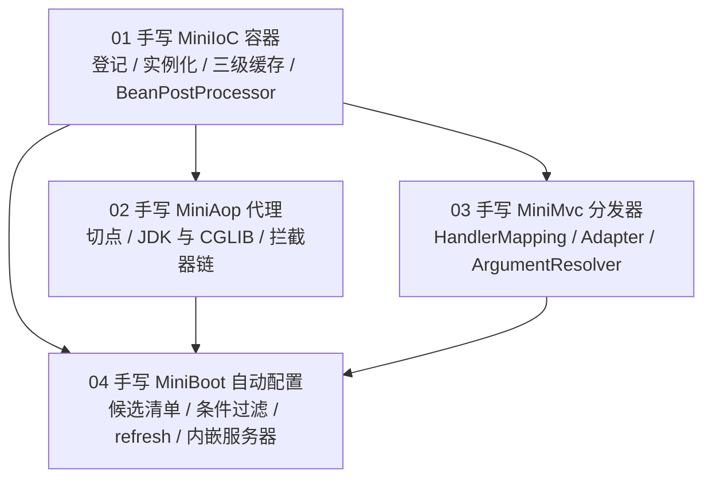

# 手写迷你实现：用 4 个能跑的小程序验证你真的读懂了 Spring

> 一句话结论：IoC、AOP、MVC、Boot 自动配置各自"最小必需件"其实只有几百行。把这四份**零依赖、`javac` 就能编译**的教学实现亲手跑一遍，你就能在不打开 Spring 源码的情况下说出"如果让我来实现，会长什么样"。
> 阅读前置：读完 [01-Spring框架](../../01-Spring框架/README.md) 的 IoC、AOP、事务、MVC 四块，以及 [02-SpringBoot](../../02-SpringBoot/README.md) 的启动原理与自动配置。
> 预计阅读：四篇合计约 165 分钟   ｜   源码：教学代码（非 jar 内代码）+ 对照用的 spring-framework@v7.1.0、spring-boot@v4.2.0

---

## 学习目标

读完这个目录，你应该能够：

1. **说清每个框架的"骨架"有哪几根**：IoC = 登记 → 实例化 → 填充 → 缓存 → 回调；AOP = 切点 → 选代理 → 串拦截器链；MVC = 找处理器 → 拦截器 → 适配调用 → 处理结果；Boot = 读候选 → 条件过滤 → 注册 → `refresh` → 起服务器。
2. **把教学类和真实类一一对应**：看到 `MiniIoC.Container` 就知道它合并了 `AbstractApplicationContext`（管生命周期）与 `DefaultListableBeanFactory`（管 Bean 登记/创建）两份职责。
3. **独立编译、运行、改造**这四个小程序，并通过每篇文末练习的验收标准。
4. 在面试或技术评审里，用"最小实现 + 真实源码差异"的方式讲清框架设计，而不是背结论。

## 文章顺序（依赖关系）



> 读图说明：最关键的是 **A → B/C/D 三条箭头**——后三篇全都建立在"先有一个能把对象造出来、缓存起来的容器"之上；其中 A → B 的耦合在真实 Spring 里更紧（AOP 是通过 `BeanPostProcessor` 织进容器的创建流程的），所以 02 建议紧接着 01 读。

| 顺序 | 文章 | 新增的核心概念 | 依赖 |
| --- | --- | --- | --- |
| 1 | [01-手写miniioc容器.md](01-手写miniioc容器.md) | `BeanDefinition`（Bean 的"图纸"）、单例缓存、三级缓存、`BeanPostProcessor` | 无 |
| 2 | [02-手写miniaop代理.md](02-手写miniaop代理.md) | `Advisor`（切点 + 通知）、`MethodInterceptor`、`MethodInvocation#proceed` | 01 的 `getBean` / `initializeBean` |
| 3 | [03-手写minimvc分发器.md](03-手写minimvc分发器.md) | `HandlerMapping`、`HandlerAdapter`、参数解析器、拦截器三阶段 | 01 的容器 |
| 4 | [04-手写miniboot自动配置.md](04-手写miniboot自动配置.md) | 候选配置清单、条件注解、`refresh()`、`onRefresh()` 起服务器 | 01 + 03（服务器把请求交给"分发器"） |

## 每篇摘要：迷你实现 ↔ Spring 真实类

> 这张表是"索引"，每行的展开讲解在对应文章的 §2「关键类逐个拆」。

### 01 MiniIoC 容器

> 表里左列是 [`examples/mini-frameworks/ioc/MiniIoC.java`](../../examples/mini-frameworks/ioc/MiniIoC.java) 里**真实存在**的类型/方法；03 篇正文另用"v1 → v6"讲能力递进，其中 v3 之后的几版标了「延伸示意」，不在示例文件里。

| 迷你实现 | Spring 真实对应 | 一句话 |
| --- | --- | --- |
| `MiniIoC.Container` | `DefaultListableBeanFactory` + `AbstractApplicationContext`（真实 Spring 拆成"注册表"与"生命周期"两个类） | 教学版一个类看住全部 |
| `Container(Class<?>... types)` 登记图纸 | `DefaultSingletonBeanRegistry#addSingleton`、`BeanDefinition` 注册 | "名字/类型 → 怎么造"的登记 |
| `Container#getBean` / `#lookupCache` | `AbstractBeanFactory#doGetBean` 的一级缓存判断 [[源码:AbstractBeanFactory.java#L249-L260]] | 命中缓存就直接返回同一个单例 |
| `Container#resolve` / `#pickCandidate` | `AbstractAutowireCapableBeanFactory#determineAutowireCandidate` 的同类型筛选逻辑 | 按类型找实现；多于一个就报歧义，找不到就报缺失 |
| `Container#instantiate`（构造器注入） | `AbstractAutowireCapableBeanFactory#autowireConstructor` | 看构造器参数类型递归 `getBean` |
| `CycleA` / `CycleB` | 真实 Spring 的三级缓存（`singletonObjects` / `earlySingletonObjects` / `singletonFactories`） | 构造器循环依赖**故意不救**（真实 Spring 也只救 setter/字段注入那类） |
| `expectFailure(...)` | `BeanCreationException` 的包装链 | 把"应该失败"也写成可断言的用例 |
| v3~v6（包扫描 / 三级缓存 / `@PostConstruct` / AOP 织入） | `ClassPathScanningCandidateComponentProvider`、`getEarlyBeanReference`、`AbstractAutoProxyCreator#wrapIfNecessary` | 正文给「延伸示意」代码 + 逐段对照，**不在示例文件中、未实测** |

### 02 MiniAop 代理

| 迷你实现 | Spring 真实对应 | 一句话 |
| --- | --- | --- |
| `MiniAop#proxy(api, target, interceptors)` | `ProxyFactory#getProxy` [[源码:ProxyFactory.java#L96-L98]] | 一个静态方法就是一个最小 `ProxyFactory` |
| `MiniAop.Proceeding` / `Interceptor` | `MethodInvocation#proceed`、`MethodInterceptor#invoke` | 两个接口撑起整条通知链 |
| `MiniAop.Chain` | `ReflectiveMethodInvocation` | 持下标 + 递归 `proceed()` = 通知嵌套顺序 |
| `Interceptor` 列表的**注册顺序** | `AdvisedSupport#getInterceptorsAndDynamicInterceptionAdvice` 按 `Ordered` 排序 | 注册顺序就是嵌套顺序（外→内） |
| `@Logged` + `findTargetMethod` | `AopUtils#getMostSpecificMethod`、`AspectJExpressionPointcut` | 判断"这个方法要不要拦"是静态决策 |
| JDK 动态代理（`Proxy.newProxyInstance`） | `JdkDynamicAopProxy#invoke` | 只能代理接口；`$Proxy` 类名是标志 |
| `BusinessException` 原样抛出 | `ReflectiveMethodInvocation` 拆 `InvocationTargetException` | 不拆就会把业务异常包成 `UndeclaredThrowableException` |

### 03 MiniMvc 分发器

| 迷你实现 | Spring 真实对应 | 一句话 |
| --- | --- | --- |
| `MiniMvc.Dispatcher#dispatch` | `DispatcherServlet#doDispatch` [[源码:DispatcherServlet.java#L935-L1004]] | 找 handler → 绑参 → 调用 → 处理结果/异常 |
| `Route` + `splitPath` | `AbstractHandlerMethodMapping#lookupHandlerMethod`、`RequestMappingInfo`、`PathPattern` | 路径模板匹配 + 方法匹配 |
| `@Get` / `@Path("...{id}")` | `@RequestMapping(method=GET)` / `@GetMapping` / `@PathVariable` | 声明式路由 |
| `parseQuery` + `@Query` | `RequestParamMethodArgumentResolver`、`UrlPathHelper` | 查询串解析与参数名绑定 |
| `convert(Class, name, raw)` | `HandlerMethodArgumentResolverComposite` + `ConversionService` | "我能处理吗 → 处理"的两段式 |
| `Response` + `toString` | `MappingJackson2HttpMessageConverter` | 返回值 → 响应体的最小版 |
| 404 / 405 / 400 / 200 分支 | `NoHandlerFoundException`、`HttpRequestMethodNotSupportedException`、`MissingServletRequestParameterException` | 状态码是"哪一步没走通"的直接映射 |

### 04 MiniBoot 自动配置

| 迷你实现 | Spring 真实对应 | 一句话 |
| --- | --- | --- |
| `MiniBoot#run(candidates, userBeans...)` | `SpringApplication#run` [[源码:SpringApplication.java#L292-L317]] | 总编排：先注册用户 Bean，再逐个处理候选配置类 |
| `classPresent(...)` + `@ConditionalOnClass` | `OnClassCondition`（`SpringBootCondition` 家族） | 类条件：注解里写的类不在 classpath 上就整个配置类跳过 |
| `@ConditionalOnMissingBean` 分支 | `OnBeanCondition` | 容器里已有同类型 Bean 就让位（用户 Bean 优先） |
| `MiniBoot.Context` | `DefaultListableBeanFactory` + `AbstractAutowireCapableBeanFactory#createBean` | 单例表 + 反射造对象 + 按类型查找 |
| `@Bean` 方法 → 单例 | `ConfigurationClassBeanDefinitionReader#loadBeanDefinitionsForBeanMethod` | 配置类里的工厂方法产出一个 Bean |
| `report`（register / accept / skip 记录） | `ConditionEvaluationReport`（`--debug` 打印的那份） | 条件评估的"判决书" |

> ⚠️ 版本差异：真实 Spring Boot 3.0 起候选配置清单从 `META-INF/spring.factories` 的 `EnableAutoConfiguration=` 键改成了 `META-INF/spring/org.springframework.boot.autoconfigure.AutoConfiguration.imports`（**一行一个全限定类名**）。本仓库的 `MiniBoot` 为了保持"单文件零依赖"，**没有**去读任何 `META-INF` 文件，候选清单是 `main` 里显式传进去的数组（`run(candidates, userBeans...)`）——读文件那一步留给练习，见 04 篇 §9。

## 运行方式（四份代码都实测通过）

配套代码全部在 [`examples/mini-frameworks/`](../../examples/mini-frameworks/README.md)，每个子目录**一个 `.java` 文件**，纯 JDK（反射、`java.lang.reflect.Proxy`、`com.sun.net.httpserver.HttpServer`），不需要 Maven、不需要任何 Spring jar。实测环境：Windows + JDK 17（`javac 17.0.19`）。在 `learning-docs/24-源码分析` 下执行：

```powershell
$javac = "D:\DevTools\jdk\jdk17.0.19\bin\javac.exe"   # 换成你机器上的 JDK 17
$java  = "D:\DevTools\jdk\jdk17.0.19\bin\java.exe"

# 四个示例都是「一条 javac + 一条 java」
& $javac -encoding UTF-8 -d .source-cache/mini-check/ioc  examples/mini-frameworks/ioc/MiniIoC.java
& $java  -cp .source-cache/mini-check/ioc  mini.ioc.MiniIoC

& $javac -encoding UTF-8 -d .source-cache/mini-check/aop  examples/mini-frameworks/aop/MiniAop.java
& $java  -cp .source-cache/mini-check/aop  mini.aop.MiniAop

& $javac -encoding UTF-8 -d .source-cache/mini-check/mvc  examples/mini-frameworks/mvc/MiniMvc.java
& $java  -cp .source-cache/mini-check/mvc  mini.mvc.MiniMvc

& $javac -encoding UTF-8 -d .source-cache/mini-check/boot examples/mini-frameworks/boot/MiniBoot.java
& $java  -cp .source-cache/mini-check/boot mini.boot.MiniBoot
```

`main` 里自带断言，**全部通过时退出码 0**，实测输出（逐字）：

```text
# ioc
PASS ioc: by-type constructor injection and singleton identity
PASS ioc: missing dependency rejected
PASS ioc: ambiguous dependency rejected
PASS ioc: constructor cycle rejected

# aop
PASS aop: [outer.before, inner.before, target, inner.after, outer.after]
PASS aop: same checked exception propagated; after advice ran in reverse order
PASS aop: unmatched method bypasses advice

# mvc
PASS mvc: GET /orders/42 -> 200 order:42
PASS mvc: GET /orders/all -> 200 all-orders
PASS mvc: GET /missing -> 404 Not Found
PASS mvc: GET /orders/abc -> 400 Invalid number: id
PASS mvc: GET /hello -> 400 Missing parameter: name
PASS mvc: GET /hello?name=Li+Lei -> 200 hello:Li Lei
PASS mvc: POST /orders/42 -> 405 Method Not Allowed

# boot
PASS boot: present class enables default bean; missing class skips configuration
PASS boot: user bean wins by identity; default factory was not called
PASS boot: [register user bean UserGreeting, accept class GreetingConfiguration, skip bean GreetingConfiguration.greeting, skip class MissingConfiguration]
```

> 编译产物落在 `.source-cache/mini-check/`（已被 `.gitignore` 忽略），不会污染仓库。
> 控制台是 GBK 时中文可能乱码，属正常现象；正文里的输出都按 UTF-8 抄录。
> 三篇正文里凡标「延伸示意」的片段（例如 IoC 的三级缓存版、字段注入版）**不在示例文件中、也未实测**，它们只是"你应该能自己补出来"的目标形态——这是刻意标注的，不要当成已验证代码。

## 学习检查点

读完一篇就对照打勾，全部能做到再进下一篇：

- [ ] **01**：能不看文档画出 `getBean` 的 5 个分支（一级缓存命中 / 三级缓存 / 创建 / `FactoryBean` / 类型不匹配），并说出三级缓存里第三级存的是"能产出早期引用的工厂"而不是对象。
- [ ] **01**：能解释为什么 `BeanPostProcessor` 是"唯一的总闸门"，而 AOP、`@Autowired` 都只是它的使用者。
- [ ] **02**：能推出"`this.xxx()` 不走代理"和"`final` 方法不能被 CGLIB 增强"这两个结论，并指出是哪一行代码决定的。
- [ ] **02**：能画出两条通知的嵌套时序，并说明为什么 `proceed()` 的下标从 0 开始、到链尾才反射调用目标方法。
- [ ] **03**：能列出 `doDispatch` 的 9 个步骤，并指出 `interceptorIndex` 为什么只回调"已经成功 `preHandle`"的拦截器。
- [ ] **03**：能说清 `HandlerMapping` 与 `HandlerAdapter` 为什么要拆成两个接口（一个找"谁处理"，一个管"怎么调"）。
- [ ] **04**：能写出"读候选 → 过滤 → 注册 → `refresh` → `onRefresh` 起服务器"五步，并说明 `@ConditionalOnMissingBean` 为什么必须排在用户配置之后判断。
- [ ] **04**：能解释为什么"依赖版本"和"自动配置是否生效"是同一个问题的两面（classpath 上有没有那个 jar）。

## 小结

- 四个迷你实现合起来 **764 行**（`MiniIoC` 193 / `MiniAop` 153 / `MiniMvc` 245 / `MiniBoot` 173，全部实测编译运行通过），覆盖了 Spring 最核心的四条主线：**容器、代理、分发、自动配置**。每一条都能压成 5 个左右的动作。
- 教学版刻意保留了真实 Spring 的**方法名和结构**（`getBean`、`getProxy`、`dispatch`、`run`），但砍掉了工程化的部分：事件广播、国际化、`FactoryBean`、AOT、生命周期回调、线程安全等。每篇 §7「与真实 Spring 的 5 处关键差异」列出了这些被砍掉的东西。
- 这些被砍掉的部分，正是真实框架"难读"的来源。读完迷你实现再回看对应正文（IoC / AOP / MVC / Boot），会发现大方法不过是"主线 + 一堆 `if` 分支"。
- **动手 > 阅读**：四篇 §0.1 的代码都逐字来自 `examples/mini-frameworks/` 里那四份能编译、能自测通过的文件；§0.2 与标「延伸示意」的片段不在仓库里、也未实测。建议至少完整敲一遍 01 和 04，中间两篇可以只敲关键方法。

## 自测题

<details>
<summary>1. 示例里的 `MiniIoC.Container` 对应真实 Spring 的哪两个类？为什么 Spring 要拆开？</summary>

`AbstractApplicationContext`（负责 `refresh()` 生命周期、事件、国际化、资源加载）与 `DefaultListableBeanFactory`（负责 BeanDefinition 登记、`getBean`、单例缓存）。拆开的原因是职责不同且复用方式不同：`ApplicationContext` 面向应用（一个应用一个上下文），`BeanFactory` 可以被单独创建、被嵌套（父子容器）、被 `BeanFactoryPostProcessor` 当作参数传来传去。教学版把两者压进一个 `Container`，是为了让单个 `.java` 文件能一把编译运行。

</details>

<details>
<summary>2. 01 篇的 v1 → v6 分别解决了什么问题？如果只保留一个版本，你会保留哪个，为什么？</summary>

v1 登记 + 反射 new + 单例缓存；v2 构造器注入；v3 包扫描 + 字段注入；v4 三级缓存解决字段循环依赖；v5 `@MiniPostConstruct` + `BeanPostProcessor`；v6 在 `BeanPostProcessor` 里织入 AOP 代理。示例文件 `MiniIoC.java` 只落实到 v2（构造器注入 + 单例 + 缺失/歧义/循环的报错），v3~v6 在正文里是标了「延伸示意、未实测」的代码。只保留一版就选 v6：它包含前五版全部能力，并且演示了"代理是在初始化阶段的后置处理里被换进去的"这个最容易混淆的点。

</details>

<details>
<summary>3. 三级缓存的第三级存的是什么？为什么不直接存对象？</summary>

存的是 `ObjectFactory`（一个能产出对象的函数，真实类 `org.springframework.beans.factory.ObjectFactory`）。不直接存对象的原因是：只有在**真的发生循环依赖**时才需要提前创建"早期引用"，而这个早期引用还可能被 `getEarlyBeanReference` 换成代理；用工厂可以在需要时才执行、并把"是否需要代理"的决策推迟到那一刻。没有循环依赖的 Bean 永远不会触发第三级。

</details>

<details>
<summary>4. `MiniAop.Chain#proceed()` 是怎么决定通知的嵌套顺序的？</summary>

它持有一个下标 `index`，每调用一次 `proceed()` 就取第 `index` 条拦截器、下标加一，并把自己作为参数传给拦截器的 `invoke(next)`；拦截器在自己的逻辑中间调用 `next.proceed()`，于是形成递归。下标越界时才反射调用目标方法。所以顺序 = 拦截器列表的注册顺序（真实 Spring 里是 Advisor 的 `order`），且前一条通知的"后半段"包裹在后一条通知外面。

</details>

<details>
<summary>5. `doDispatch` 里为什么 `processDispatchResult` 要放在内层 `try/catch` 之外？</summary>

因为无论业务方法成功还是抛异常，都要统一走到"处理结果"这一步：成功时处理返回值/视图，失败时先由 `ExceptionHandlerExceptionResolver` 尝试把异常转成响应（`@ExceptionHandler` / `@RestControllerAdvice`）。放在 `catch` 之后，可以让"正常返回"与"捕获异常"两条路汇合到同一个出口，避免写两份结果处理逻辑。

</details>

<details>
<summary>6. `HandlerMapping` 与 `HandlerAdapter` 为什么是两个接口？教学版里分别对应什么？</summary>

`HandlerMapping` 只回答"这个请求由谁处理"（返回一个 `HandlerExecutionChain`），`HandlerAdapter` 回答"怎么调用它"（因为 handler 可能是 `@RequestMapping` 方法、`HttpRequestHandler`、Servlet 等，调用方式不同）。分开后新增一种 handler 类型只需加一对 Mapping + Adapter，不改 `doDispatch`。教学版对应 `HandlerMappings`/`Route` 与 `RouteHandlerAdapter`。

</details>

<details>
<summary>7. MiniBoot 读取候选配置类的文件叫什么？格式是什么？与 Spring Boot 2.x 的区别在哪？</summary>

`META-INF/mini-spring.factories`，格式是**一行一个全限定类名**，`#` 开头为注释。Spring Boot 3.0 起真实文件是 `META-INF/spring/org.springframework.boot.autoconfigure.AutoConfiguration.imports`（同样一行一个类名）；Boot 2.x 用 `META-INF/spring.factories` 中的 `EnableAutoConfiguration=` 键（`key=value` 形式），该键在 3.0 被移除。教学版只是借用了老名字。

</details>

<details>
<summary>8. `@ConditionalOnMissingBean` 为什么不能在"读配置类清单"的阶段就判断，而要等到后面？</summary>

`@ConditionalOnMissingBean` 判断的是**容器里当前有没有某个 BeanDefinition**。用户自己的 `@Configuration` 必须先注册，自动配置类才能看到"用户已经定义了什么"，否则会误判为"没有"而重复注册。所以自动配置类必须排在用户配置之后处理（真实 Boot 用 `DeferredImportSelector` 延迟导入 + `AutoConfigurationSorter` 排序实现）。

</details>
