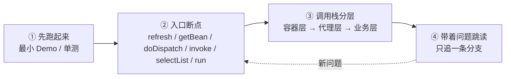
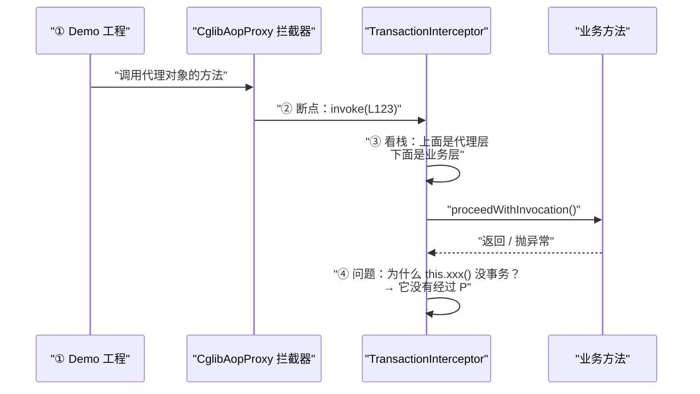

# 四步读码法：从断点到调用栈

> 一句话结论：读框架源码不需要"从第一行读到最后一行"，需要的是**先跑起来 → 在入口打断点 → 用调用栈给代码分层 → 带着一个具体问题跳读**。本篇用本套文档已入库的 6 个真实入口（`refresh`、`getBean`、`doDispatch`、`TransactionInterceptor#invoke`、`DefaultSqlSession#selectList`、`SpringApplication#run`）把这四步各走一遍，之后你看任何新框架都可以复用同一套动作。
> 阅读前置：[../README.md](../README.md)（本目录导读）。
> 预计阅读：35 分钟   ｜   源码：spring-framework@7.1.0、spring-boot@4.2.0、mybatis@3.6.0（均可在 `assets/source/` 中按行号对照）

---

## 0. 先看现象：为什么大多数人读源码会"迷路"

刚打开 `AbstractApplicationContext` 时最常见的情况是：从 L1 开始翻，看到 1100 行还没看到自己关心的东西；或者在一个方法里点进一个调用，再点进一个调用，十几层之后已经不知道自己在哪一层了。

**迷路的根本原因不是代码难，而是没有"坐标系"。** 框架源码的特点是：入口少（通常不超过 10 个）、主线短（每个入口 10~30 行）、分支多（主线上的每一行背后都有几十个 `if`）。如果你不知道"主线"是哪 10 行，就会被分支吞掉。

四步法就是建立坐标系的方法：

| 步骤 | 做什么 | 得到什么 |
| --- | --- | --- |
| ① 先跑起来 | 用一个最小工程触发目标代码 | 一个能复现的运行现场 |
| ② 入口断点 | 在"框架把控制权交给你"的那一刻停下 | 调用栈的**底部** |
| ③ 调用栈分层 | 从下往上看栈帧，给每帧贴"层"标签 | 一张分层地图 |
| ④ 带着问题跳读 | 只读能回答问题的那几层 | 结论 + 可复述的链路 |

## 1. 整体地图：四步法在 6 个入口上的落点



> 读图说明：左侧是"准备"，右侧是"收获"。①→② 之间最重要的动作是**确认断点真的会被命中**（没命中说明触发条件不对，回去改 Demo，不要硬读）。④ 之后的虚线回到 ②，表示每个新问题都从同一个入口重新走一遍，而不是在上一轮的结论上继续猜。

六个入口对应的框架层与文章：

| 入口 | 层 | 触发时机 | 对应文章 |
| --- | --- | --- | --- |
| `AbstractApplicationContext#refresh` | 容器生命周期 | 容器启动一次 | [refresh-容器启动全流程](../../01-Spring框架/01-IoC容器与Bean生命周期/01-refresh-容器启动全流程.md) |
| `AbstractBeanFactory#getBean` → `doGetBean` | Bean 获取/创建 | 任何一次 `getBean` / 注入 | [bean-创建全流程](../../01-Spring框架/01-IoC容器与Bean生命周期/02-bean-创建全流程-getbean与createbean.md) |
| `DispatcherServlet#doDispatch` | Web 分发 | 每次 HTTP 请求 | [dispatcherservlet-一次请求的完整旅程](../../01-Spring框架/04-SpringMVC/01-dispatcherservlet-一次请求的完整旅程.md) |
| `TransactionInterceptor#invoke` | AOP 事务拦截 | 每次调用 `@Transactional` 方法 | [transactional-事务拦截器与传播行为](../../01-Spring框架/03-事务管理/01-transactional-事务拦截器与传播行为.md) |
| `DefaultSqlSession#selectList` | 持久层执行 | 每次 Mapper 调用 | [sqlsession-与-mapper-代理](../../03-MyBatis/02-SqlSession与执行器/01-sqlsession-与-mapper-代理.md) |
| `SpringApplication#run` | Boot 启动 | 应用启动一次 | [springapplication-run-启动全流程](../../02-SpringBoot/01-启动原理/01-springapplication-run-启动全流程.md) |

## 2. 关键类逐个拆：六个入口各自的"主线 10 行"

每个入口我只列"主线"，分支在对应文章里展开。断点就打在表中的"停点"上。

| 入口 | 主线（按执行顺序） | 建议停点 |
| --- | --- | --- |
| `refresh` | prepareRefresh → obtainFreshBeanFactory → prepareBeanFactory → invokeBeanFactoryPostProcessors → registerBeanPostProcessors → onRefresh → finishBeanFactoryInitialization → finishRefresh | L582 方法首行；L604（BFPP）；L606（BPP）；L615（`onRefresh`，Boot 在这里起服务器）；L622（单例预实例化） |
| `doGetBean` | transformedBeanName → getSingleton（一级/二级/三级缓存） → 否则走创建 → getObjectForBeanInstance | L253；L257 |
| `doDispatch` | checkMultipart → getHandler → applyPreHandle → getHandlerAdapter → ha.handle → applyPostHandle → processDispatchResult | L951；L957；L961；L978 |
| `TransactionInterceptor#invoke` | 取 targetClass → `invokeWithinTransaction(method, targetClass, callback)` → 内部：getTransaction → proceed → commit / rollback | L127；L130；L132（`proceed()` 回调） |
| `DefaultSqlSession#selectList` | getMappedStatement → `executor.query(...)` → （CachingExecutor → BaseExecutor → SimpleExecutor → JDBC） → DefaultResultSetHandler | L151；L153 |
| `SpringApplication#run` | getRunListeners → prepareEnvironment → createApplicationContext → prepareContext → refreshContext → afterRefresh → listeners.started → callRunners | L301；L304；L306；L310；L317 |

## 3. 源码精读：按四步走一遍

### 3.1 入口一：`refresh` —— ② 在方法首行停下

```java (src: AbstractApplicationContext.java#L582-L626)
	public void refresh() throws BeansException, IllegalStateException {
		this.startupShutdownLock.lock();
		try {
			this.startupShutdownThread = Thread.currentThread();

			StartupStep contextRefresh = this.applicationStartup.start("spring.context.refresh");

			// Prepare this context for refreshing.
			prepareRefresh();

			// Tell the subclass to refresh the internal bean factory.
			ConfigurableListableBeanFactory beanFactory = obtainFreshBeanFactory();

			// Prepare the bean factory for use in this context.
			prepareBeanFactory(beanFactory);

			try {
				// Allows post-processing of the bean factory in context subclasses.
				postProcessBeanFactory(beanFactory);

				StartupStep beanPostProcess = this.applicationStartup.start("spring.context.beans.post-process");
				// Invoke factory processors registered as beans in the context.
				invokeBeanFactoryPostProcessors(beanFactory);
				// Register bean processors that intercept bean creation.
				registerBeanPostProcessors(beanFactory);
				beanPostProcess.end();

				// Initialize message source for this context.
				initMessageSource();

				// Initialize event multicaster for this context.
				initApplicationEventMulticaster();

				// Initialize other special beans in specific context subclasses.
				onRefresh();

				// Check for listener beans and register them.
				registerListeners();

				// Instantiate all remaining (non-lazy-init) singletons.
				finishBeanFactoryInitialization(beanFactory);

				// Last step: publish corresponding event.
				finishRefresh();
			}
```

这段代码是整个 Spring 容器的"目录页"：每一行注释就是一个阶段。它做了什么：按固定顺序把 BeanFactory 准备好、跑两类后置处理器、初始化事件体系、预实例化单例、发布刷新事件。

为什么要在这里打断点：因为 `refresh` 的调用栈**底**就是你的 `main`（或 Boot 的 `run`），从这里单步往下走，任何一层都可以随时回头看"我在第几个阶段"。这是避免迷路最便宜的保险。

坑：Boot 环境下 `refresh` 会被调用两次（bootstrap context 一次、主 context 一次），断点会命中两次，第一次可以 Resume 掉；另外 `onRefresh()` 在 Boot 里会被 `ServletWebServerApplicationContext` 覆写为"启动 Tomcat"，这行是理解"Boot 为什么在 refresh 中途就能起服务器"的关键。

### 3.2 入口二：`getBean` → `doGetBean` —— ③ 看调用栈分层

```java (src: AbstractBeanFactory.java#L249-L258)
	protected <T> T doGetBean(
			String name, @Nullable Class<T> requiredType, @Nullable Object @Nullable [] args, boolean typeCheckOnly)
			throws BeansException {

		String beanName = transformedBeanName(name);
		Object beanInstance;

		// Eagerly check singleton cache for manually registered singletons.
		Object sharedInstance = getSingleton(beanName);
		if (sharedInstance != null && args == null) {
```

`doGetBean` 是所有 `getBean` 重载的汇合点：先去掉 `&` 前缀、解别名，然后**先查缓存**。这一步对应的教学实现见 [01-手写miniioc容器](../01-手写迷你实现/01-手写miniioc容器.md) 的 v1。

调试时把断点打在 L257，然后**不要按 F5 进 `getSingleton`，先看调用栈面板**：你会看到类似 `main → AnnotationConfigApplicationContext.<init> → refresh → finishBeanFactoryInitialization → preInstantiateSingletons → getBean → doGetBean` 的栈。这就是"分层"：上面是容器生命周期层，下面是 Bean 获取层。

调用栈里的每一帧都属于某一层；按层阅读而不是按帧阅读，才能在几十个帧里只挑 3~4 个关键的看。

缓存命中的细节在下面这个方法里（一级 → 二级 → 三级）：

```java (src: DefaultSingletonBeanRegistry.java#L208-L226)
	protected @Nullable Object getSingleton(String beanName, boolean allowEarlyReference) {
		// Quick check for existing instance without full singleton lock.
		Object singletonObject = this.singletonObjects.get(beanName);
		if (singletonObject == null && isSingletonCurrentlyInCreation(beanName)) {
			singletonObject = this.earlySingletonObjects.get(beanName);
			if (singletonObject == null && allowEarlyReference) {
				if (!this.singletonLock.tryLock()) {
					// Avoid early singleton inference outside of original creation thread.
					return null;
				}
				try {
					// Consistent creation of early reference within full singleton lock.
					singletonObject = this.singletonObjects.get(beanName);
					if (singletonObject == null) {
						singletonObject = this.earlySingletonObjects.get(beanName);
						if (singletonObject == null) {
							ObjectFactory<?> singletonFactory = this.singletonFactories.get(beanName);
							if (singletonFactory != null) {
								singletonObject = singletonFactory.getObject();
```

这个方法是三级缓存的本体。它做了什么：先无锁查一级缓存 `singletonObjects`；只有该 Bean 正在创建中才查二级 `earlySingletonObjects`；仍为空且允许早期引用时，才尝试拿 `singletonLock`（拿不到直接返回 null，避免别的线程替创建线程推断早期引用），再在锁内重查一级、二级，最后取三级 `singletonFactories` 里的工厂并调用 `getObject()`。为什么要单步看：三级查找的"先查谁、什么时候加锁"是面试与排错的高频点，单步一遍比背结论牢。

坑：锁内还要再查两次一级和二级缓存，这是典型的双重检查——等你拿到锁时，另一个线程可能已经把 Bean 放进去了。完整流程与"为什么第三级存工厂不存对象"见 [循环依赖与三级缓存](../../01-Spring框架/01-IoC容器与Bean生命周期/03-循环依赖与三级缓存.md)。

### 3.3 入口三：`DispatcherServlet#doDispatch` —— ④ 带着问题跳读

**问题：**"`@ResponseBody` 是在哪里把对象写成 JSON 的？"从 `doDispatch` 的 L961 往下追，跳过所有 multipart / 拦截器 / 异常分支。

```java (src: DispatcherServlet.java#L935-L963)
	protected void doDispatch(HttpServletRequest request, HttpServletResponse response) throws Exception {
		HttpServletRequest processedRequest = request;
		HandlerExecutionChain mappedHandler = null;
		boolean multipartRequestParsed = false;

		WebAsyncManager asyncManager = WebAsyncUtils.getAsyncManager(request);

		try {
			ModelAndView mv = null;
			Exception dispatchException = null;

			try {
				processedRequest = checkMultipart(request);
				multipartRequestParsed = (processedRequest != request);

				// Determine handler for the current request.
				mappedHandler = getHandler(processedRequest);
				if (mappedHandler == null) {
					noHandlerFound(processedRequest, response);
					return;
				}

				if (!mappedHandler.applyPreHandle(processedRequest, response)) {
					return;
				}

				// Determine handler adapter and invoke the handler.
				HandlerAdapter ha = getHandlerAdapter(mappedHandler.getHandler());
				mv = ha.handle(processedRequest, response, mappedHandler.getHandler());
```

这段是请求分发的骨架：找到处理器链、走 preHandle、选适配器、调用。它做了什么：把"找谁处理"和"怎么调"分开，中间夹一层拦截器。为什么要在这个入口打断点：因为每一次 HTTP 请求都会重新走一遍，你随时可以发一个请求复现，不需要重启应用。

问题对应的跳读路径：`ha.handle` → `RequestMappingHandlerAdapter#invokeHandlerMethod`（L889）→ `ServletInvocableHandlerMethod#invokeAndHandle` → `RequestResponseBodyMethodProcessor#handleReturnValue` → `MappingJackson2HttpMessageConverter`。跳读时只关心"返回值"这条线，其它栈帧全部跳过。

### 3.4 入口四：`TransactionInterceptor#invoke` —— ③ 分层：代理层与业务层

```java (src: TransactionInterceptor.java#L123-L131)
	public @Nullable Object invoke(MethodInvocation invocation) throws Throwable {
		// Work out the target class: may be {@code null}.
		// The TransactionAttributeSource should be passed the target class
		// as well as the method, which may be from an interface.
		Class<?> targetClass = (invocation.getThis() != null ? AopUtils.getTargetClass(invocation.getThis()) : null);

		// Adapt to TransactionAspectSupport's invokeWithinTransaction...
		return invokeWithinTransaction(invocation.getMethod(), targetClass, new InvocationCallback() {
			@Override
```

这段代码只有两件事：算出目标类（可能来自接口，所以要 `getTargetClass`），然后把剩下的一切交给父类 `TransactionAspectSupport#invokeWithinTransaction`，并把"怎么调原方法"包成一个回调。它做了什么：把 AOP 联盟的 `MethodInvocation` 适配到 Spring 自己的事务模板上。

为什么要在这里断点：调用栈在这里会明显分成两段——上面是 `CglibAopProxy$DynamicAdvisedInterceptor#invoke → ReflectiveMethodInvocation#proceed → TransactionInterceptor#invoke`（代理层），下面 `proceedWithInvocation` 回调进去才是你的业务方法。看清楚这条边界，就能立刻解释"为什么 `this.xxx()` 不走代理"（它根本没经过上面那段栈）。详见 [事务失效场景与源码原因](../../01-Spring框架/03-事务管理/02-事务失效场景与源码原因.md)。

### 3.5 入口五：`DefaultSqlSession#selectList` —— ① 先跑起来的价值

```java (src: DefaultSqlSession.java#L145-L158)
  public <E> List<E> selectList(String statement, Object parameter, RowBounds rowBounds) {
    return selectList(statement, parameter, rowBounds, Executor.NO_RESULT_HANDLER);
  }

  private <E> List<E> selectList(String statement, Object parameter, RowBounds rowBounds, ResultHandler handler) {
    try {
      MappedStatement ms = configuration.getMappedStatement(statement);
      dirty |= ms.isDirtySelect();
      return executor.query(ms, wrapCollection(parameter), rowBounds, handler);
    } catch (Exception e) {
      throw ExceptionFactory.wrapException("Error querying database.  Cause: " + e, e);
    } finally {
      ErrorContext.instance().reset();
    }
```

`SqlSession` 本身非常薄：按 statement id 取 `MappedStatement`，标记脏位，交给 `Executor`。它做了什么：把"XML 里的一条 SQL"变成一个可执行对象，并把异常统一包装。为什么这里体现了"先跑起来"：MyBatis 的入口是**接口方法**，你不可能在 `UserMapper#findById` 的源码上打断点（它没有源码），必须先有一个能跑的工程，断点才会落在 `MapperProxy#invoke`（L59）或 `SqlSessionTemplate$SqlSessionInterceptor#invoke`（L329）上。

坑：在 Spring 集成下，断点**不要**打在 `DefaultSqlSession` 上，因为真正被调用的是 `SqlSessionTemplate` 的代理，`DefaultSqlSession` 是每次从 `SqlSessionUtils#getSqlSession` 借出来的；打在 L153 能命中，但调用栈顶上会多出 `SqlSessionInterceptor` 一层。

### 3.6 入口六：`SpringApplication#run` —— 四步合一

```java (src: SpringApplication.java#L292-L317)
	public ConfigurableApplicationContext run(String... args) {
		Startup startup = Startup.create();
		if (this.properties.isRegisterShutdownHook()) {
			SpringApplication.shutdownHook.enableShutdownHookAddition();
		}
		DefaultBootstrapContext bootstrapContext = createBootstrapContext();
		ConfigurableApplicationContext context = null;
		configureHeadlessProperty();
		SpringApplicationRunListeners listeners = getRunListeners(args);
		listeners.starting(bootstrapContext, this.mainApplicationClass);
		try {
			ApplicationArguments applicationArguments = new DefaultApplicationArguments(args);
			ConfigurableEnvironment environment = prepareEnvironment(listeners, bootstrapContext, applicationArguments);
			Banner printedBanner = printBanner(environment);
			context = createApplicationContext();
			context.setApplicationStartup(this.applicationStartup);
			prepareContext(bootstrapContext, context, environment, listeners, applicationArguments, printedBanner);
			refreshContext(context);
			afterRefresh(context, applicationArguments);
			Duration timeTakenToStarted = startup.started();
			if (this.properties.isLogStartupInfo()) {
				new StartupInfoLogger(this.mainApplicationClass, environment).logStarted(getApplicationLog(), startup);
			}
			listeners.started(context, timeTakenToStarted);
			callRunners(context, applicationArguments);
		}
```

这是 Boot 启动的目录页：每个 `listeners.xxx` 都是一次事件发布，每个 `prepareXxx` 都是一个阶段。它做了什么：构造并发布事件的环境 → 建 context → 准备 context → refresh → 收尾。四步法在这里合一：① 跑一个最简 `@SpringBootApplication` 应用；② 断点 L292；③ 从 `refreshContext` 一路下到 `ServletWebServerApplicationContext#onRefresh`（L149）→ `createWebServer`（L171），看到"Boot 层 → Spring 层 → Tomcat 层"三段；④ 问题"自动配置在哪加载"则跳到 `AutoConfigurationImportSelector#getAutoConfigurationEntry`（L130）。

## 4. 时序：一次"读 `@Transactional` 失效"的完整四步



> 读图说明：这张图刻意只画了一次调用。关键在于②停留的那一刻，调用栈里**同时**能看到代理层和业务层，这是验证"事务失效"最快的方式：在你的业务方法里打断点，看栈顶有没有 `TransactionInterceptor`，没有就是没走代理。

## 5. 设计模式与取舍：为什么入口都长得像"模板方法"

六个入口里，`refresh`、`doDispatch`、`run` 都是一个"目录页式"的模板方法：自己只排顺序，具体步骤交给子类或协作对象（`onRefresh`、`getHandler`、`prepareContext`）。读这类方法的技巧是**先读注释**——注释就是阶段名。`doGetBean` 和 `selectList` 则是"薄入口 + 委托"，读它们的价值在于确认"缓存优先""委托给 Executor"这两个事实，而不是逐行读。

代价是：模板方法的分支非常多，单步跟容易进错分支；所以第 ④ 步一定要先写下问题，再决定进哪一层。

## 6. 踩坑与调试

| 现象 | 原因 | 处理 |
| --- | --- | --- |
| 断点不命中 | 触发路径不对（如把断点打在 `DefaultSqlSession` 却用了 `SqlSessionTemplate`；或 Bean 是懒加载） | 回到 ①，用最小工程确认路径；或在 `getBean` 上打条件断点 `beanName.equals("xxx")` |
| 调用栈几十帧看不懂 | 没有分层 | 先找"目录页帧"（`refresh`/`doDispatch`/`run`/`invokeWithinTransaction`），把栈切成段 |
| 单步进了一个 `if` 出不来 | 没有问题就进了分支 | 用"Step Out"回到主线，先把主线走完 |
| `refresh` 命中两次 | Boot 的 bootstrap context | 第一次 Resume |
| 看不到局部变量 | 代理对象 / CGLIB 子类 | 在 `ReflectiveMethodInvocation#proceed` 上看 `target`，或用 `AopUtils.getTargetClass` 的结果 |
| 行号和本地 jar 不一致 | 版本不同 | 用 `tools/fetch-source.mjs` 拉本套基线版本源码到 `assets/source/` 对照 |

## 7. 版本差异

- 在 7.1.0 里 `refresh` 用 `startupShutdownLock`（`AbstractApplicationContext.java` L215、L583、L660）保护"启动/关闭不并发"，`DefaultSingletonBeanRegistry` 用 `singletonLock`（L83）并在 `getSingleton` 里 `tryLock`（L214、L261）避免非创建线程误推断早期引用。这两个锁"哪一版引入"请以官方 release notes 为准，不要凭印象写版本号。
- `BootstrapContext` 自 **2.4.0** 起就有（其 javadoc 同时写了 `@since 4.0.0`，是因为 4.0 把类迁到了 `org.springframework.boot.bootstrap` 包），所以"Boot 2.x 的 `run` 没有 `createBootstrapContext`"这种说法只对 2.4 之前成立；`Startup`/`StartupStep` 计时 API 也是 Boot 2.4 起（Spring 侧的 `ApplicationStartup` 是 5.3 起）。
- Boot 3.x 起 `spring.factories` 中的 `EnableAutoConfiguration` 键被移除，改读 `.imports` 文件；读 `AutoConfigurationImportSelector` 时注意自己看的是哪个版本。

## 8. 面试常见问题

1. **Spring 容器启动的入口是什么？分几个阶段？** `AbstractApplicationContext#refresh`，按注释分：准备、获取 BeanFactory、准备 BeanFactory、BFPP、BPP、消息源、事件广播器、`onRefresh`、监听器、单例预实例化、完成刷新。
2. **`getBean` 先做什么？** 转换 beanName（去 `&`、解别名），然后查单例缓存（一级 → 二级 → 三级），没有才创建。
3. **三级缓存分别存什么？** 完整 Bean、早期引用（半成品）、能产出早期引用的 `ObjectFactory`。
4. **`DispatcherServlet` 一次请求的主线？** `checkMultipart → getHandler → applyPreHandle → getHandlerAdapter → handle → applyPostHandle → processDispatchResult`，异常统一进 `processDispatchResult`。
5. **`@Transactional` 的实现入口？** `TransactionInterceptor#invoke` → `invokeWithinTransaction`：`getTransaction` → 回调 `proceed()` → `commit`/`rollback`。
6. **为什么 `this.method()` 事务会失效？** 调用发生在目标对象内部，没经过代理对象，调用栈里没有 `TransactionInterceptor`。
7. **MyBatis 的 Mapper 接口为什么能执行？** `MapperProxy`（JDK 动态代理）→ `SqlSession#selectList` → `Executor#query` → JDBC。
8. **Spring Boot 启动的入口和主要阶段？** `SpringApplication#run`：listeners.starting → prepareEnvironment → createApplicationContext → prepareContext → refreshContext → afterRefresh → listeners.started → callRunners。
9. **Boot 为什么能在 `refresh` 中途启动 Tomcat？** `ServletWebServerApplicationContext#onRefresh` 覆写了 `refresh` 的 `onRefresh()` 钩子，在单例预实例化之前创建 `WebServer`。
10. **读源码你一般怎么做？** 先跑最小工程 → 在入口方法首行打断点 → 看调用栈分层 → 带问题跳读；用条件断点过滤 beanName / URL。
11. **`SqlSessionTemplate` 和 `DefaultSqlSession` 的区别？** 前者是线程安全的代理，内部通过 `SqlSessionUtils` 获取/绑定到事务的 `SqlSession`；后者是单次会话，非线程安全。
12. **`refresh` 中 `invokeBeanFactoryPostProcessors` 和 `registerBeanPostProcessors` 的顺序能否颠倒？** 不能：BFPP 可能追加 BeanDefinition，BPP 必须在所有 Bean 创建前就位，而 BFPP 本身也是 Bean。

## 9. 练习

1. 建一个只含 `AnnotationConfigApplicationContext` + 一个 `@Component` 的最小工程，在 `AbstractApplicationContext#refresh` L582 打断点，记录命中时的完整调用栈，标出哪些帧属于"容器生命周期层"。
2. 把断点移到 L615（`onRefresh`），在普通 Spring 和 Boot 工程里各跑一次，对比 `this` 的实际类型。
3. 在 `doGetBean` L257 加条件断点 `beanName.equals("你的Bean名")`，单步进入 `getSingleton`，确认三次 `get` 各命中哪个 Map。
4. 发一个会命中 `@ResponseBody` 的请求，从 `doDispatch` L961 用 Step Into 一直走到 `MappingJackson2HttpMessageConverter`，记下经过的栈帧数。
5. 写一个 `this.xxx()` 调用 `@Transactional` 方法的例子，在业务方法首行打断点，截图调用栈证明没有 `TransactionInterceptor`。
6. 在 `DefaultSqlSession#selectList` L153 打断点，对比"直接用 `SqlSessionFactory.openSession()`"和"用 `@Mapper` 接口"两种情况下调用栈顶部的差异。
7. 在 `SpringApplication#run` L306 打断点，打印 `this.webApplicationType`，再换一个非 Web 工程对比 `createApplicationContext` 返回的类型。

## 小结

- 源码迷路的根源是没有坐标系；四步法用"跑起来 → 入口断点 → 调用栈分层 → 带问题跳读"建立坐标系。
- 六个入口的主线都只有 10~30 行，注释就是阶段名；先读完主线，再决定进哪一层。
- 调用栈的价值在于"切层"：找到目录页帧，把栈切成容器层 / 代理层 / 业务层 / 持久层。
- 每个新问题都从同一个入口重新走一遍，不要在上一轮结论上猜。
- 更多可直接打断点的位置见 [02-断点清单-按框架速查](02-断点清单-按框架速查.md)。

## 自测题

<details>
<summary>1. 四步读码法的四步分别是什么？为什么"先跑起来"要放在最前面？</summary>

先跑起来 → 入口断点 → 调用栈分层 → 带着问题跳读。先跑起来是因为断点只有在真实触发路径上才有意义；没有运行现场，你无法确认自己读的代码是否真的会被执行，也无法看到局部变量的真实值。

</details>

<details>
<summary>2. `refresh` 中哪两行是"后置处理器"相关？为什么 BFPP 必须在 BPP 之前？</summary>

L604 `invokeBeanFactoryPostProcessors` 和 L606 `registerBeanPostProcessors`。BFPP 可以追加或修改 BeanDefinition（例如 `@Configuration` 解析、自动配置导入），必须在任何 Bean 创建前完成；BPP 则要在单例预实例化（L622）之前注册好。而 BFPP 本身是 Bean，所以要先于 BPP 注册被创建。

</details>

<details>
<summary>3. `doGetBean` 在 L253 做了什么？为什么要先做这个？</summary>

`transformedBeanName(name)`：去掉 `&` 前缀并解析别名。因为用户传进来的可能是别名或 `&beanName`（取 FactoryBean 本身），不先规范化就会查不到缓存。

</details>

<details>
<summary>4. 调用栈里看到 `CglibAopProxy$DynamicAdvisedInterceptor#invoke` 和 `TransactionInterceptor#invoke`，它们分别属于哪一层？</summary>

都属于代理层：前者是 CGLIB 生成的拦截器（把所有调用转发到 `ReflectiveMethodInvocation`），后者是事务通知。业务方法在它们"下面"，由 `proceedWithInvocation` 回调进入。

</details>

<details>
<summary>5. `doDispatch` 中 `applyPreHandle` 返回 false 时会发生什么？</summary>

直接 `return`，不再调用 handler，也不会走 `applyPostHandle`；但已成功 `preHandle` 的拦截器会通过 `afterCompletion` 被回调（在 `triggerAfterCompletion` 中，由 `mappedHandler` 记录的 `interceptorIndex` 决定回调范围）。

</details>

<details>
<summary>6. Spring 集成下，为什么断点打在 `DefaultSqlSession` 上能看到 `SqlSessionInterceptor` 帧？</summary>

因为 `MapperProxy` 持有的 `SqlSession` 实际是 `SqlSessionTemplate`，它内部是一个 JDK 代理（`SqlSessionInterceptor`），每次方法调用都通过 `SqlSessionUtils#getSqlSession` 拿到真正的 `DefaultSqlSession` 再委托，所以栈顶会多出这一层。

</details>

<details>
<summary>7. Boot 的 `run` 里 `refreshContext` 和 `afterRefresh` 的区别？</summary>

`refreshContext` 调用 `refresh(context)`（并按需做额外定制），是 Spring 容器启动；`afterRefresh` 是 Boot 留给子类的空钩子，在容器刷新后、`listeners.started` 之前执行。

</details>

<details>
<summary>8. 断点不命中时，第一步应该做什么？</summary>

回到第①步，确认触发路径：检查 Bean 是否懒加载、是否被代理、是否走了别的入口（如 `SqlSessionTemplate` 而不是 `DefaultSqlSession`）。必要时在更上层的入口（`getBean`、`doDispatch`）加条件断点，先确认请求确实到了。

</details>

<details>
<summary>9. 什么是"目录页帧"？举三个例子。</summary>

调用栈中只负责排顺序、不含业务分支的模板方法帧，它们把栈切成段。例：`AbstractApplicationContext#refresh`、`DispatcherServlet#doDispatch`、`SpringApplication#run`（以及 `TransactionAspectSupport#invokeWithinTransaction`）。

</details>

<details>
<summary>10. `TransactionInterceptor#invoke` 为什么要算 `targetClass` 而不是直接用 `invocation.getMethod().getDeclaringClass()`？</summary>

因为方法可能声明在接口上，而事务属性（`@Transactional`）通常标在实现类上；`TransactionAttributeSource` 需要目标类才能正确匹配类级/方法级注解。`AopUtils.getTargetClass` 还能穿透 CGLIB 代理拿到用户类。

</details>
