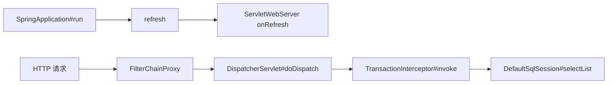
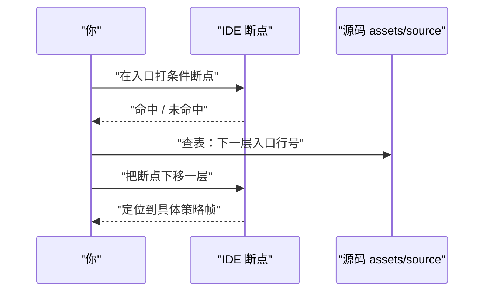

# 断点清单：按框架速查

> 一句话结论：读源码时最贵的不是"读"，而是"找从哪开始读"。本篇把 Spring / Boot / MyBatis / Cloud / Security 五大块**已在本套 `assets/source/` 入库**的类按"类#方法 + 行号 + 看什么 + 对应文章"整理成表，打断点前查一下即可，行号均与入库源码核对过。
> 阅读前置：[01-四步读码法-从断点到调用栈](01-四步读码法-从断点到调用栈.md)（本清单是它的查表工具）。
> 预计阅读：20 分钟（查阅用）   ｜   源码基线：Spring Framework 7.1.0、Spring Boot 4.2.0、Spring Cloud 5.1.0、Spring Security 7.2.0、MyBatis 3.6.0、Nacos 3.3.0、Sentinel 1.8.10

---

## 0. 先看现象：断点打错位置的四种典型表现

| 表现 | 实际原因 | 修正 |
| --- | --- | --- |
| 断点根本不命中 | 打在了"被委托者"上，调用走的是代理（`DefaultSqlSession` vs `SqlSessionTemplate`） | 改打在代理入口 |
| 命中太频繁，一直在 Resume | 打在 `getBean` / `doDispatch` 这种全局面 | 加条件断点（beanName / URL） |
| 命中了但看不懂局部变量 | 打在了目录页帧上，变量都是集合和 null | 往下走到具体策略帧 |
| 行号对不上 | 本地 jar 版本与入库基线不同 | 用 `tools/fetch-source.mjs` 拉基线版本 |

## 1. 整体地图：一次请求会穿过哪些断点



> 读图说明：上排是**启动期**（只命中一次），下排是**请求期**（每次请求命中）。请求期的顺序由外到内：Security 过滤器链 → DispatcherServlet → 事务拦截器 → MyBatis。排错时从最外层入口打断点，用 Step Into 逐层确认"请求到了哪一层"。

## 2. 关键类逐个拆：怎么读这张清单

- **类#方法**：断点打在方法体首行。
- **行号**：`assets/source/` 入库文件中的原始行号，可用 `[[源码:文件#L起-L止]]` 锚点直接跳转。
- **看什么**：停下后重点观察的变量或分支。
- **文章**：展开讲解所在的文章。

## 3. 源码精读：几个"先打断再说"的入口

### 3.1 Security 过滤器链入口

```java (src: FilterChainProxy.java#L213-L220)
	private void doFilterInternal(ServletRequest request, ServletResponse response, FilterChain chain)
			throws IOException, ServletException {
		FirewalledRequest firewallRequest = this.firewall.getFirewalledRequest((HttpServletRequest) request);
		HttpServletResponse firewallResponse = this.firewall.getFirewalledResponse((HttpServletResponse) response);
		List<Filter> filters = getFilters(firewallRequest);
		if (filters == null || filters.isEmpty()) {
			if (logger.isTraceEnabled()) {
				logger.trace(LogMessage.of(() -> "No security for " + requestLine(firewallRequest)));
```

这段做了什么：先用 `Firewall` 把请求/响应包一层（拒绝非法 URL），再按请求选出一条过滤器链。为什么要在这停：`filters` 变量就是"这个请求会经过哪些安全过滤器"的直接答案，`filters == null` 说明该 URL 没有任何安全链。坑：断点要打在 `doFilterInternal`（L213）而不是 `doFilter`（L186），后者只有一行委托。

### 3.2 Cloud：Bootstrap 上下文入口

```java (src: BootstrapApplicationListener.java#L99-L104)
	public void onApplicationEvent(ApplicationEnvironmentPreparedEvent event) {
		ConfigurableEnvironment environment = event.getEnvironment();
		if (!bootstrapEnabled(environment) && !useLegacyProcessing(environment)) {
			return;
		}
		// don't listen to events in a bootstrap context
```

这段做了什么：收到"环境已准备好"事件后，先判断是否启用 bootstrap。为什么要在这停：Spring Cloud 的配置中心拉取依赖 bootstrap 上下文，这个 `if` 就是总开关；返回了就说明 `spring.cloud.bootstrap.enabled` / `spring.config.import` 没配对。详见 [config-client-配置拉取原理](../../04-SpringCloud/05-配置中心与Bus/01-config-client-配置拉取原理.md)。

### 3.3 Cloud：Sentinel 入口

```java (src: SphU.java#L84-L86)
    public static Entry entry(String name) throws BlockException {
        return Env.sph.entry(name, EntryType.OUT, 1, OBJECTS0);
    }
```

这段做了什么：静态入口委托给单例 `Env.sph`（`CtSph`），后续在 `entryWithPriority`（L117）里 `lookProcessChain`（L194）找处理链。为什么要在这停：`@SentinelResource` 最终都会落到这里，是验证"规则有没有加载"的最快位置。

## 4. 断点清单（按框架）

### 4.1 Spring Framework —— IoC 容器

| 类#方法 | 行号 | 看什么 | 文章 |
| --- | --- | --- | --- |
| `AbstractApplicationContext#refresh` | L582（L604 BFPP / L606 BPP / L615 onRefresh / L622 预实例化） | 调用栈底部、各阶段顺序 | [refresh](../../01-Spring框架/01-IoC容器与Bean生命周期/01-refresh-容器启动全流程.md) |
| `AbstractBeanFactory#getBean(String)` | L197 | 所有重载的汇合 | [bean 创建全流程](../../01-Spring框架/01-IoC容器与Bean生命周期/02-bean-创建全流程-getbean与createbean.md) |
| `AbstractBeanFactory#doGetBean` | L249（L253 beanName / L257 一级缓存） | 条件断点 `beanName.equals(...)` | 同上 |
| `DefaultSingletonBeanRegistry#getSingleton(String, boolean)` | L208 | 三个 Map 哪个命中 | [循环依赖](../../01-Spring框架/01-IoC容器与Bean生命周期/03-循环依赖与三级缓存.md) |
| `AbstractAutowireCapableBeanFactory#createBean` | L486 | 栈里是否出现两次同名 Bean | 同上 |
| `AbstractAutowireCapableBeanFactory#doCreateBean` | L554 | createBeanInstance / populateBean / initializeBean 三段 | [bean 创建全流程](../../01-Spring框架/01-IoC容器与Bean生命周期/02-bean-创建全流程-getbean与createbean.md) |
| `AbstractAutowireCapableBeanFactory#populateBean` | L1388 | 字段注入发生在哪 | [依赖注入](../../01-Spring框架/01-IoC容器与Bean生命周期/04-依赖注入-autowired与beanpostprocessor.md) |
| `AbstractAutowireCapableBeanFactory#initializeBean` | L1810 | BPP 前置 / Aware / init / BPP 后置 | 同上 |
| `DefaultListableBeanFactory#preInstantiateSingletons` | L1099 | 哪个 Bean 初始化最慢 | [refresh](../../01-Spring框架/01-IoC容器与Bean生命周期/01-refresh-容器启动全流程.md) |
| `ConfigurationClassParser#processConfigurationClass` | L248 | 配置类解析、`@Import` | [配置类解析](../../01-Spring框架/01-IoC容器与Bean生命周期/05-配置类解析-configurationclasspostprocessor.md) |

### 4.2 Spring Framework —— AOP / 事务 / MVC

| 类#方法 | 行号 | 看什么 | 文章 |
| --- | --- | --- | --- |
| `DispatcherServlet#doDispatch` | L935（L951 getHandler / L957 preHandle / L961 handle / L978 结果处理） | 条件断点 `request.getRequestURI()` | [dispatcherservlet](../../01-Spring框架/04-SpringMVC/01-dispatcherservlet-一次请求的完整旅程.md) |
| `DispatcherServlet#getHandlerAdapter` | L1185 | handler 类型 | [handlermapping 与 adapter](../../01-Spring框架/04-SpringMVC/02-处理器映射与适配器-handlermapping与handleradapter.md) |
| `AbstractHandlerMapping#getHandler` | L542 | 拦截器链组成 | [拦截器](../../01-Spring框架/04-SpringMVC/04-拦截器与异常处理-interceptor与controlleradvice.md) |
| `AbstractHandlerMethodMapping#lookupHandlerMethod` | L393 | URL → HandlerMethod | [handlermapping](../../01-Spring框架/04-SpringMVC/02-处理器映射与适配器-handlermapping与handleradapter.md) |
| `RequestMappingHandlerAdapter#invokeHandlerMethod` | L889 | 参数解析 / 返回值处理 | [argumentresolver](../../01-Spring框架/04-SpringMVC/03-参数解析与返回值处理-argumentresolver与converter.md) |
| `TransactionInterceptor#invoke` | L123（L130 invokeWithinTransaction） | 栈里代理层与业务层边界 | [事务拦截器](../../01-Spring框架/03-事务管理/01-transactional-事务拦截器与传播行为.md) |
| `AbstractPlatformTransactionManager#getTransaction` | L373 | 传播行为判定 | [事务拦截器](../../01-Spring框架/03-事务管理/01-transactional-事务拦截器与传播行为.md) |
| `AbstractPlatformTransactionManager#commit` / `#rollback` | L734 / L858 | rollbackOnly 标记 | [数据源事务管理器](../../01-Spring框架/03-事务管理/03-数据源事务管理器与连接绑定.md) |

### 4.3 Spring Boot

| 类#方法 | 行号 | 看什么 | 文章 |
| --- | --- | --- | --- |
| `SpringApplication#run` | L292（L301 listeners / L304 env / L306 context / L310 refresh） | 启动耗时落点 | [run 启动全流程](../../02-SpringBoot/01-启动原理/01-springapplication-run-启动全流程.md) |
| `SpringApplication#createApplicationContext` | L565 | WebApplicationType → context 类型 | 同上 |
| `ServletWebServerApplicationContext#onRefresh` | L149（L152 createWebServer） | 服务器在 refresh 中途启动 | [内嵌容器](../../02-SpringBoot/03-内嵌容器与Web开发/01-内嵌容器启动-tomcat与servletweb容器.md) |
| `ServletWebServerApplicationContext#createWebServer` | L171 | Tomcat / Jetty 选择 | 同上 |
| `AutoConfigurationImportSelector#getAutoConfigurationEntry` | L130（L135 候选 / L140 过滤） | 哪些自动配置被排除 | [自动配置全链路](../../02-SpringBoot/02-自动配置/01-enableautoconfiguration-自动配置全链路.md) |
| `OnClassCondition#getMatchOutcome` | L75 | 条件注解判定 | [自定义 starter](../../02-SpringBoot/02-自动配置/02-自定义starter与条件注解.md) |
| `ConfigurationClassParser#processImports` | L581 | `@Import` 的 DeferredImportSelector | [自动配置全链路](../../02-SpringBoot/02-自动配置/01-enableautoconfiguration-自动配置全链路.md) |

### 4.4 MyBatis

| 类#方法 | 行号 | 看什么 | 文章 |
| --- | --- | --- | --- |
| `MapperProxy#invoke` | L59 | 接口方法 → SqlCommand | [sqlsession 与 mapper 代理](../../03-MyBatis/02-SqlSession与执行器/01-sqlsession-与-mapper-代理.md) |
| `SqlSessionTemplate$SqlSessionInterceptor#invoke` | L329 | SqlSession 从哪借的 | [mybatis-spring 集成](../../03-MyBatis/05-Spring集成与Boot自动配置/01-mybatis-spring-集成原理.md) |
| `SqlSessionUtils#getSqlSession` | L68 | 事务同步管理器绑定 | 同上 |
| `DefaultSqlSession#selectList(String, Object, RowBounds)` | L145（L151 MappedStatement / L153 executor.query） | statement id、参数 | [sqlsession 与 mapper 代理](../../03-MyBatis/02-SqlSession与执行器/01-sqlsession-与-mapper-代理.md) |
| `CachingExecutor#query` | L86（L88 BoundSql / L89 CacheKey） | 二级缓存键 | [二级缓存](../../03-MyBatis/04-结果映射与插件/03-二级缓存与坑位.md) |
| `SimpleExecutor#doQuery` | L56 | Statement 创建、一级缓存 | [executor 与一级缓存](../../03-MyBatis/02-SqlSession与执行器/02-executor-执行器与一级缓存.md) |

### 4.5 Spring Cloud

| 类#方法 | 行号 | 看什么 | 文章 |
| --- | --- | --- | --- |
| `BootstrapApplicationListener#onApplicationEvent` | L99 | bootstrap 是否启用 | [config-client](../../04-SpringCloud/05-配置中心与Bus/01-config-client-配置拉取原理.md) |
| `ContextRefresher#refresh` | L97 | 配置刷新范围 | [refreshscope 与 bus](../../04-SpringCloud/05-配置中心与Bus/02-配置刷新-refreshscope与bus.md) |
| `NacosServiceRegistry#register` | L60 | 服务名 / 实例信息 | [nacos 注册](../../04-SpringCloud/02-注册中心Nacos/01-nacos-服务注册与发现源码.md) |
| `NacosAutoServiceRegistration#register` | L72 | WebServer 已就绪后再注册 | 同上 |
| `FeignClientFactoryBean#getObject` / `#getTarget` | L474 / L484 | Feign 客户端代理构建 | [SpringCloud 总览](../../04-SpringCloud/README.md) |
| `FeignBlockingLoadBalancerClient#execute` | L79 | 负载均衡选实例 | 同上 |
| `RoundRobinLoadBalancer#choose` | L82 | 轮询位置 | [服务发现与拉取](../../04-SpringCloud/02-注册中心Nacos/02-服务发现与拉取-服务实例列表如何更新.md) |
| `ReactiveLoadBalancerClientFilter#filter` | L88 | Gateway 中替换 `lb://` | [SpringCloud 总览](../../04-SpringCloud/README.md) |
| `RoutePredicateHandlerMapping#getHandlerInternal` / `#lookupRoute` | L80 / L131 | 路由断言匹配 | 同上 |
| `SphU#entry(String)` | L84 | Sentinel 入口 | [sentinel](../../04-SpringCloud/06-熔断限流与容错/02-sentinel-限流降级原理.md) |
| `CtSph#entryWithPriority` / `#lookProcessChain` | L117 / L194 | ProcessorSlotChain 组装 | 同上 |

### 4.6 Spring Security

| 类#方法 | 行号 | 看什么 | 文章 |
| --- | --- | --- | --- |
| `FilterChainProxy#doFilterInternal` | L213（L218 getFilters） | 选了哪条链 | [filterchainproxy](../../05-SpringSecurity/01-过滤器链与认证/01-filterchainproxy-过滤器链原理.md) |
| `SecurityContextHolderFilter#doFilter` | L67 | 上下文从哪恢复 | 同上 |
| `UsernamePasswordAuthenticationFilter#attemptAuthentication` | L74 | 表单参数 → Token | [authentication](../../05-SpringSecurity/01-过滤器链与认证/02-authentication-认证流程与provider.md) |
| `ProviderManager#authenticate` | L166 | 轮询 Provider | 同上 |
| `AuthorizationFilter#doFilter` | L77 | 授权决策 | [filterchainproxy](../../05-SpringSecurity/01-过滤器链与认证/01-filterchainproxy-过滤器链原理.md) |

## 5. 时序：断点清单在排错中的使用顺序



> 读图说明：这是一个"二分"过程——每次只在当前层和下一层的入口各放一个断点，命中下层就删上层的，未命中就说明问题在两层之间（通常是配置/条件注解没生效）。

## 6. 踩坑与调试

- 条件断点表达式：Spring 用 `beanName.equals("xxx")`，MVC 用 `request.getRequestURI().contains("/api/x")`，MyBatis 用 `statement.endsWith("findById")`。
- CGLIB 代理下 `this` 是子类，看 `AopUtils.getTargetClass(this)` 或 `ReflectiveMethodInvocation.target`。
- Boot 2.x/3.x 行号与 4.2.0 不同，表中行号只对基线版本有效；源码可在 `assets/source/` 用 `[[源码:DispatcherServlet.java#L935-L964]]` 这类锚点定位。

## 7. 版本差异

- Boot 4.2.0 / Spring 7.1.0 中 `doDispatch` 签名未变；6.0 起 `getSingleton` 增加了 `singletonLock.tryLock()`。
- Boot 3.0 起自动配置改读 `.imports`，`AutoConfigurationImportSelector#getAutoConfigurationEntry` 逻辑相应变化。
- Cloud 5.1.0 推荐 `spring.config.import=nacos:` 替代 bootstrap，`BootstrapApplicationListener` 只在启用时生效。

## 8. 面试常见问题

1. Spring 容器启动入口与阶段？——`refresh` L582，见 4.1。
2. `getBean` 先查什么？——一级缓存 `getSingleton`（L257 → L208）。
3. 请求进入 Spring MVC 的第一个方法？——`DispatcherServlet#doDispatch` L935（外层还有 `doService` L829）。
4. `@Transactional` 入口？——`TransactionInterceptor#invoke` L123。
5. Boot 启动在哪创建上下文？——`SpringApplication#run` L306 `createApplicationContext`。
6. Boot 为什么 `refresh` 中途起 Tomcat？——`onRefresh` L615 → `ServletWebServerApplicationContext#onRefresh` L149。
7. 自动配置候选在哪加载、在哪过滤？——L135 / L140（`getAutoConfigurationEntry`）。
8. MyBatis 接口调用的第一帧？——`MapperProxy#invoke` L59。
9. MyBatis 集成 Spring 时 SqlSession 怎么保证事务一致？——`SqlSessionUtils#getSqlSession` L68。
10. Security 请求最先经过谁？——`FilterChainProxy#doFilterInternal` L213。
11. Nacos 何时注册？——WebServer 就绪后 `NacosAutoServiceRegistration#register` L72。
12. Sentinel 限流入口？——`SphU#entry` L84 → `CtSph#lookProcessChain` L194。

## 9. 练习

1. 按第 1 节地图，在启动期 3 个入口各打一个断点，记录命中顺序。
2. 在 `doDispatch` L951 加 URI 条件断点，用 Step Into 走到 `lookupHandlerMethod` L393，记下匹配到的 `HandlerMethod`。
3. 在 `getTransaction` L373 打断点，分别用 `REQUIRED` + `REQUIRES_NEW` 调用，观察 `TransactionStatus` 是否 `isNewTransaction()`。
4. 在 `getAutoConfigurationEntry` L140 前后打印 `configurations` 列表，对比加 `spring.autoconfigure.exclude` 前后的差异。
5. 在 `getFilters` L218 打断点，对比有/无 Security 依赖时 `filters` 的内容。
6. 在 `CachingExecutor#query` L89 打断点，记下 `CacheKey` 的组成，验证"同 SQL 不同参数不命中二级缓存"。

## 小结

- 五大块共 50 余个断点位置，全部对应入库源码行号与展开文章。
- 启动期断点打在目录页帧，请求期断点加条件表达式。
- 排错时用"两层入口二分法"快速定位问题落在哪一层。

## 自测题

<details><summary>1. `refresh` 中注册 BPP 的是哪一行？</summary>
L606 `registerBeanPostProcessors(beanFactory)`，必须在 L622 预实例化之前。
</details>
<details><summary>2. 断点打在 `DefaultSqlSession` 不命中，先怀疑什么？</summary>
调用走的是 `SqlSessionTemplate` 代理，应先在 `SqlSessionInterceptor#invoke` L329 确认；若那里也不命中，说明 Mapper 未被扫描或走了别的 SqlSessionFactory。
</details>
<details><summary>3. `getSingleton(String, boolean)` 中 `allowEarlyReference` 为 false 的场景？</summary>
`getSingleton(String)` 传 true；false 用于允许早期引用的场景之外，如 `containsSingleton` 类检查不希望触发工厂创建。
</details>
<details><summary>4. 事务传播行为在哪一行附近判定？</summary>
`AbstractPlatformTransactionManager#getTransaction` L373，`doGetTransaction` L379 之后根据 `TransactionDefinition` 判定。
</details>
<details><summary>5. Boot 中 `onRefresh` 被谁覆写？</summary>
`ServletWebServerApplicationContext#onRefresh` L149，L152 调 `createWebServer`。
</details>
<details><summary>6. 自动配置的候选与过滤分别对应哪两行？</summary>
L135 `getCandidateConfigurations`，L140 `filter`。
</details>
<details><summary>7. Security 中 `filters == null` 说明什么？</summary>
该请求没有匹配到任何 `SecurityFilterChain`（L218-220 分支），请求不经过任何安全过滤器。
</details>
<details><summary>8. Feign 调用时负载均衡的断点打在哪？</summary>
`FeignBlockingLoadBalancerClient#execute` L79，再到 `RoundRobinLoadBalancer#choose` L82。
</details>
<details><summary>9. Sentinel 处理链在哪组装？</summary>
`CtSph#lookProcessChain` L194，由 `entryWithPriority` L117 调用。
</details>
<details><summary>10. 为什么清单里多处强调"条件断点"？</summary>
`getBean`、`doDispatch`、`FilterChainProxy` 是全局面，一个应用内会命中成百上千次；不加条件会让人工 Resume 淹没真正的目标调用。
</details>
