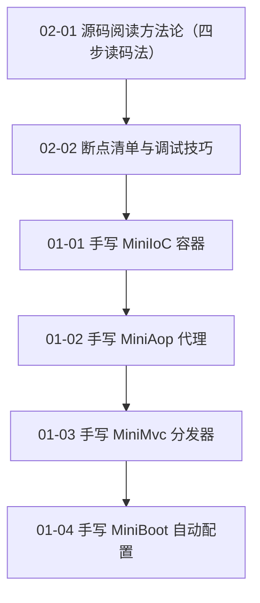

# 07 源码方法论与手写实现

> 目标：把前面 6 大块里"看源码的方法"沉淀成可以复用的技能，并通过手写迷你实现验证理解。
> 这是本套文档的**收口章节**：如果前面的代码你看得懂但记不住，说明还缺这一章。

## 学习目标

- 掌握"**入口 → 主线 → 分水岭方法 → 扩展点**"四步读码法。
- 能自己用 `list-jar` / `fetch-source` 把任意一个 Spring 组件源码抓到本地并定位行号。
- 动手写出 4 个迷你实现：`MiniIoC`、`MiniAop`、`MiniMvc`、`MiniBoot`，理解框架"最小必需件"。
- 会做断点调试：知道哪些方法值得下断点、如何用 IDEA 条件断点与 Evaluate 表达式验证结论。

## 文章顺序

> 读图说明：先学方法（A/B）再动手（C~F）；手写实现按依赖顺序排列——AOP 依赖 IoC，MVC 依赖 IoC，Boot 是"自动装配 IoC"。

## 子目录

| 目录 | 内容 | 学完能做到 |
| --- | --- | --- |
| [`01-手写迷你实现`](01-手写迷你实现/README.md) | 4 个可运行的最小实现 + 与真实 Spring 的逐点对照 | 面试时能说"如果我来实现，会长什么样" |
| [`02-源码阅读方法论`](02-源码阅读方法论/README.md) | 四步读码法、断点清单、常见反编译/调试陷阱 | 快速啃陌生框架 |

## 说明

- 本章的示例代码是**自己写的教学实现**，不属于任何 jar，因此代码块**不要**标注 `(src: ...)`，请标注 "示意代码"。
- 与真实 Spring 对照时，引用的 Spring 代码仍需入库并保持逐字符一致。

## 学习检查点

- [ ] 能不看文档列出"读一个陌生框架源码"的 4 个步骤。
- [ ] 能 30 分钟内实现一个支持单例、构造器注入、`@PostConstruct` 的迷你容器。
- [ ] 能解释 CGLIB 代理为什么不能代理 `final` 类/方法。
