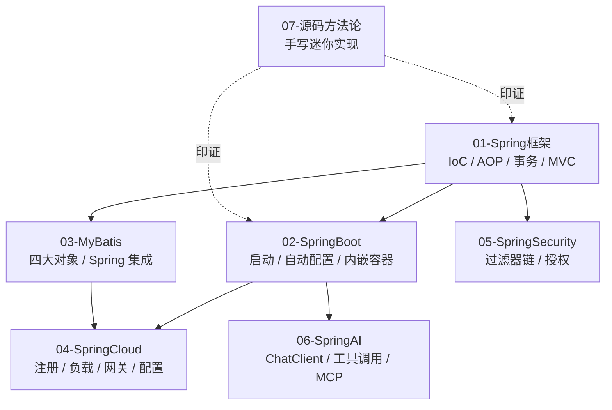

# Spring 全家桶源码精读（中文 · 面向新手）

> 这不是"API 用法手册"，也不是"面试八股合集"。这是一套**能对着源码逐行核对**的教程：每一段贴出来的框架代码都来自真实的 `-sources.jar`，标注了精确行号，并且有工具在每次提交前机械校验"正文贴的代码 == jar 里的原文"。

## 0. 这份教程是什么

- **7 个主题、114 篇正文、约 5.1 万行**：Spring 框架、Spring MVC、Spring Boot、MyBatis、Spring Cloud、Spring Security、Spring AI，外加"手写迷你实现"与"源码阅读方法论"。
- **905 份源码摘录、约 22.3 万行**：全部由脚本从 Maven Central 的 `-sources.jar` 抓取，每行前面带原始行号（`123 | 原文`），**禁止手改**。
- **每篇统一 12 节结构**：现象 → 整体地图 → 关键类 → 源码逐段精读 → 时序 → 设计取舍 → 调试与踩坑 → 版本差异 → 面试问答 → 动手练习 → 小结 → 自测题（答案折叠）。
- **4 个可编译运行的手写迷你框架**（IoC / AOP / MVC / Boot），放在 `examples/mini-frameworks/`，用来把"框架到底替你做了什么"变成几百行你能读懂、能改、能跑通的代码。

### 它不做什么

- 不保证覆盖每个类的每个分支。选的是"读懂框架必须跨过的那几个坎"：`refresh()`、`getBean()` 三级缓存、代理创建、事务拦截器、`DispatcherServlet#doDispatch`、`MyBatis` 四大对象、`AutoConfiguration.imports`、`FilterChainProxy`、`ChatClient` advisor 链。
- 不把"版本兼容性"当已验证结论。凡是"某特性从哪个小版本开始"的说法，只有源码 javadoc / 制品实测能佐证时才写；拿不到证据的一律写"以官方 release notes 为准"。
- 不写"我猜的实现"。拿不到源码的模块（见 §7）会明确标注**未验证**，而不是编一段像模像样的代码。

## 1. 目录地图

| 目录 | 内容 | 篇数 |
| --- | --- | --- |
| [`00-导读与学习路线`](00-导读与学习路线/README.md) | 先读这里：学习路线、引用约定、环境准备、自测清单 | 1 |
| [`01-Spring框架`](01-Spring框架/README.md) | IoC 容器与 Bean 生命周期、AOP 与代理、事务管理、Spring MVC、数据访问与测试 | 25 |
| [`02-SpringBoot`](02-SpringBoot/README.md) | 启动原理、自动配置、内嵌容器与 Web、配置与属性绑定、Actuator 与测试、AOT/GraalVM | 17 |
| [`03-MyBatis`](03-MyBatis/README.md) | 总体架构、初始化与配置解析、SqlSession 与执行器、动态 SQL 与参数映射、结果映射与插件、Spring 集成 | 19 |
| [`04-SpringCloud`](04-SpringCloud/README.md) | 体系与版本、Nacos、LoadBalancer/OpenFeign、Gateway、Config+Bus、熔断限流、分布式事务与链路追踪、Alibaba 生态 | 24 |
| [`05-SpringSecurity`](05-SpringSecurity/README.md) | FilterChainProxy 过滤器链与认证、授权决策与方法级安全 | 7 |
| [`06-SpringAI`](06-SpringAI/README.md) | ChatClient 与模型抽象、工具调用与 RAG、MCP 与 Agent | 10 |
| [`07-源码方法论与附录`](07-源码方法论与附录/README.md) | 手写迷你实现（4 个可运行示例）、四步读码法、断点清单 | 9 |
| [`assets/source`](assets/source) | 905 份源码摘录（带行号），所有 `src:` 引用的唯一事实来源 | 905 |
| [`examples/mini-frameworks`](examples/mini-frameworks/README.md) | 4 个单文件迷你框架 + 运行说明 | 4 |
| [`tools`](tools) | `fetch-source.mjs` 抓源码、`list-jar.mjs` 列 jar 内路径、`check-doc.mjs` 校验正文 | 4 |
| [`_templates`](_templates) | 写作规范、agent 任务书（续写时用） | 2 |

### 1.1 依赖关系图



**读图说明**：实线是"前置知识"关系——不懂 IoC 的 `getBean` 就看不懂 Boot 的 `prepareContext` 为什么要注册那么多单例；不懂 `DispatcherServlet` 就看不懂 Gateway 为什么要绕开 MVC。虚线表示 `07` 里的迷你实现是对 `01`/`02` 的**交叉验证**：你亲手写的 300 行 IoC，能跑通真实 Spring 里 `refresh()` 那 12 步的简化版，就说明你真懂了，而不是背下来了。

## 2. 三条推荐路线

| 你是谁 | 走法 | 大概耗时 |
| --- | --- | --- |
| **完全新手**（会写 `@RestController`，但不知道它怎么被调用） | `00` → `01/01`（refresh 全流程）→ `01/04`（MVC）→ `02/01`（启动）→ `02/02`（自动配置）→ 其余按兴趣 | 3～5 天 |
| **要面试** | `00` → 各目录的面试问答节 + `07/02`（断点清单）→ 挑 `refresh`/`doDispatch`/`getBean`/`AutoConfiguration`/`FilterChainProxy` 五条主线精读 | 1～2 天 |
| **线上排障**（明明加了注解却没生效） | `01/03`（事务失效）→ `01/02`（代理失效）→ `02/02`（条件不满足）→ `04/08`（微服务故障排查清单） | 半天 |

## 3. 源码引用约定（读之前必须知道）

正文里出现两种引用，含义不同：

1. **锚点**：`[[源码:AbstractApplicationContext.java#L581-L662]]` —— "这段逻辑在 `assets/source/AbstractApplicationContext.java.md` 的第 581～662 行"。点开摘录文件就能对照原文。
2. **代码块标注**：```` ```java (src: AbstractApplicationContext.java#L581-L662) ```` —— 下面这个代码块的内容，与原文对应区间**逐字符一致**。

三条硬规则（`tools/check-doc.mjs` 会机械校验，违反即报错）：

- 代码块首行必须逐字符等于声明的 `L起`，末行必须逐字符等于 `L止`；没有省略号时，行数必须正好是 `止 - 起 + 1`。
- 要跳过中间大段代码，必须**单独一行**写 `...`（不能写成 `// ...` 之外的任何形式），且省略号前后两段都必须在原文里连续命中，最后一行必须落在声明的 `L止` 上。
- 只允许忽略行尾空白。缩进、逗号、分号、注释符号有一个字符不同就是错误。

为什么这么严？因为"看起来差不多"的代码是**最坏的教程**：读者照着抄会报错，照着推理会得出错误结论。宁可让工具拦住作者，也不让读者踩坑。

## 4. 版本基线

| 组件 | 基线版本 | 说明 |
| --- | --- | --- |
| Spring Framework | `7.1.0` | `spring-core/beans/context/aop/tx/jdbc/web/webmvc` 同版本 |
| Spring Boot | `4.2.0` | 注意 Boot 4 已把模块拆细：`spring-boot-tomcat`、`spring-boot-webmvc`、`spring-boot-web-server`、`spring-boot-jdbc`、`spring-boot-health` 各自独立 |
| Spring Cloud | 子项目 `5.1.0`（train `2026.0.0`） | 用 `spring-cloud-dependencies:2026.0.0` 的 BOM 实测得到：该 BOM 内 `<version>5.1.0</version>`、`<spring-boot.version>4.2.0` |
| Spring Security | `7.2.0` | 方法级安全类在 `spring-security-core` 的 `org.springframework.security.authorization.method`（**不存在** `spring-security-authorization` 这个制品，实测 404） |
| MyBatis | `3.6.0` / `mybatis-spring 3.0.5` / starter `4.1.0` | |
| Spring AI | `2.1.0` | |
| Nacos / Sentinel / Dubbo / OTel | `3.3.0` / `1.8.10` / `3.3.6` / `1.50.0` | 旁证性质，仅在对应篇目使用 |

> 版本号不是装饰：同一个类在不同版本里可能换模块、换包名、甚至被删。比如 Boot 4 里 `ServletWebServerApplicationContext` 已经不在 `spring-boot` jar 里，`@MockBean` 已被移除（改用 Spring Test 的 `@MockitoBean`）。

## 5. 三个工具（自己核对时用）

```bash
cd learning-docs/24-源码分析

# 1) 列出某个 jar 里的源码路径（先确认类在哪个模块，别猜）
node tools/list-jar.mjs org.springframework.boot:spring-boot-webmvc:4.2.0 'autoconfigure/.*\.java'

# 2) 把某个源文件抓成带行号的摘录（缓存到 .source-cache，可重复执行）
node tools/fetch-source.mjs --from maven \
  --gav org.springframework.context:spring-context:7.1.0 \
  --path org/springframework/context/support/AbstractApplicationContext.java \
  --out assets/source/AbstractApplicationContext.java.md

# 3) 校验正文：代码块是否与摘录逐字符一致、锚点是否越界、链接是否失效
node tools/check-doc.mjs                       # 全量
node tools/check-doc.mjs 01-Spring框架 02-SpringBoot   # 可一次传多个目录
node tools/check-doc.mjs "03-MyBatis/00-总览"          # 也可以只查一个子目录

# 4) 校验器自身的单元测试（当前 7/7 通过）
node --test tools/check-doc.test.mjs
```

`check-doc.mjs` 的退出码：`0` = 无错误（警告不影响），`1` = 有错误，`2` = 参数/路径问题。

## 6. 当前校验状态（真实数字）

| 项目 | 结果 |
| --- | --- |
| 全量 `node tools/check-doc.mjs` | **114 个文件，0 错误，55 警告**（另 `_templates` 2 个模板单独校验，0 错误 0 警告） |
| `node --test tools/check-doc.test.mjs` | **7/7 通过** |
| 源码摘录 | 905 份 / 223,421 行，全部 Maven 机械抓取，行号来自 jar 原文 |
| 可运行示例 | `examples/mini-frameworks/` 四份单文件（`MiniIoC` 193 行 / `MiniAop` 153 / `MiniMvc` 245 / `MiniBoot` 173），实测 `javac` 编译 + `java` 运行全部 PASS，退出码 0 |
| 警告的构成 | 50 条是"手写教学代码（非框架源码）超过 8 行未标 `src:`"——这是**有意为之**：教学示例不该伪装成框架源码；5 条是 AOP 实战篇里标注「应用代码示例，非 Spring 源码」的块被校验器降级为警告 |

## 7. 已知边界（诚实清单）

这些地方**没有**做到"逐行源码验证"，读的时候请按此调整期待：

1. **Seata**：`io.seata:seata-all/seata-spring/seata-spring-boot-starter:2.7.0` 在 Maven Central **没有 sources jar**（实测 404）。`04-SpringCloud/07-分布式事务与链路追踪/01-分布式事务-seata-at模式源码.md` 因此只讲 AT 模式的角色、两阶段与回滚日志设计，**未贴源码**，文中已声明。
2. **Spring AI 的 MCP 协议 SDK 与 Agent 独立模块**：相关制品未入库，对应篇目对拿不到的类明确写了"未验证"，只对已入库的 `ChatClient`/advisor/工具调用链路做逐行分析。
3. **Sentinel 的 slot 链**：只入库了 `SphU`/`CtSph`/`ProcessorSlotChain`/`FlowRuleChecker`/`LeapArray`/`DefaultNode`，`AuthoritySlot`/`SystemSlot` 等部分实现未逐行展开。
4. **Boot AOT**：只覆盖到 `SpringApplicationAotProcessor` 与框架侧 `aot.factories` 机制，生成出来的 Java 源码细节以官方文档为准。
5. **版本引入点**：只在源码 javadoc（`@since`）或制品实测能佐证时写死版本，其余写"以官方 release notes 为准"。
6. **迷你实现**：4 个示例（`examples/mini-frameworks/`）已实测 `javac` 编译、`java` 运行全部 PASS（退出码 0），但它们仍是"教学级"实现，主动省略了线程安全、泛型边界、SPI 扩展等真实框架必须处理的复杂度；它们证明的是**主干流程**，不是生产可用性。正文里标「延伸示意」的片段（如 IoC 的 v3~v6、AOP 的 CGLIB 版、MVC 的 `MiniWeb` 版）**不在示例文件中、也未实测**，文中已逐处标注。

## 8. 小结

- 这套教程的核心承诺只有一条：**你看到的框架代码，就是 jar 里的代码**，行号可查、有工具兜底。所有"设计动机""为什么不那样写"的解释，都建立在这段真实代码之上。
- 结构上刻意统一：12 节固定骨架让"我想查某框架的某一步"变成肌肉记忆——先看地图定位类，再看源码段，再看时序，最后看踩坑。
- 学完之后你应该能做到：给一个 `@Transactional` 失效的线上问题，能在 10 分钟内说出三种可能原因并指明各自对应的源码位置；给一个"自动配置没生效"，能顺着 `AutoConfiguration.imports` → 条件注解 → 排序，定位到具体哪个条件没满足。

## 9. 自测题

<details><summary>Q1：为什么不直接用 IDEA 的 "Download Sources" 看源码，还要抓一份带行号的摘录？</summary>

IDEA 里的源码随依赖版本、IDE 缓存而变，文章里的"第 581 行"对读者没有意义。摘录文件是**固定快照**（含 GAV、jar 内路径、抓取时间），配上 `check-doc.mjs` 才能机械校验"正文与该快照逐字符一致"，让"行号"成为可验证的事实而不是作者的记忆。
</details>

<details><summary>Q2：代码块里出现 `...` 有什么限制？</summary>

必须**单独一行**，且前后两段都必须在摘录里连续命中，最后一行必须落在声明的 `L止` 上。省略号不能用来掩盖"正文与原文不一致"——它只表示"这里跳过了一段真实存在的代码"。
</details>

<details><summary>Q3：`01-Spring框架` 里为什么先讲 `refresh()` 再讲 `getBean()`？</summary>

因为 `refresh()` 是"容器怎么从零变成可用"的骨架，`getBean()` 是其中第 11 步（预实例化非懒加载单例）真正被大批调用的地方。先有骨架再看单个 Bean 的创建，读者才不会把 `prepareBeanFactory` 这类"配置工厂"的步骤误当成"创建 Bean"。
</details>

<details><summary>Q4：49 个警告为什么可以接受？</summary>

它们几乎全是"教学用 Java 代码块超过 8 行但没有 `src:` 标注"。这些代码是作者手写的示例（迷你框架的核心逻辑），不是从 jar 里摘的，**不应该**被标注成框架源码——否则反而会误导读者以为那是 Spring 的实现。工具报出来是为了提醒"这里没有原文可核对"，而不是错误。
</details>

<details><summary>Q5：想给这套教程加一篇新文章，最少要做哪几步？</summary>

① `list-jar.mjs` 确认类在哪个模块；② `fetch-source.mjs` 把源文件抓成摘录；③ 按 `_templates/写作规范.md` 的 12 节骨架写；④ 所有贴出的代码块标 `(src: 文件#L起-L止)` 且逐字符一致；⑤ `node tools/check-doc.mjs <你的目录>` 必须 0 错误。
</details>

<details><summary>Q6：为什么强调"版本基线"而不是笼统说"Spring 6/7"？</summary>

因为跨小版本会发生**模块搬迁和类删除**这类破坏性变化，笼统说大版本会让人照着旧路径找类然后找不到。典型例子：Boot 4 把 `ServletWebServerApplicationContext` 挪到 `spring-boot-web-server`，`@MockBean` 直接删除。写清基线 + 提供可复现的抓取命令，读者才能自己复核。
</details>

<details><summary>Q7：`assets/source` 里的摘录可以手改吗？</summary>

不可以。它是"原文快照"，是校验的事实基准；手改就等于篡改证据。发现某处需要修正，正确做法是重跑 `fetch-source.mjs` 重新抓取。
</details>

<details><summary>Q8：`examples/mini-frameworks` 的代码和文章里的教学代码是什么关系？</summary>

`examples/` 是**可编译、可运行、带断言**的完整版本；文章里的代码块是从它摘出的讲解片段。两者语义必须一致，文章若贴了与 `examples/` 不同的写法，以 `examples/` 为准（运行说明见该目录 README）。
</details>

<details><summary>Q9：怎么快速判断一篇讲得对不对？</summary>

三步：① 看它引用的类是否真在对应 jar 里（`list-jar.mjs`）；② 抽查一个代码块首行与 `L起` 是否逐字符相同；③ 看它有没有把"未验证"写成确定结论（比如把没有 sources jar 的模块讲成逐行分析）。
</details>

<details><summary>Q10：为什么每篇都要"面试问答"和"自测题"两节？</summary>

面试问答逼作者把"这个设计为什么存在"讲成一句话；自测题逼读者在合上文章后复述关键链路。两节都在对抗同一种失败模式：**读的时候都懂，关上就说不出来**。
</details>
